# SubMIT — Bayesian multiple-subevent inversion of large earthquakes

[English](README.md) | [中文](README.zh-CN.md)

SubMIT describes a large earthquake as a **small number of subevents**: point sources that each
have their own time, place, depth, duration and moment tensor (the "type" of faulting). It finds the
subevents that best explain hundreds of seismograms recorded around the world and nearby,
**estimates their uncertainties with Markov-chain Monte Carlo (MCMC)**, and **chooses how many
subevents the data actually support**.

> **A fully automated pipeline.** One command takes downloaded waveforms all the way to final
> figures, with no manual tuning:
>
> * **data screening** — broken, mis-scaled or flipped stations are found and removed automatically;
> * **configuration** — time windows, frequency bands, search ranges, wave-type weights and the
>   aftershock-based location prior are derived from the event and the data themselves;
> * **inversion** — Bayesian MCMC for 1, 2, 3, … subevents, each with uncertainties;
> * **model selection** — the number of subevents is chosen by a fixed rule, and the search is
>   extended automatically when needed, up to 7 subevents;
> * **results** — maps, moment-rate functions, posterior histograms, waveform fits, station maps
>   and a written summary.
>
> ```bash
> ./submit prepare /data/myevent && ./submit run /data/myevent
> ```

Four validated example earthquakes are included, and each can be reproduced with one command.

The method was introduced and applied in Jia et al. (2020a, 2020b, 2022a, 2025a); the full
references are in [Section 13](#13-credits-citation-and-licenses).


*How the method works, using the 2025 Kamchatka M 8.8 result. **(1)** The earthquake is described
as seven subevents. **(2)** Each releases its seismic moment as a smooth pulse; their sum is the
earthquake's moment-rate function. **(3)** Because the subevents are at different places, a station
the rupture runs toward sees the pulses arrive bunched together, while a station on the other side
sees them spread out. Matching these differences across ~100–200 stations is what locates the
subevents in space and time.*

---

## What changed in v3

Cohorts who installed v2 from scratch and applied it to the 2026 Mw 7.4 Colombia earthquake
reported six problems, and the number of subevents it selected changed from run to run.
Therefore, I ran v2 from a fresh clone, in a fresh conda environment, on three recent earthquakes
it had never seen: 2026-10-09 Panama Mw 7.7 (shallow), 2026-03-24 Tonga Mw 7.5 (234 km deep) and
2025-12-08 Aomori Mw 7.6. Only two of the fourteen incidents found this way stopped the pipeline;
in ten it ran to the end and drew plausible figures. Each one is an entry of the failure atlas
[PITFALLS.md](PITFALLS.md), with its measured cost, its fix and its regression test.

| part | v2 | v3 |
|------|----|----|
| step 1, rotation | horizontals of unequal length left unrotated and fitted as SH (Venezuela: 26 of 56 SH records) | cut to their common window, then rotated |
| step 1, regional instruments | `HH?` never read, `BH?` dropped whenever `HN?` existed, every sensor of a station fitted | one record per station, broadband unless clipped or inconsistent (Panama: 4 → 17 of 19 stations) |
| step 1, regional SNR | horizontals scored against the P coda | every component scored from the P arrival (Tonga: 1 → 5 of 5 stations) |
| forward model | teleseismic timing referenced to the depth of subevent 1; sP shifted twice | referenced to the hypocenter, one shift (published Chile model: data misfit 0.854 → 0.824) |
| prior | corridors drawn to aftershock clusters it had removed (Kamchatka: 40% of the grid) | corridors between surviving clusters only (16%) |
| sampler | independent chains; the selected N could rest on one chain | warm start, relocation moves, population resampling (Section 4.5) |
| number of subevents | the smallest N within 5% of the lowest misfit, which charges nothing per subevent (Venezuela: 6, 5 and 6 subevents in three runs) | the Akaike criterion: a subevent costs 5% of misfit, and of the numbers that tie the smallest is selected (Venezuela: 5 in every search; California: 4 in all three); ties are named (Section 4.6) |
| centroid range | set by the magnitude alone; a rupture whose main energy comes later is cut off (Colombia: every chain on the bound at 31 s, the centroid being at 49.5 s) | doubled when the first 1-subevent run ends on its bound, and that run repeated (Section 5); a larger N whose best model ends on that bound is marked and not selected (Section 4.6) |
| station screen against the 1-subevent model | skipped as a whole when that model is unrepresentative, which it is for six of nine events (Vanuatu: one drifting record kept, 68% of the P misfit) | a record more than 8 times above its group in the inversion band is always removed (Section 5) |
| first subevent | fixed at the epicenter, its depth searched (Chile: E1 at 142 km, the hypocenter at 123 km) | at the hypocenter, epicenter and catalog depth (Section 4.1) |
| rupture speed | each subevent within reach of E1's centroid at 1.0 Vs, 1.5 Vs for a shallow strike-slip event (Venezuela: 5.5 km/s from E1 to E2) | measured from the time E1 begins, capped at the mean S velocity of the searched depths (Section 4.5) |
| subevent mechanisms | free within 30° of the total mechanism (California: strikes of 120° and 127° on a fault that strikes 96–100°) | a Gaussian prior of 10° on the angle from the double couple of the total mechanism, inside the same 30° limit (Section 4.3) |
| depth grid | from 3 km down, whatever lies there (California: a source node inside 0.63 km of sediment) | from the first rock below the water and the soft sediments (Section 5) |
| systems | no `greenFuncDir_disp` in a fresh clone, after which the clean-up deleted every Green's function; arrays fixed at 100 teleseismic stations; unchecked exit codes; NaN misfits under `-Ofast` | fixed |

**Results on the three test events**, run from the raw downloads in a fresh installation with 16
MPI ranks each (`./submit prepare` and `./submit run`; misfits of v2 and v3 are not comparable,
because their data and timing differ):

| event | v2 | v3 |
|-------|----|----|
| 2026 Panama Mw 7.7 | 4 regional stations; N = 2, resting on 1 of 16 chains (the median chain's best 17% worse) | 17 regional stations; N = 4 with two seeds, L-curves within 0.4% of each other at every N, the same four subevents (the fourth 42 km west and 29–30 km north at 22–23 s) |
| 2026 Tonga Mw 7.5, 234 km deep | 1 regional station; stopped in step 3 (array limit) | 5 regional stations; N = 1 (a second subevent raises the misfit by 1.3%), all chains within 1%, split R-hat ≤ 1.12 |
| 2025 Aomori Mw 7.6 | 232 teleseismic stations; stopped in step 3 (array limit) | thinned to 100; N = 3 (a fourth subevent lowers the misfit by 3.2%), all chains within 2%, split R-hat ≤ 1.14, Mw 7.59 |

The two Panama seeds agree on the model and on N: the fourth subevent lowers the misfit by 7.2% and
7.1%, the fifth by 1.9% and 1.4% (Section 4.6). In both, the best 4-subevent model was found only
after the last resampling round, by 1 and 3 of the 16 chains, and its posterior had not converged
(split R-hat up to 5.5). For a rupture like this one, run N ≥ 4 with 32 ranks or longer chains
before interpreting the 4-subevent posterior. Each run took 67 (Aomori),
83–89 (Panama) and 143 minutes (Tonga, whose 234-km depth needs Green's functions at 64 depths) on
a shared AMD EPYC 7532 machine. These runs used the code before the review fixes described next;
each of those fixes was tested on its own.

An independent review of the new code, run alongside these tests, reported eleven more defects, all
confirmed and fixed
([PITFALLS F](PITFALLS.md#f--found-by-review)). Two of them were inherited from v2 and affect every
published posterior: proposals that broke a hard rule were redrawn instead of rejected, and the
prior was shifted by half a grid cell (2 km) to the south-west.

**A second report** (2026-11-16) came with the folders of v2 reruns of four earthquakes: the
bundled Chile example and three intermediate-depth events. In each of them the misfit rose
somewhere along the number of subevents, and the selected number changed between runs. Run again
with v3 (two chain seeds each), the four cases had three different causes:

| event | v2 reruns of the report | v3 | cause |
|-------|-------------------------|----|-------|
| 2024 Chile Mw 7.4 (the bundled example) | N = 3 where the published run, on the same inputs, selected 4: the 4-subevent search ended above the 3-subevent one (0.948 against 0.897) | N = 4 in all three searches: 16 ranks, and 32 ranks with two seeds (4-subevent misfits 0.731, 0.732 and 0.734) | independent chains ([PITFALLS D1](PITFALLS.md#d1--one-lucky-chain-decides-the-number-of-subevents)) |
| 2026 Colombia Mw 7.4, 116 km deep | N = 1, then N = 3; misfits of 3.3–4.0 | pipeline of 2026-11-16: N = 1 with both seeds, every chain on the upper bound of the centroid range (31 s). With the range doubled by the pipeline: N = 2 with both seeds, the two L-curves within 0.4% of each other at every N, and the same two subevents (a 24–27 s long one at the epicenter and a 5 s short one at 50 s, 41 km to the south-west) | the centroid range ended before the main energy of the rupture ([D4](PITFALLS.md#d4--the-centroid-range-cut-off-a-late-main-rupture)) |
| 2026 Vanuatu Mw 7.3, 121 km deep | N = 1 twice, the misfit rising from one subevent to two | pipeline of 2026-11-16: N = 1 with both seeds, the misfit 10–15% higher with two subevents. With the record screen: N = 1 with both seeds; a second subevent lowers the misfit by 3.4% in one search and raises it by 2.3% in the other. Three subevents fit 11% better, with a third subevent in the corner of its search range (28.0 s of 28 s, 53 km east of 53 km) that fits the three regional stations; such models are marked and not selected. With the range widened by hand to 55 s, that subevent settles at 31.5 s on the top of the depth grid, and its P wave arrives between the pP phases of the first two subevents | one drifting record carried 68% of the P misfit ([A6](PITFALLS.md#a6--a-drifting-record-passed-both-station-screens)); a subevent on the bound of its range then won the selection ([D5](PITFALLS.md#d5--a-subevent-in-the-corner-of-its-search-range-won-the-selection)) |
| 2026 Tonga Mw 7.5, 234 km deep | N = 1 twice, the misfit rising with every subevent | N = 1 (16 ranks, the data of the report): a second subevent raises the misfit by 3.6%, and no model with up to 5 subevents fits more than 1.2% better than one; all 16 chains within 1%, split R-hat ≤ 1.13 | none: one subevent is the answer |

**Insight: "the selected number is unstable" was one symptom with three causes, and only measuring
each of them told them apart: two seeds for the search, the position of the best model in its
search range, and the share of the misfit that each record carries.**

**A review of the examples** (2026-11-17). The four v3 examples reproduced, and independent
searches agreed on their numbers of subevents. I had not yet compared the models with what is known
about each earthquake, and three of the four failed that comparison:

| example | the first v3 model | what is known | cause | the model now |
|---------|--------------------|---------------|-------|---------------|
| Chile | first subevent at 142 km | the hypocenter is at 123 km | the first subevent was fixed at the epicenter, and its depth was searched ([D6](PITFALLS.md#d6--the-first-subevent-was-fixed-at-the-epicentre-only-and-the-rupture-clock-at-its-centroid)) | first subevent at 123 km, the others at 136, 148 and 169 km: the rupture ran 46 km down the slab in 10 s |
| Venezuela | first subevent at 15.8 s, the second 127 km away at 38.7 s: 5.5 km/s between the centroids | an eastward rupture of about 200 km in about 60 s (Celis et al., 2026) | the speed was measured from the centroid of the first subevent and capped at 1.5 times the S speed (D6) | first subevent in the first 7 s, the three large ones 121–140 km to the east at 32–51 s: 3.8, 3.2 and 2.8 km/s since the rupture began |
| California | subevent strikes of 120° and 127° | the Mendocino transform fault strikes 96–100° | mechanisms were free within 30° of the total ([B4](PITFALLS.md#b4--subevent-mechanisms-sat-on-the-30-cone)); three subevents sat on a depth node inside 0.63 km of sediment ([B5](PITFALLS.md#b5--the-top-of-the-depth-grid-was-a-source-in-the-sediment-layer)) | every subevent strikes 96–102°; the two large ones still dip 67° and 50° |

The rules that changed are the four rows above "systems" in the first table. Each was measured on
the examples before it was adopted. Fixing the depth of the first subevent alone cost Chile 26% of
misfit, because the deepest moment, 168 km at 10 s, cannot be reached at the S speed from the
centroid of a subevent that lasts 7 s. It can from the time that subevent begins, so the clock of
the rupture now starts there. A stricter rule, the first subevent beginning at the origin time, was
tried and dropped: Colombia, whose first resolvable moment release starts 17 s after the origin,
then fit 11% and 17% worse with two and three subevents (1.62 and 1.64 against 1.47 and 1.40).

**The reruns found one more defect.** With its first subevent at the hypocenter, Chile's subevents
follow each other so closely that a new one drawn from the prior fits only after the last. One set
of chain seeds then selected 3 subevents and another 5. The warm start now inserts the new subevent
between two neighbors when the model leaves no free slot
([D7](PITFALLS.md#d7--a-model-without-a-free-slot-in-time-could-only-grow-at-its-end),
[Section 4.6](#46-how-many-subevents)). With it, the two searches of Chile agree within 0.6% at
every number of subevents, and both select 4.

Two limits remain, and each is a limit of what these data and this model can say:

- **The speed cap is touched, and it costs little.** Chile's deepest subevent lies at 4.49 km/s of
  a cap of 4.51, and Venezuela's first large one at 3.82 of 3.83. Raising the cap changed little:
  with 5.5 km/s Venezuela's five subevents fit 0.5% better and its large subevents stayed where
  they were, and with 6 km/s Chile's five subevents fit 1.0% better at the same depths
  ([Section 6](#6-results-of-the-examples)). Both ruptures ran at about the S speed, and these data
  do not decide whether slightly below or above it. For Venezuela a supershear segment has been
  proposed (Celis et al., 2026); `vmax_cau` can be raised to test one
  ([Section 11](#11-troubleshooting)).
- **California's P waves are not reproduced.** At the stations to the north they are an
  oscillation with a period of 15.6 s, which strike-slip sources in rock did not produce in any of
  five layered models. The two large subevents tilt in opposite directions to fit it, and the
  number of subevents depends on how far the prior lets them tilt: four with the default
  `MechanismSigma= 10`, one with 5 ([Section 6](#6-results-of-the-examples)).

The three events of the second report were run again with these rules (one search each, 32 ranks)
and keep their selections: Colombia 2 subevents (tied with 3; the first is now at the hypocenter,
116 km deep, at 25.7 s, the second 34 km to the south-south-west at 49.9 s), Vanuatu 1 and Tonga 1
(three subevents fit 3.8% better than one, less than two more subevents cost).

The forward model is now one file (`programs/code_SubMIT/forward_model.c`). With the two timing
fixes patched into the v2 code as well, both give the same misfits (California 3-subevent model
1.792850, Chile 4-subevent model 1.074403 against 1.074404), the same moment tensors and the same
alignment shifts; the new code runs an iteration about twice as fast (6,000 iterations on 16 ranks:
559 s against 1,156 s). The inversion core shrank from 10 files and 5,626 lines (two diverged copies
of the forward code among them) to 3 files and 2,169 lines; the whole pipeline from 90 files and
13,800 lines, plus a 42,694-line numerical library of which v2 used a few functions, to 58 files
and 8,971 lines. Steps 3 and 4 are one script each (`step3_do_inversions.sh`, `step4_figures.sh`)
where v2 had four, and the three 1-subevent calibration hooks are one (`calibrate_from_1sub.sh`).
`tests/test_regressions.py` guards the fixes that can be tested without SAC or MPI.

**The bundled examples (Sections 2 and 6) are v3 runs.** Each example was run again on 2026-11-17,
after the review above, from its raw downloads with 32 MPI ranks, and `examples/<name>/` holds that
run: its step-1 records,
the configuration of every inversion, the best models and the figures
(`tools/make_example_from_run.py`). Against the v2 results that they replace, California has four
subevents where v2 had three and Venezuela five where v2 had six; Chile and Kamchatka keep four and
seven. Section 6 says what changed in each model.

**Insight: a pipeline that runs to the end is not a pipeline that worked. Most of these defects
were found by checking the property a step was supposed to create (a rotated component, a timing
reference, a prior that covers the aftershocks), not by looking for errors.**

## Contents

0. [What changed in v3](#what-changed-in-v3)
1. [Quick start: reproduce an example in three commands](#1-quick-start)
2. [The four example earthquakes](#2-the-four-example-earthquakes)
3. [Installation](#3-installation)
4. [How the method works (with equations)](#4-how-the-method-works)
5. [The automated pipeline](#5-the-automated-pipeline)
6. [Results of the examples](#6-results-of-the-examples)
7. [Data: what to download and how](#7-data)
8. [Running your own earthquake](#8-running-your-own-earthquake)
9. [Reading the outputs](#9-reading-the-outputs)
10. [Using an AI coding assistant](#10-using-an-ai-coding-assistant)
11. [Troubleshooting](#11-troubleshooting)
12. [Repository layout](#12-repository-layout)
13. [Credits, citation and licenses](#13-credits-citation-and-licenses)

---

## 1. Quick start

On a Linux machine with SAC, an MPI library, Fortran/C compilers, Java and conda
([details](#3-installation)):

```bash
git clone https://github.com/jiazhe868/SubMIT.git && cd SubMIT
conda env create -f environment.yml && conda activate submit

./submit check                         # are all dependencies installed?
./submit build                         # compile the bundled Green's-function codes
./submit example california            # reproduce the 2024 California M7.0 result (~10 min)
./submit compare california            # check it against the bundled numbers
```

The figures and a summary (`RESULTS.md`) appear in `work/california/IRIS/figs_and_results/`.
`./submit compare` prints a table like this one (from a run of 5 minutes on 32 cores):

```
L-curve (best penalized misfit for each number of subevents)
  n  published  reproduced     diff
  1     4.7984      4.7984    +0.0%
  2     4.2606      4.2606    +0.0%
  3     4.3285      4.3285    +0.0%
  ...
selected number of subevents: published 4, reproduced 4

selected 4-subevent model (published -> reproduced)
          time (s)               x,y (km)     depth (km)      dur (s)          Mw  MT sim
E1     5.2->5.2        0,0   ->    0,0       4.0->4.0      5.3->5.3   6.20->6.20 +1.00
E2     7.7->7.7       14,11  ->   14,11     12.3->12.3     3.0->3.0   6.89->6.89 +1.00
E3    11.9->11.9      29,13  ->   29,13     13.5->13.5     3.1->3.1   6.83->6.83 +1.00
E4    17.4->17.4      -5,-5  ->   -5,-5      4.0->4.0      3.5->3.5   5.64->5.64 +1.00
total Mw: published 7.04, reproduced 7.04
```

"Published" stands for the numbers bundled with the example: those of its v3 run of 2026-11-17,
made from the raw downloads with 32 MPI ranks. This default mode takes the L-curve and the best
models from that run and recomputes the Green's functions, the forward model and the moment tensors.

### Three ways to reproduce an example

| mode | what it does | time on 32 cores |
|------|--------------|------------------|
| `--mode figures` (default) | rebuilds the Green's functions and regenerates every figure from the published best models | 5–11 min |
| `--mode frozen` | re-runs all the MCMC inversions with the exact published configuration files, then selects the number of subevents | 1.5–4 h |
| `--mode full` | runs the whole automated pipeline from the processed waveforms: screening, weighting, priors, inversions, selection, figures | 1.5–4 h |

```bash
./submit example chile --mode frozen      # re-run the inversions of the Chile example
./submit example chile --mode full        # re-derive everything from the waveforms
./submit example chile --mode full --quick   # 10-minute smoke test (numbers not meaningful)
./submit status chile                     # progress of a running example
./submit list                             # all bundled examples
```

Long runs keep going after you log out if you start them with
`nohup ./submit example kamchatka --mode frozen > kam.log 2>&1 &`.

Measured times with 32 MPI ranks on shared servers (AMD EPYC 7532, 7543, 7552 and 7F72). The
bundled runs, from the raw downloads to the figures (`./submit prepare` and `./submit run`), took
1 h 31 min (Chile), 1 h 34 min (Venezuela), 2 h 27 min (California, on a server that ran three such
jobs at once) and 3 h 20 min (Kamchatka, seven subevent counts). The `figures` mode took 5 min
(California), 6 min (Kamchatka), 7 min (Venezuela) and 11 min (Chile). The `frozen` mode took
1 h 22 min (Chile), 1 h 40 min (Venezuela), 2 h 11 min (California) and 3 h 24 min (Kamchatka), and
the `full` mode of Chile 1 h 22 min. With v2 the inversions alone took about 3 h (California) to 14 h (Kamchatka).

`frozen` mode repeats the bundled chains. Run again with 32 MPI ranks and the same compiler, on a
server with another processor model, the frozen modes of all four examples wrote the chain files
of the bundled runs byte for byte (160 files for Chile and for California, 192 for Venezuela, 224
for Kamchatka), and their L-curves agreed with the bundled ones in every printed digit. With another number of ranks (`SUBMIT_NCORE`; the
default is the number of physical cores, at most 32) or another compiler the chains differ, and the
misfits agree within the search noise that Section 4.6 measures. `full` mode starts from the
bundled step-1 records (`inputs.tar.gz`) and the archived aftershock catalog and moment tensor
(`catalog/`), and derives everything else again: station screening, weights, bounds, Green's
functions, priors and the grid of subevent counts. The `full` mode of Chile also ended with the
L-curve and the 160 chain files of the bundled run.

---

## 2. The four example earthquakes


| example | earthquake | depth | selected subevents | total Mw (catalog) | best misfit |
|---------|-----------|-------|:------------------:|:------------------:|:-----------:|
| `chile` | 2024-07-19 Chile–Argentina border | 123 km (intraslab) | **4** | 7.41 (7.4) | 0.812 |
| `california` | 2024-12-05 offshore Cape Mendocino | shallow strike-slip | **4** | 7.04 (7.0) | 3.790 |
| `venezuela` | 2026-06-24 near the coast of Venezuela | shallow, a doublet | **5** | 7.59 (7.2 and 7.5) | 2.243 |
| `kamchatka` | 2025-07-29 Kamchatka megathrust | shallow subduction | **7** | 8.83 (8.8) | 0.882 |

They were chosen to span the problems the method has to handle: a deep event whose depth phases
arrive late (Chile), a strike-slip event with a dense regional network (California), a doublet of
two earthquakes 30 s and 150 km apart (Venezuela) and a megathrust rupture more than 350 km long
(Kamchatka). Misfit values are only comparable between runs of the *same*
event ([why](#misfit)). Detailed results are in [Section 6](#6-results-of-the-examples).

---

## 3. Installation

SubMIT runs on Linux (tested on Ubuntu 22.04). You need:

| requirement | why | how to get it |
|-------------|-----|---------------|
| **SAC** (with `libsac.a`, `libsacio.a`) | reading/writing seismograms, data processing | request it from [IRIS/EarthScope](https://ds.iris.edu/ds/nodes/dmc/forms/sac/); put `sac` on your `PATH` and set `SACAUX` as in its install notes |
| **MPI** + **C and Fortran compilers** | the inversion runs one Markov chain per MPI rank | Open MPI or MPICH with `gcc`/`gfortran` (`sudo apt install libopenmpi-dev gfortran`), or Intel oneAPI (`mpiicx`/`mpiifx`, faster) |
| **Java** | TauP travel times (bundled) | `sudo apt install default-jre` |
| **Perl, gawk** | Green's-function and data scripts | usually preinstalled |
| **wget, unzip** | only for the optional Chilean strong-motion download (`./submit fetch-csn`) | usually preinstalled |
| **Python 3 + packages** | preparation, screening, figures | `conda env create -f environment.yml` |
| ~2–4 GB disk per example | Green's functions | |
| internet access | step 2 queries the USGS catalog for a new earthquake; maps download coastlines once | not needed to reproduce the examples, apart from the coastlines |

Then:

```bash
conda activate submit
./submit check     # lists anything missing
./submit build     # compiles fk, mtel3 and a test build of the inversion code
```

The inversion and forward codes (`finv`, `ffwd`) are compiled automatically inside every run
directory, so they always match the configuration of that run. The build uses Intel oneAPI if it
finds it and GNU MPI wrappers otherwise; add `--gnu` to `./submit example` to force the GNU
toolchain (all checks in this README were run with GNU). With Intel, point `INTEL_SETVARS` at your
`setvars.sh` if it is not in `/opt/intel/oneapi/`.

Useful environment variables: `SUBMIT_PYTHON` (which Python to use), `SUBMIT_NCORE` (MPI ranks;
default = physical cores, at most 32), `SACHOME` (if `sac` is not on `PATH`).

---

## 4. How the method works

### 4.1 The subevent model

This parameterization follows Jia et al. (2020a, 2020b, 2022a). Each subevent $`i = 1 \dots N`$ has

| symbol | meaning | type |
|--------|---------|------|
| $`t_i`$ | centroid time after the origin time | nonlinear (searched) |
| $`x_i, y_i`$ | horizontal position east / north of the epicenter | nonlinear |
| $`z_i`$ | centroid depth | nonlinear |
| $`T_i`$ | duration | nonlinear |
| $`\mathbf m_i`$ | five independent components of the deviatoric moment tensor | linear (solved exactly) |

**Subevent 1 is where the rupture starts.** With two or more subevents it is fixed at the
hypocenter: at the epicenter and at the catalog depth (moved into the depth grid when it lies
outside). Its centroid time and its duration are searched, and the rupture front that the
causality rule of [Section 4.5](#45-bayesian-sampling) limits leaves it when its moment rate
begins. A single subevent is the centroid of the whole rupture and can move freely.

So $`N \ge 2`$ subevents have $`5N-3`$ nonlinear and $`5N`$ linear unknowns. Rupture directivity
*within* a subevent can be switched on, but is off by default (`vr = 0.01 km/s` in `Input.model`
makes each subevent a point source); directivity of the whole earthquake emerges from the
arrangement of the subevents.

Each subevent releases its moment with a Gaussian moment-rate function whose full width at 10% of
the peak is its duration. As seen at station $`j`$ it is shifted by a time $`\Delta t_{ij}`$ that
depends on where the subevent is (Section 4.2):

```math
s_{ij}(t) = \frac{1}{\sqrt{2\pi}\,\sigma_i}\exp\!\left[-\frac{(t-t_i-\Delta t_{ij})^2}{2\sigma_i^2}\right],
\qquad \sigma_i = \frac{T_i}{2\sqrt{2\ln 10}} .
```

### 4.2 Forward problem: predicting a seismogram

The displacement predicted at station $`j`$ is the sum over subevents of moment-tensor components
times Green's functions, convolved with the subevent's moment-rate function:

```math
u_j(t) \;=\; \sum_{i=1}^{N}\sum_{k=1}^{5} m_{ik}\;\big[\,G_{jk}(z_i,\,t) * s_{ij}(t)\,\big].
```

For **teleseismic P and SH waves** (stations at about 40°–90°), Green's functions $`G_{jk}`$ are computed at the
station's distance on a 2-km depth grid (linearly interpolated to $`z_i`$) with the ray-theory code
`mtel3`, using a CRUST1.0 source-side crust. The subevent's position enters through a time shift
relative to the hypocenter,

```math
\Delta t_{ij} \;=\; -\,\frac{r_i}{c_j}\cos(\phi_j-\psi_i)\;-\;(z_i-z_0)\,\eta_j,
\qquad \eta_j=\sqrt{v^{-2}-c_j^{-2}},
```

where $`(r_i,\psi_i)`$ are the distance and azimuth of the subevent from the epicenter, $`z_0`$ the
catalog depth of the hypocenter, $`\phi_j`$ the station azimuth, $`c_j`$ the apparent horizontal
velocity of the ray (from TauP) and $`\eta_j`$ the vertical slowness at the source (P or S velocity
$`v`$). The first term produces the bunching/stretching in the figure at the top.

The reference depth is $`z_0`$ because the data are aligned on the arrival time that step 1
computes for the hypocenter (SAC header `t1`), and `mtel3` puts the direct wave of every grid depth
at the same time. The depth phases (pP, sP, sS) are already delayed correctly in the Green's
function of each depth, so the whole Green's function gets this one shift. Until v2 the reference
was the depth of subevent 1, which moved P and SH by different amounts whenever subevent 1 left the
catalog depth, and sP received a second, S-wave shift ([PITFALLS B1, B2](PITFALLS.md#b--forward-model)).

For **regional three-component records** (stations up to ~750 km away), Green's functions are computed with the
frequency–wavenumber code `fk` in a 1-D CRUST1.0 model on a distance–depth grid, and each subevent
uses the Green's function for its *own* distance and azimuth to the station (bilinear
interpolation), so the timing is exact rather than approximated.

All records are band-pass filtered identically to the data (teleseismic 0.005–0.2 Hz, regional
0.02–0.15 Hz by default; narrower for some extended ruptures).

### 4.3 Linear step: the moment tensors

For every trial set of nonlinear parameters $`\theta`$, the moment tensors are found by damped
least squares, with two pieces of prior knowledge: their sum stays close to the catalog moment
tensor of the whole earthquake (GCMT or USGS), and each of them stays close to the mechanism of
the whole earthquake:

```math
\hat{\mathbf m}(\theta) = \arg\min_{\mathbf m}\;
\big\|\mathbf W\big(\mathbf G(\theta)\,\mathbf m-\mathbf d\big)\big\|^2
\;+\;\alpha^2\|\mathbf m\|^2
\;+\;\lambda^2\Big\|\sum_{i=1}^N \mathbf m_i-\mathbf m_{\mathrm{CMT}}\Big\|^2
\;+\;\frac{\sigma^2 R}{\sigma_m^2}\sum_{i=1}^N \sin^2\gamma_i ,
\qquad \lambda = \kappa_{\mathrm{CMT}}\,\frac{\|\mathbf W\mathbf d\|}{M_0^{\mathrm{CMT}}} .
```

$`\mathbf W`$ holds the weights of the three wave types (P, SH, regional; [Section 5](#5-the-automated-pipeline)),
$`\alpha`$ is a small Tikhonov damping (`Tikhonov_alpha`) and $`\kappa_{\mathrm{CMT}}`$
(`CMTscaling`, default 3; set `SUBMIT_CMTSCALING` before step 2 to change it) sets how firmly the
total is anchored; it is scaled by the data norm so the same value works for an M 6.9 and an M 8.8.

**The mechanism prior** is the last term. $`\gamma_i`$ is the angle between the tensor of subevent
$`i`$ and the double couple of the catalog tensor, both taken as vectors of their nine components
(a strike rotated by 10° on a vertical strike-slip fault is $`\gamma = 20°`$; the opposite sense
of slip is 180°). The prior is Gaussian in that angle with standard deviation $`\sigma_m`$
(`MechanismSigma`, default 10°). $`\sigma = 0.05`$ is the width of the sampler's posterior
([Section 4.5](#45-bayesian-sampling)) and $`R`$ the residual energy, so the term is that prior
written in the units of the least squares. The problem is solved twice, as the alignment of
[Section 4.4](#misfit) needs anyway: the first solve, without the prior, gives $`R`$ and the
norm of each tensor, which make $`\sin^2\gamma_i`$ quadratic in the unknowns of the second.
Each solve is exact (Cholesky) and takes a fraction of a second, which is why the moment tensors
do not need to be sampled.

*Why a prior.* The common approach leaves the five components of every subevent free, and v2 only
walled them in: the P and T axes of a subevent could rotate by 30° from those of the summed tensor
at no cost. In the first v3 runs the worst axis lay 28.8–29.9° away in three of the four examples,
and two California subevents struck 120° and 127° on a transform fault that strikes 96–100°
([PITFALLS B4](PITFALLS.md#b4--subevent-mechanisms-sat-on-the-30-cone)). A constraint that every
best model touches is choosing the model. With the prior, a subevent 20° from the reference costs
1% of misfit and one at 45° costs 5%, as much as a subevent. It is relative to each subevent's own
moment, so a small subevent is held as firmly as a large one.

### 4.4 Misfit and physical penalties <a name="misfit"></a>

Each predicted trace is aligned with the data by cross-correlation (shift
$`|\tau_j|\le\tau_{\max}`$: 2 s for P, 5 s for SH, distance-scaled for regional records) and the
misfit combines amplitude and waveform-shape agreement:

```math
\chi(\theta) \;=\; \frac{\displaystyle\sum_j \big\|d_j(t+\tau_j)-u_j(t)\big\|^2\; e^{\,|1-C_j|}}
                        {\displaystyle\sum_j \|d_j\|\,\|u_j\|},
```

where $`C_j`$ is the correlation coefficient. Values near 1 mean "residual energy comparable to the
signal", and they depend on the station set, windows and weights — so compare misfits only between
runs of the same event.

Three penalties keep the solution physical:

```math
\Phi(\theta) \;=\; \chi(\theta)\;
\exp\!\Big(\frac{\bar\epsilon}{\kappa}\Big)\;
\exp\!\Big(\sigma^2\sum_i \frac{\gamma_i^2}{\sigma_m^2}\Big)\;
\exp\!\Big(\max\!\big(0,\tfrac{\Theta_P}{30^\circ}-1\big)+\max\!\big(0,\tfrac{\Theta_T}{30^\circ}-1\big)\Big).
```

* **Double-couple penalty.** $`\bar\epsilon=\sum_i \sqrt{\epsilon_i}\,M_{0,i}/\sum_i M_{0,i}`$ is the
  moment-weighted non-double-couple (CLVD) content; $`\kappa`$ is `DCconstrain` (default 1).
* **Mechanism prior.** The Gaussian prior of [Section 4.3](#43-linear-step-the-moment-tensors),
  counted in the misfit that is sampled: a subevent at $`\gamma_i = 2\sigma_m`$ raises it by 1%.
* **Stress-consistency limit.** $`\Theta_P`$ ($`\Theta_T`$) is the largest angle, over *all*
  subevents, between a subevent's pressure (tension) axis and that of the summed moment tensor.
  Beyond 30° the misfit grows exponentially: this is the hard limit next to the prior. Every
  subevent counts, however small, so a tiny subevent cannot "soak up" unexplained energy with an
  implausible, opposite mechanism. `lcurve.txt` lists the product of the last two factors as
  `stress_factor`.

### 4.5 Bayesian sampling

The posterior probability of the nonlinear parameters is

```math
p(\theta\mid\mathbf d)\;\propto\;\exp\!\left[-\frac{\Phi(\theta)}{2\sigma^2\,\Phi_{\min}}\right]\pi(\theta),
\qquad \sigma = 0.05 ,
```

i.e. models whose misfit is a few percent above the best one found ($`\Phi_{\min}`$) remain
plausible. The prior $`\pi(\theta)`$ is

```math
\pi(\theta) \;\propto\; \prod_{i=2}^N \rho(x_i,y_i)\;\times\;
\mathbb 1\!\left[\;t_{i+1}-t_i \ge 2.5\,\mathrm s,\;\; t_i \ge T_i/2,\;\;
|\mathbf x_i-\mathbf x_1| \le v_{\max}\,\big(t_i-(t_1-T_1/2)\big),\;\; \theta\in\text{bounds}\right],
```

where $`\rho`$ is a smoothed map of the aftershocks (subevents are more likely where aftershocks
occurred) and subevents are numbered in time order.

**Causality.** Subevent 1 sits at the hypocenter, and $`t_1-T_1/2`$ is the time at which its
moment rate begins. The condition says that no centroid lies ahead of a rupture front that leaves
the hypocenter at that time with $`v_{\max}`$, the mean S velocity of the source-side model over the
depths that are searched (3.8–4.5 km/s in the four examples; `vmax_cau` in `search_par.file`).
`RESULTS.md` lists this speed for every subevent. The speed *between two centroids*, read off a
figure, is a different number: two subevents that overlap in time can lie 21 km apart with
centroids 2.7 s apart, as the last two of the Chile example do.

*Why from the start of subevent 1, and why the S speed.* In v2 and the first v3 runs the clock
started at the centroid of subevent 1, its depth was free, and a shallow strike-slip event was
allowed 1.5 $`V_S`$. Three things followed
([PITFALLS D6](PITFALLS.md#d6--the-first-subevent-was-fixed-at-the-epicentre-only-and-the-rupture-clock-at-its-centroid)).
Chile's first subevent lay 14–23 km below the hypocenter in every run. With its depth fixed, the
old clock cost 26% of misfit: the deepest moment, 168 km at 10 s, cannot be reached at the S speed
from the centroid of a subevent that lasts 7 s, but it can from the time that subevent starts.
And Venezuela's best model used the allowance: 5.5 km/s from a first subevent that was worth 0.1%
of misfit. To test a supershear rupture, raise `vmax_cau` by hand and compare the misfits.

The posterior is sampled with **up to 32 parallel Markov chains** (one per MPI rank) using
Metropolis–Hastings with single-parameter moves, adaptive joint moves along the learned posterior
covariance (Haario et al., 2001, tuned to 23% acceptance) and one-dimensional moves along its
principal directions.

**Why a population of chains.** The usual approach runs the chains independently and pools the
ones that converged. This posterior is too peaked for that: a model 1% worse has $`e^{-2}`$ of the
density, and each chain settles in the first good mode it finds. On the California 3-subevent
configuration, 16 independent chains ended with 1 chain within 2% of the best misfit and the median
chain 34% worse; in the published v2 runs, typically 2–6 of 32 chains came within 2% of the best.
Therefore, I made the chains a population (`programs/code_SubMIT/finv.f90`):

```
relocation:   5% of the proposals move one subevent to a position drawn from the prior
warm start:   half of the chains start from the best (N-1)-subevent model plus one new subevent,
              drawn from the prior or, when that model leaves no free slot in time, inserted
              between two of its subevents (Section 4.6)
resampling:   at 25, 50 and 75% of the burn-in each chain copies a chain drawn with weight
              exp(-dPhi / (2 sigma^2 Phi_min)) from its island of 8 chains; the last round draws
              from all chains
hard rules:   a random-walk proposal that breaks one is a rejection (v2 redrew it until it held,
              which samples the posterior times the feasible share of proposals and under-weights
              states near the bounds and the time-gap and causality rules)
```

With resampling, 10–16 of 16 chains ended within 2% of the best in seven of the eight
12,000-iteration test runs. The chains still do not all find the same mode. The final sampler
reached best misfits of 1.840 and 1.844 with two seeds; an earlier version of it, which redrew
infeasible proposals, reached 1.761, 1.840 and 1.847, the lowest with the third subevent east of the
epicenter instead of west of it. A mode 4.5% below the usual one, found in 1 of 5 runs, is nearly as
large as the 5% that Section 4.6 asks of a subevent. After the last round every chain descends from
one island, so the agreement of the chains says nothing about this spread. The islands are
independent searches until that round, and `lcurve.txt` lists their best misfits
(`island_best_misfits.txt`) for every $`N`$.

Chain lengths grow with $`N`$: 3000·N burn-in iterations and 1000·N samples. The collective steps
happen at fixed iteration counts, so a rerun with the same number of ranks, compiler and machine
repeats the same chains (two 4-rank runs under different machine load, 47 s and 83 s, wrote
identical files). A second machine with the same compiler repeated them too: the whole California
run from the raw downloads, with 32 ranks and five subevent counts, wrote 160 byte-identical chain
files on two servers.

### 4.6 How many subevents?

More subevents always fit the data at least as well, so the inversion is repeated for
$`N = 1, 2, 3, \dots`$ and a rule has to decide which subevents the data pay for.

The runs that this section quotes as evidence were made before the review of the examples
([What changed in v3](#what-changed-in-v3)), unless a sentence says otherwise. The review changed
the models of the examples and left the rule as it was.

**The rule.** The usual choice, and the one v2 made, is the elbow of the L-curve: the smallest
$`N`$ whose best misfit is within 5% of the lowest misfit of all $`N`$. That rule charges nothing per
subevent, and it measures every $`N`$ against the largest ones, whose searches are the hardest to
finish. In the 32-rank v3 run of the Venezuela example it rejected 5 subevents because 7 fit 6.5%
better, which is 3.3% per added subevent, and over three runs of that example it selected 6, 5 and
6. Therefore, I select $`N`$ with the Akaike information criterion (AIC; Akaike, 1974), which
charges every free parameter.

The posterior of Section 4.5 already says what a change of the misfit is worth. Its
$`\sigma = 0.05`$ is a relative noise level: a model whose misfit is 1% higher has $`e^{-2}`$ of the
density, as if the data held $`n = 1/\sigma^2 = 400`$ independent values. For least squares with an
unknown noise level the criterion is $`\mathrm{AIC} = n\ln(\mathrm{RSS}) + 2K`$ (Burnham & Anderson,
2002), where RSS is the residual sum of squares and $`K`$ the number of free parameters. A subevent
has $`k = 10`$ of them: five moment-tensor components, centroid time, duration, depth and two
horizontal coordinates. With the misfit in the place of RSS,

```math
\mathrm{AIC}(N) \;=\; \frac{\ln \Phi_N}{\sigma^2} + 2kN ,
```

where $`\Phi_N`$ is the best misfit found with $`N`$ subevents
(`programs/prepare_SubMIT/plot_lcurve.py`). In words: **a subevent costs $`2k\sigma^2 = 5\%`$ of
misfit** (exactly: $`\ln\Phi`$ has to fall by 0.05, a misfit 4.9% lower, for the AIC to stay equal).
The 5% is no longer a separate choice: it follows
from the noise level that the posterior assumes and from the size of a subevent. The misfit is not
a plain sum of squares (Section 4.4) and $`\sigma`$ is an assumed noise level, so this is a
consistent price for a subevent and not an exact statistical test.

**Ties.** The usual reading of the AIC takes the $`N`$ with the lowest value. Two 32-rank searches
of California that differ only in the seeds of their chains showed that this is not enough. The
fifth subevent lowered the misfit by 4.8% in one search and by 5.0% in the other, on the two sides
of the 4.9% that it costs, so the lowest AIC was at 4 subevents in the first and at 5 in the
second. Models whose AIC differs by less than 2 are equally supported (Burnham & Anderson, 2002).
Therefore, every $`N`$ whose AIC is within 2 of the lowest counts as tied, `lcurve.txt` names them,
and **the selection is the smallest of the tied $`N`$**: a larger $`N`$ has to be clearly better.
Both California searches name the tie of 4 and 5, and both select 4. In two more searches the
fifth subevent changed the misfit by −1.8% (16 ranks) and by +1.3% (32 ranks, a wider centroid
range). The models say the same.
The two 4-subevent models agree in time and place: every subevent lies within 0.35 s and 9 km of
its counterpart (the fourth differs in depth, 16 against 4 km). The two 5-subevent models place
their fourth subevent 46 km apart. Venezuela's sixth subevent is the other
tie of the examples (32 ranks: it lowers the misfit by 4.8%, an AIC 0.2 above that of five
subevents). The best misfit of each $`N`$ is what a stochastic search found, so it is an upper
bound of the true minimum, and larger $`N`$ are harder to search. A tie can therefore end in a
deeper search, and both numbers should be reported.

Selected $`N`$ of every run of the four examples, with the 5% band and with the rule above:

| example | published v2 run | v3, 16 ranks | v3, 32 ranks | v3, 32 ranks, other seeds |
|---------|:----------------:|:------------:|:------------:|:-------------------------:|
| California | 3 → 3 | 4 → 4 | 5 → **4** | 5 → **4** |
| Chile | 4 → 4 | 4 → 4 | 4 → 4 | 4 → 4 |
| Venezuela | 6 → **5** | 5 → 5 | 6 → **5** | 5 → 5 |
| Kamchatka | 7 → 7 | 7 → 7 | 7 → 7 | 7 → 7 |

With the band, the independent v3 searches of California and of Venezuela disagreed. With the rule
above every example gives the same $`N`$ in all of them. In the 21 v3 runs of nine
earthquakes made so far (the four examples, and the five test events of
[What changed in v3](#what-changed-in-v3)), every subevent that was kept lowered the misfit by at
least 7.0%, and the first one that was rejected lowered it by at most 5.0%.

The present examples, made with the rules of the review, were searched twice each with 32 ranks.
The two searches select Chile 4 and 4, California 4 and 4, Venezuela 5 and 5, and Kamchatka 7 and
7 (the limit).

If the AIC is lowest at the largest $`N`$ tried, the grid is extended automatically, up to a limit
of 7 subevents (`max_subevent_count` in `./submit`). The lowest AIC decides this, not the
selection: with 4 and 5 tied on a grid that ends at 5, stopping would never try the 6 subevents
that might be clearly better than both. Models with more than 7 subevents are hard to
interpret as distinct ruptures: in the v3 rerun of the Mw 8.8 Kamchatka example, the two independent
8-subevent searches disagreed (0.775 and 0.801) while the 7-subevent ones agreed (0.8197 and
0.8198). An AIC that is still lowest at the limit is reported in `lcurve.txt` as a lower bound.

**A best model on the bound of its range.** One condition comes before the AIC. In the Vanuatu
test event of [What changed in v3](#what-changed-in-v3), three subevents fit 11% better than one,
and two searches agreed on them. Both put the third subevent at 28.0 s of a centroid range that
ends at 28 s, at the east edge of the search box. From two to three subevents the P and SH misfits
rose, and the misfit of the three regional stations fell from 0.54 to 0.31. A subevent in the
corner of its search range is a constrained optimum: it fits later moment release, or arrivals that
the model does not predict, from the edge of what the range allows. Therefore, an $`N`$ whose best
model has its last subevent in the last 1% of the centroid range is listed with `bound` in the place
of its AIC, drawn as a hollow point in `lcurve.pdf`, and cannot be selected. Vanuatu then selects
one subevent in both searches. For one subevent the pipeline widens the range by itself
([Section 5](#5-the-automated-pipeline)); for more, the range and the windows are raised by hand
([Section 11](#11-troubleshooting)), because a wider range also gives such a subevent more room.
In Vanuatu, with the range widened to 55 s, it settles at 31.5 s at the top of the depth grid, 60 km
above the first two subevents, and its P wave arrives between their pP phases
([PITFALLS D5](PITFALLS.md#d5--a-subevent-in-the-corner-of-its-search-range-won-the-selection)):
it looks like depth-phase energy that the model does not predict, and whether to keep it is a
decision for the user.
**Two searches that agree show that the search repeats, not that its best model is free of its
bounds.**

**How well was each $`N`$ searched?** `lcurve.txt` lists two things for every $`N`$: the number of
chains that ended within 1% of the best, and the best misfit of each island before the last
resampling round (Section 4.5). An island best can lie a little below the best misfit of its row
(second California search, 6 subevents: 1.3504 against 1.3572), because the best misfit is the best
sample after the burn-in and the burn-in passes through models that the sampling does not visit
again. The warm start needs room. The new subevent has to lie 2.5 s from
its neighbors in time, and California's 4-subevent model (centroid times 5.2, 8.5, 12.8 and 15.4 s
in a search range that ends at 16 s) leaves none. Its 5- and 6-subevent searches therefore started
from the prior on every chain (step 3 prints that count after each inversion), their islands ended
15% apart and more, and from 5 to 6 subevents the misfit rose. The two California searches also
measure how far a search is from the minimum: with the same data and configuration and other seeds,
their best misfits differ by 5.4% at 2 subevents (1.890 and 1.792, both searches started from the
prior) and by 1.4–1.6% at 4 and 5. A step of the L-curve is known no better than that, which is one
more reason to ask a larger $`N`$ for a clear gain. v2 started every $`N`$ from the
prior, and its curves rose and fell from one $`N`$ to the next: a v2 rerun of the bundled Chile
example ended its 4-subevent search at 0.948, above the 3-subevent 0.897, and selected 3 subevents
where the published run, on the same inputs, selected 4.

**A model without a free slot.** After the review of the examples
([What changed in v3](#what-changed-in-v3)) the same weakness changed a selection. Chile's four
subevents follow each other at 3.6, 6.1, 9.8 and 14.2 s. No two of them leave the 5 s that a
subevent between them needs, so every warm draw appended the new subevent after the last one. With
one set of chain seeds the 5-subevent search started there at 0.8716, above the 0.8599 of four
subevents, ended at 0.8714, and the run selected 3 subevents. With another set, one island of
chains found 0.7819, with the new subevent between the second and the third, and the run selected
5. Therefore, when no two subevents of the $`(N-1)`$-subevent model leave a free
slot between them, half of the warm draws insert the new subevent between two neighbors and move
the centroid times of the others apart until every gap is 2.5 s again
(`programs/code_SubMIT/finv.f90`). From the same 4-subevent model, three sets of seeds then ended
at 0.7795, 0.7801 and 0.7827, and all twelve islands of chains had the model before the last
resampling round. A model that has a free slot is drawn as before: the 3-subevent California
search wrote byte-identical chain files
([PITFALLS D7](PITFALLS.md#d7--a-model-without-a-free-slot-in-time-could-only-grow-at-its-end)).
In the full reruns of Chile the insertion acts one step earlier, on the 3-subevent model, which has
no free slot either. Both searches then find the same four subevents (0.8124 and 0.8102, where the
old starts had ended at 0.8599 and 0.8595), a fifth lowers the misfit by 3.5% and 3.8%, and both
select 4.

**Insight: the number of subevents is a model-selection problem, and its threshold is not a free
choice. The noise level that the posterior already assumes sets the price of a subevent, and when
two numbers tie, the smaller one is the model that independent searches agree on.**

**What moves the L-curve?** The rule compares penalized misfits, and a penalized misfit is the
product of three factors (Section 4.4): the data misfit $`\chi`$, the CLVD factor
$`e^{\bar\epsilon/\kappa}`$ and the stress factor. A drop from $`N`$ to $`N+1`$ can therefore come
from a better fit to the data or from a smaller penalty, and the two mean different things.
Therefore, after each inversion step 3 re-evaluates the best sample of every chain with the forward
code and writes its three factors to `misfit_components.txt`
(`programs/prepare_SubMIT/evaluate_misfit_components.sh`). `lcurve.txt` lists them for the best
model of each $`N`$, and `lcurve.pdf` draws them next to the L-curve, with the worst P/T-axis
rotation that the stress penalty acts on. A run that was sampled with other code re-evaluates
differently on every chain, and its factors would not multiply to the L-curve, so the table is
written only if the median chain agrees with its sampled misfit within 1%. Of the 944 chain bests
of the v3 reruns of the four examples (16 and 32 MPI ranks), all but one agreed within 0.1%; that
one (0.15%, a 1-subevent sample of the 32-rank Venezuela run) is stored with 4 decimals next to a
jump of the misfit. In those reruns the factors showed three things:

- The stress factor was 1.000 for the best model of every example and every $`N`$, while the worst
  axis sat at 26–30° from 2 subevents on in California and Venezuela and from 4 on in Chile (15–21°
  in Kamchatka). The 30° cone acts as a limit that the best models lean on, not as a cost they pay.
- California's choice between 4 and 5 subevents rested on the data misfit alone. From 4 to 5
  subevents the data misfit fell 6.6% and the CLVD factor rose 1.9%. Two independent searches (16
  and 32 ranks) agreed on the CLVD factor within 0.2% at both $`N`$, but their data misfits were 2.3%
  apart at $`N = 4`$ and 5.4% at $`N = 5`$: the 5-subevent search had not converged.
- The CLVD penalty can create a second solution. At 3 subevents, Chile's 16-rank search kept the
  three mechanisms aligned (worst axis 6°) but not double-couple (data misfit 0.697 × CLVD factor
  1.150 = 0.802); the 32-rank search made them double-couple and turned one to the 30° limit
  (0.835 × 1.005 = 0.840). Of Chile's 26% drop from 2 to 4 subevents, 18% is the data misfit and 10%
  the CLVD factor (1.146 → 1.032): several double-couple subevents can add up to the
  non-double-couple total moment tensor, which a single subevent cannot.

The first of these observations led to the mechanism prior of Section 4.3
([PITFALLS B4](PITFALLS.md#b4--subevent-mechanisms-sat-on-the-30-cone)): a cost that grows with
the angle in the place of a limit that costs nothing until it is reached. In the selected models
of the present examples the stress factor is 1.01 for Chile, 1.03 for Venezuela and Kamchatka and
1.06 for California.

**The penalties decide where the best models sit; whether a selection is stable depends on how
well the search fits the data at the deciding $`N`$.**

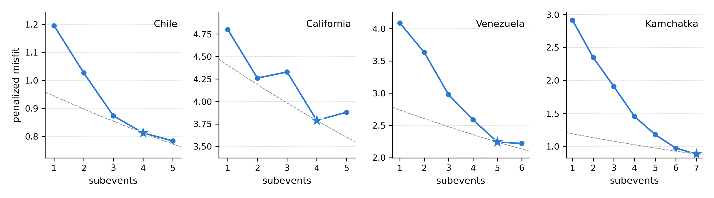

*Penalized misfit against the number of subevents, one panel per example. Stars mark the
selection, and the dashed line through each star falls 5% per subevent, the cost of a subevent.
Once extra subevents stop being supported by the data, the curve flattens or rises above that
line.*

---

## 5. The automated pipeline

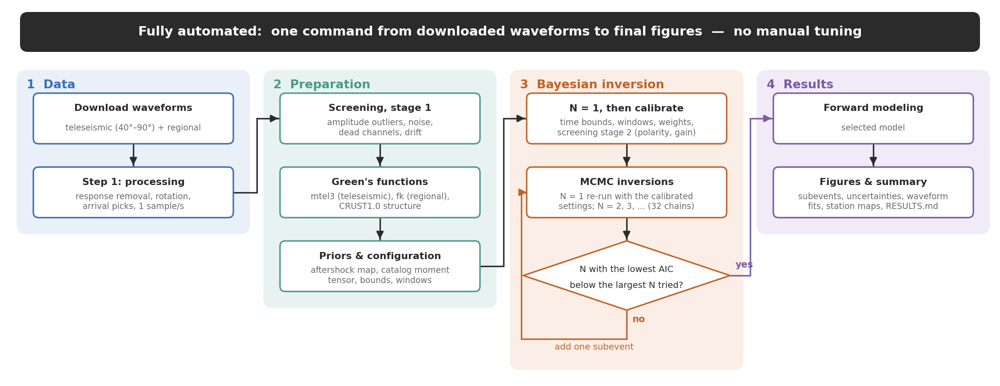

What each automatic decision does, and why it matters:

| stage | what happens | why |
|-------|--------------|-----|
| **Integration** | teleseismic velocity records become displacement | the inversion fits displacement |
| **Screening, stage 1** | rejects records whose amplitude is >8× off the network median (robust median/MAD), whose signal-to-noise ratio is too low (5.5 teleseismic, 3 regional), whose channel is dead, or whose regional record is dominated by long-period drift | one broken sensor can bias a whole solution |
| **Green's functions** | depth grid centered on the catalog depth, wider for deep events (half-width from the Wells & Coppersmith, 1994, rupture length). It starts in rock, at least 0.5 km below the water and the soft sediments (S velocity below 2 km/s) of the CRUST1.0 column | subevents of deep ruptures can be 50 km apart in depth. A grid node in soft sediment is not a place where an earthquake releases its moment, but it fits well for the wrong reason: California's 3-km node lay in a 0.63-km sediment layer, where the P Green's functions are 11–29 times those in rock, and every shallow subevent of the first v3 models sat on it ([PITFALLS B5](PITFALLS.md#b5--the-top-of-the-depth-grid-was-a-source-in-the-sediment-layer)) |
| **Aftershock prior** | USGS aftershocks above a magnitude floor; background seismicity removed with a Poisson test against the year before; small clusters dropped; gaps between the surviving clusters bridged with weak smooth corridors | keeps subevents where the fault actually slipped; corridors to dropped clusters once opened 40% of the Kamchatka grid instead of 16% ([PITFALLS C1](PITFALLS.md#c--prior)) |
| **Windows** | long enough for the whole rupture plus, for deep events, the depth phases (pP, sP) | a 120-km-deep event's sS arrives ~60 s after S |
| **1-subevent calibration** | the 1-subevent solution sets the time range searched for N ≥ 2 and the window lengths. If its centroid lies on the upper bound of the range that the magnitude gave, that range is first doubled for every N and the 1-subevent inversion repeated | stops late subevents from fitting noise; a rupture whose main energy comes later than its magnitude suggests is otherwise cut off (2026 Colombia: the range ended at 31 s, every chain ended on that bound, and the 1-subevent centroid lies at 49.5 s once the range allows it) |
| **Wave-type weights** | P, SH and regional weights are iterated until their contributions to the misfit are about 1.2 : 1 : 1 | otherwise the nearest, largest records drown the rest |
| **Screening, stage 2** | stations that anti-correlate with the 1-subevent prediction (flipped polarity) or are ×4 off in amplitude (wrong gain) are removed. So is any record whose rms in the band and window of the inversion is more than 8 times the median of its group, a test that needs no model | the first two errors only show up against a model; the third test removed a drifting record that carried 68% of the P misfit (2026 Vanuatu, IM.IL31) |
| **Consistent scoring** | the 1-subevent inversion is repeated with the calibrated windows, weights and stations | the number of subevents is chosen by comparing misfits, which is only fair if every N is scored on the same data |

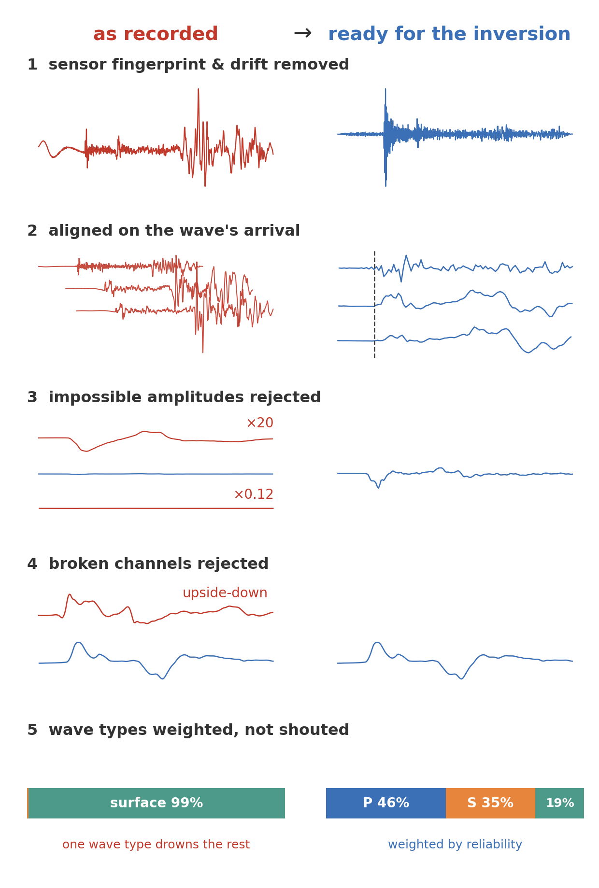

*Examples of what the processing does to real records from these events: drift removal, alignment
on the arrival, rejection of impossible amplitudes and of a sensor with reversed polarity, and
weighting of the three wave types.*

The pipeline is a set of shell steps that you can also run by hand from an `IRIS/` folder (this is
what `./submit` does):

```bash
bash ../programs/step2_prepare_inversions.sh        # screening, GFs, priors, configuration
bash ../programs/step3_do_inversions.sh             # N = 1, 1-subevent calibration, N = 1..5
bash ../programs/step3_do_inversions.sh 6           # only N = 6 (folder inv_<event>_6sub must exist)
python ../programs/prepare_SubMIT/plot_lcurve.py    # L-curve and the selected N
bash ../programs/step4_figures.sh 4                 # forward model + figures for N = 4
```

`./submit run` creates the folder of a further $`N`$ by itself when the AIC is lowest at the
largest $`N`$ tried. Every stage stops the pipeline when it fails; v2 ran its stages through
`awk ... | sh`, which discarded their exit codes ([PITFALLS E3](PITFALLS.md#e--systems)).

---

## 6. Results of the examples

These are v3 results, made with the rules of the review of the examples
([What changed in v3](#what-changed-in-v3)). Each example was run on 2026-11-17 from its raw
downloads (`./submit prepare`, then `./submit run`, 32 MPI ranks), and `examples/<name>/` holds
that run. Each subsection says what changed against the first v3 model and against v2.

| example | subevents (v2) | best misfit | chains within 2% of the best | largest split R-hat | mean correlation P / SH / regional |
|---------|:--------------:|:-----------:|:----------------------------:|:-------------------:|:----------------------------------:|
| `chile` | 4 (4) | 0.812 | 31 of 32 | 1.4 | 0.69 / 0.91 / 0.59 |
| `california` | 4 (3) | 3.790 | 23 of 32 | 4.4 | 0.49 / 0.74 / 0.32 |
| `venezuela` | 5 (6) | 2.243 | 23 of 32 | 1.7 | 0.46 / 0.35 / 0.67 |
| `kamchatka` | 7 (7) | 0.882 | 19 of 32 | 2.2 | 0.70 / 0.68 / 0.11 |

The correlation is the mean, over the records of a wave type, of the correlation coefficient
between a record and its prediction (`reference/sta_residual.dat`). The split R-hat compares the
chains with each other for every parameter (`reference/RESULTS.md`); above 1.1 the chains disagree.
In all four examples most chains reach the best misfit within 2%, and the chains still disagree on
some parameters (California: the east position of the fourth subevent, which holds under 1% of the
moment; Kamchatka: the depth of the fourth). The best models below are what the searches agree on;
the error bars of the parameters with a large R-hat are not converged.

For each example, the main figure shows the subevents in map view (beachballs = moment tensors,
error bars = 95% intervals from the MCMC ensemble, ★ = epicenter), the moment-rate functions, the
total moment tensor and a depth section. The station map shows the data used: teleseismic
stations on a globe centered on the epicenter (rings every 30°), marked by whether they provide P,
SH or both, and the regional stations around the epicenter. A collapsible block holds the
diagnostics:

* **Posterior histograms** — one row per subevent (E1, E2, …), one column per parameter (centroid
  time, duration, east and north location, depth). Narrow, single-peaked histograms mean a
  well-resolved parameter; broad or multi-peaked ones show the trade-offs the data allow. With two
  or more subevents, E1 is fixed at the hypocenter, and its location and depth panels show that
  value.
* **Waveform fits** — recorded (black) and predicted (red) seismograms for every station, labeled
  with the station name, epicentral distance and azimuth. The full plates (all stations, all
  pages) and the convergence of every Markov chain are in `examples/<name>/reference/` and are
  regenerated by `./submit example <name>`.

### 2024 Chile–Argentina border, Mw 7.4 (123 km deep)


Four subevents (Mw 6.5–7.2) within ~15 s. The first is at the hypocenter, 123 km deep, and the
others lie at 136, 148 and 169 km, all within 10 km of the epicenter: the rupture grew **downward**
through the subducting slab, 46 km in 10 s. All four are normal-faulting mechanisms within 14° of
the total mechanism. Measured from the time the rupture begins, the three deeper subevents lie at
3.0, 3.4 and 4.5 km/s, and the last of them sits on the cap of the search (4.51 km/s, the mean S
velocity of the source model at these depths). To see what the cap costs, I ran five subevents
again with a cap of 6 km/s: the misfit fell by 1.0% (0.776 against 0.784), the depths stayed, and
the third and fourth subevents came 0.8 and 0.4 s earlier (4.8 and 5.0 km/s). The rupture went down
at about the S speed, and these data do not decide whether slightly below or above it. This event
(the "2024 Mw 7.4 Calama earthquake") was studied in detail with SubMIT by Jia et al. (2025a), who
found five subevents over ~20 s at 125–174 km depth. Here a fifth subevent lowers the misfit by
3.5% and 3.8% in two searches, less than the 4.9% that it costs ([Section
4.6](#46-how-many-subevents)). The two searches agree on the four subevents within 0.3 s and 5 km
(misfits 0.8124 and 0.8102).

*Against the first v3 model:* there the first subevent lay at 142 km, 19 km below the hypocenter,
because only its horizontal position was fixed ([PITFALLS D6](PITFALLS.md#d6--the-first-subevent-was-fixed-at-the-epicentre-only-and-the-rupture-clock-at-its-centroid)). The data misfit of the
present model is as low as that of the first one (0.702 against 0.709), with the same weights and
windows. Its penalized misfit is higher (0.812 against 0.732) because the mechanisms no longer
rotate to the edge of the 30° cone. There, double-couple subevents added up to the catalog tensor,
which is 31% non-double-couple, and so avoided the CLVD penalty (factor 1.03 then, 1.15 now).

*Against v2:* the same number of subevents and the same downward growth; in v2 the first subevent
lay at 126 km.

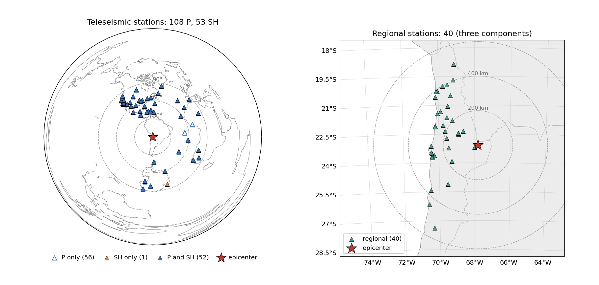

<details>
<summary><b>Uncertainties and waveform fits (Chile)</b></summary>

**Posterior distributions** of each subevent's parameters from the MCMC ensemble:


**Teleseismic P waves** (displacement; first of 2 pages):


**Teleseismic SH waves** (displacement; first of 2 pages):

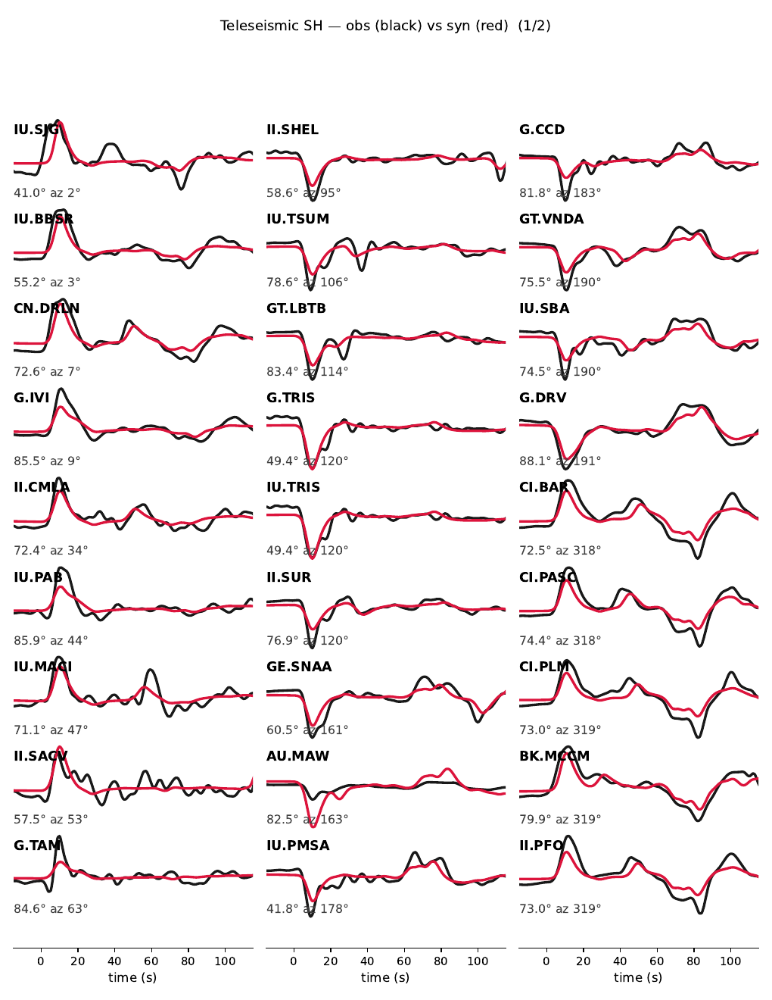

**Regional three-component records** (first of 4 pages):

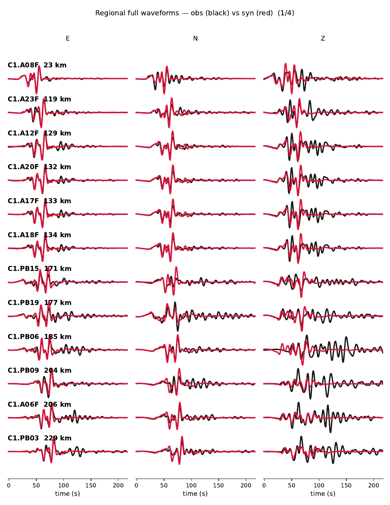

</details>

### 2025 Kamchatka megathrust, Mw 8.8

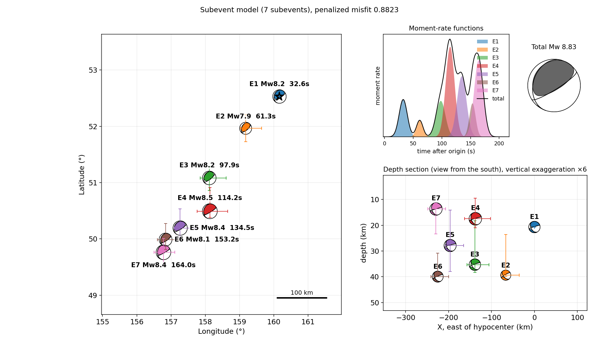

Seven thrust subevents (Mw 7.9–8.5) over ~180 s. The rupture ran **~380 km to the south-west**
along the trench: the first subevent at the hypocenter, 21 km deep, at 33 s, the second 91 km away
at 61 s, and five more at 212, 264, 325, 360 and 383 km between 98 and 164 s. Measured from the
time the first subevent begins, 17 s after the origin time, every subevent lies at 2.1–2.8 km/s,
well below the cap of 4.23 km/s. The moment rate peaks at about 114 s and again at 163 s. Six of
the seven mechanisms agree with the total thrust mechanism (tensor similarity ≥ 0.98; the second:
0.89). Seven is the limit of the grid: the AIC is still falling there, so seven is a lower bound
([Section 4.6](#46-how-many-subevents)). A second search with other chain seeds ended at the same
misfit (0.8829 against 0.8823) with the same seven subevents, each within 1.5 s and 25 km of its
counterpart.

*Against the first v3 model:* the same picture, seven subevents along the trench that end near
380 km at about 160 s. There the two searches agreed on the first three subevents and divided the
rest of the trench differently; here they agree on all seven. The misfits (0.819 then, 0.882 now)
are not comparable: the depth grid now starts at 8 km instead of 3 km, below 7.45 km of water and
sediments in the source model, and the first subevent is held at the hypocenter depth.

*Against v2:* the v2 model had its second subevent ~80 km north of the epicenter, on one of the 141
spurious corridors of its aftershock prior
([PITFALLS C1](PITFALLS.md#c1--prior-corridors-re-attached-to-zeroed-speckle)), and its last one at
212 s, 450 km to the south-southwest. With the corrected prior, which covers 16% of the search grid
instead of 40%, all seven subevents lie along the trench to the south-west, and none is later than
164 s.

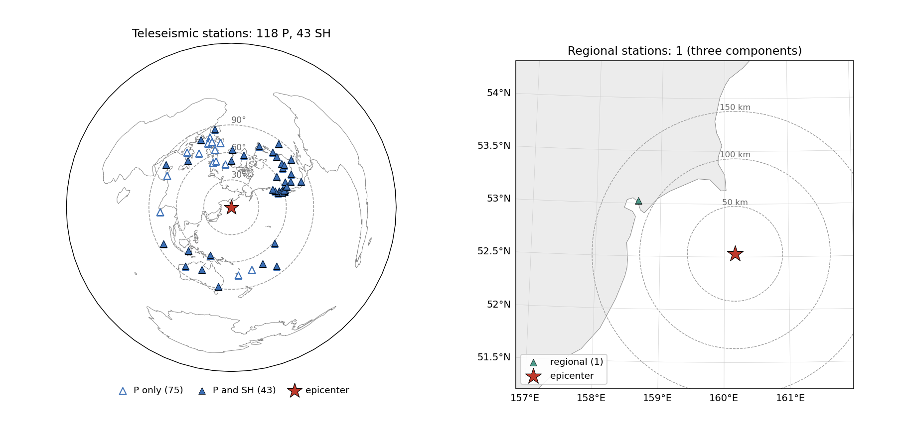

<details>
<summary><b>Uncertainties and waveform fits (Kamchatka)</b></summary>

**Posterior distributions** of each subevent's parameters from the MCMC ensemble:


**Teleseismic P waves** (displacement; first of 2 pages):


**Teleseismic SH waves** (displacement; first of 2 pages):


**Regional three-component records**; one regional station (IU.PET) with a small weight, so this event relies on teleseismic data:


</details>

### 2026 near the coast of Venezuela, Mw 7.2

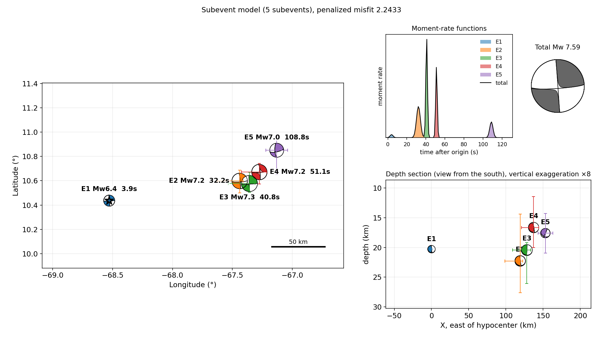

Five subevents over ~110 s. This earthquake is a **doublet**: the USGS catalog lists an Mw 7.2
event at the epicenter and an M 7.5 event 30 s later, 147 km to the east. The pipeline finds the
pair when it fetches the moment tensor, uses the sum of the two tensors as the reference mechanism
and lowers the body-wave corner to 0.1 Hz (`programs/prepare_SubMIT/gen_totalmt.py`). The first
subevent (Mw 6.5) is at the hypocenter, 20 km deep, and releases its moment in the first 7 s. Three
subevents 121–140 km to the east at 32–51 s hold 87% of the moment (Mw 7.2, 7.3 and 7.2; together
Mw 7.55); they lie 10–27 km from the second epicenter. A fifth subevent (Mw 7.0) follows at 109 s,
160 km from the epicenter. The total, Mw 7.59, equals the moment of the two cataloged events
together.

**How fast.** For every subevent, `reference/RESULTS.md` gives its distance from the hypocenter
divided by the time since the first subevent began: 3.8, 3.2 and 2.8 km/s for the three large ones.
The cap of the search is 3.83 km/s, the mean S velocity of the source model
([Section 4.5](#45-bayesian-sampling)), and the first large subevent sits on it: the front crosses
the western 120 km at the S speed and releases little moment there. To see whether the cap hides a
faster rupture, I ran five subevents again with the cap at 5.5 km/s. The misfit fell by 0.5% (2.232
against 2.243), and the three large subevents stayed where they were (the first of them at 31.6 s,
121 km from the hypocenter). Only the small first subevent moved, from 3.9 s to 15.5 s, which puts
the first large one at 5.4 km/s on the new clock. What the data fix is that most of the moment is
released about 120 km to the east from 28 s on. The speed in between depends on when the weak start
is placed, and these data do not require a supershear front. Celis et al. (2026) describe the same
rupture from regional waveforms: five subevents along about 200 km in about 60 s, the eastern ones
20–42 s after the western one (here 28–47 s), and a possible supershear rupture on a fault segment
without aftershocks.

A second search with other chain seeds also selects five subevents, with a misfit 5.7% higher. It
has the same three parts: a first subevent at the hypocenter, most of the moment 95–117 km to the
east at 35–53 s, and a late subevent at 99 s. Its first subevent is later and longer (centered at
14 s, 13 s long, Mw 6.7). The first 15 s of this rupture are the least certain part of the model.

*Against the first v3 model:* there the first subevent was a 4.5-s pulse at 15.8 s, and the second,
24 s long and centered at 38.7 s, lay 127 km away. That is 5.5 km/s between the two centroids, and
the second subevent began 11 s after the centroid of the first. The search measured the speed from
the centroid of the first subevent and allowed 1.5 times the S speed for a shallow strike-slip
event ([PITFALLS D6](PITFALLS.md#d6--the-first-subevent-was-fixed-at-the-epicentre-only-and-the-rupture-clock-at-its-centroid)).
The misfits of the two models (2.056 then, 2.243 now) are not comparable: the depth grid now starts
at 4 km instead of 3 km, and the mechanism prior is new.

*Against v2:* v2 selected six subevents and spread them along the 170 km: its subevents at 35–43 s
lay within 45 km of the epicenter, and its SH fit was poor (mean correlation 0.26). 26 of the 56 SH
records of that model were unrotated north or east components
([PITFALLS A1](PITFALLS.md#a1--horizontals-of-unequal-length-left-unrotated)). With all horizontals
rotated, the moment released at 32–51 s lies 121–140 km from the epicenter, where the catalog has
the second earthquake, and the SH correlation is 0.35. That is still the lowest of the four
examples: point sources describe the SH waves of this doublet less well than its P waves (0.46).

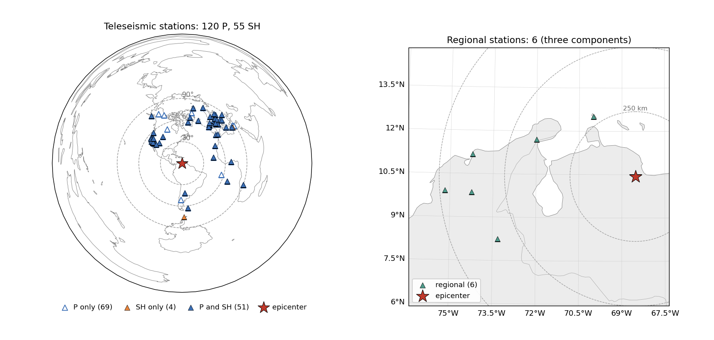

<details>
<summary><b>Uncertainties and waveform fits (Venezuela)</b></summary>

**Posterior distributions** of each subevent's parameters from the MCMC ensemble:

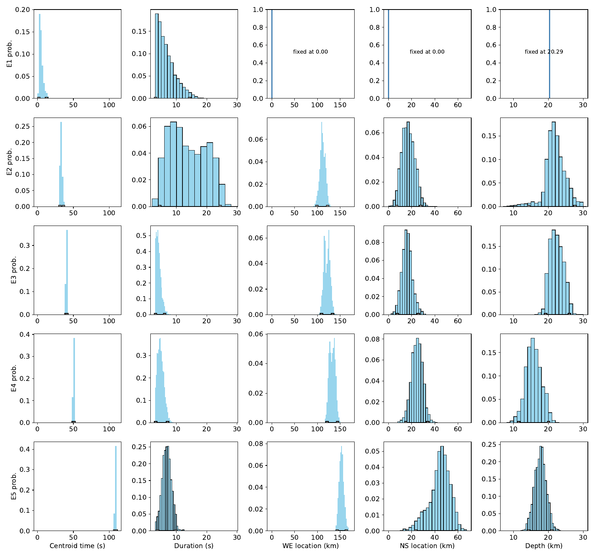

**Teleseismic P waves** (displacement; first of 2 pages):

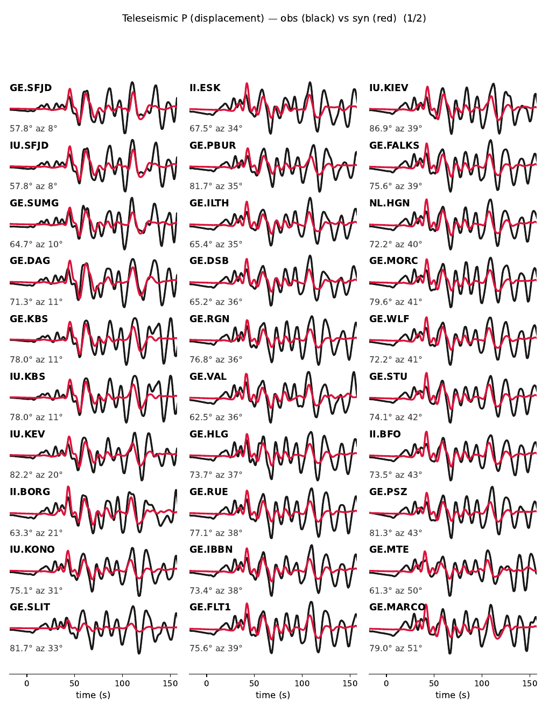

**Teleseismic SH waves** (displacement; first of 2 pages):

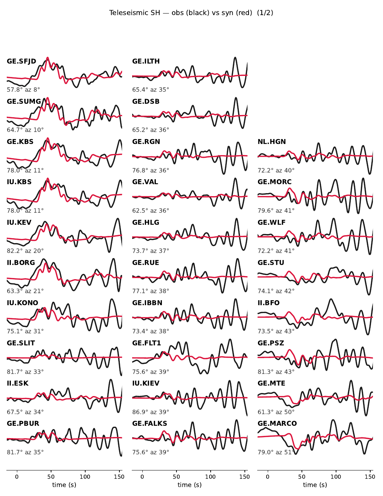

**Regional three-component records**:


</details>

### 2024 offshore Cape Mendocino, California, Mw 7.0


Four subevents within ~19 s. The rupture starts with a small subevent (Mw 6.2) at the hypocenter.
Two subevents of Mw 6.9 and 6.8 follow at 7.7 and 11.9 s, 18 and 32 km to the north-east and
east-north-east at 12–14 km depth; each lasts 3 s, and together they hold 94% of the moment. A
fourth subevent (Mw 5.6, under 1% of the moment) at 17 s lies near the epicenter, and its position
is not resolved. Since the rupture began, the two large subevents lie at 3.8 and 3.5 km/s (cap
4.24 km/s). The catalog depth of this earthquake, 0.65 km, lies in the water layer of the source
model, so the first subevent sits at the top of the depth grid (4 km). A second search with other
chain seeds selects four subevents as well (misfits 3.790 and 3.802), each within 0.2 s and 4 km of
its counterpart.

**Mechanisms.** One nodal plane of every subevent strikes 96–102°, along the Mendocino transform
fault (96–100°). On the two large subevents that plane dips 67° to the south and 50° to the north,
where the fault is close to vertical. Their dip-slip parts have opposite signs, and the sum of the
four tensors is a vertical strike-slip mechanism (strike 280°, dip 84°).

**The P waves decide this model, and the model does not reproduce them.** At the stations to the
north-west, north and east (39 of the 71 P displacement records) the P wave is an oscillation with
a period of 15.6 s, the same at every azimuth, at stations that lie near a node of the strike-slip
P radiation (left column of the P-wave figure below). Strike-slip sources in rock do not produce
it in the layered models that I tried: the CRUST1.0 column of the pipeline, the same column without
its water layer, without water and sediment, and with 2.0 and 3.9 km of sediment in the place of
0.63 km ([PITFALLS B5](PITFALLS.md#b5--the-top-of-the-depth-grid-was-a-source-in-the-sediment-layer)).
A single subevent leaves a P misfit of 16.7 against 2.6 for SH (`reference/lcurve.txt`), and the
predictions of the selected model are three times smaller than the P and SH records, while the
regional records are matched in amplitude. Two subevents lower the
P misfit to 5.1 by tilting their mechanisms in opposite directions, and four lower it to 3.6. The
SH misfit does not fall with more subevents (2.58, 2.81 and 2.82 for one, two and four). The
subevents after the first are placed where the P waves need energy.

**How far the mechanisms may tilt is a choice.** It is the width of the prior of
[Section 4.3](#43-linear-step-the-moment-tensors). With `MechanismSigma= 5` in the place of 10, a
second subevent lowers the misfit by 1.4% where it lowered it by 11%, no model with up to five
subevents fits more than 1.4% better than one, and the rule of
[Section 4.6](#46-how-many-subevents) selects a single subevent: Mw 7.0 at 10.3 s, 16 km east of
the epicenter and 8 km deep, 4 s long. Both settings agree on where and when the moment is
released: 16–32 km east of the epicenter between 7 and 12 s. The dips and the number of subevents
of the four-subevent model rest on P waves that a layered model does not explain.

*Against the first v3 model:* three of its four subevents lay at 3 km, the top of a depth grid that
reached into 0.63 km of sediment. The P Green's functions of that node are 11–29 times those of the
next one and ring at 7.4 s, so the model fitted the oscillation with a source that cannot exist,
and its misfit of 1.50 is not comparable with the 3.79 of this one
([PITFALLS B5](PITFALLS.md#b5--the-top-of-the-depth-grid-was-a-source-in-the-sediment-layer)). Two
of its subevents struck 120° and 127°
([PITFALLS B4](PITFALLS.md#b4--subevent-mechanisms-sat-on-the-30-cone)).

*Against v2:* v2 selected three subevents at depths of 3.0–3.7 km, on that node or between it
and the next.


<details>
<summary><b>Uncertainties and waveform fits (California)</b></summary>

**Posterior distributions** of each subevent's parameters from the MCMC ensemble:

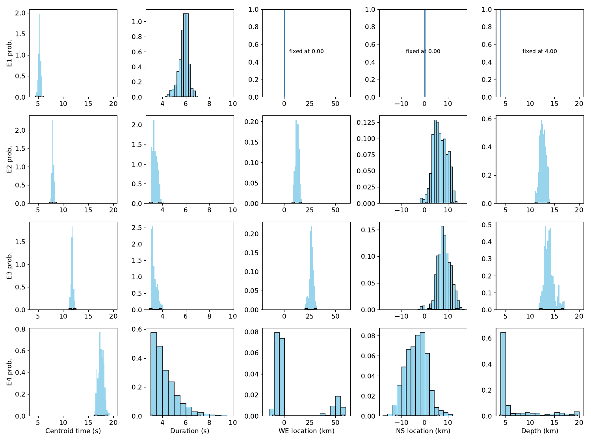

**Teleseismic P waves** (displacement; first of 2 pages):

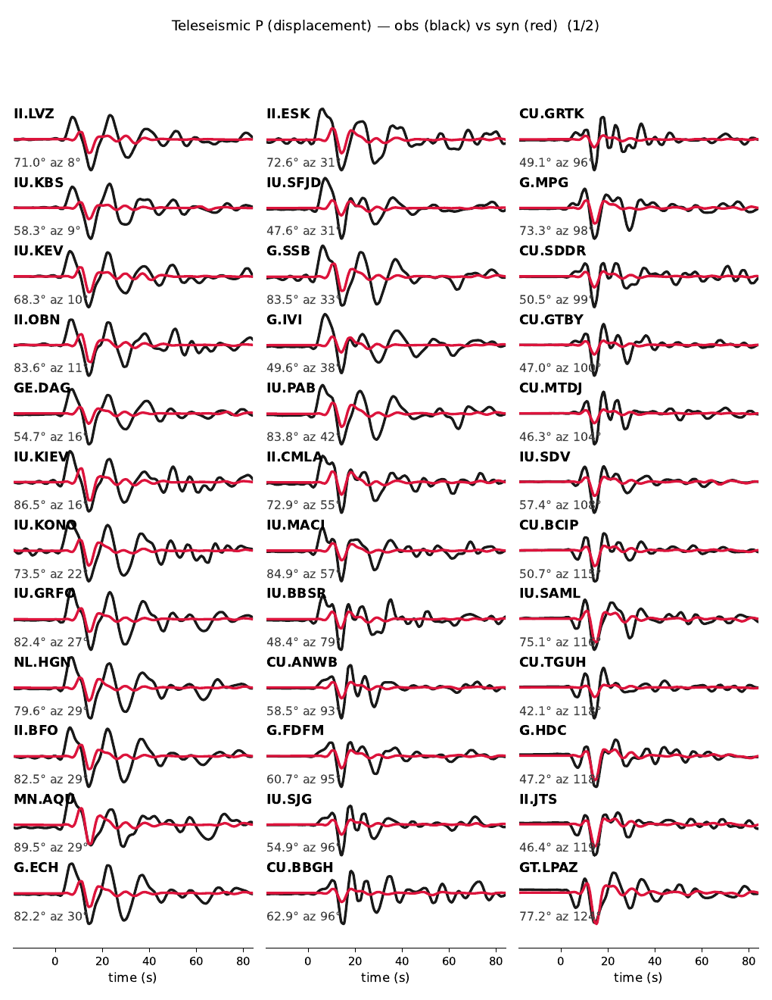

**Teleseismic SH waves** (displacement; first of 2 pages):


**Regional three-component records** (first of 8 pages):


</details>

---

## 7. Data

SubMIT fits two sets of seismograms of the same earthquake: **teleseismic** records from stations
far away, and **regional** records from stations near the earthquake. Both are free. You download
them with [Wilber 3](https://ds.iris.edu/wilber3/), the event-based download tool of the
EarthScope (formerly IRIS) Data Management Center, which also collects data from other data
centers (GEOFON, RESIF, NCEDC, …). All four examples use both sets, and the pipeline has only been
tested with both.

| | teleseismic | regional |
|---|---|---|
| what it constrains | P and SH waves seen from all directions: when, where and how each subevent slipped | three-component waveforms close to the rupture: sharpen locations and timing |
| distance from the epicenter | **40°–90°** | **up to ~6.5° (~750 km)** |
| channels | **`BH?`** (broadband seismometers) | **`HN?`** (strong-motion accelerometers) **or** **`BH?`**, see below |
| time window | 5 min before the P arrival to 30 min after it | 5 min before the origin time to 20 min after it |
| stations in the examples | 100–150 downloaded, 58–75 kept | from 2 (Kamchatka) to 96 (California) used |
| what SubMIT fits | P on the vertical and SH on the transverse component | all three components |

Why these distances: closer than ~40°, teleseismic P and S waves travel through the upper mantle,
whose layering splits them into several arrivals that the simple teleseismic Green's functions do
not model; beyond ~90° they are diffracted around the core. Regional stations farther than
~750 km are ignored automatically: the regional Green's functions are computed in a single 1-D
model of the source region and only out to 950 km, which includes a 200-km margin for subevents
away from the epicenter.

### 7.1 Strong-motion (`HN?`) and broadband (`HH?`, `BH?`) regional stations

Channel codes have three letters: the first is the sampling band, the second the type of sensor,
the third the component (`Z`, `N`, `E` or `1`, `2`).

* **`HN?` = accelerometers ("strong-motion" sensors)**, usually 100–200 samples/s. They are built
  to stay on scale during the strongest shaking, so they record large earthquakes cleanly even a
  few tens of kilometers from the fault. They are much less sensitive than broadband sensors.
  Dense strong-motion networks cover Chile, California, Japan, Taiwan, …; the `chile`,
  `california` and `venezuela` examples use them.
* **`BH?` and `HH?` = broadband seismometers**, at 20–50 (`BH?`) or 100–200 (`HH?`) samples/s.
  They are far more sensitive, but near a large earthquake they can **clip** (the signal exceeds
  the sensor's range) or be disturbed by tilt. Many networks distribute only one of `BH?` and
  `HH?`. The `kamchatka` example uses `BH?`.
* Step 1 removes the instrument response of every type to obtain ground velocity, and filters the
  regional records above 0.02 Hz (periods shorter than 50 s), which removes the long-period drift
  that accelerometer records often carry.

**Request all three types.** Step 1 processes every `HN?`, `HH?` and `BH?` record and keeps
**one record per station** (`programs/select/choose_regional_instruments.py`). It keeps the
broadband record (`HH?` before `BH?`) unless that record is clipped or disagrees with the
strong-motion record of the same station at 0.02–0.1 Hz (correlation below 0.9, or amplitude ratio
outside 0.8–1.25); then it keeps the strong-motion record. A record counts as clipped when it stays
at its peak value for 3 or more samples and that peak exceeds 10% of 2²³ counts. Each choice is
listed in `IRISloc/<event>_loc/regional_instrument_choice.log`. Other channel types (`HL?`, `EN?`,
`LH?`, …) are not read.

Until v2, step 1 used only `HN?` whenever the download contained any `HN?` channel, and it never
read `HH?`. From the same download of the 2026 Panama Mw 7.7 earthquake, v2 kept 4 of 19 regional
stations and v3 keeps 17. v2 also fitted every sensor of a station: 11 records from 7 stations for
the 2025 Aomori Mw 7.6 earthquake ([PITFALLS A2, A4](PITFALLS.md#a--data-integrity)).

Rule of thumb: request `HN?`, `HH?` and `BH?` within ~6.5° of the earthquake.

### 7.2 Downloading with Wilber 3, step by step

1. **Find the earthquake.** Open <https://ds.iris.edu/wilber3/>, find the event on the map or in
   the list below it (**Custom Query** finds older events), and click its region name. The station
   page opens.
2. **Teleseismic request.** On the station page, set
   * **Networks**: keep the default `_GSN` (Global Seismographic Network) and add other permanent
     broadband networks, for example `G` (GEOSCOPE), `GE` (GEOFON), `MN`, `IM`, `CN`, `AU`, `PS`.
     Aim for stations evenly spread in azimuth around the earthquake. If one region has many
     stations, the drop-down next to **All**/**None** keeps one station every X degrees.
   * **Channels**: `BH?`
   * **Distance Range**: 40 to 90 (degrees)

   Click **Request Data** and fill in the dialog:
   * **Time Range**: Starting `5` minutes before `P arrival`; Ending `30` minutes after `P arrival`
   * **Output Format**: `SAC binary (little-endian)`; **Bundle As**: `tar archive`
   * **Request Label**: keep the default, for example `2024-07-19 mww7.4 Chile-Argentina Border Region`
   * your name and e-mail address, then **Submit**.
3. **Regional request.** Go back to the station page of the same event and set
   * **Networks**: delete `_GSN` so that every network is shown
   * **Channels**: `HN?,HH?,BH?` (see [7.1](#71-strong-motion-hn-and-broadband-hh-bh-regional-stations))
   * **Distance Range**: 0 to 6.5

   **Request Data**: Starting `5` minutes before `event time`; Ending `20` minutes after
   `event time`; the same output format and bundle; and as **Request Label** the teleseismic label
   followed by `_loc`, for example `2024-07-19 mww7.4 Chile-Argentina Border Region_loc`.
4. **Download.** Wilber e-mails you when each request is ready. Download the two `.tar` files from
   the link (they are kept in a public folder named after your name and the label).

The examples used similar settings: teleseismic windows starting 5 min (Kamchatka: 10 min) before
P and ending 17–31 min after it, and regional windows starting 3–7 min before and ending
11–25 min after the origin time. Step 1 needs at least 50 s of record before the first arrival (to
measure the noise) and, for regional records, at least 10 min after the origin time.

### 7.3 Where to put the downloads

Put the two tar files, unopened, in a new folder with a short path:

```text
/data/myevent/
├── IRIS/       2024-07-19-mww74-chile-argentina-border-region.tar       (teleseismic)
└── IRISloc/    2024-07-19-mww74-chile-argentina-border-region_loc.tar   (regional)
```

Each tar file contains one folder named after the request label, for example
`2024-07-19-mww74-chile-argentina-border-region/`. Inside it are one SAC file per channel
(`NET.STA.LOC.CHA.Q.YYYY.DDD.HHMMSS.SAC`) and, in one sub-folder per data center, the
instrument-response files (`IRISDMC/SACPZ.NET.STA.LOC.CHA`, …). The folder names matter:

* they must start with Wilber's date and magnitude, `YYYY-MM-DD-mwwXY-`. The magnitude (`mww74`
  = 7.4) sets the ranges that the inversion searches;
* the regional folder must be the teleseismic folder name followed by `_loc`. The teleseismic
  folder may also end in `_tel…` (for example `…-northern_tel-california`); step 1 removes that
  suffix.

The epicenter, depth and origin time are read from the SAC headers that Wilber writes (`evla`,
`evlo`, `evdp` in km, origin time `o`), that is, from the catalog solution shown in Wilber.

**Data from somewhere else** (FDSN web services, ObsPy, your own network) work if you arrange them
in the same way: SAC files with these names at the top of the folder, with station coordinates,
component orientations (`cmpaz`, `cmpinc`) and the event location, depth and origin time in
their headers, plus SACPZ response files (counts per meter of displacement, as FDSN services
provide them) one sub-folder down. Put the folder in a `.tar` file, or put the folder itself
directly in `IRIS/` or `IRISloc/`.

### 7.4 Optional: Chilean strong-motion records (CSN)

For earthquakes in Chile, the database of the Centro Sismológico Nacional (CSN,
<https://evtdb.csn.uchile.cl>) has accelerograms from many more stations than Wilber
distributes. For the `chile` example it provided 53 stations; Wilber had 7 usable ones, 4 of
which are also in the CSN set. To use it, find the earthquake on the CSN site and copy the
32-character id at the end of its address (`https://evtdb.csn.uchile.cl/event/<EVENT_ID>`).
Then run, **before** `prepare`:

```bash
./submit fetch-csn /data/myevent 030cd73d4cf743e322b7bc88f1166a4c   # the chile example event
./submit prepare /data/myevent
```

`fetch-csn` needs `wget` and `unzip`. It downloads every station of the event, integrates
acceleration to velocity, filters above 0.01 Hz, resamples to 1 sample/s and writes the records
to `myevent/StrongMotionData/`. `prepare` then merges them into the regional data; where a station
is in both, the CSN record replaces the Wilber one. The CSN database keeps growing: a download in
October 2026 returned 57 stations instead of the 53 used in the `chile` example (all 53 were
identical to the published records). The bundled `examples/chile/inputs.tar.gz` keeps the
published set.

### 7.5 What step 1 (`./submit prepare`) does

`prepare` unpacks the tar files and turns every record into a file that the inversion can read:

1. renames the files `NET.STA.LOC.CHA` and makes the origin time the time reference (`o = 0`,
   also across midnight and New Year), and computes distance and azimuth when the headers lack
   them;
2. removes the instrument response with the SACPZ files, giving ground velocity in m/s (SAC
   `transfer … to vel freq 0.001 0.005 10 20`), then removes the mean and trend and tapers the
   ends; regional records are also high-pass filtered at 0.02 Hz;
3. computes the first P arrival (vertical component) and S arrival (horizontal components) in the
   iasp91 Earth model with TauP and stores them in header `t1`;
4. corrects horizontal components that are not exactly 90° apart in the metadata;
5. rotates the horizontals: teleseismic to radial and transverse (`.r`, `.t`, `.z`); regional
   `1`/`2` components to east and north (`.e`, `.n`, `.z`). Two horizontals of different length
   are first cut to their common time window: SAC refuses to rotate such a pair, and until v2 the
   unrotated east and north records were then written as radial and transverse
   ([PITFALLS A1](PITFALLS.md#a1--horizontals-of-unequal-length-left-unrotated));
6. keeps a station only if its signal-to-noise ratio, 10·log₁₀ of the variance in the 50 s after
   the arrival divided by that in the 50 s before, is at least 3 dB on the teleseismic vertical
   and transverse components, or at least 2 dB on all three regional components. For regional
   records the arrival is the P arrival on every component: before the S arrival of a deep event
   lies the P coda, not noise ([PITFALLS A3](PITFALLS.md#a3--regional-signal-to-noise-measured-against-the-p-coda));
7. removes stations that miss a component; teleseismic only, also removes records with peak
   velocities above 1 mm/s (usually a wrong response or a glitch) and duplicate sensors at the
   same station (location code `00` is preferred over `10`, and so on); regional only, keeps one
   instrument per station ([Section 7.1](#71-strong-motion-hn-and-broadband-hh-bh-regional-stations));
8. resamples to 1 sample/s from 500, 200, 100, 80, 50, 40, 25 or 20 samples/s with SAC's
   anti-alias `decimate`; a record at any other sampling rate is set aside with a warning;
9. regional only: cuts the records from 50 s before to 600 s after the origin time (padding with
   zeros if a record is shorter), and renames network `C` to `C1`.

The results are in `IRIS/<event>/data/` (`*.r`, `*.t`, `*.z`) and `IRISloc/<event>_loc/data/`
(`*.e`, `*.n`, `*.z`). Rejected records are kept, so you can see what was removed: those with a
low signal-to-noise ratio in `Vel/rtr/bad_data/` (teleseismic) or `Vel/enz/bad_data/`
(regional) inside the event folder, and the others in `Vel/rtr/others/` or `Vel/enz/others/`.
This is the form in which the examples are bundled (`examples/<name>/inputs.tar.gz`): the step-1
results of their v3 runs. Running `prepare` (plus `fetch-csn` for `chile`) on the original Wilber
downloads of the four examples reproduces those files. They differ from the inputs that v2 bundled
where v3 corrects step 1. Horizontal pairs of unequal length are now rotated, which changed the
radial and transverse records of 13 (Chile), 11 (California), 60 (Venezuela) and 8 (Kamchatka)
files, and moved a few stations across the signal-to-noise threshold (Venezuela GE.KBS in, GE.MATE
out; Kamchatka G.CAN in). The regional sets gained stations (California CE.89688, Chile C1.GO02,
and 12 Kamchatka stations beyond 750 km, which the inversion ignores) and keep one sensor per site
(Kamchatka IU.PET.00 only).
`python tools/compare_step1_outputs.py /data/rerun examples/<name>/inputs.tar.gz` lists the
differences between a rerun and the bundled files, and the radial and transverse records that are
unrotated (62 of the Venezuela records that v2 bundled, none now). Step 2 then screens the records
again, more strictly
([Section 5](#5-the-automated-pipeline)).

### 7.6 Data that the pipeline downloads by itself

| what | source | used for | offline? |
|------|--------|----------|----------|
| aftershocks (first 7 days) and the seismicity of the year before | [USGS ComCat](https://earthquake.usgs.gov/fdsnws/event/1/) | the aftershock-based location prior | the examples replay the copies archived in `examples/<name>/catalog/` |
| catalog moment tensor | Global CMT catalog 1990–2023, bundled (`programs/mt_SubMIT/1990_2023_gcmt.dat`); for later events the USGS ComCat moment tensor | the total-moment-tensor constraint | bundled, or archived for the examples |
| crustal structure | CRUST1.0, bundled | Green's functions | yes |
| coastlines and borders | [Natural Earth](https://www.naturalearthdata.com/), downloaded once by cartopy | maps | without internet the maps are drawn without coastlines |

### 7.7 The data of the four examples

| example | teleseismic (`BH?`) | regional | regional networks |
|---------|---------------------|----------|-------------------|
| `chile` | 103 `BHZ` channels at 41°–88° → 59 stations kept | `HN?`, 8 stations at 0.4°–4.8° from Wilber + 53 from CSN → 57 kept | C1 |
| `california` | 129 `BHZ` channels at 42°–90° → 75 stations kept | `HN?`, 98 stations at 0.5°–2° → 97 kept | BK, CE, NC, RE, UO, UW |
| `venezuela` | 117 `BHZ` channels at 42°–90° → 67 stations kept | `HN?`, 26 stations at 2.5°–8° → 22 kept | CM, PR |
| `kamchatka` | 152 `BHZ` channels at 40°–90° → 59 stations kept | `BH?` (no strong motion nearby), 54 stations at 1°–14.6° → 38 kept, of which only IU.PET is within 750 km | AV, IM, IU |

Teleseismic networks: AU, BK, CI, CN, CU, G, GE, GT, IC, II, IM, IU, MN, NL, PS. All networks
are listed with their DOIs in [Section 13](#13-credits-citation-and-licenses). Please cite them when
you publish results based on their data.

---

## 8. Running your own earthquake

1. **Download the data** as described in [Section 7](#7-data): a teleseismic request (`BH?`,
   40°–90°) and a regional request (`HN?`, `HH?` and `BH?`, within ~6.5°), both as SAC tar
   files.
2. **Put the downloads in a new folder** (short path, see [Troubleshooting](#11-troubleshooting)):

   ```text
   /data/myevent/
   ├── IRIS/       the teleseismic .tar file
   └── IRISloc/    the regional .tar file
   ```

3. **Run it:**

   ```bash
   ./submit prepare /data/myevent     # step 1: responses, rotation, picks, 1 sample/s, SNR selection
   ./submit run /data/myevent         # steps 2-4: everything else, including choosing N
   ```

   For Chilean earthquakes, run `./submit fetch-csn /data/myevent EVENT_ID` before `prepare` to add
   the CSN strong-motion records ([Section 7.4](#74-optional-chilean-strong-motion-records-csn)).
   Step 2 downloads the aftershock catalog (and, for events after 2023, the catalog moment tensor)
   from the USGS, so the machine needs internet access. Results appear in
   `/data/myevent/IRIS/figs_and_results/`. Add `--quick` to `run` first if you want a 10-minute
   check that everything works.

Settings you may want to change afterwards are in `Par.file` (windows, frequency bands,
weights, regularization) and `search_par.file` (search bounds, chain lengths, and
`neq_min`/`neq_max`, which set the number of subevents) inside each `IRIS/inv_<event>_<N>sub/`
folder; `programs/submit.conf` holds the sampling interval. After editing, re-run one
subevent count with `bash ../programs/step3_do_inversions.sh N` from `IRIS/`, then
`python ../programs/prepare_SubMIT/plot_lcurve.py` and `bash ../programs/step4_figures.sh N`.
Two optional environment variables change the automatic configuration: `SUBMIT_CMTSCALING`
(default 3) sets how firmly the summed moment tensor is tied to the catalog one (Section 4.3), and
`SUBMIT_MAX_TELESEISMIC_STATIONS` (default 100) is the number of teleseismic stations above which
step 2 thins the densest networks.

---

## 9. Reading the outputs

`IRIS/figs_and_results/` collects everything for the selected model:

| file | content |
|------|---------|
| `RESULTS.md` | summary: selected N, misfits, total moment, and the subevent table. For every subevent the table also gives its distance from subevent 1, that distance divided by the time since subevent 1 began (the speed that the causality rule caps, [Section 4.5](#45-bayesian-sampling)), its nodal planes, and the angle of its moment tensor from the mechanism of the whole earthquake (the angle that the mechanism prior acts on, [Section 4.3](#43-linear-step-the-moment-tensors)) |
| `subevents.png/.pdf` | the figure shown in Section 6 |
| `stations.png/.pdf` | stations used: teleseismic P and SH (global map) and regional (local map) |
| `lcurve.pdf/.txt` | misfit against the number of subevents, how much each subevent lowered it, the AIC that selects N (in the figure the star; the dashed line through it falls 5% per subevent, the cost of a subevent; hollow points are N that cannot be selected), the island bests, and the three factors of each best misfit (data misfit, CLVD factor, stress factor) with the worst axis rotation (Section 4.6) |
| `fits_P.pdf`, `fits_SH.pdf`, `fits_Pvel.pdf`, `fits_rayl.pdf` | data (black) vs prediction (red) at every station, with correlation coefficients |
| `histoplot_py.pdf` | posterior distributions of every subevent parameter |
| `misfit_evolution.pdf` | misfit along each Markov chain |
| `convergence.txt` | chains within 1, 2 and 5% of the best misfit, and the split R-hat of every sampled parameter (values well above 1.1 mean the chains disagree; the position of subevent 1 is fixed and not listed) |

Per-N details are in `IRIS/inv_<event>_<N>sub/` (`best_model_hybrid.dat`, chains, logs,
`island_best_misfits.txt`, `misfit_components.txt`) and
`IRIS/fwd_<event>_<N>sub/` (`fm.dat` = moment tensors in 10²⁷ dyne·cm as Mxx Mxy Mxz Myy Myz Mzz
with x north, y east, z down; `Input.model` = time, x east, y north, duration, vr, θ, depth).

---

## 10. Using an AI coding assistant

Everything above is driven by the `./submit` command, so an AI coding assistant that can run
shell commands can install, run and check SubMIT for you by following this README. Open the
repository in the assistant and ask, for example:

* *"Check whether my machine has everything SubMIT needs, and help me install what is missing."*
* *"Reproduce the California example and tell me whether it matches the published result."*
* *"Re-run the Chile inversions in frozen mode in the background and report when they finish."*
* *"Explain the L-curve and the selected model of the Kamchatka example."*
* *"Set up a new run for the earthquake whose Wilber downloads are in ~/data/myevent."*

---

## 11. Troubleshooting

| symptom | fix |
|---------|-----|
| SAC reports files it cannot read, or integrated records are unchanged | SAC cannot handle file names longer than ~120 characters: use a short work path (`--workdir /data/w`) |
| `COMPILE FAILED` | run `./submit check`; with GNU compilers try `./submit example … --gnu` |
| `mpirun` fails right away after building with GNU | an Intel `mpirun` was picked up; use `--gnu` (sets `SUBMIT_NO_INTEL=1`) |
| `ERROR: missing Green's function file` | a station has no Green's function; rerun the Green's-function stage or remove the station from `stations*.info` and update the `num_sta_*` counts in `Par.file` |
| Python errors about `numpy`/`obspy` | `conda activate submit`, or set `SUBMIT_PYTHON` to that environment's `python3` |
| `./submit check` reports that `mpirun` did not start `true` within 20 s | the MPI launcher hangs (the Open MPI launcher of the test machine did this even for `hostname`); use another MPI installation, for example Intel oneAPI |
| `lcurve.txt` reports `NOTE: a tie` | two or more numbers of subevents are equally supported, and the smallest is selected (Section 4.6): report them all. A run with more MPI ranks (`SUBMIT_NCORE`) searches the larger ones more thoroughly |
| `lcurve.txt` reports that some N `cannot be selected` | the last subevent of their best model lies on the upper bound of the centroid range (Section 4.6). If the rupture may have lasted longer than that range, raise `cen_max` in `search_par.file` and `nd_timeP`, `nd_timeSH`, `nd_timeRayl` and `stf_etime` in `Par.file` by the same number of seconds in every `inv_<event>_<N>sub` folder, then run every N, the L-curve and the figures again with the commands of Section 5 (`bash ../programs/step3_do_inversions.sh 1 2 3 4 5` in `IRIS/`, then `plot_lcurve.py` and `step4_figures.sh`) |
| `convergence.txt` lists split R-hat values well above 1.1 | the chains disagree on that parameter: it is poorly resolved, or the chains were too short (`burn_in`, `nsample` in `search_par.file`) |
| the rupture may have been faster than the S wave | the causality cap is the mean S velocity of the source model (Section 4.5). Raise `vmax_cau` (km/s) in the `search_par.file` of every `inv_<event>_<N>sub` folder, run `bash ../programs/step3_do_inversions.sh 1 2 3 4 5` again and compare the misfits |
| subevent mechanisms should be freer, or all alike | `MechanismSigma` in the `Par.file` of every inversion folder is the standard deviation of the mechanism prior in degrees (Section 4.3): 20 is weak, 5 is strong, 0 switches it off and leaves the 30° limit |
| need to stop a run | `sh programs/stop_step3.sh work/<name>/IRIS` (stops the step-3 driver *and* its MPI jobs; killing only the shell leaves them running) |

---

## 12. Repository layout

```text
submit                  command-line driver (check, build, example, status, compare,
                        prepare, fetch-csn, run)
environment.yml         Python environment
PITFALLS.md             failure atlas: every defect found in v2, its cost, its fix and its test
tests/                  regression tests (python tests/test_regressions.py, a few seconds)
examples/<name>/        four validated earthquakes
  inputs.tar.gz           processed waveforms (output of step 1, see Section 7)
  catalog/                archived aftershock catalog and moment tensor (exact reproduction)
  gf_inputs/              velocity models + grid of the published Green's functions
  frozen/<N>sub/          exact configuration + best model of every published inversion
  reference/              published figures, L-curve, moment tensors, best model
programs/               the package (paths inside are relative: keep this layout)
  step1_* ... step4_*     pipeline steps (step3_do_inversions.sh, step4_figures.sh)
  compiler_environment.sh MPI ranks, Python and compilers shared by steps 3 and 4
  MyExtractSeed*.sh       step-1 processing of the Wilber downloads (teleseismic / regional)
  select/                 step-1 helpers: arrival times, signal-to-noise selection, choice of one
                          regional instrument per station, decimation to 1 sample/s
  ChileArray/             optional download and conversion of Chilean CSN strong-motion records
  code_SubMIT/            the inversion: finv.f90 (MCMC), forward_model.c (data, Green's
                          functions, forward model, moment tensors, misfit), ffwd.f90 (forward
                          runs for the figures and the misfit components), prepare_stationinfo.py
                          (station lists)
  fwd_SubMIT/             figures and RESULTS.md
  prepare_SubMIT/         screening, priors, weights, bounds, 1-subevent calibration, selection,
                          misfit components
  gf_SubMIT/              Green's-function drivers
  hist/                   posterior histograms, misfit evolution, convergence diagnostics
  fk3.2/ mtel3/ crust1.0/ TauP-2.0/   bundled third-party codes and models
tools/                  comparison with the published results and the bundled step-1 inputs,
                        packaging of a finished run as an example, README-figure scripts
docs/figures/           figures used in this README
```

---

## 13. Credits, citation and licenses

SubMIT was developed by Zhe Jia. If you use it, please cite the method papers (Jia et al., 2020a,
2020b, 2022a) and Jia et al. (2025a), which used this code for the 2024 Mw 7.4 Calama earthquake
(the `chile` example).

### Method and applications of the multiple-subevent inversion

* Jia, Z., Shen, Z., Zhan, Z., Li, C., Peng, Z., & Gurnis, M. (2020a). The 2018 Fiji Mw 8.2 and
  7.9 deep earthquakes: One doublet in two slabs. *Earth and Planetary Science Letters*, 531,
  115997. https://doi.org/10.1016/j.epsl.2019.115997
* Jia, Z., Wang, X., & Zhan, Z. (2020b). Multifault models of the 2019 Ridgecrest sequence
  highlight complementary slip and fault junction instability. *Geophysical Research Letters*,
  47(17), e2020GL089802. https://doi.org/10.1029/2020GL089802
* Jia, Z., Zhan, Z., & Kanamori, H. (2022a). The 2021 South Sandwich Island Mw 8.2 earthquake: A
  slow event sandwiched between regular ruptures. *Geophysical Research Letters*, 49(3),
  e2021GL097104. https://doi.org/10.1029/2021GL097104
* Jia, Z., Mao, W., Flores, M. C., Barra, S., Ruiz, S., Potin, B., Becker, T. W., Moreno, M.,
  Baez, J. C., Ceroni, D., & Cabrera, L. (2025a). Deep intra-slab rupture and mechanism transition
  of the 2024 Mw 7.4 Calama earthquake. *Nature Communications*, 16, 8140.
  https://doi.org/10.1038/s41467-025-63480-5
* Kutschera, F., Jia, Z., Oryan, B., Wong, J. W. C., Fan, W., & Gabriel, A.-A. (2024). The
  multi-segment complexity of the 2024 Mw 7.5 Noto Peninsula earthquake governs tsunami
  generation. *Geophysical Research Letters*, 51(21), e2024GL109790.
  https://doi.org/10.1029/2024GL109790

### Related studies

* Jia, Z., Zhan, Z., & Helmberger, D. (2022b). Bayesian differential moment tensor inversion:
  Theory and application to the North Korea nuclear tests. *Geophysical Journal International*,
  229(3), 2034–2046. https://doi.org/10.1093/gji/ggac053
* Jia, Z., Jin, Z., Marchandon, M., Ulrich, T., Gabriel, A.-A., Fan, W., Shearer, P., Zou, X.,
  Rekoske, J., Bulut, F., Garagon, A., & Fialko, Y. (2023). The complex dynamics of the 2023
  Kahramanmaraş, Turkey, Mw 7.8–7.7 earthquake doublet. *Science*, 381(6661), 985–990.
  https://doi.org/10.1126/science.adi0685
* Jia, Z., Fan, W., Mao, W., Shearer, P. M., & May, D. A. (2025b). Dual mechanism transition
  controls rupture development of large deep earthquakes. *AGU Advances*, 6(3), e2025AV001701.
  https://doi.org/10.1029/2025AV001701 (subevent models of 40 deep earthquakes with a related,
  grid-search subevent method)
* Celis, S., Zahradník, J., Plicka, V., Sokos, E., Gallovič, F., Bucha, V., & Kalmár, D. (2026).
  Unilateral rupture and moment release of the 2026 Mw 7.5 Venezuela earthquake from regional
  waveforms. *The Seismic Record*, 453–462. https://doi.org/10.1785/0320260047
  (multiple-point-source model of the `venezuela` example event)
* Li, J., & Jia, Z. (2026). The 2025 Mw 8.8 Kamchatka megathrust: A rapid recurrence with complex
  heterogeneous rupture. *Geophysical Research Letters*, 53(9), e2026GL121923.
  https://doi.org/10.1029/2026GL121923 (finite-fault model of the `kamchatka` example event)

### Other references used in this README

* Akaike, H. (1974). A new look at the statistical model identification. *IEEE Transactions on
  Automatic Control*, 19(6), 716–723. https://doi.org/10.1109/TAC.1974.1100705
* Burnham, K. P., & Anderson, D. R. (2002). *Model Selection and Multimodel Inference: A Practical
  Information-Theoretic Approach* (2nd ed.). Springer. https://doi.org/10.1007/b97636
* Haario, H., Saksman, E., & Tamminen, J. (2001). An adaptive Metropolis algorithm. *Bernoulli*,
  7(2), 223–242. https://doi.org/10.2307/3318737
* Kennett, B. L. N., & Engdahl, E. R. (1991). Traveltimes for global earthquake location and
  phase identification. *Geophysical Journal International*, 105(2), 429–465.
  https://doi.org/10.1111/j.1365-246X.1991.tb06724.x (the iasp91 model used for arrival times)
* Wells, D. L., & Coppersmith, K. J. (1994). New empirical relationships among magnitude, rupture
  length, rupture width, rupture area, and surface displacement. *Bulletin of the Seismological
  Society of America*, 84(4), 974–1002.

### Bundled third-party software and models (with their own terms)

* **fk** — Lupei Zhu (Saint Louis University), frequency–wavenumber synthetics: Zhu, L., &
  Rivera, L. A. (2002). A note on the dynamic and static displacements from a point source in
  multilayered media. *Geophysical Journal International*, 148(3), 619–627.
  https://doi.org/10.1046/j.1365-246X.2002.01610.x. Copyright notice in `programs/fk3.2/README`
  (redistribution permitted with the notice; the author asks to be informed of redistribution).
* **TauP 2.0** — Crotwell, H. P., Owens, T. J., & Ritsema, J. (1999). The TauP Toolkit: Flexible
  seismic travel-time and ray-path utilities. *Seismological Research Letters*, 70(2), 154–160.
  https://doi.org/10.1785/gssrl.70.2.154. GPL-3.0 (`programs/TauP-2.0/gpl-3.0.txt`, source
  included); the bundled copy omits the documentation and the optional Jython console.
* **CRUST1.0** — Laske, G., Masters, G., Ma, Z., & Pasyanos, M. (2013). Update on CRUST1.0 — A
  1-degree global model of Earth's crust. *Geophysical Research Abstracts*, 15, EGU2013-2658.
* SAC is required but **not** included; obtain it from IRIS/EarthScope.

### Data

The waveforms of the examples were downloaded with Wilber 3 from the EarthScope Consortium Data
Management Center (formerly IRIS DMC), which retrieved them through FDSN web services from
EarthScope, GEOFON, INGV, NCEDC, NRCAN, ORFEUS, RESIF and SCEDC. The Chilean strong-motion records
are from the Centro Sismológico Nacional (CSN), Universidad de Chile. Please acknowledge the
networks whose data you use:

| code | network | DOI |
|------|---------|-----|
| AU | Australian National Seismograph Network | [10.26186/144675](https://doi.org/10.26186/144675) |
| AV | Alaska Volcano Observatory | [10.7914/SN/AV](https://doi.org/10.7914/SN/AV) |
| BK | Berkeley Digital Seismograph Network | [10.7932/BDSN](https://doi.org/10.7932/BDSN) |
| C1 | Red Sismológica Nacional (Chile) | [10.7914/SN/C1](https://doi.org/10.7914/SN/C1) |
| CE | California Strong Motion Instrumentation Program | [10.7914/b34q-bb70](https://doi.org/10.7914/b34q-bb70) |
| CI | Southern California Seismic Network | [10.7914/SN/CI](https://doi.org/10.7914/SN/CI) |
| CM | Red Sismológica Nacional de Colombia | [10.7914/SN/CM](https://doi.org/10.7914/SN/CM) |
| CN | Canadian National Seismograph Network | [10.7914/SN/CN](https://doi.org/10.7914/SN/CN) |
| CU | Caribbean Network | [10.7914/SN/CU](https://doi.org/10.7914/SN/CU) |
| G | GEOSCOPE | [10.18715/GEOSCOPE.G](https://doi.org/10.18715/GEOSCOPE.G) |
| GE | GEOFON | [10.14470/TR560404](https://doi.org/10.14470/TR560404) |
| GT | Global Telemetered Seismograph Network (USAF/USGS) | [10.7914/SN/GT](https://doi.org/10.7914/SN/GT) |
| IC | New China Digital Seismograph Network | [10.7914/SN/IC](https://doi.org/10.7914/SN/IC) |
| II | Global Seismograph Network (IRIS/IDA) | [10.7914/SN/II](https://doi.org/10.7914/SN/II) |
| IM | International Miscellaneous Stations | [10.7914/vefq-vh75](https://doi.org/10.7914/vefq-vh75) |
| IU | Global Seismograph Network (IRIS/USGS) | [10.7914/SN/IU](https://doi.org/10.7914/SN/IU) |
| MN | Mediterranean Very Broadband Seismographic Network | [10.13127/sd/fbbbtdtd6q](https://doi.org/10.13127/sd/fbbbtdtd6q) |
| NC | USGS Northern California Seismic Network | [10.7914/SN/NC](https://doi.org/10.7914/SN/NC) |
| NL | Netherlands Seismic and Acoustic Network | [10.21944/e970fd34-23b9-3411-b366-e4f72877d2c5](https://doi.org/10.21944/e970fd34-23b9-3411-b366-e4f72877d2c5) |
| PR | Puerto Rico Seismic Network & Puerto Rico Strong Motion Program | [10.7914/SN/PR](https://doi.org/10.7914/SN/PR) |
| PS | Pacific21 | none ([FDSN page](https://www.fdsn.org/networks/detail/PS/)) |
| RE | US Bureau of Reclamation Seismic Networks | none ([FDSN page](https://www.fdsn.org/networks/detail/RE/)) |
| UO | Pacific Northwest Seismic Network, University of Oregon | [10.7914/SN/UO](https://doi.org/10.7914/SN/UO) |
| UW | Pacific Northwest Seismic Network, University of Washington | [10.7914/SN/UW](https://doi.org/10.7914/SN/UW) |

Catalogs and data sources:

* Barrientos, S., & National Seismological Center (CSN) Team (2018). The seismic network of Chile.
  *Seismological Research Letters*, 89(2A), 467–474. https://doi.org/10.1785/0220160195
* Dziewonski, A. M., Chou, T.-A., & Woodhouse, J. H. (1981). Determination of earthquake source
  parameters from waveform data for studies of global and regional seismicity. *Journal of
  Geophysical Research*, 86(B4), 2825–2852. https://doi.org/10.1029/JB086iB04p02825
* Ekström, G., Nettles, M., & Dziewoński, A. M. (2012). The global CMT project 2004–2010:
  Centroid-moment tensors for 13,017 earthquakes. *Physics of the Earth and Planetary Interiors*,
  200–201, 1–9. https://doi.org/10.1016/j.pepi.2012.04.002
* U.S. Geological Survey (2017). Advanced National Seismic System (ANSS) Comprehensive Catalog
  (ComCat). https://doi.org/10.5066/F7MS3QZH
* Maps use coastlines and borders from [Natural Earth](https://www.naturalearthdata.com/) (public
  domain).
