# SubMIT — Bayesian multiple-subevent inversion of large earthquakes

[English](README.md) | [中文](README.zh-CN.md)

SubMIT describes a large earthquake as a **small number of subevents**: point sources that each
have their own time, place, depth, duration and moment tensor (the "type" of faulting). It finds the
subevents that best explain hundreds of seismograms recorded around the world and nearby,
**estimates their uncertainties with Markov-chain Monte Carlo (MCMC)**, and **chooses how many
subevents the data actually support**.

> **A fully automated pipeline.** One command takes downloaded waveforms all the way to final
> figures, with no manual tuning:
>
> * **data screening** — broken, mis-scaled or flipped stations are found and removed automatically;
> * **configuration** — time windows, frequency bands, search ranges, wave-type weights and the
>   aftershock-based location prior are derived from the event and the data themselves;
> * **inversion** — Bayesian MCMC for 1, 2, 3, … subevents, each with uncertainties;
> * **model selection** — the number of subevents is chosen by a fixed rule, and the search is
>   extended automatically when needed, up to 7 subevents;
> * **results** — maps, moment-rate functions, posterior histograms, waveform fits, station maps
>   and a written summary.
>
> ```bash
> ./submit prepare /data/myevent && ./submit run /data/myevent
> ```

Four validated example earthquakes are included, and each can be reproduced with one command.

The method was introduced and applied in Jia et al. (2020a, 2020b, 2022a, 2025a); the full
references are in [Section 13](#13-credits-citation-and-licenses).


*How the method works, using the 2025 Kamchatka M 8.8 result. **(1)** The earthquake is described
as seven subevents. **(2)** Each releases its seismic moment as a smooth pulse; their sum is the
earthquake's moment-rate function. **(3)** Because the subevents are at different places, a station
the rupture runs toward sees the pulses arrive bunched together, while a station on the other side
sees them spread out. Matching these differences across ~100–200 stations is what locates the
subevents in space and time.*

---

## What changed in v3

Cohorts who installed v2 from scratch and applied it to the 2026 Mw 7.4 Colombia earthquake
reported six problems, and the number of subevents it selected changed from run to run.
Therefore, I ran v2 from a fresh clone, in a fresh conda environment, on three recent earthquakes
it had never seen: 2026-10-09 Panama Mw 7.7 (shallow), 2026-03-24 Tonga Mw 7.5 (234 km deep) and
2025-12-08 Aomori Mw 7.6. Only two of the fourteen incidents found this way stopped the pipeline;
in ten it ran to the end and drew plausible figures. Each one is an entry of the failure atlas
[PITFALLS.md](PITFALLS.md), with its measured cost, its fix and its regression test.

| part | v2 | v3 |
|------|----|----|
| step 1, rotation | horizontals of unequal length left unrotated and fitted as SH (Venezuela: 26 of 56 SH records) | cut to their common window, then rotated |
| step 1, regional instruments | `HH?` never read, `BH?` dropped whenever `HN?` existed, every sensor of a station fitted | one record per station, broadband unless clipped or inconsistent (Panama: 4 → 17 of 19 stations) |
| step 1, regional SNR | horizontals scored against the P coda | every component scored from the P arrival (Tonga: 1 → 5 of 5 stations) |
| forward model | teleseismic timing referenced to the depth of subevent 1; sP shifted twice | referenced to the hypocenter, one shift (published Chile model: data misfit 0.854 → 0.824) |
| prior | corridors drawn to aftershock clusters it had removed (Kamchatka: 40% of the grid) | corridors between surviving clusters only (16%) |
| sampler | independent chains; the selected N could rest on one chain | warm start, relocation moves, population resampling, replicate bootstrap of the selection (Sections 4.5, 4.6) |
| systems | no `greenFuncDir_disp` in a fresh clone, after which the clean-up deleted every Green's function; arrays fixed at 100 teleseismic stations; unchecked exit codes; NaN misfits under `-Ofast` | fixed |

**Results on the three test events**, run from the raw downloads in a fresh installation with 16
MPI ranks each (`./submit prepare` and `./submit run`; misfits of v2 and v3 are not comparable,
because their data and timing differ):

| event | v2 | v3 |
|-------|----|----|
| 2026 Panama Mw 7.7 | 4 regional stations; N = 2, resting on 1 of 16 chains (bootstrap 67%) | 17 regional stations; N = 4 with two seeds, L-curves within 0.4% of each other at every N, the same four subevents (the fourth 42 km west and 29–30 km north at 22–23 s) |
| 2026 Tonga Mw 7.5, 234 km deep | 1 regional station; stopped in step 3 (array limit) | 5 regional stations; N = 1 (bootstrap 100%), all chains within 1%, split R-hat ≤ 1.12 |
| 2025 Aomori Mw 7.6 | 232 teleseismic stations; stopped in step 3 (array limit) | thinned to 100; N = 3 (bootstrap 100%), all chains within 2%, split R-hat ≤ 1.14, Mw 7.59 |

The replicate check of Section 4.6 warned in both Panama runs (N = 4 won 16% and 20% of the
bootstrap). In both, the best 4-subevent model was found only after the last resampling round, by
1 and 3 of the 16 chains, and its posterior had not converged (split R-hat up to 5.5). The check is
conservative at 16 ranks, because each island holds 8 chains and stops at 75% of the burn-in, and
the two seeds did agree. What it flags is still real: for a rupture like this one, run N ≥ 4 with
32 ranks or longer chains before interpreting the 4-subevent posterior. Each run took 67 (Aomori),
83–89 (Panama) and 143 minutes (Tonga, whose 234-km depth needs Green's functions at 64 depths) on
a shared AMD EPYC 7532 machine. These runs used the code before the review fixes described next;
each of those fixes was tested on its own.

An independent review of the new code, run alongside these tests, reported eleven more defects, all
confirmed and fixed
([PITFALLS F](PITFALLS.md#f--found-by-review)). Two of them were inherited from v2 and affect every
published posterior: proposals that broke a hard rule were redrawn instead of rejected, and the
prior was shifted by half a grid cell (2 km) to the south-west.

The forward model is now one file (`programs/code_SubMIT/forward_model.c`). With the two timing
fixes patched into the v2 code as well, both give the same misfits (California 3-subevent model
1.792850, Chile 4-subevent model 1.074403 against 1.074404), the same moment tensors and the same
alignment shifts; the new code runs an iteration about twice as fast (6,000 iterations on 16 ranks:
559 s against 1,156 s). The inversion core shrank from 10 files and 5,626 lines (two diverged copies
of the forward code among them) to 3 files and 2,127 lines; the whole pipeline from 90 files and
13,800 lines, plus a 42,694-line numerical library of which v2 used a few functions, to 58 files
and 8,971 lines. Steps 3 and 4 are one script each (`step3_do_inversions.sh`, `step4_figures.sh`)
where v2 had four, and the three 1-subevent calibration hooks are one (`calibrate_from_1sub.sh`).
`tests/test_regressions.py` guards the fixes that can be tested without SAC or MPI.

**The bundled examples (Sections 2 and 6) still hold v2 results.** `--mode figures` redraws them
with the v3 forward code, so its waveform fits and moment tensors differ slightly from the published
ones, and `--mode frozen`/`full` give v3 results, still on the v2 step-1 inputs that are bundled
with the examples (Section 1). The v3 reruns of the four examples from the raw downloads, which
Section 4.6 cites, are not bundled yet.

**Insight: a pipeline that runs to the end is not a pipeline that worked. Most of these defects
were found by checking the property a step was supposed to create (a rotated component, a timing
reference, a prior that covers the aftershocks), not by looking for errors.**

## Contents

0. [What changed in v3](#what-changed-in-v3)
1. [Quick start: reproduce an example in three commands](#1-quick-start)
2. [The four example earthquakes](#2-the-four-example-earthquakes)
3. [Installation](#3-installation)
4. [How the method works (with equations)](#4-how-the-method-works)
5. [The automated pipeline](#5-the-automated-pipeline)
6. [Results of the examples](#6-results-of-the-examples)
7. [Data: what to download and how](#7-data)
8. [Running your own earthquake](#8-running-your-own-earthquake)
9. [Reading the outputs](#9-reading-the-outputs)
10. [Using an AI coding assistant](#10-using-an-ai-coding-assistant)
11. [Troubleshooting](#11-troubleshooting)
12. [Repository layout](#12-repository-layout)
13. [Credits, citation and licenses](#13-credits-citation-and-licenses)

---

## 1. Quick start

On a Linux machine with SAC, an MPI library, Fortran/C compilers, Java and conda
([details](#3-installation)):

```bash
git clone https://github.com/jiazhe868/SubMIT.git && cd SubMIT
conda env create -f environment.yml && conda activate submit

./submit check                         # are all dependencies installed?
./submit build                         # compile the bundled Green's-function codes
./submit example california            # reproduce the 2024 California M7.0 result (~10 min)
./submit compare california            # check it against the published numbers
```

The figures and a summary (`RESULTS.md`) appear in `work/california/IRIS/figs_and_results/`.
`./submit compare` prints a table like this one (from a test run of v3 on a fresh install):

```
L-curve (best penalized misfit for each number of subevents)
  n  published  reproduced     diff
  1     2.7122      2.7122    +0.0%
  2     1.9677      1.9677    +0.0%
  3     1.7905      1.7905    +0.0%
  ...
selected number of subevents: published 3, reproduced 3

selected 3-subevent model (published -> reproduced)
          time (s)               x,y (km)     depth (km)      dur (s)          Mw  MT sim
E1     4.5->4.5        0,0   ->    0,0       3.1->3.1      3.3->3.3   6.55->6.54 +0.99
E2     7.7->7.7        2,-0  ->    2,-0      3.0->3.0      8.7->8.7   6.91->6.91 +1.00
E3    14.9->14.9      49,-18 ->   49,-18     3.7->3.7     11.7->11.7  6.62->6.62 +1.00
total Mw: published 7.04, reproduced 7.04
```

The L-curve comes from the published (v2) runs. The moment tensors are recomputed with the v3
forward code, whose teleseismic timing changed ([What changed in v3](#what-changed-in-v3)), so E1
differs slightly, and `RESULTS.md` notes that v3 scores the published model at 1.8850.

### Three ways to reproduce an example

| mode | what it does | time on 32 cores |
|------|--------------|------------------|
| `--mode figures` (default) | rebuilds the Green's functions and regenerates every figure from the published best models | 5–60 min |
| `--mode frozen` | re-runs all the MCMC inversions with the exact published configuration files, then selects the number of subevents | 1–14 h |
| `--mode full` | runs the whole automated pipeline from the processed waveforms: screening, weighting, priors, inversions, selection, figures | 1.5–16 h |

```bash
./submit example chile --mode frozen      # re-run the inversions of the Chile example
./submit example chile --mode full        # re-derive everything from the waveforms
./submit example chile --mode full --quick   # 10-minute smoke test (numbers not meaningful)
./submit status chile                     # progress of a running example
./submit list                             # all bundled examples
```

Long runs keep going after you log out if you start them with
`nohup ./submit example kamchatka --mode frozen > kam.log 2>&1 &`.

Measured inversion times for the whole subevent grid with v2 (32 MPI ranks, AMD EPYC 7532):
California ≈ 3 h, Chile ≈ 5 h, Venezuela ≈ 5 h, Kamchatka ≈ 14 h. v3 runs 4000·N iterations per
subevent count instead of 2000·N, at about twice the speed per iteration; its three test events
took 1–2.5 h from the raw downloads on 16 ranks ([What changed in v3](#what-changed-in-v3)).
Green's functions add 5–60 min (more for deep events, which need a wide depth range).

`frozen` and `full` runs use the v3 code, so they do not reproduce the published v2 numbers: the
timing of the synthetics and the sampler have changed ([What changed in v3](#what-changed-in-v3)).
The bundled `inputs.tar.gz` are still the v2 step-1 outputs, so they also keep the unrotated SH
records of v2 until they are rebuilt with `./submit prepare` from the original downloads. A v3 run
repeats itself exactly on the same machine with the same number of MPI ranks. `full` mode also
builds Green's functions with the current velocity-model rules (the published Chile run used an
earlier regional model), and, for example, the Chile station AU.MAW, dropped by hand in the
published run, is now handled automatically.

---

## 2. The four example earthquakes

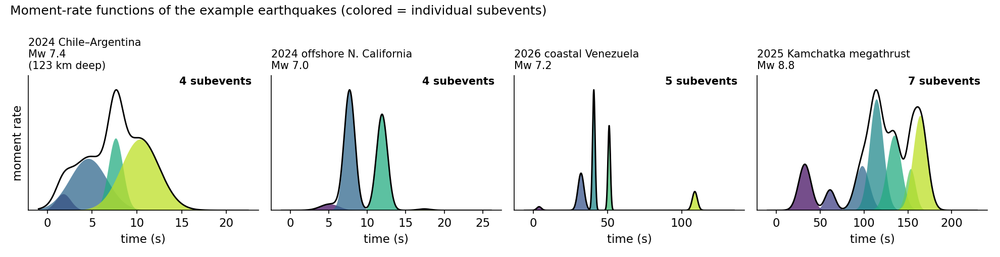

| example | earthquake | depth | selected subevents | total Mw (catalog) | best misfit |
|---------|-----------|-------|:------------------:|:------------------:|:-----------:|
| `chile` | 2024-07-19 Chile–Argentina border | 123 km (intraslab) | **4** | 7.41 (7.4) | 0.869 |
| `california` | 2024-12-05 offshore Cape Mendocino | shallow strike-slip | **3** | 7.04 (7.0) | 1.791 |
| `venezuela` | 2026-06-24 near the coast of Venezuela | shallow | **6** | 7.58 (7.2) | 3.072 |
| `kamchatka` | 2025-07-29 Kamchatka megathrust | shallow subduction | **7** | 8.83 (8.8) | 1.107 |

They were chosen to span the problems the method has to handle: a deep event whose depth phases
arrive late (Chile), a strike-slip event with a dense regional network (California), a
complex event that appears to combine smooth, slower slip with short, sharp ruptures (Venezuela) and a 450-km-long
megathrust rupture (Kamchatka). Misfit values are only comparable between runs of the *same*
event ([why](#misfit)). Detailed results are in [Section 6](#6-results-of-the-examples).

---

## 3. Installation

SubMIT runs on Linux (tested on Ubuntu 22.04). You need:

| requirement | why | how to get it |
|-------------|-----|---------------|
| **SAC** (with `libsac.a`, `libsacio.a`) | reading/writing seismograms, data processing | request it from [IRIS/EarthScope](https://ds.iris.edu/ds/nodes/dmc/forms/sac/); put `sac` on your `PATH` and set `SACAUX` as in its install notes |
| **MPI** + **C and Fortran compilers** | the inversion runs one Markov chain per MPI rank | Open MPI or MPICH with `gcc`/`gfortran` (`sudo apt install libopenmpi-dev gfortran`), or Intel oneAPI (`mpiicx`/`mpiifx`, faster) |
| **Java** | TauP travel times (bundled) | `sudo apt install default-jre` |
| **Perl, gawk** | Green's-function and data scripts | usually preinstalled |
| **wget, unzip** | only for the optional Chilean strong-motion download (`./submit fetch-csn`) | usually preinstalled |
| **Python 3 + packages** | preparation, screening, figures | `conda env create -f environment.yml` |
| ~2–4 GB disk per example | Green's functions | |
| internet access | step 2 queries the USGS catalog for a new earthquake; maps download coastlines once | not needed to reproduce the examples, apart from the coastlines |

Then:

```bash
conda activate submit
./submit check     # lists anything missing
./submit build     # compiles fk, mtel3 and a test build of the inversion code
```

The inversion and forward codes (`finv`, `ffwd`) are compiled automatically inside every run
directory, so they always match the configuration of that run. The build uses Intel oneAPI if it
finds it and GNU MPI wrappers otherwise; add `--gnu` to `./submit example` to force the GNU
toolchain (all checks in this README were run with GNU). With Intel, point `INTEL_SETVARS` at your
`setvars.sh` if it is not in `/opt/intel/oneapi/`.

Useful environment variables: `SUBMIT_PYTHON` (which Python to use), `SUBMIT_NCORE` (MPI ranks;
default = physical cores, at most 32), `SACHOME` (if `sac` is not on `PATH`).

---

## 4. How the method works

### 4.1 The subevent model

This parameterization follows Jia et al. (2020a, 2020b, 2022a). Each subevent $`i = 1 \dots N`$ has

| symbol | meaning | type |
|--------|---------|------|
| $`t_i`$ | centroid time after the origin time | nonlinear (searched) |
| $`x_i, y_i`$ | horizontal position east / north of the epicenter (with two or more subevents, subevent 1 is fixed at the epicenter; a single subevent can move) | nonlinear |
| $`z_i`$ | centroid depth | nonlinear |
| $`T_i`$ | duration | nonlinear |
| $`\mathbf m_i`$ | five independent components of the deviatoric moment tensor | linear (solved exactly) |

So $`N`$ subevents have $`5N`$ nonlinear and $`5N`$ linear unknowns. Rupture directivity *within* a
subevent can be switched on, but is off by default (`vr = 0.01 km/s` in `Input.model` makes each
subevent a point source); directivity of the whole earthquake emerges from the arrangement of the
subevents.

Each subevent releases its moment with a Gaussian moment-rate function whose full width at 10% of
the peak is its duration. As seen at station $`j`$ it is shifted by a time $`\Delta t_{ij}`$ that
depends on where the subevent is (Section 4.2):

```math
s_{ij}(t) = \frac{1}{\sqrt{2\pi}\,\sigma_i}\exp\!\left[-\frac{(t-t_i-\Delta t_{ij})^2}{2\sigma_i^2}\right],
\qquad \sigma_i = \frac{T_i}{2\sqrt{2\ln 10}} .
```

### 4.2 Forward problem: predicting a seismogram

The displacement predicted at station $`j`$ is the sum over subevents of moment-tensor components
times Green's functions, convolved with the subevent's moment-rate function:

```math
u_j(t) \;=\; \sum_{i=1}^{N}\sum_{k=1}^{5} m_{ik}\;\big[\,G_{jk}(z_i,\,t) * s_{ij}(t)\,\big].
```

For **teleseismic P and SH waves** (stations at about 40°–90°), Green's functions $`G_{jk}`$ are computed at the
station's distance on a 2-km depth grid (linearly interpolated to $`z_i`$) with the ray-theory code
`mtel3`, using a CRUST1.0 source-side crust. The subevent's position enters through a time shift
relative to the hypocenter,

```math
\Delta t_{ij} \;=\; -\,\frac{r_i}{c_j}\cos(\phi_j-\psi_i)\;-\;(z_i-z_0)\,\eta_j,
\qquad \eta_j=\sqrt{v^{-2}-c_j^{-2}},
```

where $`(r_i,\psi_i)`$ are the distance and azimuth of the subevent from the epicenter, $`z_0`$ the
catalog depth of the hypocenter, $`\phi_j`$ the station azimuth, $`c_j`$ the apparent horizontal
velocity of the ray (from TauP) and $`\eta_j`$ the vertical slowness at the source (P or S velocity
$`v`$). The first term produces the bunching/stretching in the figure at the top.

The reference depth is $`z_0`$ because the data are aligned on the arrival time that step 1
computes for the hypocenter (SAC header `t1`), and `mtel3` puts the direct wave of every grid depth
at the same time. The depth phases (pP, sP, sS) are already delayed correctly in the Green's
function of each depth, so the whole Green's function gets this one shift. Until v2 the reference
was the depth of subevent 1, which moved P and SH by different amounts whenever subevent 1 left the
catalog depth, and sP received a second, S-wave shift ([PITFALLS B1, B2](PITFALLS.md#b--forward-model)).

For **regional three-component records** (stations up to ~750 km away), Green's functions are computed with the
frequency–wavenumber code `fk` in a 1-D CRUST1.0 model on a distance–depth grid, and each subevent
uses the Green's function for its *own* distance and azimuth to the station (bilinear
interpolation), so the timing is exact rather than approximated.

All records are band-pass filtered identically to the data (teleseismic 0.005–0.2 Hz, regional
0.02–0.15 Hz by default; narrower for some extended ruptures).

### 4.3 Linear step: the moment tensors

For every trial set of nonlinear parameters $`\theta`$, the moment tensors are found by damped
least squares, with an extra constraint that their sum stays close to the catalog moment tensor
of the whole earthquake (GCMT or USGS):

```math
\hat{\mathbf m}(\theta) = \arg\min_{\mathbf m}\;
\big\|\mathbf W\big(\mathbf G(\theta)\,\mathbf m-\mathbf d\big)\big\|^2
\;+\;\alpha^2\|\mathbf m\|^2
\;+\;\lambda^2\Big\|\sum_{i=1}^N \mathbf m_i-\mathbf m_{\mathrm{CMT}}\Big\|^2 ,
\qquad \lambda = \kappa_{\mathrm{CMT}}\,\frac{\|\mathbf W\mathbf d\|}{M_0^{\mathrm{CMT}}} .
```

$`\mathbf W`$ holds the weights of the three wave types (P, SH, regional; [Section 5](#5-the-automated-pipeline)),
$`\alpha`$ is a small Tikhonov damping (`Tikhonov_alpha`) and $`\kappa_{\mathrm{CMT}}`$
(`CMTscaling`, default 3; set `SUBMIT_CMTSCALING` before step 2 to change it) sets how firmly the
total is anchored; it is scaled by the data norm so the same value works for an M 6.9 and an M 8.8. This is solved exactly (Cholesky) in a fraction of a second,
which is why the moment tensors do not need to be sampled.

### 4.4 Misfit and physical penalties <a name="misfit"></a>

Each predicted trace is aligned with the data by cross-correlation (shift
$`|\tau_j|\le\tau_{\max}`$: 2 s for P, 5 s for SH, distance-scaled for regional records) and the
misfit combines amplitude and waveform-shape agreement:

```math
\chi(\theta) \;=\; \frac{\displaystyle\sum_j \big\|d_j(t+\tau_j)-u_j(t)\big\|^2\; e^{\,|1-C_j|}}
                        {\displaystyle\sum_j \|d_j\|\,\|u_j\|},
```

where $`C_j`$ is the correlation coefficient. Values near 1 mean "residual energy comparable to the
signal", and they depend on the station set, windows and weights — so compare misfits only between
runs of the same event.

Two penalties keep the solution physical:

```math
\Phi(\theta) \;=\; \chi(\theta)\;
\exp\!\Big(\frac{\bar\epsilon}{\kappa}\Big)\;
\exp\!\Big(\max\!\big(0,\tfrac{\Theta_P}{30^\circ}-1\big)+\max\!\big(0,\tfrac{\Theta_T}{30^\circ}-1\big)\Big).
```

* **Double-couple penalty.** $`\bar\epsilon=\sum_i \sqrt{\epsilon_i}\,M_{0,i}/\sum_i M_{0,i}`$ is the
  moment-weighted non-double-couple (CLVD) content; $`\kappa`$ is `DCconstrain` (default 1).
* **Stress-consistency penalty.** $`\Theta_P`$ ($`\Theta_T`$) is the largest angle, over *all*
  subevents, between a subevent's pressure (tension) axis and that of the summed moment tensor.
  Mechanisms may rotate freely within 30° of the overall mechanism; beyond that the misfit grows
  exponentially. Every subevent counts, however small, so a tiny subevent cannot "soak up"
  unexplained energy with an implausible, opposite mechanism.

### 4.5 Bayesian sampling

The posterior probability of the nonlinear parameters is

```math
p(\theta\mid\mathbf d)\;\propto\;\exp\!\left[-\frac{\Phi(\theta)}{2\sigma^2\,\Phi_{\min}}\right]\pi(\theta),
\qquad \sigma = 0.05 ,
```

i.e. models whose misfit is a few percent above the best one found ($`\Phi_{\min}`$) remain
plausible. The prior $`\pi(\theta)`$ is

```math
\pi(\theta) \;\propto\; \prod_{i=1}^N \rho(x_i,y_i)\;\times\;
\mathbb 1\!\left[\;t_{i+1}-t_i \ge 2.5\,\mathrm s,\;\; t_i \ge T_i/2,\;\;
|\mathbf x_i-\mathbf x_1| \le v_{\max}\,(t_i-t_1),\;\; \theta\in\text{bounds}\right],
```

where $`\rho`$ is a smoothed map of the aftershocks (subevents are more likely where aftershocks
occurred), subevents are numbered in time order, and the causality condition (default
$`v_{\max}=1.5\,V_S`$) forbids a subevent that would require the rupture to travel faster than
plausible.

The posterior is sampled with **up to 32 parallel Markov chains** (one per MPI rank) using
Metropolis–Hastings with single-parameter moves, adaptive joint moves along the learned posterior
covariance (Haario et al., 2001, tuned to 23% acceptance) and one-dimensional moves along its
principal directions.

**Why a population of chains.** The usual approach runs the chains independently and pools the
ones that converged. This posterior is too peaked for that: a model 1% worse has $`e^{-2}`$ of the
density, and each chain settles in the first good mode it finds. On the California 3-subevent
configuration, 16 independent chains ended with 1 chain within 2% of the best misfit and the median
chain 34% worse; in the published v2 runs, typically 2–6 of 32 chains came within 2% of the best.
Therefore, I made the chains a population (`programs/code_SubMIT/finv.f90`):

```
relocation:   5% of the proposals move one subevent to a position drawn from the prior
warm start:   half of the chains start from the best (N-1)-subevent model plus one new subevent
resampling:   at 25, 50 and 75% of the burn-in each chain copies a chain drawn with weight
              exp(-dPhi / (2 sigma^2 Phi_min)) from its island of 8 chains; the last round draws
              from all chains
hard rules:   a random-walk proposal that breaks one is a rejection (v2 redrew it until it held,
              which samples the posterior times the feasible share of proposals and under-weights
              states near the bounds and the time-gap and causality rules)
```

With resampling, 10–16 of 16 chains ended within 2% of the best in seven of the eight
12,000-iteration test runs. The chains still do not all find the same mode. The final sampler
reached best misfits of 1.840 and 1.844 with two seeds; an earlier version of it, which redrew
infeasible proposals, reached 1.761, 1.840 and 1.847, the lowest with the third subevent east of the
epicenter instead of west of it. A mode 4.5% below the usual one, found in 1 of 5 runs, is nearly as
wide as the 5% selection band of Section 4.6. After the last round every chain descends from one
island, so the agreement of the chains says nothing about this spread. The
islands are independent searches until that round, and their best misfits
(`island_best_misfits.txt`) are what Section 4.6 uses to test the selection.

Chain lengths grow with $`N`$: 3000·N burn-in iterations and 1000·N samples. The collective steps
happen at fixed iteration counts, so a rerun with the same number of ranks, compiler and machine
repeats the same chains (two 4-rank runs under different machine load, 47 s and 83 s, wrote
identical files).

### 4.6 How many subevents?

More subevents always fit the data at least as well, so the inversion is repeated for
$`N = 1, 2, 3, \dots`$ and the answer is the **smallest $`N`$ whose best misfit is within 5% of the
best misfit over all $`N`$**. If that is the largest $`N`$ tried, the grid is extended automatically,
up to a limit of 7 subevents (`max_subevent_count` in `./submit`). Models with more subevents are
hard to interpret as distinct ruptures: in the v3 rerun of the Mw 8.8 Kamchatka example, the two
independent 8-subevent searches disagreed (0.775 and 0.801) while the 7-subevent ones agreed (0.8197
and 0.8198). A selection at the limit is reported in `lcurve.txt` as a lower bound.

**How reproducible is the selection?** The rule compares the best misfit of each $`N`$, so it is
only as reliable as the search that found those bests. In the v2 run of the 2026 Panama test event,
$`N = 2`$ was selected because one of 16 chains reached a misfit of 1.530; the median chain's best
was 17% worse, and without that chain the rule picks $`N = 3`$. Therefore, `plot_lcurve.py`
bootstraps the independent searches of every $`N`$ (the islands of Section 4.5; the chains for v2
runs) 1000 times and reports the share of resamples that select each $`N`$. A winner below 80% is
flagged in `lcurve.txt` as `WARNING: unstable selection`; the remedy is more MPI ranks, or a rerun
of the deciding $`N`$ with another seed (`rank.dat`), and reporting both candidates. An island's
best is the lowest misfit it visited during the burn-in, and the best misfit of the L-curve is the
best sample after the burn-in, which is the model reported. An island best can therefore lie slightly
below it, by up to 0.5% in the v3 reruns of the four examples. The warm start
of Section 4.5 also makes the curve fall more regularly: the search for $`N`$ starts from the misfit
already reached with $`N-1`$, where v2 started every $`N`$ from scratch (the 2026 Colombia runs
selected 5, 4, 3, 2 and 4 subevents under small configuration changes).


*Misfit (relative to each event's best) against the number of subevents. Stars mark the selection.
Thanks to the penalties, the curves flatten or rise once extra subevents stop being supported
by the data.*

---

## 5. The automated pipeline


What each automatic decision does, and why it matters:

| stage | what happens | why |
|-------|--------------|-----|
| **Integration** | teleseismic velocity records become displacement | the inversion fits displacement |
| **Screening, stage 1** | rejects records whose amplitude is >8× off the network median (robust median/MAD), whose signal-to-noise ratio is too low (5.5 teleseismic, 3 regional), whose channel is dead, or whose regional record is dominated by long-period drift | one broken sensor can bias a whole solution |
| **Green's functions** | depth grid centered on the catalog depth, wider for deep events (half-width from the Wells & Coppersmith, 1994, rupture length) | subevents of deep ruptures can be 50 km apart in depth |
| **Aftershock prior** | USGS aftershocks above a magnitude floor; background seismicity removed with a Poisson test against the year before; small clusters dropped; gaps between the surviving clusters bridged with weak smooth corridors | keeps subevents where the fault actually slipped; corridors to dropped clusters once opened 40% of the Kamchatka grid instead of 16% ([PITFALLS C1](PITFALLS.md#c--prior)) |
| **Windows** | long enough for the whole rupture plus, for deep events, the depth phases (pP, sP) | a 120-km-deep event's sS arrives ~60 s after S |
| **1-subevent calibration** | the 1-subevent solution sets the time range searched for N ≥ 2 and the window lengths | stops late subevents from fitting noise |
| **Wave-type weights** | P, SH and regional weights are iterated until their contributions to the misfit are about 1.2 : 1 : 1 | otherwise the nearest, largest records drown the rest |
| **Screening, stage 2** | stations that anti-correlate with the 1-subevent prediction (flipped polarity) or are ×4 off in amplitude (wrong gain) are removed | these errors only show up against a model |
| **Consistent scoring** | the 1-subevent inversion is repeated with the calibrated windows, weights and stations | the number of subevents is chosen by comparing misfits, which is only fair if every N is scored on the same data |


*Examples of what the processing does to real records from these events: drift removal, alignment
on the arrival, rejection of impossible amplitudes and of a sensor with reversed polarity, and
weighting of the three wave types.*

The pipeline is a set of shell steps that you can also run by hand from an `IRIS/` folder (this is
what `./submit` does):

```bash
bash ../programs/step2_prepare_inversions.sh        # screening, GFs, priors, configuration
bash ../programs/step3_do_inversions.sh             # N = 1, 1-subevent calibration, N = 1..5
bash ../programs/step3_do_inversions.sh 6           # only N = 6 (folder inv_<event>_6sub must exist)
python ../programs/prepare_SubMIT/plot_lcurve.py    # L-curve, selected N, reproducibility
bash ../programs/step4_figures.sh 4                 # forward model + figures for N = 4
```

`./submit run` creates the folder of a further $`N`$ by itself when the selection lands on the
largest $`N`$ tried. Every stage stops the pipeline when it fails; v2 ran its stages through
`awk ... | sh`, which discarded their exit codes ([PITFALLS E3](PITFALLS.md#e--systems)).

---

## 6. Results of the examples

These results were computed with v2, before the corrections listed in
[What changed in v3](#what-changed-in-v3). The timing of the teleseismic synthetics has changed
since, and some SH records of every example were unrotated. The two caveats that affect an
interpretation are marked below (Venezuela, Kamchatka).

For each example, the main figure shows the subevents in map view (beachballs = moment tensors,
error bars = 95% intervals from the MCMC ensemble, ★ = epicenter), the moment-rate functions, the
total moment tensor and a depth section. The station map shows the data used: teleseismic
stations on a globe centered on the epicenter (rings every 30°), marked by whether they provide P,
SH or both, and the regional stations around the epicenter. A collapsible block holds the
diagnostics:

* **Posterior histograms** — one row per subevent (E1, E2, …), one column per parameter (centroid
  time, duration, east and north location, depth). Narrow, single-peaked histograms mean a
  well-resolved parameter; broad or multi-peaked ones show the trade-offs the data allow. With two
  or more subevents, E1's horizontal position is fixed at the epicenter.
* **Waveform fits** — recorded (black) and predicted (red) seismograms for every station, labeled
  with the station name, epicentral distance and azimuth. The full plates (all stations, all
  pages) and the convergence of every Markov chain are in `examples/<name>/reference/` and are
  regenerated by `./submit example <name>`.

### 2024 Chile–Argentina border, Mw 7.4 (123 km deep)

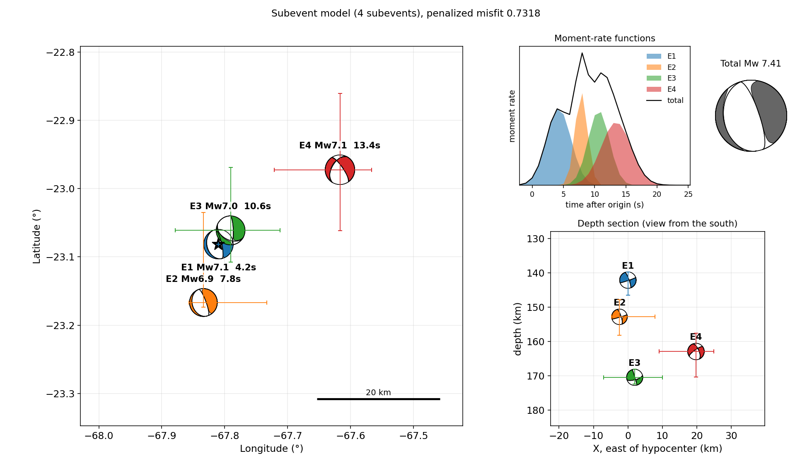

Four subevents within ~17 s. Horizontally they stay within 15 km of the epicenter, but their
depths step from 126 km to 170 km: the rupture grew mainly **downward** through the subducting
slab. This event (the "2024 Mw 7.4 Calama earthquake") was studied in detail with SubMIT by
Jia et al. (2025a), who found five subevents over ~20 s at 125–174 km depth. Here the 5-subevent
model fits only 1.4% worse than the 4-subevent one, and the 5% rule prefers the simpler model.


<details>
<summary><b>Uncertainties and waveform fits (Chile)</b></summary>

**Posterior distributions** of each subevent's parameters from the MCMC ensemble:

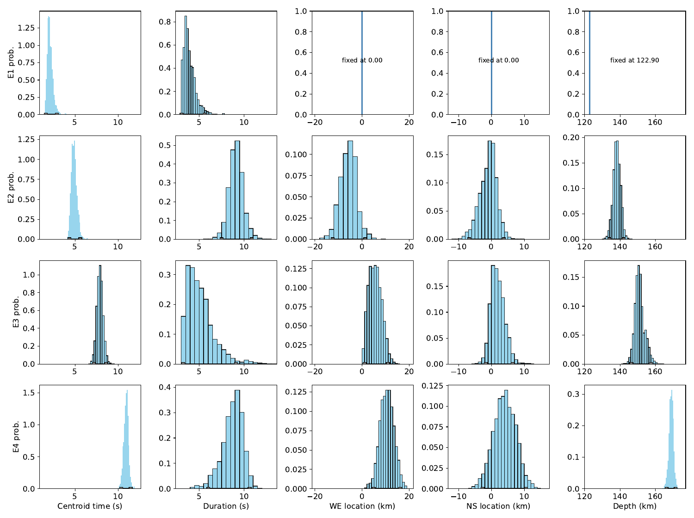

**Teleseismic P waves** (displacement; first of 2 pages):

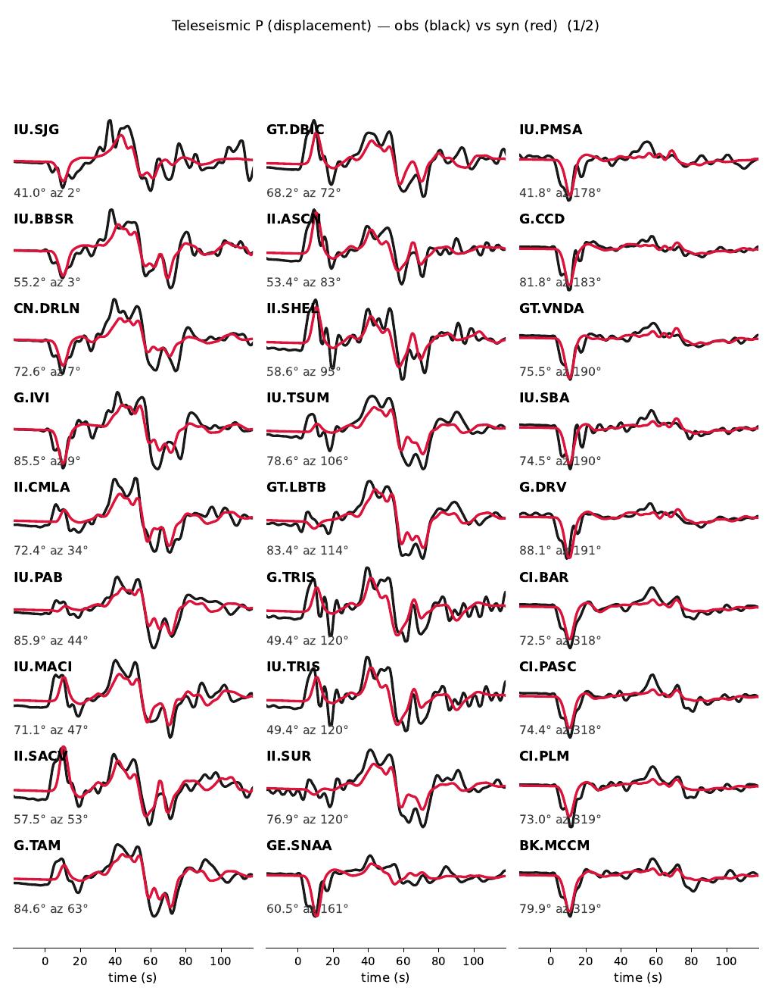

**Teleseismic SH waves** (displacement; first of 2 pages):


**Regional three-component records** (first of 4 pages):


</details>

### 2025 Kamchatka megathrust, Mw 8.8


Seven thrust subevents (Mw 8.1–8.5) over ~230 s. After a first subevent at the epicenter and a
second ~80 km to the north, the rupture ran **~450 km to the south-southwest** along the
trench. All seven mechanisms agree with the overall thrust mechanism (tensor similarity ≥ 0.94).

> **Caveat (November 2026).** The aftershock prior of this run contained 141 spurious corridors
> to clusters that the prior had removed ([PITFALLS C1](PITFALLS.md#c1--prior-corridors-re-attached-to-zeroed-speckle)):
> it covered 40% of the search grid instead of 16%. The second subevent (~80 km north) and the
> sixth lie where the corrected prior is zero, so the rupture path above has to be re-examined
> with v3.


<details>
<summary><b>Uncertainties and waveform fits (Kamchatka)</b></summary>

**Posterior distributions** of each subevent's parameters from the MCMC ensemble:

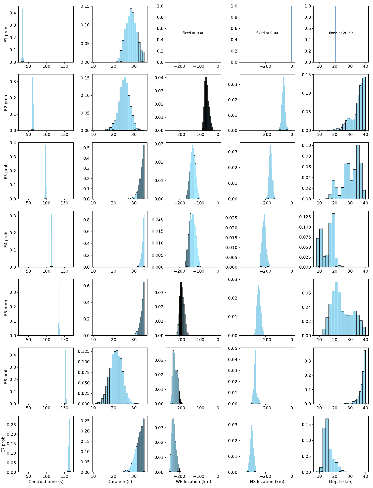

**Teleseismic P waves** (displacement; first of 2 pages):


**Teleseismic SH waves** (displacement; first of 2 pages):

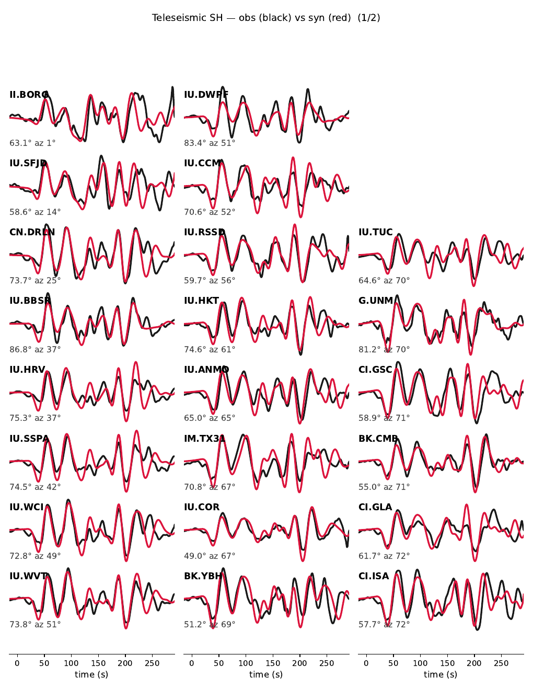

**Regional three-component records**; only two regional stations, with a small weight, so this event relies mainly on teleseismic data:

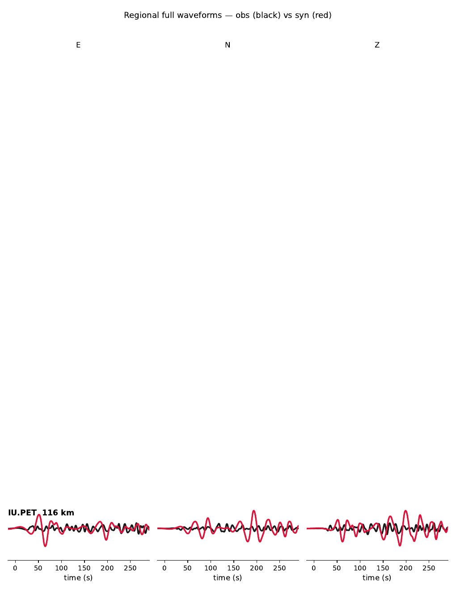

</details>

### 2026 near the coast of Venezuela, Mw 7.2


Six subevents over ~110 s propagating **~170 km east-northeast** along the coast. The subevents'
moment-rate functions are **too spiky**: four of the six last only 3–5 s despite magnitudes of
Mw 6.5–7.3, and the model fits the SH waves poorly (mean waveform correlation 0.26 for SH versus
0.59 for P, whereas SH correlates at 0.62–0.91 in the other examples). This points to a rupture
that was not only a cascade of short, high-frequency asperity failures but also had a **much
smoother, longer-lasting rupture in the background**, which is expressed more strongly in the SH
waves and which short point-source subevents cannot represent. The total moment (Mw 7.58) also
exceeds the catalog Mw 7.2. We flag this event for further study.

> **Caveat (November 2026).** 26 of the 56 SH records of this model are unrotated north or east
> components, not transverse ones ([PITFALLS A1](PITFALLS.md#a1--horizontals-of-unequal-length-left-unrotated)):
> their mean correlation with the predictions is 0.17, against 0.34 for the correctly rotated
> records. The poor SH fit, and with it the case for a smooth background rupture, is therefore at
> least partly a data-processing error. The example has to be re-run with v3 before that
> interpretation can stand.


<details>
<summary><b>Uncertainties and waveform fits (Venezuela)</b></summary>

**Posterior distributions** of each subevent's parameters from the MCMC ensemble:


**Teleseismic P waves** (displacement; first of 2 pages):


**Teleseismic SH waves** (displacement; first of 2 pages):


**Regional three-component records**:

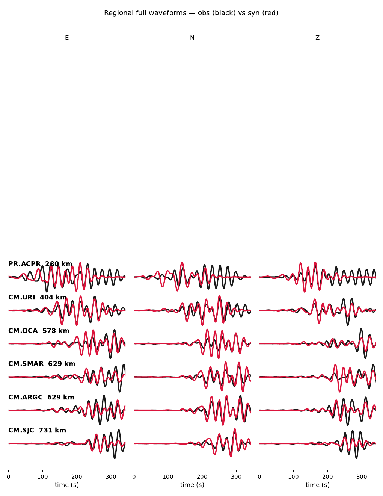

</details>

### 2024 offshore Cape Mendocino, California, Mw 7.0


Three strike-slip subevents within ~21 s; the third, ~15 s after the origin, lies ~50 km to the
east-southeast. This matches the number of subevents of an earlier hand-tuned inversion.

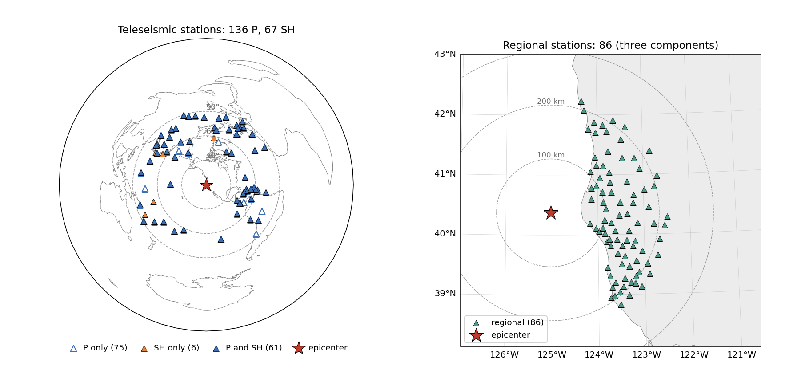

<details>
<summary><b>Uncertainties and waveform fits (California)</b></summary>

**Posterior distributions** of each subevent's parameters from the MCMC ensemble:


**Teleseismic P waves** (displacement; first of 2 pages):


**Teleseismic SH waves** (displacement; first of 2 pages):

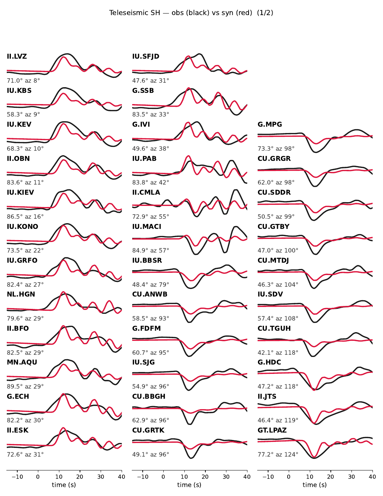

**Regional three-component records** (first of 7 pages):

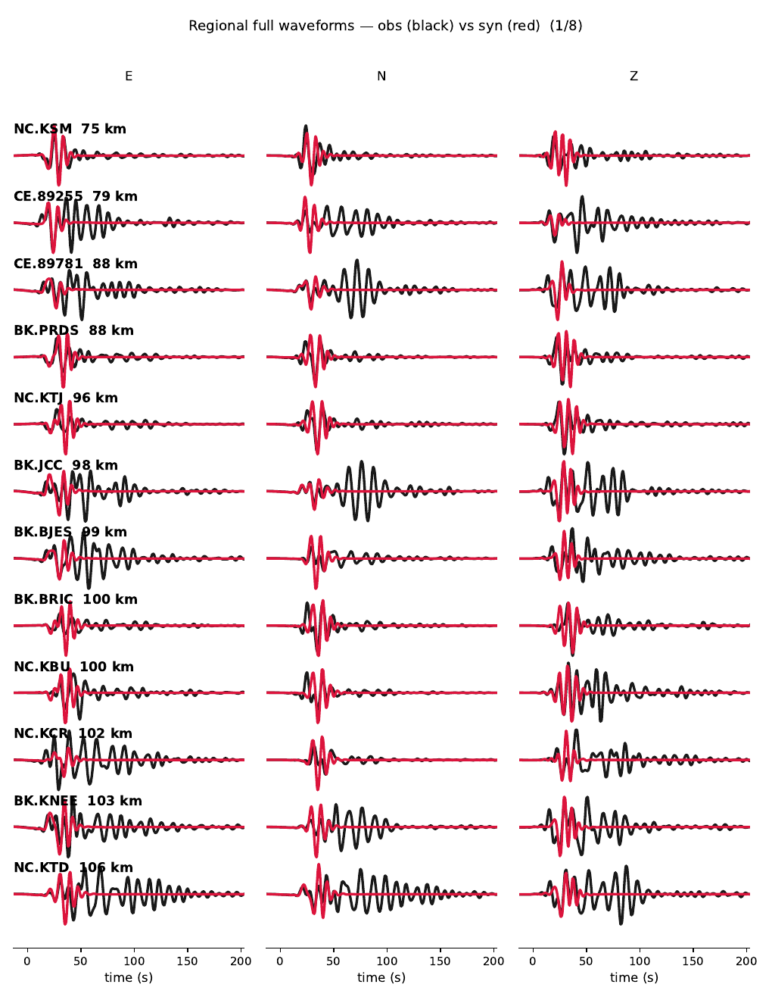

</details>

---

## 7. Data

SubMIT fits two sets of seismograms of the same earthquake: **teleseismic** records from stations
far away, and **regional** records from stations near the earthquake. Both are free. You download
them with [Wilber 3](https://ds.iris.edu/wilber3/), the event-based download tool of the
EarthScope (formerly IRIS) Data Management Center, which also collects data from other data
centers (GEOFON, RESIF, NCEDC, …). All four examples use both sets, and the pipeline has only been
tested with both.

| | teleseismic | regional |
|---|---|---|
| what it constrains | P and SH waves seen from all directions: when, where and how each subevent slipped | three-component waveforms close to the rupture: sharpen locations and timing |
| distance from the epicenter | **40°–90°** | **up to ~6.5° (~750 km)** |
| channels | **`BH?`** (broadband seismometers) | **`HN?`** (strong-motion accelerometers) **or** **`BH?`**, see below |
| time window | 5 min before the P arrival to 30 min after it | 5 min before the origin time to 20 min after it |
| stations in the examples | 100–150 downloaded, 58–75 kept | from 2 (Kamchatka) to 96 (California) used |
| what SubMIT fits | P on the vertical and SH on the transverse component | all three components |

Why these distances: closer than ~40°, teleseismic P and S waves travel through the upper mantle,
whose layering splits them into several arrivals that the simple teleseismic Green's functions do
not model; beyond ~90° they are diffracted around the core. Regional stations farther than
~750 km are ignored automatically: the regional Green's functions are computed in a single 1-D
model of the source region and only out to 950 km, which includes a 200-km margin for subevents
away from the epicenter.

### 7.1 Strong-motion (`HN?`) and broadband (`HH?`, `BH?`) regional stations

Channel codes have three letters: the first is the sampling band, the second the type of sensor,
the third the component (`Z`, `N`, `E` or `1`, `2`).

* **`HN?` = accelerometers ("strong-motion" sensors)**, usually 100–200 samples/s. They are built
  to stay on scale during the strongest shaking, so they record large earthquakes cleanly even a
  few tens of kilometers from the fault. They are much less sensitive than broadband sensors.
  Dense strong-motion networks cover Chile, California, Japan, Taiwan, …; the `chile`,
  `california` and `venezuela` examples use them.
* **`BH?` and `HH?` = broadband seismometers**, at 20–50 (`BH?`) or 100–200 (`HH?`) samples/s.
  They are far more sensitive, but near a large earthquake they can **clip** (the signal exceeds
  the sensor's range) or be disturbed by tilt. Many networks distribute only one of `BH?` and
  `HH?`. The `kamchatka` example uses `BH?`.
* Step 1 removes the instrument response of every type to obtain ground velocity, and filters the
  regional records above 0.02 Hz (periods shorter than 50 s), which removes the long-period drift
  that accelerometer records often carry.

**Request all three types.** Step 1 processes every `HN?`, `HH?` and `BH?` record and keeps
**one record per station** (`programs/select/choose_regional_instruments.py`). It keeps the
broadband record (`HH?` before `BH?`) unless that record is clipped or disagrees with the
strong-motion record of the same station at 0.02–0.1 Hz (correlation below 0.9, or amplitude ratio
outside 0.8–1.25); then it keeps the strong-motion record. A record counts as clipped when it stays
at its peak value for 3 or more samples and that peak exceeds 10% of 2²³ counts. Each choice is
listed in `IRISloc/<event>_loc/regional_instrument_choice.log`. Other channel types (`HL?`, `EN?`,
`LH?`, …) are not read.

Until v2, step 1 used only `HN?` whenever the download contained any `HN?` channel, and it never
read `HH?`. From the same download of the 2026 Panama Mw 7.7 earthquake, v2 kept 4 of 19 regional
stations and v3 keeps 17. v2 also fitted every sensor of a station: 11 records from 7 stations for
the 2025 Aomori Mw 7.6 earthquake ([PITFALLS A2, A4](PITFALLS.md#a--data-integrity)).

Rule of thumb: request `HN?`, `HH?` and `BH?` within ~6.5° of the earthquake.

### 7.2 Downloading with Wilber 3, step by step

1. **Find the earthquake.** Open <https://ds.iris.edu/wilber3/>, find the event on the map or in
   the list below it (**Custom Query** finds older events), and click its region name. The station
   page opens.
2. **Teleseismic request.** On the station page, set
   * **Networks**: keep the default `_GSN` (Global Seismographic Network) and add other permanent
     broadband networks, for example `G` (GEOSCOPE), `GE` (GEOFON), `MN`, `IM`, `CN`, `AU`, `PS`.
     Aim for stations evenly spread in azimuth around the earthquake. If one region has many
     stations, the drop-down next to **All**/**None** keeps one station every X degrees.
   * **Channels**: `BH?`
   * **Distance Range**: 40 to 90 (degrees)

   Click **Request Data** and fill in the dialog:
   * **Time Range**: Starting `5` minutes before `P arrival`; Ending `30` minutes after `P arrival`
   * **Output Format**: `SAC binary (little-endian)`; **Bundle As**: `tar archive`
   * **Request Label**: keep the default, for example `2024-07-19 mww7.4 Chile-Argentina Border Region`
   * your name and e-mail address, then **Submit**.
3. **Regional request.** Go back to the station page of the same event and set
   * **Networks**: delete `_GSN` so that every network is shown
   * **Channels**: `HN?,HH?,BH?` (see [7.1](#71-strong-motion-hn-and-broadband-hh-bh-regional-stations))
   * **Distance Range**: 0 to 6.5

   **Request Data**: Starting `5` minutes before `event time`; Ending `20` minutes after
   `event time`; the same output format and bundle; and as **Request Label** the teleseismic label
   followed by `_loc`, for example `2024-07-19 mww7.4 Chile-Argentina Border Region_loc`.
4. **Download.** Wilber e-mails you when each request is ready. Download the two `.tar` files from
   the link (they are kept in a public folder named after your name and the label).

The examples used similar settings: teleseismic windows starting 5 min (Kamchatka: 10 min) before
P and ending 17–31 min after it, and regional windows starting 3–7 min before and ending
11–25 min after the origin time. Step 1 needs at least 50 s of record before the first arrival (to
measure the noise) and, for regional records, at least 10 min after the origin time.

### 7.3 Where to put the downloads

Put the two tar files, unopened, in a new folder with a short path:

```text
/data/myevent/
├── IRIS/       2024-07-19-mww74-chile-argentina-border-region.tar       (teleseismic)
└── IRISloc/    2024-07-19-mww74-chile-argentina-border-region_loc.tar   (regional)
```

Each tar file contains one folder named after the request label, for example
`2024-07-19-mww74-chile-argentina-border-region/`. Inside it are one SAC file per channel
(`NET.STA.LOC.CHA.Q.YYYY.DDD.HHMMSS.SAC`) and, in one sub-folder per data center, the
instrument-response files (`IRISDMC/SACPZ.NET.STA.LOC.CHA`, …). The folder names matter:

* they must start with Wilber's date and magnitude, `YYYY-MM-DD-mwwXY-`. The magnitude (`mww74`
  = 7.4) sets the ranges that the inversion searches;
* the regional folder must be the teleseismic folder name followed by `_loc`. The teleseismic
  folder may also end in `_tel…` (for example `…-northern_tel-california`); step 1 removes that
  suffix.

The epicenter, depth and origin time are read from the SAC headers that Wilber writes (`evla`,
`evlo`, `evdp` in km, origin time `o`), that is, from the catalog solution shown in Wilber.

**Data from somewhere else** (FDSN web services, ObsPy, your own network) work if you arrange them
in the same way: SAC files with these names at the top of the folder, with station coordinates,
component orientations (`cmpaz`, `cmpinc`) and the event location, depth and origin time in
their headers, plus SACPZ response files (counts per meter of displacement, as FDSN services
provide them) one sub-folder down. Put the folder in a `.tar` file, or put the folder itself
directly in `IRIS/` or `IRISloc/`.

### 7.4 Optional: Chilean strong-motion records (CSN)

For earthquakes in Chile, the database of the Centro Sismológico Nacional (CSN,
<https://evtdb.csn.uchile.cl>) has accelerograms from many more stations than Wilber
distributes. For the `chile` example it provided 53 stations; Wilber had 7 usable ones, 4 of
which are also in the CSN set. To use it, find the earthquake on the CSN site and copy the
32-character id at the end of its address (`https://evtdb.csn.uchile.cl/event/<EVENT_ID>`).
Then run, **before** `prepare`:

```bash
./submit fetch-csn /data/myevent 030cd73d4cf743e322b7bc88f1166a4c   # the chile example event
./submit prepare /data/myevent
```

`fetch-csn` needs `wget` and `unzip`. It downloads every station of the event, integrates
acceleration to velocity, filters above 0.01 Hz, resamples to 1 sample/s and writes the records
to `myevent/StrongMotionData/`. `prepare` then merges them into the regional data; where a station
is in both, the CSN record replaces the Wilber one. The CSN database keeps growing: a download in
October 2026 returned 57 stations instead of the 53 used in the `chile` example (all 53 were
identical to the published records). The bundled `examples/chile/inputs.tar.gz` keeps the
published set.

### 7.5 What step 1 (`./submit prepare`) does

`prepare` unpacks the tar files and turns every record into a file that the inversion can read:

1. renames the files `NET.STA.LOC.CHA` and makes the origin time the time reference (`o = 0`,
   also across midnight and New Year), and computes distance and azimuth when the headers lack
   them;
2. removes the instrument response with the SACPZ files, giving ground velocity in m/s (SAC
   `transfer … to vel freq 0.001 0.005 10 20`), then removes the mean and trend and tapers the
   ends; regional records are also high-pass filtered at 0.02 Hz;
3. computes the first P arrival (vertical component) and S arrival (horizontal components) in the
   iasp91 Earth model with TauP and stores them in header `t1`;
4. corrects horizontal components that are not exactly 90° apart in the metadata;
5. rotates the horizontals: teleseismic to radial and transverse (`.r`, `.t`, `.z`); regional
   `1`/`2` components to east and north (`.e`, `.n`, `.z`). Two horizontals of different length
   are first cut to their common time window: SAC refuses to rotate such a pair, and until v2 the
   unrotated east and north records were then written as radial and transverse
   ([PITFALLS A1](PITFALLS.md#a1--horizontals-of-unequal-length-left-unrotated));
6. keeps a station only if its signal-to-noise ratio, 10·log₁₀ of the variance in the 50 s after
   the arrival divided by that in the 50 s before, is at least 3 dB on the teleseismic vertical
   and transverse components, or at least 2 dB on all three regional components. For regional
   records the arrival is the P arrival on every component: before the S arrival of a deep event
   lies the P coda, not noise ([PITFALLS A3](PITFALLS.md#a3--regional-signal-to-noise-measured-against-the-p-coda));
7. removes stations that miss a component; teleseismic only, also removes records with peak
   velocities above 1 mm/s (usually a wrong response or a glitch) and duplicate sensors at the
   same station (location code `00` is preferred over `10`, and so on); regional only, keeps one
   instrument per station ([Section 7.1](#71-strong-motion-hn-and-broadband-hh-bh-regional-stations));
8. resamples to 1 sample/s from 500, 200, 100, 80, 50, 40, 25 or 20 samples/s with SAC's
   anti-alias `decimate`; a record at any other sampling rate is set aside with a warning;
9. regional only: cuts the records from 50 s before to 600 s after the origin time (padding with
   zeros if a record is shorter), and renames network `C` to `C1`.

The results are in `IRIS/<event>/data/` (`*.r`, `*.t`, `*.z`) and `IRISloc/<event>_loc/data/`
(`*.e`, `*.n`, `*.z`). Rejected records are kept, so you can see what was removed: those with a
low signal-to-noise ratio in `Vel/rtr/bad_data/` (teleseismic) or `Vel/enz/bad_data/`
(regional) inside the event folder, and the others in `Vel/rtr/others/` or `Vel/enz/others/`.
This is the form in which the examples are bundled (`examples/<name>/inputs.tar.gz`). Running
`prepare` (plus `fetch-csn` for `chile`) on the original Wilber downloads of the four examples
reproduces those files except where v3 corrects them. Horizontal pairs of unequal length are now
rotated, which changes the radial and transverse records of 13 (Chile), 11 (California),
60 (Venezuela) and 8 (Kamchatka) files, and moves a few stations across the signal-to-noise
threshold (Venezuela GE.KBS in, GE.MATE out; Kamchatka G.CAN in). The regional sets gain stations
(California CE.89688, Chile C1.GO02, and 12 Kamchatka stations beyond 750 km, which the inversion
ignores) and keep one sensor per site (Kamchatka IU.PET.00 only).
`python tools/compare_step1_outputs.py /data/rerun examples/<name>/inputs.tar.gz` lists these
differences, and the radial and transverse records that are still unrotated (62 of the bundled
Venezuela records, none after v3). Step 2 then screens the records again, more strictly
([Section 5](#5-the-automated-pipeline)).

### 7.6 Data that the pipeline downloads by itself

| what | source | used for | offline? |
|------|--------|----------|----------|
| aftershocks (first 7 days) and the seismicity of the year before | [USGS ComCat](https://earthquake.usgs.gov/fdsnws/event/1/) | the aftershock-based location prior | the examples replay the copies archived in `examples/<name>/catalog/` |
| catalog moment tensor | Global CMT catalog 1990–2023, bundled (`programs/mt_SubMIT/1990_2023_gcmt.dat`); for later events the USGS ComCat moment tensor | the total-moment-tensor constraint | bundled, or archived for the examples |
| crustal structure | CRUST1.0, bundled | Green's functions | yes |
| coastlines and borders | [Natural Earth](https://www.naturalearthdata.com/), downloaded once by cartopy | maps | without internet the maps are drawn without coastlines |

### 7.7 The data of the four examples

| example | teleseismic (`BH?`) | regional | regional networks |
|---------|---------------------|----------|-------------------|
| `chile` | 103 `BHZ` channels at 41°–88° → 59 stations kept | `HN?`, 8 stations at 0.4°–4.8° from Wilber + 53 from CSN → 56 kept | C1 |
| `california` | 129 `BHZ` channels at 42°–90° → 75 stations kept | `HN?`, 98 stations at 0.5°–2° → 96 kept | BK, CE, NC, RE, UO, UW |
| `venezuela` | 117 `BHZ` channels at 42°–90° → 67 stations kept | `HN?`, 26 stations at 2.5°–8° → 22 kept | CM, PR |
| `kamchatka` | 152 `BHZ` channels at 40°–90° → 58 stations kept | `BH?` (no strong motion nearby), 54 stations at 1°–14.6° → 27 kept, of which only IU.PET (two sensors) is within 750 km | AV, IU |

Teleseismic networks: AU, BK, CI, CN, CU, G, GE, GT, IC, II, IM, IU, MN, NL, PS. All networks
are listed with their DOIs in [Section 13](#13-credits-citation-and-licenses). Please cite them when
you publish results based on their data.

---

## 8. Running your own earthquake

1. **Download the data** as described in [Section 7](#7-data): a teleseismic request (`BH?`,
   40°–90°) and a regional request (`HN?`, `HH?` and `BH?`, within ~6.5°), both as SAC tar
   files.
2. **Put the downloads in a new folder** (short path, see [Troubleshooting](#11-troubleshooting)):

   ```text
   /data/myevent/
   ├── IRIS/       the teleseismic .tar file
   └── IRISloc/    the regional .tar file
   ```

3. **Run it:**

   ```bash
   ./submit prepare /data/myevent     # step 1: responses, rotation, picks, 1 sample/s, SNR selection
   ./submit run /data/myevent         # steps 2-4: everything else, including choosing N
   ```

   For Chilean earthquakes, run `./submit fetch-csn /data/myevent EVENT_ID` before `prepare` to add
   the CSN strong-motion records ([Section 7.4](#74-optional-chilean-strong-motion-records-csn)).
   Step 2 downloads the aftershock catalog (and, for events after 2023, the catalog moment tensor)
   from the USGS, so the machine needs internet access. Results appear in
   `/data/myevent/IRIS/figs_and_results/`. Add `--quick` to `run` first if you want a 10-minute
   check that everything works.

Settings you may want to change afterwards are in `Par.file` (windows, frequency bands,
weights, regularization) and `search_par.file` (search bounds, chain lengths, and
`neq_min`/`neq_max`, which set the number of subevents) inside each `IRIS/inv_<event>_<N>sub/`
folder; `programs/submit.conf` holds the sampling interval. After editing, re-run one
subevent count with `bash ../programs/step3_do_inversions.sh N` from `IRIS/`, then
`python ../programs/prepare_SubMIT/plot_lcurve.py` and `bash ../programs/step4_figures.sh N`.
Two optional environment variables change the automatic configuration: `SUBMIT_CMTSCALING`
(default 3) sets how firmly the summed moment tensor is tied to the catalog one (Section 4.3), and
`SUBMIT_MAX_TELESEISMIC_STATIONS` (default 100) is the number of teleseismic stations above which
step 2 thins the densest networks.

---

## 9. Reading the outputs

`IRIS/figs_and_results/` collects everything for the selected model:

| file | content |
|------|---------|
| `RESULTS.md` | summary: selected N, misfits, subevent table with uncertainties, total moment |
| `subevents.png/.pdf` | the figure shown in Section 6 |
| `stations.png/.pdf` | stations used: teleseismic P and SH (global map) and regional (local map) |
| `lcurve.pdf/.txt` | misfit against the number of subevents, the selection, and the share of the replicate bootstrap that selects each N (Section 4.6) |
| `fits_P.pdf`, `fits_SH.pdf`, `fits_Pvel.pdf`, `fits_rayl.pdf` | data (black) vs prediction (red) at every station, with correlation coefficients |
| `histoplot_py.pdf` | posterior distributions of every subevent parameter |
| `misfit_evolution.pdf` | misfit along each Markov chain |
| `convergence.txt` | chains within 1, 2 and 5% of the best misfit, and the split R-hat of every parameter (values well above 1.1 mean the chains disagree) |

Per-N details are in `IRIS/inv_<event>_<N>sub/` (`best_model_hybrid.dat`, chains, logs,
`island_best_misfits.txt`) and
`IRIS/fwd_<event>_<N>sub/` (`fm.dat` = moment tensors in 10²⁷ dyne·cm as Mxx Mxy Mxz Myy Myz Mzz
with x north, y east, z down; `Input.model` = time, x east, y north, duration, vr, θ, depth).

---

## 10. Using an AI coding assistant

Everything above is driven by the `./submit` command, so an AI coding assistant that can run
shell commands can install, run and check SubMIT for you by following this README. Open the
repository in the assistant and ask, for example:

* *"Check whether my machine has everything SubMIT needs, and help me install what is missing."*
* *"Reproduce the California example and tell me whether it matches the published result."*
* *"Re-run the Chile inversions in frozen mode in the background and report when they finish."*
* *"Explain the L-curve and the selected model of the Kamchatka example."*
* *"Set up a new run for the earthquake whose Wilber downloads are in ~/data/myevent."*

---

## 11. Troubleshooting

| symptom | fix |
|---------|-----|
| SAC reports files it cannot read, or integrated records are unchanged | SAC cannot handle file names longer than ~120 characters: use a short work path (`--workdir /data/w`) |
| `COMPILE FAILED` | run `./submit check`; with GNU compilers try `./submit example … --gnu` |
| `mpirun` fails right away after building with GNU | an Intel `mpirun` was picked up; use `--gnu` (sets `SUBMIT_NO_INTEL=1`) |
| `ERROR: missing Green's function file` | a station has no Green's function; rerun the Green's-function stage or remove the station from `stations*.info` and update the `num_sta_*` counts in `Par.file` |
| Python errors about `numpy`/`obspy` | `conda activate submit`, or set `SUBMIT_PYTHON` to that environment's `python3` |
| `./submit check` reports that `mpirun` did not start `true` within 20 s | the MPI launcher hangs (the Open MPI launcher of the test machine did this even for `hostname`); use another MPI installation, for example Intel oneAPI |
| `lcurve.txt` ends with `WARNING: unstable selection` | independent searches disagree on N (Section 4.6): rerun the deciding N with more MPI ranks (`SUBMIT_NCORE`) or another seed (`rank.dat` in the inversion folder), and report both candidates |
| `convergence.txt` lists split R-hat values well above 1.1 | the chains disagree on that parameter: it is poorly resolved, or the chains were too short (`burn_in`, `nsample` in `search_par.file`) |
| need to stop a run | `sh programs/stop_step3.sh work/<name>/IRIS` (stops the step-3 driver *and* its MPI jobs; killing only the shell leaves them running) |

---

## 12. Repository layout

```text
submit                  command-line driver (check, build, example, status, compare,
                        prepare, fetch-csn, run)
environment.yml         Python environment
PITFALLS.md             failure atlas: every defect found in v2, its cost, its fix and its test
tests/                  regression tests (python tests/test_regressions.py, a few seconds)
examples/<name>/        four validated earthquakes
  inputs.tar.gz           processed waveforms (output of step 1, see Section 7)
  catalog/                archived aftershock catalog and moment tensor (exact reproduction)
  gf_inputs/              velocity models + grid of the published Green's functions
  frozen/<N>sub/          exact configuration + best model of every published inversion
  reference/              published figures, L-curve, moment tensors, best model
programs/               the package (paths inside are relative: keep this layout)
  step1_* ... step4_*     pipeline steps (step3_do_inversions.sh, step4_figures.sh)
  compiler_environment.sh MPI ranks, Python and compilers shared by steps 3 and 4
  MyExtractSeed*.sh       step-1 processing of the Wilber downloads (teleseismic / regional)
  select/                 step-1 helpers: arrival times, signal-to-noise selection, choice of one
                          regional instrument per station, decimation to 1 sample/s
  ChileArray/             optional download and conversion of Chilean CSN strong-motion records
  code_SubMIT/            the inversion: finv.f90 (MCMC), forward_model.c (data, Green's
                          functions, forward model, moment tensors, misfit), ffwd.f90 (one
                          forward run for the figures), prepare_stationinfo.py (station lists)
  fwd_SubMIT/             figures and RESULTS.md
  prepare_SubMIT/         screening, priors, weights, bounds, 1-subevent calibration, selection
  gf_SubMIT/              Green's-function drivers
  hist/                   posterior histograms, misfit evolution, convergence diagnostics
  fk3.2/ mtel3/ crust1.0/ TauP-2.0/   bundled third-party codes and models
tools/                  comparison with the published results and the bundled step-1 inputs,
                        README-figure scripts
docs/figures/           figures used in this README
```

---

## 13. Credits, citation and licenses

SubMIT was developed by Zhe Jia. If you use it, please cite the method papers (Jia et al., 2020a,
2020b, 2022a) and Jia et al. (2025a), which used this code for the 2024 Mw 7.4 Calama earthquake
(the `chile` example).

### Method and applications of the multiple-subevent inversion

* Jia, Z., Shen, Z., Zhan, Z., Li, C., Peng, Z., & Gurnis, M. (2020a). The 2018 Fiji Mw 8.2 and
  7.9 deep earthquakes: One doublet in two slabs. *Earth and Planetary Science Letters*, 531,
  115997. https://doi.org/10.1016/j.epsl.2019.115997
* Jia, Z., Wang, X., & Zhan, Z. (2020b). Multifault models of the 2019 Ridgecrest sequence
  highlight complementary slip and fault junction instability. *Geophysical Research Letters*,
  47(17), e2020GL089802. https://doi.org/10.1029/2020GL089802
* Jia, Z., Zhan, Z., & Kanamori, H. (2022a). The 2021 South Sandwich Island Mw 8.2 earthquake: A
  slow event sandwiched between regular ruptures. *Geophysical Research Letters*, 49(3),
  e2021GL097104. https://doi.org/10.1029/2021GL097104
* Jia, Z., Mao, W., Flores, M. C., Barra, S., Ruiz, S., Potin, B., Becker, T. W., Moreno, M.,
  Baez, J. C., Ceroni, D., & Cabrera, L. (2025a). Deep intra-slab rupture and mechanism transition
  of the 2024 Mw 7.4 Calama earthquake. *Nature Communications*, 16, 8140.
  https://doi.org/10.1038/s41467-025-63480-5
* Kutschera, F., Jia, Z., Oryan, B., Wong, J. W. C., Fan, W., & Gabriel, A.-A. (2024). The
  multi-segment complexity of the 2024 Mw 7.5 Noto Peninsula earthquake governs tsunami
  generation. *Geophysical Research Letters*, 51(21), e2024GL109790.
  https://doi.org/10.1029/2024GL109790

### Related studies

* Jia, Z., Zhan, Z., & Helmberger, D. (2022b). Bayesian differential moment tensor inversion:
  Theory and application to the North Korea nuclear tests. *Geophysical Journal International*,
  229(3), 2034–2046. https://doi.org/10.1093/gji/ggac053
* Jia, Z., Jin, Z., Marchandon, M., Ulrich, T., Gabriel, A.-A., Fan, W., Shearer, P., Zou, X.,
  Rekoske, J., Bulut, F., Garagon, A., & Fialko, Y. (2023). The complex dynamics of the 2023
  Kahramanmaraş, Turkey, Mw 7.8–7.7 earthquake doublet. *Science*, 381(6661), 985–990.
  https://doi.org/10.1126/science.adi0685
* Jia, Z., Fan, W., Mao, W., Shearer, P. M., & May, D. A. (2025b). Dual mechanism transition
  controls rupture development of large deep earthquakes. *AGU Advances*, 6(3), e2025AV001701.
  https://doi.org/10.1029/2025AV001701 (subevent models of 40 deep earthquakes with a related,
  grid-search subevent method)
* Li, J., & Jia, Z. (2026). The 2025 Mw 8.8 Kamchatka megathrust: A rapid recurrence with complex
  heterogeneous rupture. *Geophysical Research Letters*, 53(9), e2026GL121923.
  https://doi.org/10.1029/2026GL121923 (finite-fault model of the `kamchatka` example event)

### Other references used in this README

* Haario, H., Saksman, E., & Tamminen, J. (2001). An adaptive Metropolis algorithm. *Bernoulli*,
  7(2), 223–242. https://doi.org/10.2307/3318737
* Kennett, B. L. N., & Engdahl, E. R. (1991). Traveltimes for global earthquake location and
  phase identification. *Geophysical Journal International*, 105(2), 429–465.
  https://doi.org/10.1111/j.1365-246X.1991.tb06724.x (the iasp91 model used for arrival times)
* Wells, D. L., & Coppersmith, K. J. (1994). New empirical relationships among magnitude, rupture
  length, rupture width, rupture area, and surface displacement. *Bulletin of the Seismological
  Society of America*, 84(4), 974–1002.

### Bundled third-party software and models (with their own terms)

* **fk** — Lupei Zhu (Saint Louis University), frequency–wavenumber synthetics: Zhu, L., &
  Rivera, L. A. (2002). A note on the dynamic and static displacements from a point source in
  multilayered media. *Geophysical Journal International*, 148(3), 619–627.
  https://doi.org/10.1046/j.1365-246X.2002.01610.x. Copyright notice in `programs/fk3.2/README`
  (redistribution permitted with the notice; the author asks to be informed of redistribution).
* **TauP 2.0** — Crotwell, H. P., Owens, T. J., & Ritsema, J. (1999). The TauP Toolkit: Flexible
  seismic travel-time and ray-path utilities. *Seismological Research Letters*, 70(2), 154–160.
  https://doi.org/10.1785/gssrl.70.2.154. GPL-3.0 (`programs/TauP-2.0/gpl-3.0.txt`, source
  included); the bundled copy omits the documentation and the optional Jython console.
* **CRUST1.0** — Laske, G., Masters, G., Ma, Z., & Pasyanos, M. (2013). Update on CRUST1.0 — A
  1-degree global model of Earth's crust. *Geophysical Research Abstracts*, 15, EGU2013-2658.
* **r8lib** — John Burkardt (LGPL), linear algebra.
* SAC is required but **not** included; obtain it from IRIS/EarthScope.

### Data

The waveforms of the examples were downloaded with Wilber 3 from the EarthScope Consortium Data
Management Center (formerly IRIS DMC), which retrieved them through FDSN web services from
EarthScope, GEOFON, INGV, NCEDC, NRCAN, ORFEUS, RESIF and SCEDC. The Chilean strong-motion records
are from the Centro Sismológico Nacional (CSN), Universidad de Chile. Please acknowledge the
networks whose data you use:

| code | network | DOI |
|------|---------|-----|
| AU | Australian National Seismograph Network | [10.26186/144675](https://doi.org/10.26186/144675) |
| AV | Alaska Volcano Observatory | [10.7914/SN/AV](https://doi.org/10.7914/SN/AV) |
| BK | Berkeley Digital Seismograph Network | [10.7932/BDSN](https://doi.org/10.7932/BDSN) |
| C1 | Red Sismológica Nacional (Chile) | [10.7914/SN/C1](https://doi.org/10.7914/SN/C1) |
| CE | California Strong Motion Instrumentation Program | [10.7914/b34q-bb70](https://doi.org/10.7914/b34q-bb70) |
| CI | Southern California Seismic Network | [10.7914/SN/CI](https://doi.org/10.7914/SN/CI) |
| CM | Red Sismológica Nacional de Colombia | [10.7914/SN/CM](https://doi.org/10.7914/SN/CM) |
| CN | Canadian National Seismograph Network | [10.7914/SN/CN](https://doi.org/10.7914/SN/CN) |
| CU | Caribbean Network | [10.7914/SN/CU](https://doi.org/10.7914/SN/CU) |
| G | GEOSCOPE | [10.18715/GEOSCOPE.G](https://doi.org/10.18715/GEOSCOPE.G) |
| GE | GEOFON | [10.14470/TR560404](https://doi.org/10.14470/TR560404) |
| GT | Global Telemetered Seismograph Network (USAF/USGS) | [10.7914/SN/GT](https://doi.org/10.7914/SN/GT) |
| IC | New China Digital Seismograph Network | [10.7914/SN/IC](https://doi.org/10.7914/SN/IC) |
| II | Global Seismograph Network (IRIS/IDA) | [10.7914/SN/II](https://doi.org/10.7914/SN/II) |
| IM | International Miscellaneous Stations | [10.7914/vefq-vh75](https://doi.org/10.7914/vefq-vh75) |
| IU | Global Seismograph Network (IRIS/USGS) | [10.7914/SN/IU](https://doi.org/10.7914/SN/IU) |
| MN | Mediterranean Very Broadband Seismographic Network | [10.13127/sd/fbbbtdtd6q](https://doi.org/10.13127/sd/fbbbtdtd6q) |
| NC | USGS Northern California Seismic Network | [10.7914/SN/NC](https://doi.org/10.7914/SN/NC) |
| NL | Netherlands Seismic and Acoustic Network | [10.21944/e970fd34-23b9-3411-b366-e4f72877d2c5](https://doi.org/10.21944/e970fd34-23b9-3411-b366-e4f72877d2c5) |
| PR | Puerto Rico Seismic Network & Puerto Rico Strong Motion Program | [10.7914/SN/PR](https://doi.org/10.7914/SN/PR) |
| PS | Pacific21 | none ([FDSN page](https://www.fdsn.org/networks/detail/PS/)) |
| RE | US Bureau of Reclamation Seismic Networks | none ([FDSN page](https://www.fdsn.org/networks/detail/RE/)) |
| UO | Pacific Northwest Seismic Network, University of Oregon | [10.7914/SN/UO](https://doi.org/10.7914/SN/UO) |
| UW | Pacific Northwest Seismic Network, University of Washington | [10.7914/SN/UW](https://doi.org/10.7914/SN/UW) |

Catalogs and data sources:

* Barrientos, S., & National Seismological Center (CSN) Team (2018). The seismic network of Chile.
  *Seismological Research Letters*, 89(2A), 467–474. https://doi.org/10.1785/0220160195
* Dziewonski, A. M., Chou, T.-A., & Woodhouse, J. H. (1981). Determination of earthquake source
  parameters from waveform data for studies of global and regional seismicity. *Journal of
  Geophysical Research*, 86(B4), 2825–2852. https://doi.org/10.1029/JB086iB04p02825
* Ekström, G., Nettles, M., & Dziewoński, A. M. (2012). The global CMT project 2004–2010:
  Centroid-moment tensors for 13,017 earthquakes. *Physics of the Earth and Planetary Interiors*,
  200–201, 1–9. https://doi.org/10.1016/j.pepi.2012.04.002
* U.S. Geological Survey (2017). Advanced National Seismic System (ANSS) Comprehensive Catalog
  (ComCat). https://doi.org/10.5066/F7MS3QZH
* Maps use coastlines and borders from [Natural Earth](https://www.naturalearthdata.com/) (public
  domain).
