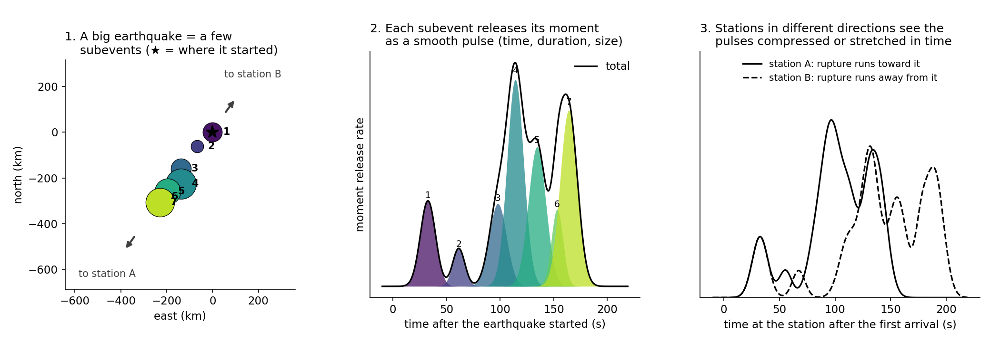
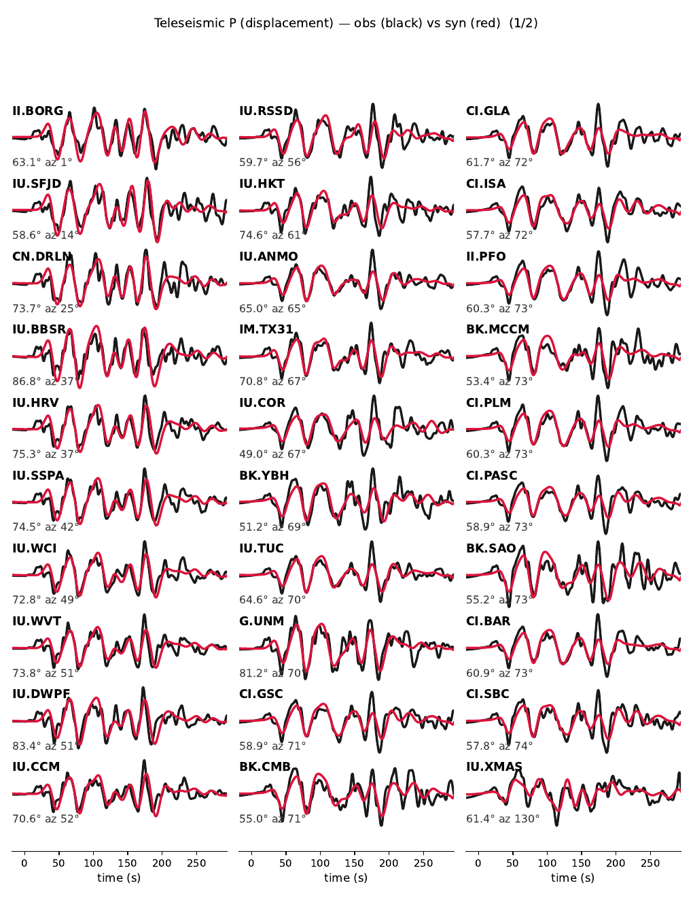
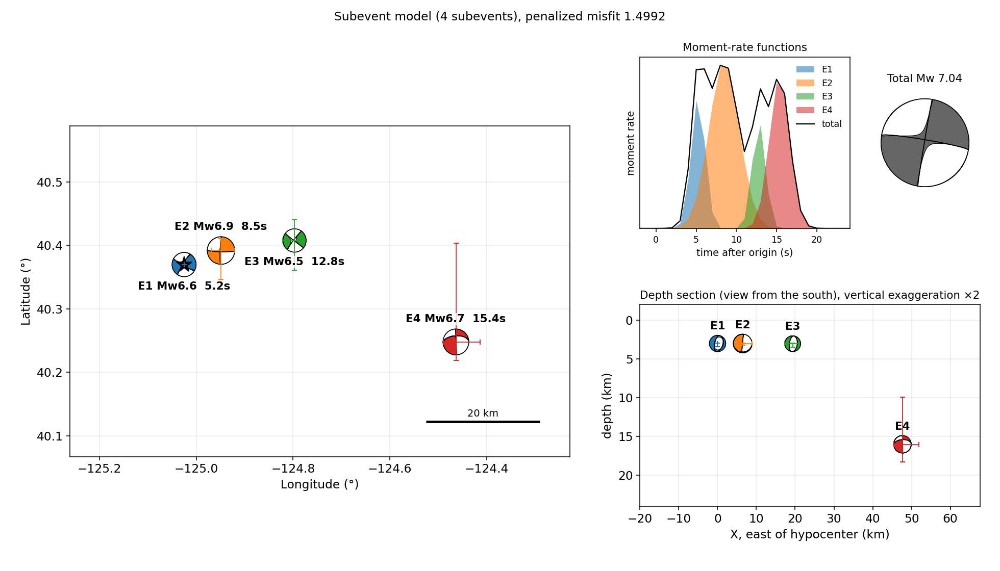

# SubMIT — Bayesian multiple-subevent inversion of large earthquakes

[English](README.md) | [中文](README.zh-CN.md)

A large earthquake is not a single point. The rupture starts at one place, the hypocenter, and then
spreads along the fault. It can run for tens or hundreds of kilometers and last for tens of seconds
or longer. Different parts of the fault slip at different times, and sometimes in slightly
different ways.

SubMIT describes such an earthquake with a **small number of subevents**. A subevent is a point
source. Each subevent has its own time, position, depth and duration. Each one also has its own
moment tensor, which describes the type of faulting, for example strike-slip or thrust. Taken
together, the subevents give a simple picture of how the rupture grew.

SubMIT finds the subevents from seismograms. It uses hundreds of records: from stations far away
around the world (teleseismic stations) and from stations near the earthquake (regional stations).
It does three things:

1. It finds the subevents that best explain the recorded waveforms.
2. It **estimates how uncertain each subevent is**. For this it uses a Bayesian method called
   Markov-chain Monte Carlo (MCMC).
3. It **decides how many subevents the data actually support**, so that the model is not more
   complicated than the data can justify.

> **A fully automated pipeline.** One command takes the downloaded waveforms all the way to the
> final figures. You do not need to tune anything by hand. The pipeline does the following:
>
> * **data screening** — it finds broken, mis-scaled or flipped stations and removes them;
> * **configuration** — it derives the time windows, frequency bands, search ranges and the
>   weights of the different wave types from the earthquake and the data. It also builds a prior
>   on the location of the subevents from the aftershocks;
> * **inversion** — it runs the Bayesian MCMC search for 1, 2, 3, … subevents, each with
>   uncertainties;
> * **model selection** — it chooses the number of subevents with a fixed rule. When needed, it
>   extends the search automatically, up to 7 subevents;
> * **results** — it draws maps, moment-rate functions, posterior histograms, waveform fits and
>   station maps, and it writes a short summary.
>
> ```bash
> ./submit prepare /data/myevent && ./submit run /data/myevent
> ```

Four example earthquakes come with the code. Each one can be reproduced with a single command
([Section 1](#1-quick-start)).

The method was introduced and applied in Jia et al. (2020a, 2020b, 2022a, 2025a). The full
references are in [Section 13](#13-credits-citation-and-licenses).



*How the method works, shown with the result for the 2025 Kamchatka M 8.8 earthquake. **(1)** The
earthquake is described as seven subevents. **(2)** Each subevent releases its seismic moment as a
smooth pulse. The sum of the pulses is the moment-rate function of the whole earthquake. **(3)** The
subevents sit at different places. A station that the rupture runs toward therefore sees the pulses
arrive close together. A station on the other side sees them spread out in time. SubMIT matches
these differences at about 100–200 stations, and this is what places the subevents in space and
time.*

---

## What changed in v3

Version 3 (v3) is a large revision of SubMIT. This section explains why the revision was needed,
how the problems were found, what was changed, and how the results changed. Every problem named
here has its own entry in the failure atlas, [PITFALLS.md](PITFALLS.md). Each entry gives the
measured cost of the problem, the fix, and the test that now guards against it.

### Why a new version

A group of users installed v2 from scratch and applied it to the 2026 Mw 7.4 Colombia earthquake.
They reported six problems. The most worrying one was that the selected number of subevents changed
from run to run, even when almost nothing in the setup had changed.

To find out how common such problems were, I installed v2 in a fresh environment (a new clone of
the code and a new conda environment). Then I ran it on three recent earthquakes that it had never
seen:

- the 2026-10-09 Panama earthquake, Mw 7.7, shallow;
- the 2026-03-24 Tonga earthquake, Mw 7.5, 234 km deep;
- the 2025-12-08 Aomori earthquake, Mw 7.6.

These runs uncovered fourteen problems. Only two of them stopped the pipeline with an error. In ten
cases the pipeline ran to the end and drew figures that looked plausible. This is the most important
lesson of the whole revision: a run that finishes is not the same as a run that worked.

### What was changed

The table lists the changes, in the order of the pipeline. The last column gives an example of what
each problem did in v2. The four rows from "first subevent" to "depth grid" came later, from a
review of the examples against what is known about each earthquake (see
[below](#a-review-of-the-examples-against-what-is-known)).

| Part of the pipeline | What v2 did | What v3 does | What the problem did in v2 |
|----------------------|-------------|--------------|----------------------------|
| Step 1: rotating the horizontal records | Horizontal records of unequal length were left unrotated, and then fitted as if they were SH waves | The records are cut to a common time window, and then rotated | Venezuela: 26 of the 56 SH records were really north or east components |
| Step 1: choosing the regional instruments | Broadband `HH?` channels were never read. `BH?` channels were dropped whenever a strong-motion `HN?` channel existed. Every sensor of a station was fitted | One record per station, from the broadband sensor unless it is clipped or inconsistent | Panama: 4 of 19 regional stations were used; now 17 |
| Step 1: signal-to-noise test of regional records | Horizontal components were compared with the P coda instead of with noise | Every component is scored from the P arrival | Tonga: 1 of 5 regional stations was kept; now all 5 |
| Forward model: timing | Teleseismic times were measured from the depth of the first subevent, and the sP phase was shifted twice | Times are measured from the hypocenter, with one shift | Published Chile model: data misfit 0.854; with the fix 0.824 |
| Prior on the location of subevents | Corridors were drawn to aftershock clusters that had already been removed | Corridors join only the clusters that remain | Kamchatka: the prior covered 40% of the search grid; now 16% |
| Sampler | Every chain searched on its own, so the selected number of subevents could depend on one lucky chain | Warm start, relocation moves and population resampling ([Section 4.5](#45-bayesian-sampling)) | — |
| Choosing the number of subevents | The smallest number within 5% of the lowest misfit. This rule charges nothing for an extra subevent | The Akaike criterion: each subevent costs about 5% of misfit. Among numbers that tie, the smallest is chosen, and the tie is reported ([Section 4.6](#46-how-many-subevents)) | Venezuela: 6, 5 and 6 subevents in three runs; now 5 in every search |
| Range of centroid times | Set by the magnitude alone, so a rupture whose main energy comes late was cut off | Doubled automatically when the 1-subevent model ends on its upper bound. A larger number whose best model ends on that bound cannot be selected ([Section 4.6](#46-how-many-subevents), [Section 5](#5-the-automated-pipeline)) | Colombia: every chain stopped at the bound of 31 s, while the centroid is at 49.5 s |
| Removing bad records | The test against the 1-subevent model was skipped as a whole when that model looked unrepresentative, which happened for six of nine events | A record more than 8 times stronger than the rest of its group is always removed ([Section 5](#5-the-automated-pipeline)) | Vanuatu: one drifting record was kept, and it carried 68% of the P misfit |
| First subevent | Fixed at the epicenter, with its depth searched | Fixed at the hypocenter: the epicenter and the catalog depth ([Section 4.1](#41-the-subevent-model)) | Chile: first subevent at 142 km, while the hypocenter is at 123 km |
| Limit on the rupture speed | Measured from the centroid of the first subevent. For a shallow strike-slip event, 1.5 times the S speed was allowed | Measured from the time the first subevent begins. The limit is the mean S velocity at the searched depths ([Section 4.5](#45-bayesian-sampling)) | Venezuela: 5.5 km/s between the first two subevents |
| Mechanisms of the subevents | Free within 30° of the total mechanism | A Gaussian prior of 10° on the angle from the total mechanism, inside the same 30° limit ([Section 4.3](#43-linear-step-the-moment-tensors)) | California: strikes of 120° and 127° on a fault that strikes 96–100° |
| Depth grid | Started at 3 km, whatever material lay there | Starts in rock, below the water and the soft sediments ([Section 5](#5-the-automated-pipeline)) | California: one grid node lay inside a 0.63 km thick sediment layer |
| Software | A fresh clone had no `greenFuncDir_disp` folder, and the clean-up step then deleted every Green's function. Arrays were fixed at 100 teleseismic stations. Exit codes were not checked. Misfits became NaN under `-Ofast` | Fixed | Tonga and Aomori stopped in step 3 |

### Results on the three test earthquakes

I ran all three earthquakes from the raw downloads, in a fresh installation, with 16 MPI ranks each.
One MPI rank runs one Markov chain, so each search used 16 chains. The misfits of v2 and v3 cannot
be compared directly, because the two versions prepare the data and measure time differently. The
table therefore compares what each version could do and what it selected.

| Earthquake | v2 | v3 |
|------------|----|----|
| 2026 Panama, Mw 7.7 | 4 regional stations. Selected 2 subevents, but only 1 of the 16 chains reached that model; the median chain ended 17% worse | 17 regional stations. Selected 4 subevents with two different sets of chain seeds. The two L-curves agree within 0.4% at every number of subevents, and the four subevents are the same: the fourth lies 42 km west and 29–30 km north, at 22–23 s |
| 2026 Tonga, Mw 7.5, 234 km deep | 1 regional station. Stopped in step 3, because a fixed array was too small | 5 regional stations. Selected 1 subevent: a second one makes the misfit 1.3% worse. All chains ended within 1% of the best, and the split R-hat is at most 1.12 |
| 2025 Aomori, Mw 7.6 | 232 teleseismic stations. Stopped in step 3, because a fixed array was too small | The stations were thinned to 100. Selected 3 subevents: a fourth one would lower the misfit by only 3.2%. All chains ended within 2% of the best, the split R-hat is at most 1.14, and the total is Mw 7.59 |

A few terms in this table:

- An **L-curve** is the best misfit plotted against the number of subevents ([Section 4.6](#46-how-many-subevents)).
- A **chain seed** sets the random numbers that the chains use. Two runs with different seeds are
  two independent searches of the same data.
- The **split R-hat** compares the chains with each other. A value close to 1 means that the
  chains agree; values above 1.1 mean that they disagree.

The Panama result needs one caveat. The fourth subevent lowers the misfit by 7.2% and 7.1% in the
two searches, and a fifth one by only 1.9% and 1.4%, so both searches select four. But in both
searches the best 4-subevent model was found late, only after the last resampling round, and only
by 1 and 3 of the 16 chains. Its posterior had not converged: the split R-hat reached 5.5. For a
rupture like this one, run four or more subevents with 32 ranks or with longer chains before you
read the error bars of the 4-subevent model.

Each run took 67 minutes (Aomori), 83–89 minutes (Panama) and 143 minutes (Tonga) on a shared AMD
EPYC 7532 machine. Tonga took longest because its depth of 234 km needs Green's functions at 64
depths. These runs used the code from before the review fixes described next. Each of those fixes
was tested on its own.

### An independent review of the code

While these tests ran, an independent reviewer read the new code. The reviewer reported eleven more
defects. I confirmed and fixed all of them ([PITFALLS F](PITFALLS.md#f--found-by-review)). Two of
them were inherited from v2, and they affect every posterior that v2 published:

- A proposal that broke a hard rule of the search was drawn again instead of being rejected. This
  makes the chains sample the wrong distribution.
- The prior on the location was shifted by half a grid cell, 2 km, to the south-west.

### Four earthquakes whose number of subevents was unstable

A second report arrived on 2026-11-16. It came with the folders of v2 reruns of four earthquakes:
the bundled Chile example and three earthquakes at intermediate depth. In each of them, the misfit
rose somewhere as more subevents were added, and the selected number changed between runs. I ran
each event again with v3, with two sets of chain seeds. The same symptom turned out to have three
different causes:

- **2024 Chile, Mw 7.4 (the bundled example).** The v2 rerun selected 3 subevents, while the
  published run of the same inputs had selected 4. Its 4-subevent search ended at a higher misfit
  (0.948) than its 3-subevent search (0.897). The cause was the v2 sampler: each chain searched on
  its own and could stay in a poor local solution
  ([PITFALLS D1](PITFALLS.md#d1--one-lucky-chain-decides-the-number-of-subevents)). With v3, all
  three searches (one with 16 ranks, two with 32 ranks and different seeds) select 4 subevents,
  with misfits of 0.731, 0.732 and 0.734.
- **2026 Colombia, Mw 7.4, 116 km deep.** The v2 reruns selected 1 subevent and then 3, with
  misfits of 3.3–4.0. The cause was the range of centroid times. It ended at 31 s, before most of
  the energy of the rupture arrived
  ([D4](PITFALLS.md#d4--the-centroid-range-cut-off-a-late-main-rupture)). With v3 and the old
  range, both seeds selected 1 subevent, and every chain stopped on the bound at 31 s. Now the
  pipeline doubles the range in such a case. Both seeds then select 2 subevents, and their
  L-curves agree within 0.4% at every number of subevents. The two subevents are also the same: a
  long one (24–27 s) at the epicenter, and a short one (5 s) at 50 s, 41 km to the south-west.
- **2026 Vanuatu, Mw 7.3, 121 km deep.** The v2 reruns selected 1 subevent twice, and the misfit
  rose from one subevent to two. Here two causes came one after the other. First, one record
  drifted. It carried 68% of the P misfit, and both station screens had let it through
  ([A6](PITFALLS.md#a6--a-drifting-record-passed-both-station-screens)). Second, once that record
  was removed, three subevents fitted 11% better than one. But the third subevent sat in the
  corner of its search range: at 28.0 s in a range that ends at 28 s, and 53 km east at the edge
  of the box. It fitted the three regional stations. Such a model is now marked and cannot be
  selected ([D5](PITFALLS.md#d5--a-subevent-in-the-corner-of-its-search-range-won-the-selection)).
  With both fixes, both seeds select 1 subevent. A second subevent lowers the misfit by 3.4% in
  one search and raises it by 2.3% in the other. When I widened the range by hand to 55 s, the
  third subevent settled at 31.5 s, at the top of the depth grid. Its P wave arrives between the
  pP depth phases of the first two subevents, so it may be depth-phase energy that the model does
  not predict.
- **2026 Tonga, Mw 7.5, 234 km deep.** The v2 reruns selected 1 subevent twice, and the misfit
  rose with every added subevent. There was no defect. With v3 (16 ranks, the data of the report),
  a second subevent makes the misfit 3.6% worse, and no model with up to five subevents fits more
  than 1.2% better than one. All 16 chains ended within 1% of the best, with a split R-hat of at
  most 1.13. One subevent is the answer.

**Insight: "the selected number is unstable" was one symptom with three causes. Only measuring each
cause separately told them apart: two seeds tested the search, the position of the best model in
its search range tested the range, and the share of the misfit carried by each record tested the
data.**

### A review of the examples against what is known

On 2026-11-17 the four v3 examples could be reproduced, and independent searches agreed on their
numbers of subevents. But I had not yet compared the models with what is known about each
earthquake. When I did, three of the four did not pass:

| Example | The first v3 model | What is known | Cause | The model now |
|---------|--------------------|---------------|-------|---------------|
| Chile | The first subevent lay at 142 km | The hypocenter is at 123 km | Only the horizontal position of the first subevent was fixed; its depth was searched ([D6](PITFALLS.md#d6--the-first-subevent-was-fixed-at-the-epicentre-only-and-the-rupture-clock-at-its-centroid)) | The first subevent is at 123 km, and the others at 136, 148 and 169 km: the rupture ran 46 km down the slab in 10 s |
| Venezuela | The first subevent was at 15.8 s and the second, 127 km away, at 38.7 s: 5.5 km/s between their centroids | The rupture ran about 200 km to the east in about 60 s (Celis et al., 2026) | The speed was measured from the centroid of the first subevent, and the limit was 1.5 times the S speed (D6) | The first subevent releases its moment in the first 7 s. The three large subevents lie 121–140 km to the east at 32–51 s, at 3.8, 3.2 and 2.8 km/s since the rupture began |
| California | Two subevents struck 120° and 127° | The Mendocino transform fault strikes 96–100° | The mechanisms were free within 30° of the total ([B4](PITFALLS.md#b4--subevent-mechanisms-sat-on-the-30-cone)), and three subevents sat on a depth node inside sediment ([B5](PITFALLS.md#b5--the-top-of-the-depth-grid-was-a-source-in-the-sediment-layer)) | Every subevent strikes 96–102°. The two large ones still dip 67° and 50° |

I measured each new rule on the examples before I adopted it. Fixing the depth of the first
subevent alone made the Chile misfit 26% worse. The reason was the speed rule as it stood then.
The deepest moment, at 168 km after 10 s, cannot be reached at the S speed from the centroid of a
first subevent that lasts 7 s. It can be reached from the time that subevent begins. So the
rupture clock now starts when the first subevent begins.

I also tried a stricter rule, in which the first subevent must begin at the origin time, and I
dropped it. The first clear moment release of the Colombia earthquake starts 17 s after the origin
time. Under the strict rule, Colombia fitted 11% worse with two subevents and 17% worse with three
(1.62 and 1.64, against 1.47 and 1.40).

**The reruns found one more defect.** With its first subevent at the hypocenter, Chile's subevents
follow each other very closely in time. A new subevent drawn from the prior then fitted only after
the last one. As a result, one set of chain seeds selected 3 subevents and another selected 5. The
warm start now inserts the new subevent between two neighbors when the model leaves no free slot in
time ([D7](PITFALLS.md#d7--a-model-without-a-free-slot-in-time-could-only-grow-at-its-end),
[Section 4.6](#46-how-many-subevents)). With this change, the two searches of Chile agree within
0.6% at every number of subevents, and both select 4.

Two limits remain. Each one is a limit of what these data and this model can say:

- **The speed limit is reached, but it costs little.** Chile's deepest subevent lies at 4.49 km/s,
  just below the limit of 4.51 km/s. Venezuela's first large subevent lies at 3.82 km/s, below the
  limit of 3.83. Raising the limit changed little. With 5.5 km/s, Venezuela's five subevents fitted
  0.5% better, and its large subevents stayed where they were. With 6 km/s, Chile's five subevents
  fitted 1.0% better, at the same depths ([Section 6](#6-results-of-the-examples)). Both ruptures
  ran at about the S speed, and these data cannot tell whether it was slightly below or above. For
  Venezuela, a supershear segment has been proposed (Celis et al., 2026). You can test one by
  raising `vmax_cau` ([Section 11](#11-troubleshooting)).
- **California's P waves are not reproduced.** At the stations to the north, the P waves are an
  oscillation with a period of 15.6 s. Strike-slip sources in rock did not produce it in any of
  five layered velocity models. The two large subevents tilt in opposite directions to fit it.
  The number of subevents therefore depends on how far the prior lets them tilt: four with the
  default `MechanismSigma= 10`, and one with 5 ([Section 6](#6-results-of-the-examples)).

I also ran the three events of the second report again with these rules (one search each, with 32
ranks). They keep their selections. Colombia selects 2 subevents, tied with 3. Its first subevent
is now at the hypocenter, 116 km deep, at 25.7 s, and the second lies 34 km to the
south-south-west at 49.9 s. Vanuatu selects 1 subevent. Tonga selects 1: three subevents fit 3.8%
better than one, which is less than two more subevents cost.

### A smaller and faster code

The forward model, which predicts the seismograms, is now one file
(`programs/code_SubMIT/forward_model.c`). To check it, I also patched the two timing fixes into
the old v2 code. Both versions then give the same misfits (California 3-subevent model: 1.792850;
Chile 4-subevent model: 1.074403 against 1.074404), the same moment tensors and the same alignment
shifts. The new code runs about twice as fast: 6,000 iterations on 16 ranks take 559 s instead of
1,156 s.

The inversion core shrank from 10 files and 5,626 lines to 3 files and 2,169 lines. The old core
contained two copies of the forward code that had drifted apart. The whole pipeline shrank from 90
files and 13,800 lines to 58 files and 8,971 lines. v2 also carried a numerical library of 42,694
lines, of which it used only a few functions. Steps 3 and 4 are now one script each
(`step3_do_inversions.sh` and `step4_figures.sh`) where v2 had four. The three calibration hooks
that run after the 1-subevent search are now one (`calibrate_from_1sub.sh`). The tests in
`tests/test_regressions.py` guard every fix that can be tested without SAC or MPI.

### The bundled examples are v3 runs

The examples in [Section 2](#2-the-four-example-earthquakes) and
[Section 6](#6-results-of-the-examples) are v3 runs. I ran each example again on 2026-11-17, after
the review above, from its raw downloads and with 32 MPI ranks. The folder `examples/<name>/` holds
that run: its step-1 records, the configuration of every inversion, the best models and the figures
(`tools/make_example_from_run.py`). Compared with the v2 results they replace, California has four
subevents where v2 had three, and Venezuela has five where v2 had six. Chile and Kamchatka keep four
and seven. Section 6 says what changed in each model.

**Insight: a pipeline that runs to the end is not a pipeline that worked. Most of these defects were
found by checking the property that a step was supposed to create — a rotated component, a timing
reference, a prior that covers the aftershocks — and not by looking for errors.**

## Contents

0. [What changed in v3](#what-changed-in-v3)
1. [Quick start: reproduce an example in three commands](#1-quick-start)
2. [The four example earthquakes](#2-the-four-example-earthquakes)
3. [Installation](#3-installation)
4. [How the method works (with equations)](#4-how-the-method-works)
5. [The automated pipeline](#5-the-automated-pipeline)
6. [Results of the examples](#6-results-of-the-examples)
7. [Data: what to download and how](#7-data)
8. [Running your own earthquake](#8-running-your-own-earthquake)
9. [Reading the outputs](#9-reading-the-outputs)
10. [Using an AI coding assistant](#10-using-an-ai-coding-assistant)
11. [Troubleshooting](#11-troubleshooting)
12. [Repository layout](#12-repository-layout)
13. [Credits, citation and licenses](#13-credits-citation-and-licenses)

---

## 1. Quick start

This section shows how to reproduce one of the bundled examples. You need a Linux machine with SAC,
an MPI library, Fortran and C compilers, Java and conda. [Section 3](#3-installation) explains how
to get them.

```bash
git clone https://github.com/jiazhe868/SubMIT.git && cd SubMIT
conda env create -f environment.yml && conda activate submit

./submit check                         # are all dependencies installed?
./submit build                         # compile the bundled Green's-function codes
./submit example california            # reproduce the 2024 California M7.0 result (~10 min)
./submit compare california            # check it against the bundled numbers
```

The figures and a written summary (`RESULTS.md`) appear in
`work/california/IRIS/figs_and_results/`.

`./submit compare` then prints a table like the one below. This one comes from a run that took 5
minutes on 32 cores.

```
L-curve (best penalized misfit for each number of subevents)
  n  published  reproduced     diff
  1     4.7984      4.7984    +0.0%
  2     4.2606      4.2606    +0.0%
  3     4.3285      4.3285    +0.0%
  ...
selected number of subevents: published 4, reproduced 4

selected 4-subevent model (published -> reproduced)
          time (s)               x,y (km)     depth (km)      dur (s)          Mw  MT sim
E1     5.2->5.2        0,0   ->    0,0       4.0->4.0      5.3->5.3   6.20->6.20 +1.00
E2     7.7->7.7       14,11  ->   14,11     12.3->12.3     3.0->3.0   6.89->6.89 +1.00
E3    11.9->11.9      29,13  ->   29,13     13.5->13.5     3.1->3.1   6.83->6.83 +1.00
E4    17.4->17.4      -5,-5  ->   -5,-5      4.0->4.0      3.5->3.5   5.64->5.64 +1.00
total Mw: published 7.04, reproduced 7.04
```

How to read it:

- "Published" means the numbers that come with the example. They are the results of its v3 run of
  2026-11-17, made from the raw downloads with 32 MPI ranks.
- "Reproduced" means the numbers of your run.
- The first block is the L-curve: the best misfit for each number of subevents.
- The second block compares the selected model subevent by subevent. "MT sim" is the similarity
  of the two moment tensors; +1.00 means that they are the same.

This default mode does not run the search again. It takes the L-curve and the best models of the
bundled run, and it recomputes the Green's functions, the predicted seismograms and the moment
tensors. That is why it is fast.

### Three ways to reproduce an example

There are three modes. They differ in how much of the work they repeat.

| Mode | What it does | Time on 32 cores |
|------|--------------|------------------|
| `--mode figures` (default) | Rebuilds the Green's functions and draws every figure again from the published best models | 5–11 min |
| `--mode frozen` | Runs all the MCMC inversions again with the exact published configuration files, and then selects the number of subevents | 1.5–4 h |
| `--mode full` | Runs the whole automated pipeline again from the processed waveforms: screening, weighting, priors, inversions, selection and figures | 1.5–4 h |

```bash
./submit example chile --mode frozen      # re-run the inversions of the Chile example
./submit example chile --mode full        # re-derive everything from the waveforms
./submit example chile --mode full --quick   # 10-minute smoke test (numbers not meaningful)
./submit status chile                     # progress of a running example
./submit list                             # all bundled examples
```

A long run keeps going after you log out if you start it like this:
`nohup ./submit example kamchatka --mode frozen > kam.log 2>&1 &`.

**How long it takes.** I measured the times with 32 MPI ranks on shared servers (AMD EPYC 7532,
7543, 7552 and 7F72):

- The bundled runs, from the raw downloads to the figures (`./submit prepare` and then
  `./submit run`), took 1 h 31 min for Chile and 1 h 34 min for Venezuela. California took 2 h 27
  min, on a server that ran three such jobs at the same time. Kamchatka took 3 h 20 min, because it
  needs seven numbers of subevents.
- The `figures` mode took 5 min (California), 6 min (Kamchatka), 7 min (Venezuela) and 11 min
  (Chile).
- The `frozen` mode took 1 h 22 min (Chile), 1 h 40 min (Venezuela), 2 h 11 min (California) and
  3 h 24 min (Kamchatka).
- The `full` mode of Chile took 1 h 22 min.
- For comparison, with v2 the inversions alone took about 3 h (California) to 14 h (Kamchatka).

**What "reproduce" means in each mode.**

- The `frozen` mode repeats the bundled chains exactly. I ran it again with 32 MPI ranks and the
  same compiler, on a server with a different processor model. For all four examples it wrote the
  same chain files as the bundled runs, byte for byte: 160 files for Chile and for California, 192
  for Venezuela and 224 for Kamchatka. The L-curves agreed with the bundled ones in every printed
  digit.
- If you use a different number of ranks (`SUBMIT_NCORE`; the default is the number of physical
  cores, at most 32) or a different compiler, the chains are different. The misfits then agree
  within the search noise that [Section 4.6](#46-how-many-subevents) measures, but not digit for
  digit.
- The `full` mode starts from the bundled step-1 records (`inputs.tar.gz`) and from the archived
  aftershock catalog and moment tensor (`catalog/`). It derives everything else again: the station
  screening, the weights, the search bounds, the Green's functions, the priors and the grid of
  subevent numbers. The `full` mode of Chile also ended with the same L-curve and the same 160
  chain files as the bundled run.

---

## 2. The four example earthquakes


The figure shows the moment-rate function of each example: how fast the earthquake released its
seismic moment over time. Each colored area is one subevent, and the black line is their sum.

| Example | Earthquake | Depth | Selected subevents | Total Mw (catalog) | Best misfit |
|---------|-----------|-------|:------------------:|:------------------:|:-----------:|
| `chile` | 2024-07-19 Chile–Argentina border | 123 km (inside the subducting slab) | **4** | 7.41 (7.4) | 0.812 |
| `california` | 2024-12-05 offshore Cape Mendocino | shallow, strike-slip | **4** | 7.04 (7.0) | 3.790 |
| `venezuela` | 2026-06-24 near the coast of Venezuela | shallow, a doublet | **5** | 7.59 (7.2 and 7.5) | 2.243 |
| `kamchatka` | 2025-07-29 Kamchatka megathrust | shallow subduction | **7** | 8.83 (8.8) | 0.882 |

I chose these four earthquakes because each one tests a different difficulty of the method:

- **Chile** is deep. Its depth phases arrive late and overlap with the direct waves. A depth phase
  is a wave that first travels up to the surface above the source, reflects there, and only then
  travels to the station.
- **California** is a strike-slip earthquake with a dense regional network.
- **Venezuela** is a doublet: two earthquakes about 30 s and 150 km apart.
- **Kamchatka** is a megathrust rupture more than 350 km long.

A misfit value can only be compared with other runs of the *same* earthquake. The reason is
explained in [Section 4.4](#misfit). The detailed results of each example are in
[Section 6](#6-results-of-the-examples).

---

## 3. Installation

SubMIT runs on Linux. It was tested on Ubuntu 22.04. You need the following:

| Requirement | Why it is needed | How to get it |
|-------------|------------------|---------------|
| **SAC** (with `libsac.a` and `libsacio.a`) | Reading, writing and processing seismograms | Request it from [IRIS/EarthScope](https://ds.iris.edu/ds/nodes/dmc/forms/sac/). Put `sac` on your `PATH` and set `SACAUX` as its install notes say |
| **MPI**, and **C and Fortran compilers** | The inversion runs one Markov chain per MPI rank | Open MPI or MPICH with `gcc` and `gfortran` (`sudo apt install libopenmpi-dev gfortran`), or Intel oneAPI (`mpiicx` and `mpiifx`, which are faster) |
| **Java** | The bundled TauP code computes travel times | `sudo apt install default-jre` |
| **Perl** and **gawk** | The Green's-function scripts and the data scripts | Usually preinstalled |
| **wget** and **unzip** | Only for the optional download of Chilean strong-motion data (`./submit fetch-csn`) | Usually preinstalled |
| **Python 3** and its packages | Preparation, screening and figures | `conda env create -f environment.yml` |
| About 2–4 GB of disk per example | The Green's functions | |
| Internet access | Step 2 asks the USGS catalog about a new earthquake, and the maps download coastlines once | Not needed to reproduce the examples, apart from the coastlines |

Then build and check:

```bash
conda activate submit
./submit check     # lists anything missing
./submit build     # compiles fk, mtel3 and a test build of the inversion code
```

The inversion code (`finv`) and the forward code (`ffwd`) are compiled again inside every run
folder. This way they always match the configuration of that run. The build uses Intel oneAPI if it
finds it, and the GNU MPI wrappers otherwise. To force the GNU tools, add `--gnu` to
`./submit example`. The bundled runs of 2026-11-17 and the checks in this README used Intel oneAPI.
If you use Intel and your `setvars.sh` is not in `/opt/intel/oneapi/`, point `INTEL_SETVARS` at
it.

Three environment variables are useful:

- `SUBMIT_PYTHON`: which Python to use;
- `SUBMIT_NCORE`: the number of MPI ranks (the default is the number of physical cores, at most 32);
- `SACHOME`: where SAC is installed, if `sac` is not on your `PATH`.

---

## 4. How the method works

This section explains the method step by step. It starts with what a subevent is (4.1). It then
shows how SubMIT predicts a seismogram from a set of subevents (4.2) and how it finds the moment
tensors (4.3). Next it defines how a prediction is scored against the data (4.4), how the search
explores the possible models (4.5), and how the number of subevents is chosen (4.6).

### 4.1 The subevent model

The way the subevents are described follows Jia et al. (2020a, 2020b, 2022a). Each subevent
$`i = 1 \dots N`$ is described by the quantities in this table:

| Symbol | Meaning | Type |
|--------|---------|------|
| $`t_i`$ | centroid time, counted from the origin time | nonlinear (searched) |
| $`x_i, y_i`$ | horizontal position, east and north of the epicenter | nonlinear |
| $`z_i`$ | centroid depth | nonlinear |
| $`T_i`$ | duration | nonlinear |
| $`\mathbf m_i`$ | the five independent components of the deviatoric moment tensor | linear (solved exactly) |

The table splits the unknowns into two kinds. The time, position, depth and duration change the
seismograms in a nonlinear way, so they have to be searched (Section 4.5). The moment tensor
changes the seismograms linearly, so it can be solved exactly for each trial of the other
parameters (Section 4.3).

**Subevent 1 is where the rupture starts.** When there are two or more subevents, subevent 1 is
fixed at the hypocenter. That means it sits at the epicenter and at the catalog depth. If the
catalog depth lies outside the depth grid, the nearest grid depth is used. The centroid time and
the duration of subevent 1 are still searched. The rupture front starts at subevent 1 at the time
its moment release begins, and the speed limit of [Section 4.5](#45-bayesian-sampling) is
measured from there. A model with a single subevent is different: that one subevent stands for the
centroid of the whole rupture, so it can move freely.

So a model with $`N \ge 2`$ subevents has $`5N-3`$ nonlinear unknowns and $`5N`$ linear unknowns.

Rupture directivity *within* one subevent can be switched on, but it is off by default. The value
`vr = 0.01 km/s` in `Input.model` makes each subevent a point source. The directivity of the whole
earthquake still appears, because it comes from how the subevents are arranged in space and time.

Each subevent releases its moment as a Gaussian pulse. The duration $`T_i`$ is the full width of
this pulse at 10% of its peak. At station $`j`$, the pulse is shifted by a time $`\Delta t_{ij}`$
that depends on where the subevent is (Section 4.2):

```math
s_{ij}(t) = \frac{1}{\sqrt{2\pi}\,\sigma_i}\exp\!\left[-\frac{(t-t_i-\Delta t_{ij})^2}{2\sigma_i^2}\right],
\qquad \sigma_i = \frac{T_i}{2\sqrt{2\ln 10}} .
```

### 4.2 Forward problem: predicting a seismogram

The forward problem asks: given a set of subevents, what seismogram should each station record?
The predicted displacement at station $`j`$ is a sum over the subevents. For each subevent, the
moment-tensor components multiply the Green's functions, and the result is convolved with the
subevent's moment-rate pulse:

```math
u_j(t) \;=\; \sum_{i=1}^{N}\sum_{k=1}^{5} m_{ik}\;\big[\,G_{jk}(z_i,\,t) * s_{ij}(t)\,\big].
```

A Green's function $`G_{jk}`$ is the seismogram that a unit moment-tensor component would produce
at that station. SubMIT uses two kinds, one for distant stations and one for nearby stations.

**Teleseismic P and SH waves** are recorded at stations about 40°–90° away. Their Green's
functions are computed with the ray-theory code `mtel3`, at the distance of each station, on a
depth grid with 2 km spacing. Between grid depths they are interpolated linearly. The structure on
the source side is a layered crust taken from CRUST1.0.

The position of a subevent enters as a time shift relative to the hypocenter:

```math
\Delta t_{ij} \;=\; -\,\frac{r_i}{c_j}\cos(\phi_j-\psi_i)\;-\;(z_i-z_0)\,\eta_j,
\qquad \eta_j=\sqrt{v^{-2}-c_j^{-2}},
```

The symbols mean:

- $`(r_i,\psi_i)`$: the distance and the azimuth of the subevent from the epicenter;
- $`z_0`$: the catalog depth of the hypocenter;
- $`\phi_j`$: the azimuth of the station;
- $`c_j`$: the apparent horizontal velocity of the ray, computed with TauP;
- $`\eta_j`$: the vertical slowness at the source, with $`v`$ the P or the S velocity there.

The first term is what creates the bunching and stretching of the pulses in the figure at the top
of this README. A subevent that lies toward a station sends its waves there earlier.

The shift is measured from the catalog depth $`z_0`$, for a simple reason. Step 1 aligns the data
on the arrival time computed for the hypocenter (the SAC header `t1`). The code `mtel3` puts the
direct wave of every grid depth at the same time. The depth phases (pP, sP and sS) are already
delayed correctly inside the Green's function of each depth. So the whole Green's function needs
just this one shift. Up to v2, the reference was the depth of subevent 1 instead. Whenever subevent
1 moved away from the catalog depth, that moved the P and the SH waves by different amounts, and
the sP phase got a second, S-wave shift ([PITFALLS B1, B2](PITFALLS.md#b--forward-model)).

**Regional three-component records** come from stations up to about 750 km away. Their Green's
functions are computed with the frequency–wavenumber code `fk`, in a layered (1-D) CRUST1.0 model,
on a grid of distances and depths. Each subevent uses the Green's function for its *own* distance
and azimuth to the station, interpolated between grid points. So the timing at regional stations
is exact and not approximated by a shift.

All predicted records are filtered with the same band-pass filter as the data. By default the band
is 0.005–0.2 Hz for teleseismic records and 0.02–0.15 Hz for regional records. Some long ruptures
use a narrower band.

### 4.3 Linear step: the moment tensors

For every trial of the nonlinear parameters $`\theta`$ (times, positions, depths and durations),
the moment tensors are found by damped least squares. Two pieces of prior knowledge are added:

- the sum of the moment tensors should stay close to the catalog moment tensor of the whole
  earthquake (from GCMT or USGS);
- each moment tensor should stay close to the mechanism of the whole earthquake.

In one formula:

```math
\hat{\mathbf m}(\theta) = \arg\min_{\mathbf m}\;
\big\|\mathbf W\big(\mathbf G(\theta)\,\mathbf m-\mathbf d\big)\big\|^2
\;+\;\alpha^2\|\mathbf m\|^2
\;+\;\lambda^2\Big\|\sum_{i=1}^N \mathbf m_i-\mathbf m_{\mathrm{CMT}}\Big\|^2
\;+\;\frac{\sigma^2 R}{\sigma_m^2}\sum_{i=1}^N \sin^2\gamma_i ,
\qquad \lambda = \kappa_{\mathrm{CMT}}\,\frac{\|\mathbf W\mathbf d\|}{M_0^{\mathrm{CMT}}} .
```

The four terms are:

1. **The data term.** $`\mathbf W`$ holds the weights of the three wave types: P, SH and regional
   ([Section 5](#5-the-automated-pipeline)).
2. **A small damping.** $`\alpha`$ is a Tikhonov damping (`Tikhonov_alpha`) that keeps the
   solution stable.
3. **The anchor to the catalog tensor.** $`\kappa_{\mathrm{CMT}}`$ (`CMTscaling`, default 3) sets
   how firmly the sum of the tensors is tied to the catalog tensor. To change it, set
   `SUBMIT_CMTSCALING` before step 2. It is scaled by the size of the data, so the same value works
   for an M 6.9 and an M 8.8 earthquake.
4. **The mechanism prior.** This term keeps each subevent's mechanism close to that of the whole
   earthquake. It is explained next.

**The mechanism prior.** $`\gamma_i`$ is the angle between the moment tensor of subevent $`i`$ and
the double couple of the catalog tensor. Both tensors are treated as vectors of their nine
components. Two examples help to read this angle: rotating the strike of a vertical strike-slip
fault by 10° gives $`\gamma = 20°`$, and the opposite sense of slip gives 180°. The prior is a
Gaussian in this angle, with standard deviation $`\sigma_m`$ (`MechanismSigma`, default 10°).

The other symbols in that term convert the prior into the units of the least squares.
$`\sigma = 0.05`$ is the width of the posterior that the sampler uses
([Section 4.5](#45-bayesian-sampling)), and $`R`$ is the residual energy.

The least-squares problem is solved twice. The alignment of [Section 4.4](#misfit) needs two solves
anyway. The first solve, without the prior, gives $`R`$ and the size of each tensor. With these,
$`\sin^2\gamma_i`$ becomes a quadratic function of the unknowns, so the second solve is again an
ordinary least-squares problem. Each solve is exact (a Cholesky factorization) and takes a fraction
of a second. This is why the moment tensors do not need to be sampled.

*Why a prior.* The common approach leaves all five components of every subevent free. v2 only put a
wall around them: the pressure and tension axes of a subevent could rotate by up to 30° from those
of the summed tensor, at no cost. In the first v3 runs, the worst axis lay 28.8–29.9° away in three
of the four examples. Two California subevents struck 120° and 127° on a transform fault that
strikes 96–100° ([PITFALLS B4](PITFALLS.md#b4--subevent-mechanisms-sat-on-the-30-cone)). When every
best model touches a constraint, that constraint is choosing the model. With the prior, a deviation
has a price that grows smoothly. A subevent 20° from the reference costs 1% of misfit. One at 45°
costs 5%, which is as much as a whole subevent. The prior is relative to each subevent's own
moment, so a small subevent is held as firmly as a large one.

### 4.4 Misfit and physical penalties <a name="misfit"></a>

This section defines the number that tells how well a model fits the data.

First, each predicted trace is aligned with the recorded trace by cross-correlation. The shift
$`|\tau_j|`$ may be at most $`\tau_{\max}`$: 2 s for P, 5 s for SH, and a value that grows with
distance for regional records. Then the misfit combines how well the amplitudes agree and how well
the waveform shapes agree:

```math
\chi(\theta) \;=\; \frac{\displaystyle\sum_j \big\|d_j(t+\tau_j)-u_j(t)\big\|^2\; e^{\,|1-C_j|}}
                        {\displaystyle\sum_j \|d_j\|\,\|u_j\|},
```

Here $`C_j`$ is the correlation coefficient between record and prediction. A misfit near 1 means
that the energy of the residual is about as large as the energy of the signal.

The value of the misfit depends on the station set, the time windows and the weights. These differ
from one earthquake to another. **So compare misfits only between runs of the same earthquake.**

Three penalties keep the solution physical. The penalized misfit that the search minimizes is

```math
\Phi(\theta) \;=\; \chi(\theta)\;
\exp\!\Big(\frac{\bar\epsilon}{\kappa}\Big)\;
\exp\!\Big(\sigma^2\sum_i \frac{\gamma_i^2}{\sigma_m^2}\Big)\;
\exp\!\Big(\max\!\big(0,\tfrac{\Theta_P}{30^\circ}-1\big)+\max\!\big(0,\tfrac{\Theta_T}{30^\circ}-1\big)\Big).
```

* **Double-couple penalty.** Most earthquakes are close to a double couple, that is, slip on a
  plane. $`\bar\epsilon=\sum_i \sqrt{\epsilon_i}\,M_{0,i}/\sum_i M_{0,i}`$ measures how far the
  subevents are from a double couple (their CLVD content), weighted by their moments.
  $`\kappa`$ is `DCconstrain` (default 1).
* **Mechanism prior.** This is the Gaussian prior of
  [Section 4.3](#43-linear-step-the-moment-tensors), now counted in the misfit that is sampled. A
  subevent at $`\gamma_i = 2\sigma_m`$ raises the misfit by 1%.
* **Stress-consistency limit.** $`\Theta_P`$ is the largest angle, over *all* subevents, between
  a subevent's pressure axis and the pressure axis of the summed moment tensor. $`\Theta_T`$ is the
  same for the tension axes. Beyond 30°, the misfit grows exponentially. This is the hard limit
  next to the prior. Every subevent counts here, however small. So a tiny subevent cannot "soak
  up" unexplained energy with an implausible, opposite mechanism. In `lcurve.txt`, the product of
  the last two factors is listed as `stress_factor`.

### 4.5 Bayesian sampling

The search does not only look for the single best model. It also estimates how uncertain each
parameter is. For this it samples the posterior probability of the nonlinear parameters:

```math
p(\theta\mid\mathbf d)\;\propto\;\exp\!\left[-\frac{\Phi(\theta)}{2\sigma^2\,\Phi_{\min}}\right]\pi(\theta),
\qquad \sigma = 0.05 .
```

Here $`\Phi_{\min}`$ is the best misfit found. With $`\sigma = 0.05`$, models whose misfit is a few
percent above the best one remain plausible. A model 1% worse has $`e^{-2}`$, about 14%, of the
probability density of the best model.

The prior $`\pi(\theta)`$ says which models are allowed and which are more likely before the data
are used:

```math
\pi(\theta) \;\propto\; \prod_{i=2}^N \rho(x_i,y_i)\;\times\;
\mathbb 1\!\left[\;t_{i+1}-t_i \ge 2.5\,\mathrm s,\;\; t_i \ge T_i/2,\;\;
|\mathbf x_i-\mathbf x_1| \le v_{\max}\,\big(t_i-(t_1-T_1/2)\big),\;\; \theta\in\text{bounds}\right],
```

It has two parts:

- $`\rho`$ is a smoothed map of the aftershocks. A subevent is more likely where aftershocks
  occurred.
- The bracket holds hard rules. A model that breaks one of them has zero probability. The
  subevents are numbered in time order, and their centroids must be at least 2.5 s apart. No
  subevent may release moment before the origin time ($`t_i \ge T_i/2`$). Every parameter must stay
  inside its search bounds. And the causality rule, explained next, limits how fast the rupture can
  travel.

**Causality.** Subevent 1 sits at the hypocenter. Its moment release begins at the time
$`t_1-T_1/2`$, half a duration before its centroid. The rule says that no centroid may lie ahead of
a rupture front that leaves the hypocenter at that time and travels at $`v_{\max}`$. The speed
$`v_{\max}`$ is the mean S velocity of the source-side model over the searched depths. In the four
examples it is 3.8–4.5 km/s. It is written as `vmax_cau` in `search_par.file`.

For every subevent, `RESULTS.md` lists the speed that this rule limits: its distance from the
hypocenter divided by the time since subevent 1 began. Note that the speed *between two centroids*,
read off a figure, is a different number. Two subevents that overlap in time can have centroids
21 km and 2.7 s apart, as the last two subevents of the Chile example do.

The rule limits the centroids, not the start of each subevent. A subevent's moment begins half a
duration before its centroid, so moment release can begin slightly ahead of a front that travels at
the S speed.

*Why the clock starts at the beginning of subevent 1, and why the limit is the S speed.* In v2 and
in the first v3 runs, the clock started at the centroid of subevent 1, its depth was free, and a
shallow strike-slip event was allowed 1.5 times the S speed. This had three consequences
([PITFALLS D6](PITFALLS.md#d6--the-first-subevent-was-fixed-at-the-epicentre-only-and-the-rupture-clock-at-its-centroid)):

- Chile's first subevent lay 14–23 km below the hypocenter in every run.
- With its depth fixed, the old clock made the Chile misfit 26% worse. The deepest moment, at
  168 km after 10 s, cannot be reached at the S speed from the centroid of a subevent that lasts
  7 s. It can be reached from the time that subevent begins.
- Venezuela's best model used the full allowance: 5.5 km/s, measured from a first subevent that was
  worth only 0.1% of misfit.

A supershear rupture is therefore not allowed by default. To test one, raise `vmax_cau` by hand and
compare the misfits.

**The sampler.** The posterior is sampled with **up to 32 parallel Markov chains**, one per MPI
rank. Each chain uses the Metropolis–Hastings algorithm with three kinds of moves:

- moves that change one parameter at a time;
- adaptive joint moves along the posterior covariance that the chain has learned so far (Haario et
  al., 2001), tuned to an acceptance rate of 23%;
- one-dimensional moves along the main directions of that covariance.

**Why a population of chains.** The usual approach runs the chains independently, and then pools
the chains that converged. This posterior is too peaked for that. Because a model 1% worse has only
$`e^{-2}`$ of the density, each chain settles in the first good solution it finds and stays there.
On the California 3-subevent configuration, 16 independent chains ended with only 1 chain within 2%
of the best misfit, and the median chain ended 34% worse. In the published v2 runs, typically 2–6
of 32 chains came within 2% of the best.

Therefore, I made the chains work as a population (`programs/code_SubMIT/finv.f90`). Four
mechanisms do this:

```
relocation:   5% of the proposals move one subevent to a position drawn from the prior
warm start:   half of the chains start from the best (N-1)-subevent model plus one new subevent,
              drawn from the prior or, when that model leaves no free slot in time, inserted
              between two of its subevents (Section 4.6)
resampling:   at 25, 50 and 75% of the burn-in each chain copies a chain drawn with weight
              exp(-dPhi / (2 sigma^2 Phi_min)) from its island of 8 chains; the last round draws
              from all chains
hard rules:   a random-walk proposal that breaks one is a rejection (v2 redrew it until it held,
              which samples the posterior times the feasible share of proposals and under-weights
              states near the bounds and the time-gap and causality rules)
```

In words: relocation lets a chain jump to a distant part of the search space. The warm start lets
the search for $`N`$ subevents begin from what was already found with $`N-1`$. Resampling replaces
chains that are stuck in poor solutions with copies of better ones. The other half of the chains
start from the prior, without the warm start.

**What this gains.** With resampling, 10–16 of 16 chains ended within 2% of the best in seven of
eight test runs of 12,000 iterations. Two searches with different seeds now usually agree: for
example, the two California searches place their four subevents within 0.2 s and 4 km of each
other.

**What it gives up.** The population trades some diversity for this agreement. Three things keep
the search diverse:

- the half of the chains that start from the prior;
- the islands: until the last resampling round, the four islands of 8 chains search independently;
- the relocation moves.

But within an island, resampling copies the best chains quickly, because a chain 1% worse keeps
only $`e^{-2}`$ of the weight. And after the last round, every chain descends from one island. The
posterior samples then describe one solution, and the split R-hat only says how well the chains
mix within it. Different solutions still exist. The final sampler reached best misfits of 1.840
and 1.844 with two seeds. An earlier version reached 1.761, 1.840 and 1.847; its lowest model had
the third subevent east of the epicenter instead of west. That solution, 4.5% better than the usual
one, was found in only 1 of 5 runs. 4.5% is almost as large as the 5% that
[Section 4.6](#46-how-many-subevents) asks of an extra subevent.

For this reason, `lcurve.txt` lists the best misfit of each island before the last round
(`island_best_misfits.txt`), for every $`N`$. The islands are independent searches until that
round, so their bests show how much the search varies. Running a second search with other seeds
shows the same thing more fully.

**Repeatability.** The chains get longer with $`N`$: 3000·N iterations of burn-in, then 1000·N
samples. The steps in which chains exchange states happen at fixed iteration counts. So a rerun
with the same number of ranks, the same compiler and the same machine repeats the same chains. Two
4-rank runs under different machine loads, which took 47 s and 83 s, wrote identical files. A
second machine with the same compiler repeated them too: the whole California run from the raw
downloads, with 32 ranks and five numbers of subevents, wrote 160 identical chain files on two
servers.

### 4.6 How many subevents?

A model with more subevents always fits the data at least as well as a model with fewer. So the
misfit alone cannot tell how many subevents an earthquake has. SubMIT therefore runs the inversion
for $`N = 1, 2, 3, \dots`$ subevents, and then a rule decides which subevents the data really pay
for.

Unless a sentence says otherwise, the runs quoted in this section were made before the review of
the examples ([What changed in v3](#what-changed-in-v3)). That review changed the models of the
examples, but it did not change the rule.

**The usual rule, and why it failed.** The usual choice, and the one v2 made, is the elbow of the
L-curve. The L-curve is the best misfit plotted against $`N`$. The elbow rule takes the smallest
$`N`$ whose best misfit is within 5% of the lowest misfit of all $`N`$. This rule has two
weaknesses:

- It charges nothing for an extra subevent.
- It measures every $`N`$ against the largest ones, and the searches with the most subevents are
  the hardest to finish.

In the 32-rank v3 run of the Venezuela example, the elbow rule rejected 5 subevents because 7
subevents fitted 6.5% better. That is only 3.3% per added subevent. Over three runs of that example,
the rule selected 6, 5 and 6 subevents. Therefore, I now select $`N`$ with the Akaike information
criterion (AIC; Akaike, 1974), which charges a price for every free parameter.

**The rule used now: the Akaike criterion.** The posterior of Section 4.5 already says what a change
of the misfit is worth. Its $`\sigma = 0.05`$ is a relative noise level. A model whose misfit is 1%
higher has $`e^{-2}`$ of the density. This is what you would get if the data held
$`n = 1/\sigma^2 = 400`$ independent values.

For least squares with an unknown noise level, the criterion is
$`\mathrm{AIC} = n\ln(\mathrm{RSS}) + 2K`$ (Burnham & Anderson, 2002). Here RSS is the residual sum
of squares, and $`K`$ is the number of free parameters. A subevent has $`k = 10`$ free parameters:
five moment-tensor components, the centroid time, the duration, the depth and the two horizontal
coordinates. If the misfit takes the place of RSS, the criterion becomes

```math
\mathrm{AIC}(N) \;=\; \frac{\ln \Phi_N}{\sigma^2} + 2kN ,
```

where $`\Phi_N`$ is the best misfit found with $`N`$ subevents
(`programs/prepare_SubMIT/plot_lcurve.py`).

In words: **one subevent costs $`2k\sigma^2 = 5\%`$ of misfit.** More exactly, $`\ln\Phi`$ has to
fall by 0.05 for the AIC to stay the same. That is a misfit 4.9% lower. So an extra subevent is
worth adding only if it lowers the misfit by more than 4.9%.

This 5% is no longer a separate choice. It follows from the noise level that the posterior already
assumes, and from the number of parameters of a subevent. One caveat: the misfit is not a plain sum
of squares (Section 4.4), and $`\sigma`$ is an assumed noise level. So the rule gives a consistent
price for a subevent, but it is not an exact statistical test.

**Ties.** The usual reading of the AIC takes the $`N`$ with the lowest value. Two 32-rank searches
of California showed that this is not enough. The two searches differed only in the seeds of their
chains. The fifth subevent lowered the misfit by 4.8% in one search and by 5.0% in the other. These
two values lie on the two sides of the 4.9% that a subevent costs. So the lowest AIC was at 4
subevents in the first search and at 5 in the second.

Models whose AIC differs by less than 2 are equally well supported (Burnham & Anderson, 2002).
Therefore, every $`N`$ whose AIC is within 2 of the lowest counts as tied. `lcurve.txt` names the
tied numbers, and **the selection is the smallest of the tied $`N`$**. A larger $`N`$ has to be
clearly better to be selected.

With this rule, both California searches name the tie of 4 and 5, and both select 4. Two more
searches agree: there the fifth subevent changed the misfit by −1.8% (16 ranks) and by +1.3% (32
ranks, with a wider centroid range). The models agree too. In the two 4-subevent models, every
subevent lies within 0.35 s and 9 km of its counterpart; only the fourth differs in depth (16 km
against 4 km). The two 5-subevent models, in contrast, place their fourth subevent 46 km apart.

Venezuela's sixth subevent is the other tie among the examples. In the 32-rank run it lowered the
misfit by 4.8%, which puts its AIC only 0.2 above that of five subevents.

Why report both numbers of a tie? The best misfit of each $`N`$ is what a random search happened
to find. It is an upper bound of the true minimum, and larger $`N`$ are harder to search. A deeper
search could therefore break the tie in either direction.

**Do the selections repeat?** The table gives the number of subevents selected in every run of the
four examples. Each cell shows the number that the old 5% band selects, then the number that the
rule above selects.

| Example | Published v2 run | v3, 16 ranks | v3, 32 ranks | v3, 32 ranks, other seeds |
|---------|:----------------:|:------------:|:------------:|:-------------------------:|
| California | 3 → 3 | 4 → 4 | 5 → **4** | 5 → **4** |
| Chile | 4 → 4 | 4 → 4 | 4 → 4 | 4 → 4 |
| Venezuela | 6 → **5** | 5 → 5 | 6 → **5** | 5 → 5 |
| Kamchatka | 7 → 7 | 7 → 7 | 7 → 7 | 7 → 7 |

With the band, the independent v3 searches of California and of Venezuela disagreed. With the rule
above, every example gives the same $`N`$ in all its searches. Across the 21 v3 runs of nine
earthquakes made so far (the four examples, and the five test events of
[What changed in v3](#what-changed-in-v3)), every subevent that was kept lowered the misfit by at
least 7.0%. The first subevent that was rejected lowered it by at most 5.0%.

The present examples, made with the rules of the review, were each searched twice with 32 ranks.
Both searches select the same numbers: Chile 4 and 4, California 4 and 4, Venezuela 5 and 5, and
Kamchatka 7 and 7 (the limit).

**Extending the grid.** If the AIC is lowest at the largest $`N`$ tried, the pipeline extends the
grid automatically. The limit is 7 subevents (`max_subevent_count` in `./submit`). The lowest AIC
decides whether to extend, not the selection. Here is why: suppose 4 and 5 are tied on a grid that
ends at 5. If the pipeline stopped there, it would never try 6 subevents, which might be clearly
better than both.

Why stop at 7? Models with more than 7 subevents are hard to read as distinct parts of the rupture.
In the v3 rerun of the Mw 8.8 Kamchatka example, two independent 8-subevent searches disagreed
(0.775 and 0.801), while the 7-subevent searches agreed (0.8197 and 0.8198). When the AIC is still
lowest at the limit, `lcurve.txt` reports the selection as a lower bound.

**A best model on the bound of its range.** One condition is checked before the AIC. In the
Vanuatu test event of [What changed in v3](#what-changed-in-v3), three subevents fitted 11% better
than one, and two searches agreed on them. But both searches put the third subevent at 28.0 s, in
a centroid range that ends at 28 s, and at the east edge of the search box. From two to three
subevents, the P and SH misfits rose. Only the misfit of the three regional stations fell, from
0.54 to 0.31.

A subevent in the corner of its search range is a constrained optimum. It fits later moment
release, or arrivals that the model does not predict, from the edge of what the range allows.
Therefore, an $`N`$ whose best model has its last subevent in the last 1% of the centroid range is
treated specially:

- `lcurve.txt` lists it with `bound` in the place of its AIC;
- `lcurve.pdf` draws it as a hollow point;
- it cannot be selected.

Vanuatu then selects one subevent in both searches. For a single subevent, the pipeline widens the
range by itself ([Section 5](#5-the-automated-pipeline)). For more subevents, you raise the range
and the windows by hand ([Section 11](#11-troubleshooting)), because a wider range also gives such
a subevent more room. In Vanuatu, with the range widened to 55 s, the subevent settles at 31.5 s at
the top of the depth grid, 60 km above the first two subevents. Its P wave arrives between their pP
phases ([PITFALLS D5](PITFALLS.md#d5--a-subevent-in-the-corner-of-its-search-range-won-the-selection)).
It looks like depth-phase energy that the model does not predict. Whether to keep it is a decision
for the user.

**Two searches that agree show that the search repeats. They do not show that its best model is
free of its bounds.**

**How well was each $`N`$ searched?** For every $`N`$, `lcurve.txt` lists two things:

- the number of chains that ended within 1% of the best;
- the best misfit of each island before the last resampling round (Section 4.5).

An island best can lie slightly below the best misfit of its row. For example, in the second
California search with 6 subevents, an island reached 1.3504 while the row says 1.3572. This
happens because the row gives the best sample after the burn-in, and the burn-in passes through
models that the sampling does not visit again.

The warm start needs room. The new subevent has to lie 2.5 s from its neighbors in time. In an early
32-rank California run, the 4-subevent model (centroid times 5.2, 8.5, 12.8 and 15.4 s, in a search
range that ended at 16 s) left no room at all. Its 5- and 6-subevent searches therefore started from
the prior on every chain; step 3 prints this count after each inversion. Their islands ended 15%
or more apart, and from 5 to 6 subevents the misfit rose.

The two California searches also show how far a search can be from the true minimum. With the same
data and configuration but other seeds, their best misfits differ by 5.4% at 2 subevents (1.890 and
1.792; both of these searches started from the prior) and by 1.4–1.6% at 4 and 5 subevents. A step
of the L-curve is not known better than that. This is one more reason to ask a larger $`N`$ for a
clear gain.

v2 started every $`N`$ from the prior, and its curves rose and fell from one $`N`$ to the next. A
v2 rerun of the bundled Chile example ended its 4-subevent search at 0.948, above the 3-subevent
search at 0.897. It selected 3 subevents, where the published run, on the same inputs, had selected
4.

**A model without a free slot.** After the review of the examples, the same weakness changed a
selection. Chile's four subevents follow each other at 3.6, 6.1, 9.8 and 14.2 s. No two of them
leave the 5 s that a new subevent between them would need. So every warm start put the new subevent
after the last one:

- With one set of chain seeds, the 5-subevent search started there at 0.8716, above the 0.8599 of
  four subevents. It ended at 0.8714, and the run selected 3 subevents.
- With another set, one island of chains found 0.7819, with the new subevent between the second and
  the third. That run selected 5.

Therefore, when no two subevents of the $`(N-1)`$-subevent model leave a free slot between them,
half of the warm starts now insert the new subevent between two neighbors. The centroid times of the
other subevents are moved apart until every gap is 2.5 s again (`programs/code_SubMIT/finv.f90`).
From the same 4-subevent model, three sets of seeds then ended at 0.7795, 0.7801 and 0.7827. All
twelve islands of chains had found that model before the last resampling round. A model that does
have a free slot is drawn as before: the 3-subevent California search wrote byte-identical chain
files ([PITFALLS D7](PITFALLS.md#d7--a-model-without-a-free-slot-in-time-could-only-grow-at-its-end)).

In the full reruns of Chile, the insertion acts one step earlier, on the 3-subevent model, which has
no free slot either. Both searches then find the same four subevents, at 0.8124 and 0.8102. With the
old starts they had ended at 0.8599 and 0.8595. A fifth subevent lowers the misfit by 3.5% and
3.8%, less than it costs, and both searches select 4.

**Insight: the number of subevents is a model-selection problem, and its threshold is not a free
choice. The noise level that the posterior already assumes sets the price of a subevent. When two
numbers tie, the smaller one is the model that independent searches agree on.**

**What moves the L-curve?** The rule compares penalized misfits. A penalized misfit is the product of
three factors (Section 4.4): the data misfit $`\chi`$, the CLVD factor $`e^{\bar\epsilon/\kappa}`$
and the stress factor. So a drop from $`N`$ to $`N+1`$ can come from a better fit to the data, or
from a smaller penalty. The two mean different things.

Therefore, after each inversion, step 3 re-evaluates the best sample of every chain with the forward
code. It writes the three factors to `misfit_components.txt`
(`programs/prepare_SubMIT/evaluate_misfit_components.sh`). `lcurve.txt` lists them for the best
model of each $`N`$. `lcurve.pdf` draws them next to the L-curve, together with the worst rotation
of a P or T axis, which the stress penalty acts on.

There is one safety check. A run that was sampled with different code gives different values on
every chain when it is re-evaluated, and its factors would not multiply to the L-curve. So the table
is written only if the median chain agrees with its sampled misfit within 1%. Of the 944 chain bests
of the v3 reruns of the four examples (16 and 32 MPI ranks), all but one agreed within 0.1%. The
one exception (0.15%, a 1-subevent sample of the 32-rank Venezuela run) is stored with 4 decimals,
next to a jump of the misfit.

In those reruns, the factors showed three things:

- **The 30° cone was a limit, not a cost.** The stress factor was 1.000 for the best model of every
  example and every $`N`$. At the same time, the worst axis sat at 26–30° from 2 subevents on in
  California and Venezuela, and from 4 on in Chile (15–21° in Kamchatka). The best models leaned on
  the limit without paying for it.
- **California's choice between 4 and 5 subevents rested on the data misfit alone.** From 4 to 5
  subevents, the data misfit fell 6.6% and the CLVD factor rose 1.9%. Two independent searches (16
  and 32 ranks) agreed on the CLVD factor within 0.2% at both $`N`$. But their data misfits were
  2.3% apart at $`N = 4`$ and 5.4% apart at $`N = 5`$: the 5-subevent search had not converged.
- **The CLVD penalty can create a second solution.** At 3 subevents, Chile's 16-rank search kept
  the three mechanisms aligned (worst axis 6°) but not double-couple: data misfit 0.697 × CLVD
  factor 1.150 = 0.802. The 32-rank search made them double-couple and turned one of them to the 30°
  limit: 0.835 × 1.005 = 0.840. Of Chile's 26% drop from 2 to 4 subevents, 18% came from the data
  misfit and 10% from the CLVD factor (1.146 → 1.032). Several double-couple subevents can add up to
  the total moment tensor, which is not a double couple. A single subevent cannot.

The first of these observations led to the mechanism prior of Section 4.3
([PITFALLS B4](PITFALLS.md#b4--subevent-mechanisms-sat-on-the-30-cone)). It replaces a limit that
costs nothing until it is reached with a cost that grows with the angle. In the selected models of
the present examples, the stress factor is 1.01 for Chile, 1.03 for Venezuela and Kamchatka, and
1.06 for California.

**The penalties decide where the best models sit. Whether a selection is stable depends on how well
the search fits the data at the deciding $`N`$.**


*Penalized misfit against the number of subevents, one panel per example. The stars mark the
selection. The dashed line through each star falls 5% per subevent, which is the cost of a
subevent. Once extra subevents stop being supported by the data, the curve flattens, or it rises
above that line.*

---

## 5. The automated pipeline


The pipeline makes many decisions that used to be made by hand. This section lists them in the
order in which they happen. For each stage it says what happens and why it matters.

1. **Integration.** The teleseismic records arrive as velocity. They are integrated to
   displacement, because the inversion fits displacement.

2. **Screening, stage 1.** A record is rejected if any of these is true:
   - its amplitude is more than 8 times above or below the median of the network (measured with a
     robust median and MAD);
   - its signal-to-noise ratio is too low (below 5.5 for teleseismic records, below 3 for regional
     records);
   - its channel is dead;
   - it is a regional record dominated by long-period drift.

   *Why:* one broken sensor can bias a whole solution.

3. **Green's functions.** The depth grid is centered on the catalog depth. It is wider for deep
   earthquakes; its half-width comes from the rupture length that Wells & Coppersmith (1994) give
   for the magnitude. The grid starts in rock: at least 0.5 km below the water and the soft
   sediments of the CRUST1.0 column, that is, below every layer with an S velocity under 2 km/s.

   *Why:* the subevents of a deep rupture can be 50 km apart in depth, so the grid has to cover
   that range. And a grid node in soft sediment is not a place where an earthquake releases its
   moment, yet it can fit well for the wrong reason. In California, the 3-km node lay in a 0.63 km
   thick sediment layer. There the P Green's functions are 11–29 times larger than in rock, and
   every shallow subevent of the first v3 models sat on that node
   ([PITFALLS B5](PITFALLS.md#b5--the-top-of-the-depth-grid-was-a-source-in-the-sediment-layer)).

4. **Aftershock prior.** The pipeline takes the USGS aftershocks above a magnitude floor. It removes
   the background seismicity with a Poisson test against the year before the earthquake. It drops
   small clusters. Then it bridges the gaps between the remaining clusters with weak, smooth
   corridors.

   *Why:* the prior keeps the subevents where the fault actually slipped. In v2, corridors were also
   drawn to clusters that had been dropped. For Kamchatka this opened 40% of the search grid instead
   of 16% ([PITFALLS C1](PITFALLS.md#c--prior)).

5. **Time windows.** The windows are long enough for the whole rupture. For deep earthquakes they
   also include the depth phases (pP and sP).

   *Why:* for an earthquake 120 km deep, the sS phase arrives about 60 s after S.

6. **1-subevent calibration.** The pipeline first runs the inversion with one subevent. That
   solution then sets the range of centroid times searched for two or more subevents, and the
   lengths of the windows. If the 1-subevent centroid lies on the upper bound of the range that the
   magnitude gave, the range is first doubled for every $`N`$, and the 1-subevent inversion runs
   again.

   *Why:* a limited range stops late subevents from fitting noise. But a rupture whose main energy
   comes later than its magnitude suggests would otherwise be cut off. In the 2026 Colombia
   earthquake the range ended at 31 s, and every chain ended on that bound. Once the range allows
   it, the 1-subevent centroid lies at 49.5 s.

7. **Weights of the wave types.** The weights of the P, SH and regional records are adjusted step by
   step, until their contributions to the misfit are about 1.2 : 1 : 1.

   *Why:* without this, the nearest and largest records would drown out the rest.

8. **Screening, stage 2.** Three more tests remove records:
   - a station whose record anti-correlates with the 1-subevent prediction (reversed polarity);
   - a station whose amplitude is 4 times too large or too small compared with that prediction
     (wrong gain);
   - any record whose rms, in the band and window of the inversion, is more than 8 times the median
     of its group. This test needs no model.

   *Why:* the first two errors only show up when the data are compared with a model. The third test
   removed a drifting record that carried 68% of the P misfit (2026 Vanuatu, station IM.IL31).

9. **Consistent scoring.** The 1-subevent inversion runs once more, with the calibrated windows,
   weights and stations.

   *Why:* the number of subevents is chosen by comparing misfits. That is only fair if every $`N`$ is
   scored on the same data.


*Examples of what the processing does to real records of these earthquakes: removing drift, aligning
the records on the arrival, rejecting impossible amplitudes and a sensor with reversed polarity, and
weighting the three wave types.*

The pipeline is a set of shell steps. `./submit` runs them for you, but you can also run them by hand
from an `IRIS/` folder:

```bash
bash ../programs/step2_prepare_inversions.sh        # screening, GFs, priors, configuration
bash ../programs/step3_do_inversions.sh             # N = 1, 1-subevent calibration, N = 1..5
bash ../programs/step3_do_inversions.sh 6           # only N = 6 (folder inv_<event>_6sub must exist)
python ../programs/prepare_SubMIT/plot_lcurve.py    # L-curve and the selected N
bash ../programs/step4_figures.sh 4                 # forward model + figures for N = 4
```

When the AIC is lowest at the largest $`N`$ tried, `./submit run` creates the folder for the next
$`N`$ by itself. If any stage fails, the pipeline stops. v2 ran its stages through `awk ... | sh`,
which threw away their exit codes, so failures went unnoticed
([PITFALLS E3](PITFALLS.md#e--systems)).

---

## 6. Results of the examples

These are v3 results, made with the rules that came out of the review of the examples
([What changed in v3](#what-changed-in-v3)). I ran each example on 2026-11-17 from its raw
downloads (`./submit prepare`, then `./submit run`, with 32 MPI ranks). The folder
`examples/<name>/` holds that run. Each subsection below says what changed compared with the first
v3 model and with v2.

| Example | Subevents (v2) | Best misfit | Chains within 2% of the best | Largest split R-hat | Mean correlation P / SH / regional |
|---------|:--------------:|:-----------:|:----------------------------:|:-------------------:|:----------------------------------:|
| `chile` | 4 (4) | 0.812 | 31 of 32 | 1.4 | 0.69 / 0.91 / 0.59 |
| `california` | 4 (3) | 3.790 | 23 of 32 | 4.4 | 0.49 / 0.74 / 0.32 |
| `venezuela` | 5 (6) | 2.243 | 23 of 32 | 1.7 | 0.46 / 0.35 / 0.67 |
| `kamchatka` | 7 (7) | 0.882 | 19 of 32 | 2.2 | 0.70 / 0.68 / 0.11 |

How to read the columns:

- **Mean correlation:** for each wave type, the correlation coefficient between each record and its
  prediction, averaged over the records (`reference/sta_residual.dat`). A value of 1 would be a
  perfect fit of the waveform shapes.
- **Split R-hat:** compares the chains with each other, parameter by parameter
  (`reference/RESULTS.md`). Above 1.1, the chains disagree.

In all four examples, most chains reach the best misfit within 2%. The chains still disagree on some
parameters. In California this is the east position of the fourth subevent, which holds less than
1% of the moment. In Kamchatka it is the depth of the fourth subevent. The best models shown below
are what the searches agree on. The error bars of parameters with a large R-hat have not
converged.

**What the figures show.** For each example, the main figure has four parts:

- a map of the subevents. The beachballs show the moment tensors, the error bars are 95% intervals
  from the MCMC ensemble, and the star marks the epicenter;
- the moment-rate functions;
- the total moment tensor;
- a depth section.

The station map shows the data that were used. The teleseismic stations are drawn on a globe
centered on the epicenter, with rings every 30°, and marked by whether they provide P, SH or both.
The regional stations are drawn around the epicenter.

A collapsible block below each example holds the diagnostics:

* **Posterior histograms.** There is one row per subevent (E1, E2, …) and one column per parameter:
  centroid time, duration, east and north position, and depth. A narrow histogram with a single
  peak means that the parameter is well resolved. A broad histogram, or one with several peaks,
  shows the trade-offs that the data allow. With two or more subevents, E1 is fixed at the
  hypocenter, so its position and depth panels just show that fixed value.
* **Waveform fits.** These are the recorded seismograms (black) and the predicted ones (red) for
  every station. Each trace is labeled with the station name, its distance from the epicenter and
  its azimuth. The full plates, with all stations on all pages, and the convergence of every Markov
  chain are in `examples/<name>/reference/`. `./submit example <name>` draws them again.

### 2024 Chile–Argentina border, Mw 7.4 (123 km deep)


The model has four subevents, of Mw 6.5–7.2, within about 15 s.

**Where and when.** The first subevent is at the hypocenter, 123 km deep. The others lie at 136, 148
and 169 km depth, all within 10 km of the epicenter. So the rupture grew **downward** through the
subducting slab: 46 km in 10 s. All four subevents have normal-faulting mechanisms, within 14° of
the total mechanism.

**How fast.** Measured from the time the rupture begins, the three deeper subevents lie at 3.0, 3.4
and 4.5 km/s. The last one sits on the speed limit of the search, 4.51 km/s, which is the mean S
velocity of the source model at these depths. To see what this limit costs, I ran five subevents
again with a limit of 6 km/s. The misfit fell by only 1.0% (0.776 against 0.784). The depths stayed
the same, and the third and fourth subevents came 0.8 and 0.4 s earlier, at 4.8 and 5.0 km/s. So
the rupture went down at about the S speed. These data cannot tell whether it was slightly below or
above.

**How many.** This earthquake, the "2024 Mw 7.4 Calama earthquake", was studied in detail with
SubMIT by Jia et al. (2025a). They found five subevents over about 20 s, at 125–174 km depth. Here a
fifth subevent lowers the misfit by 3.5% and 3.8% in two searches. That is less than the 4.9% that
a subevent costs ([Section 4.6](#46-how-many-subevents)), so four are selected. The two searches
agree on the four subevents within 0.3 s and 5 km, with misfits of 0.8124 and 0.8102.

*Compared with the first v3 model:* there the first subevent lay at 142 km, 19 km below the
hypocenter, because only its horizontal position was fixed
([PITFALLS D6](PITFALLS.md#d6--the-first-subevent-was-fixed-at-the-epicentre-only-and-the-rupture-clock-at-its-centroid)).
With the same weights and windows, the present model fits the data as well as the first one: data
misfit 0.702 against 0.709. Its penalized misfit is higher (0.812 against 0.732), and the reason is
the mechanisms. In the first model, they rotated to the edge of the 30° cone. There, several
double-couple subevents could add up to the catalog tensor, which is 31% non-double-couple, and so
avoid the CLVD penalty. The CLVD factor was 1.03 then and is 1.15 now.

*Compared with v2:* the same number of subevents and the same downward growth. In v2, the first
subevent lay at 126 km.


<details>
<summary><b>Uncertainties and waveform fits (Chile)</b></summary>

**Posterior distributions** of each subevent's parameters from the MCMC ensemble:


**Teleseismic P waves** (displacement; first of 2 pages):


**Teleseismic SH waves** (displacement; first of 2 pages):


**Regional three-component records** (first of 4 pages):


</details>

### 2025 Kamchatka megathrust, Mw 8.8


The model has seven thrust subevents, of Mw 7.9–8.5, over about 180 s.

**Where and when.** The rupture ran **about 380 km to the south-west** along the trench. The first
subevent is at the hypocenter, 21 km deep, at 33 s. The second lies 91 km away, at 61 s. The other
five lie at 212, 264, 325, 360 and 383 km from the hypocenter, between 98 and 164 s. The moment rate
peaks at about 114 s and again at 163 s.

**How fast.** The first subevent begins 17 s after the origin time. Measured from then, every
subevent lies at 2.1–2.8 km/s, well below the speed limit of 4.23 km/s.

**Mechanisms.** Six of the seven mechanisms agree with the total thrust mechanism: their tensor
similarity is at least 0.98. The second subevent is the exception, at 0.89.

**How many.** Seven is the limit of the grid. The AIC is still falling there, so seven is a lower
bound ([Section 4.6](#46-how-many-subevents)). A second search with other chain seeds ended at the
same misfit (0.8829 against 0.8823). It found the same seven subevents, each within 1.5 s and 25 km
of its counterpart.

*Compared with the first v3 model:* the picture is the same, with seven subevents along the trench
that end near 380 km at about 160 s. Back then, the two searches agreed only on the first three
subevents and divided the rest of the trench differently. Now they agree on all seven. The two
misfits (0.819 then, 0.882 now) cannot be compared. The depth grid now starts at 8 km instead of
3 km, below 7.45 km of water and sediment in the source model, and the first subevent is held at
the hypocenter depth.

*Compared with v2:* the v2 model had its second subevent about 80 km north of the epicenter. It sat
on one of the 141 false corridors of the v2 aftershock prior
([PITFALLS C1](PITFALLS.md#c1--prior-corridors-re-attached-to-zeroed-speckle)). Its last subevent
was at 212 s, 450 km to the south-southwest. With the corrected prior, which covers 16% of the
search grid instead of 40%, all seven subevents lie along the trench to the south-west, and none is
later than 164 s.


<details>
<summary><b>Uncertainties and waveform fits (Kamchatka)</b></summary>

**Posterior distributions** of each subevent's parameters from the MCMC ensemble:


**Teleseismic P waves** (displacement; first of 2 pages):



**Teleseismic SH waves** (displacement; first of 2 pages):


**Regional three-component records.** Only one regional station (IU.PET) is used, with a small
weight, so this earthquake relies on the teleseismic data:


</details>

### 2026 near the coast of Venezuela, Mw 7.2


The model has five subevents over about 110 s.

**A doublet.** The USGS catalog lists two earthquakes: an Mw 7.2 event at the epicenter, and an M 7.5
event 30 s later and 147 km to the east. The pipeline notices the pair when it fetches the moment
tensor (`programs/prepare_SubMIT/gen_totalmt.py`). It then does two things. It uses the sum of the
two moment tensors as the reference mechanism, and it lowers the upper corner of the body-wave band
to 0.1 Hz.

**Where and when.** The first subevent (Mw 6.5) is at the hypocenter, 20 km deep, and it releases its
moment in the first 7 s. Three subevents lie 121–140 km to the east, at 32–51 s. They hold 87% of
the moment (Mw 7.2, 7.3 and 7.2; together Mw 7.55), and they lie 10–27 km from the second epicenter
of the catalog. A fifth subevent (Mw 7.0) follows at 109 s, 160 km from the epicenter. The total,
Mw 7.59, equals the moment of the two catalog events together.

**How fast.** For every subevent, `reference/RESULTS.md` gives its distance from the hypocenter
divided by the time since the first subevent began. For the three large subevents this is 3.8, 3.2
and 2.8 km/s. The speed limit of the search is 3.83 km/s, the mean S velocity of the source model
([Section 4.5](#45-bayesian-sampling)), and the first large subevent sits on it. In other words, the
front crosses the western 120 km at the S speed, and it releases little moment there.

Does the limit hide a faster rupture? To find out, I ran five subevents again with a limit of
5.5 km/s. The misfit fell by only 0.5% (2.232 against 2.243). The three large subevents stayed where
they were; the first of them is at 31.6 s, 121 km from the hypocenter. Only the small first subevent
moved, from 3.9 s to 15.5 s. On this new clock, the first large subevent travels at 5.4 km/s. So the
data fix one thing: most of the moment is released about 120 km to the east, from 28 s on. The speed
in between depends on when the weak start is placed, and these data do not require a supershear
front.

Celis et al. (2026) describe the same rupture from regional waveforms. They find five subevents
along about 200 km in about 60 s, with the eastern subevents 20–42 s after the western one (here
28–47 s). They also suggest a possible supershear rupture on a segment of the fault without
aftershocks.

**A second search.** A second search with other chain seeds also selects five subevents, with a
misfit 5.7% higher. It has the same three parts: a first subevent at the hypocenter, most of the
moment 95–117 km to the east at 35–53 s, and a late subevent at 99 s. Its first subevent is later and
longer: centered at 14 s, 13 s long, Mw 6.7. So the first 15 s of this rupture are the least certain
part of the model.

*Compared with the first v3 model:* there the first subevent was a 4.5 s pulse at 15.8 s. The second
subevent was 24 s long, centered at 38.7 s, and 127 km away. That means 5.5 km/s between the two
centroids, and the second subevent began only 11 s after the centroid of the first. Back then the
search measured the speed from the centroid of the first subevent, and it allowed 1.5 times the S
speed for a shallow strike-slip event
([PITFALLS D6](PITFALLS.md#d6--the-first-subevent-was-fixed-at-the-epicentre-only-and-the-rupture-clock-at-its-centroid)).
The two misfits (2.056 then, 2.243 now) cannot be compared: the depth grid now starts at 4 km
instead of 3 km, and the mechanism prior is new.

*Compared with v2:* v2 selected six subevents and spread them along the 170 km. Its subevents at
35–43 s lay within 45 km of the epicenter, and its SH fit was poor (mean correlation 0.26). The
reason was a data error: 26 of the 56 SH records of that model were unrotated north or east
components ([PITFALLS A1](PITFALLS.md#a1--horizontals-of-unequal-length-left-unrotated)). With all
horizontal records rotated, the moment released at 32–51 s lies 121–140 km from the epicenter,
where the catalog has the second earthquake. The SH correlation is now 0.35. This is still the
lowest of the four examples: point sources describe the SH waves of this doublet less well than its
P waves (0.46).


<details>
<summary><b>Uncertainties and waveform fits (Venezuela)</b></summary>

**Posterior distributions** of each subevent's parameters from the MCMC ensemble:


**Teleseismic P waves** (displacement; first of 2 pages):


**Teleseismic SH waves** (displacement; first of 2 pages):


**Regional three-component records**:


</details>

### 2024 offshore Cape Mendocino, California, Mw 7.0



The model has four subevents within about 19 s.

**Where and when.** The rupture starts with a small subevent (Mw 6.2) at the hypocenter. Two
subevents of Mw 6.9 and 6.8 follow at 7.7 and 11.9 s. They lie 18 and 32 km to the north-east and
east-north-east, at 12–14 km depth. Each lasts 3 s, and together they hold 94% of the moment. A
fourth subevent (Mw 5.6, less than 1% of the moment) at 17 s lies near the epicenter, and its
position is not resolved.

**How fast.** Since the rupture began, the two large subevents lie at 3.8 and 3.5 km/s. The speed
limit is 4.24 km/s, so it does not bind here.

**Depth of the first subevent.** The catalog depth of this earthquake is 0.65 km. That depth lies in
the water layer of the source model, so the first subevent sits at the top of the depth grid, at
4 km.

**A second search.** A second search with other chain seeds also selects four subevents (misfits
3.790 and 3.802). Each subevent lies within 0.2 s and 4 km of its counterpart.

**Mechanisms.** For every subevent, one nodal plane strikes 96–102°, along the Mendocino transform
fault, which strikes 96–100°. But on the two large subevents this plane dips 67° to the south and
50° to the north, while the fault is close to vertical. Their dip-slip parts have opposite signs.
The sum of the four tensors is a vertical strike-slip mechanism (strike 280°, dip 84°).

**The P waves decide this model, and the model does not reproduce them.** Look at the stations to
the north-west, north and east: 39 of the 71 P displacement records. There, the P wave is an
oscillation with a period of 15.6 s. It looks the same at every azimuth, and these stations lie
near a node of the strike-slip P radiation (left column of the P-wave figure below).

Strike-slip sources in rock do not produce this oscillation in any of the layered models that I
tried:

- the CRUST1.0 column that the pipeline uses;
- the same column without its water layer;
- the same column without water and without sediment;
- the column with 2.0 km and with 3.9 km of sediment in the place of 0.63 km
  ([PITFALLS B5](PITFALLS.md#b5--the-top-of-the-depth-grid-was-a-source-in-the-sediment-layer)).

With a single subevent, the P misfit is 16.7, against 2.6 for SH (`reference/lcurve.txt`). Two
subevents lower the P misfit to 5.1 by tilting their mechanisms in opposite directions, and four
subevents lower it to 3.6. The SH misfit does not fall with more subevents (2.58, 2.81 and 2.82 for
one, two and four). So the subevents after the first are placed where the P waves need energy.

**Why the predicted teleseismic waves are too small.** The predictions of the selected model are
about three times smaller than the P and SH records. The regional records come out at about the
right amplitude, but their shapes are not predicted (mean correlation 0.32). To find out what holds
the teleseismic amplitudes down, I kept the four subevents in place and solved their moment tensors
again with different data:

| Data used for the moment tensors | Total Mw | P misfit | SH misfit | SH correlation |
|----------------------------------|:--------:|:--------:|:---------:|:--------------:|
| All data, tied to the catalog moment (the bundled model) | 7.04 | 3.61 | 2.82 | 0.80 |
| Teleseismic records only, tied to the catalog moment | 7.04 | 2.65 | 1.09 | 0.73 |
| Teleseismic records only, moment free | 7.32 | 2.06 | 0.54 | 0.83 |
| Regional records weighted ten times more, moment free | 6.21 | 135 | 35 | 0.69 |

Two things hold the teleseismic fit down. The first is the regional records. The 1-D model cannot
predict their shapes: their median correlation stays at 0.25–0.39 in every one of these solutions. Yet the
weighting of the pipeline gives them a third of the misfit, and they pull the moment down. With ten
times their weight, the moment falls to Mw 6.2, and two subevents reverse their sense of slip. The
second is the tie to the catalog moment. On their own, the teleseismic records ask for Mw 7.32, about
2.4 times the catalog moment. With both removed, the SH waves fit as well as in Chile (misfit 0.54
against 0.55). The P waves stay poorer, because the 15.6 s oscillation is still not explained.

Two causes are likely, but I have not tested them yet. The regional velocity model is the oceanic
column at the epicenter with its water removed, while the regional stations are onshore. And the
source column puts the two large subevents in the mantle, at 12–14 km, where a unit of moment
radiates only about half as much as it would in the crust.

**How far the mechanisms may tilt is a choice.** It is the width of the prior of
[Section 4.3](#43-linear-step-the-moment-tensors). With `MechanismSigma= 5` instead of 10, a second
subevent lowers the misfit by only 1.4%, where it lowered it by 11% before. No model with up to five
subevents then fits more than 1.4% better than one, and the rule of
[Section 4.6](#46-how-many-subevents) selects a single subevent: Mw 7.0 at 10.3 s, 16 km east of the
epicenter, 8 km deep and 4 s long. Both settings agree on where and when the moment is released:
16–32 km east of the epicenter, between 7 and 12 s. The dips and the number of subevents of the
four-subevent model rest on P waves that a layered model does not explain.

*Compared with the first v3 model:* three of its four subevents lay at 3 km, the top of a depth grid
that reached into 0.63 km of sediment. The P Green's functions of that node are 11–29 times larger
than those of the next node, and they ring at 7.4 s. So that model fitted the oscillation with a
source that cannot exist. Its misfit of 1.50 cannot be compared with the 3.79 of this one
([PITFALLS B5](PITFALLS.md#b5--the-top-of-the-depth-grid-was-a-source-in-the-sediment-layer)). Two of
its subevents struck 120° and 127°
([PITFALLS B4](PITFALLS.md#b4--subevent-mechanisms-sat-on-the-30-cone)).

*Compared with v2:* v2 selected three subevents at depths of 3.0–3.7 km, on that node or between it
and the next one.


<details>
<summary><b>Uncertainties and waveform fits (California)</b></summary>

**Posterior distributions** of each subevent's parameters from the MCMC ensemble:


**Teleseismic P waves** (displacement; first of 2 pages):


**Teleseismic SH waves** (displacement; first of 2 pages):


**Regional three-component records** (first of 8 pages):


</details>

---

## 7. Data

SubMIT fits two sets of seismograms of the same earthquake:

- **teleseismic** records, from stations far away;
- **regional** records, from stations near the earthquake.

Both sets are free. You download them with [Wilber 3](https://ds.iris.edu/wilber3/), the
event-based download tool of the EarthScope (formerly IRIS) Data Management Center. Wilber also
collects data from other data centers, such as GEOFON, RESIF and NCEDC. All four examples use both
sets, and the pipeline has only been tested with both.

| | Teleseismic | Regional |
|---|---|---|
| What it constrains | P and SH waves seen from all directions: when, where and how each subevent slipped | Three-component waveforms close to the rupture, which sharpen the locations and the timing |
| Distance from the epicenter | **40°–90°** | **up to about 6.5° (about 750 km)** |
| Channels | **`BH?`** (broadband seismometers) | **`HN?`** (strong-motion accelerometers) **or** **`BH?`**; see below |
| Time window | From 5 min before the P arrival to 30 min after it | From 5 min before the origin time to 20 min after it |
| Stations in the examples | 100–150 downloaded, 58–75 kept | From 2 (Kamchatka) to 96 (California) used |
| What SubMIT fits | P on the vertical component, and SH on the transverse component | All three components |

**Why these distances.** At distances closer than about 40°, teleseismic P and S waves travel
through the upper mantle. Its layers split each wave into several arrivals, and the simple
teleseismic Green's functions do not model them. Beyond about 90°, the waves are bent around the
Earth's core. For the regional records, stations farther than about 750 km are ignored
automatically. The reason is that the regional Green's functions are computed in a single layered
model of the source region, and only out to 950 km. That limit leaves a margin of 200 km for
subevents that lie away from the epicenter.

### 7.1 Strong-motion (`HN?`) and broadband (`HH?`, `BH?`) regional stations

A channel code has three letters. The first gives the sampling band, the second the type of sensor,
and the third the component (`Z`, `N`, `E`, or `1` and `2`).

* **`HN?` channels are accelerometers, also called strong-motion sensors.** They usually record
  100–200 samples per second. They are built to stay on scale during the strongest shaking, so they
  record large earthquakes cleanly even a few tens of kilometers from the fault. They are much less
  sensitive than broadband sensors. Dense strong-motion networks cover Chile, California, Japan,
  Taiwan and other regions. The `chile`, `california` and `venezuela` examples use them.
* **`BH?` and `HH?` channels are broadband seismometers.** They record 20–50 samples per second
  (`BH?`) or 100–200 (`HH?`). They are far more sensitive. But near a large earthquake they can
  **clip**, which means that the signal exceeds the range of the sensor, or they can be disturbed
  by tilt. Many networks distribute only one of `BH?` and `HH?`. The `kamchatka` example uses
  `BH?`.
* Step 1 removes the instrument response of every type to get the ground velocity. It then filters
  the regional records above 0.02 Hz, that is, it keeps periods shorter than 50 s. This removes the
  long-period drift that accelerometer records often carry.

**Request all three types.** Step 1 processes every `HN?`, `HH?` and `BH?` record and keeps **one
record per station** (`programs/select/choose_regional_instruments.py`). It prefers the broadband
record, and among broadband records it prefers `HH?` to `BH?`. It falls back to the strong-motion
record in two cases:

- the broadband record is clipped. A record counts as clipped when it stays at its peak value for 3
  or more samples, and that peak is above 10% of 2²³ counts;
- the broadband record disagrees with the strong-motion record of the same station at 0.02–0.1 Hz,
  that is, their correlation is below 0.9 or their amplitude ratio is outside 0.8–1.25.

Each choice is written to `IRISloc/<event>_loc/regional_instrument_choice.log`. Other channel types
(`HL?`, `EN?`, `LH?` and so on) are not read.

Up to v2, step 1 used only the `HN?` channels whenever the download contained any of them, and it
never read `HH?`. From the same download of the 2026 Panama Mw 7.7 earthquake, v2 kept 4 of 19
regional stations; v3 keeps 17. v2 also fitted every sensor of a station: for the 2025 Aomori
Mw 7.6 earthquake, it fitted 11 records from 7 stations
([PITFALLS A2, A4](PITFALLS.md#a--data-integrity)).

Rule of thumb: request `HN?`, `HH?` and `BH?` within about 6.5° of the earthquake.

### 7.2 Downloading with Wilber 3, step by step

1. **Find the earthquake.** Open <https://ds.iris.edu/wilber3/>. Find the event on the map or in the
   list below it (**Custom Query** finds older events), and click its region name. The station page
   opens.
2. **Make the teleseismic request.** On the station page, set:
   * **Networks**: keep the default `_GSN` (Global Seismographic Network), and add other permanent
     broadband networks, for example `G` (GEOSCOPE), `GE` (GEOFON), `MN`, `IM`, `CN`, `AU` and
     `PS`. Aim for stations that are spread evenly in azimuth around the earthquake. If one region
     has many stations, the drop-down menu next to **All**/**None** keeps one station every X
     degrees.
   * **Channels**: `BH?`
   * **Distance Range**: 40 to 90 (degrees)

   Click **Request Data** and fill in the dialog:
   * **Time Range**: Starting `5` minutes before `P arrival`; Ending `30` minutes after `P arrival`
   * **Output Format**: `SAC binary (little-endian)`; **Bundle As**: `tar archive`
   * **Request Label**: keep the default, for example `2024-07-19 mww7.4 Chile-Argentina Border Region`
   * your name and e-mail address, then **Submit**.
3. **Make the regional request.** Go back to the station page of the same event, and set:
   * **Networks**: delete `_GSN`, so that every network is shown
   * **Channels**: `HN?,HH?,BH?` (see [7.1](#71-strong-motion-hn-and-broadband-hh-bh-regional-stations))
   * **Distance Range**: 0 to 6.5

   Click **Request Data** and set: Starting `5` minutes before `event time`; Ending `20` minutes
   after `event time`; the same output format and bundle. As **Request Label**, use the teleseismic
   label followed by `_loc`, for example `2024-07-19 mww7.4 Chile-Argentina Border Region_loc`.
4. **Download.** Wilber e-mails you when each request is ready. Download the two `.tar` files from
   the link. They are kept in a public folder named after your name and the label.

The examples used similar settings. The teleseismic windows started 5 min before P (10 min for
Kamchatka) and ended 17–31 min after it. The regional windows started 3–7 min before the origin
time and ended 11–25 min after it. Step 1 needs at least 50 s of record before the first arrival,
to measure the noise. For regional records, it also needs at least 10 min after the origin time.

### 7.3 Where to put the downloads

Put the two tar files, unopened, in a new folder with a short path:

```text
/data/myevent/
├── IRIS/       2024-07-19-mww74-chile-argentina-border-region.tar       (teleseismic)
└── IRISloc/    2024-07-19-mww74-chile-argentina-border-region_loc.tar   (regional)
```

Each tar file contains one folder, named after the request label, for example
`2024-07-19-mww74-chile-argentina-border-region/`. Inside it there is one SAC file per channel
(`NET.STA.LOC.CHA.Q.YYYY.DDD.HHMMSS.SAC`). There are also instrument-response files, in one
sub-folder per data center (`IRISDMC/SACPZ.NET.STA.LOC.CHA` and so on).

The folder names matter:

* They must start with Wilber's date and magnitude, `YYYY-MM-DD-mwwXY-`. The magnitude (`mww74`
  means 7.4) sets the ranges that the inversion searches.
* The regional folder must be named like the teleseismic folder, followed by `_loc`. The
  teleseismic folder may also end in `_tel…` (for example `…-northern_tel-california`); step 1
  removes that suffix.

The epicenter, depth and origin time are read from the SAC headers that Wilber writes (`evla`,
`evlo`, `evdp` in km, and the origin time `o`). These come from the catalog solution shown in
Wilber.

**Data from somewhere else** (FDSN web services, ObsPy, your own network) also work, if you arrange
them in the same way:

- SAC files with these names at the top of the folder;
- station coordinates, component orientations (`cmpaz`, `cmpinc`), and the event location, depth
  and origin time in their headers;
- SACPZ response files, in counts per meter of displacement as FDSN services provide them, one
  sub-folder down.

Put the folder in a `.tar` file, or put the folder itself directly into `IRIS/` or `IRISloc/`.

### 7.4 Optional: Chilean strong-motion records (CSN)

For earthquakes in Chile, the database of the Centro Sismológico Nacional (CSN,
<https://evtdb.csn.uchile.cl>) has accelerograms from many more stations than Wilber distributes.
For the `chile` example it provided 53 stations. Wilber had only 7 usable stations, and 4 of them
are also in the CSN set.

To use it, find the earthquake on the CSN site and copy the 32-character id at the end of its
address (`https://evtdb.csn.uchile.cl/event/<EVENT_ID>`). Then run, **before** `prepare`:

```bash
./submit fetch-csn /data/myevent 030cd73d4cf743e322b7bc88f1166a4c   # the chile example event
./submit prepare /data/myevent
```

`fetch-csn` needs `wget` and `unzip`. It downloads every station of the event, integrates the
acceleration to velocity, filters above 0.01 Hz, resamples to 1 sample per second, and writes the
records to `myevent/StrongMotionData/`. `prepare` then merges them into the regional data. Where a
station is in both sets, the CSN record replaces the Wilber record.

The CSN database keeps growing. A download in October 2026 returned 57 stations instead of the 53
used in the `chile` example; all 53 were identical to the published records. The bundled
`examples/chile/inputs.tar.gz` keeps the published set.

### 7.5 What step 1 (`./submit prepare`) does

`prepare` unpacks the tar files. It then turns every record into a file that the inversion can
read, in nine steps:

1. It renames the files to `NET.STA.LOC.CHA`, and it makes the origin time the time reference
   (`o = 0`), also across midnight and New Year. It computes the distance and azimuth when the
   headers lack them.
2. It removes the instrument response with the SACPZ files, which gives the ground velocity in m/s
   (SAC `transfer … to vel freq 0.001 0.005 10 20`). It then removes the mean and the trend, and it
   tapers the ends. Regional records are also high-pass filtered at 0.02 Hz.
3. It computes the first P arrival (for the vertical component) and the first S arrival (for the
   horizontal components) in the iasp91 Earth model with TauP. It stores them in the header `t1`.
4. It corrects horizontal components that are not exactly 90° apart in the metadata.
5. It rotates the horizontal components. Teleseismic records are rotated to radial and transverse
   (`.r`, `.t`, `.z`). Regional `1`/`2` components are rotated to east and north (`.e`, `.n`,
   `.z`). Two horizontal records of different lengths are first cut to their common time window.
   SAC refuses to rotate such a pair, and up to v2 the unrotated east and north records were then
   written out as radial and transverse
   ([PITFALLS A1](PITFALLS.md#a1--horizontals-of-unequal-length-left-unrotated)).
6. It keeps a station only if its signal is strong enough. The signal-to-noise ratio is 10·log₁₀ of
   the variance in the 50 s after the arrival, divided by the variance in the 50 s before it. It
   must be at least 3 dB on the teleseismic vertical and transverse components, or at least 2 dB on
   all three regional components. For regional records, the arrival is the P arrival on every
   component. The reason: before the S arrival of a deep earthquake lies the P coda, not noise
   ([PITFALLS A3](PITFALLS.md#a3--regional-signal-to-noise-measured-against-the-p-coda)).
7. It removes stations that miss a component. For teleseismic records, it also removes records with
   peak velocities above 1 mm/s (usually a wrong response or a glitch), and duplicate sensors at the
   same station (location code `00` is preferred over `10`, and so on). For regional records, it
   keeps one instrument per station ([Section 7.1](#71-strong-motion-hn-and-broadband-hh-bh-regional-stations)).
8. It resamples every record to 1 sample per second, from 500, 200, 100, 80, 50, 40, 25 or 20
   samples per second, with SAC's anti-alias `decimate`. A record at any other sampling rate is set
   aside with a warning.
9. For regional records only, it cuts the records from 50 s before to 600 s after the origin time
   (padding with zeros if a record is shorter), and it renames the network `C` to `C1`.

**Where the results go.** The teleseismic records end up in `IRIS/<event>/data/` (`*.r`, `*.t`,
`*.z`), and the regional records in `IRISloc/<event>_loc/data/` (`*.e`, `*.n`, `*.z`). Rejected
records are kept, so you can see what was removed. Records with a low signal-to-noise ratio go to
`Vel/rtr/bad_data/` (teleseismic) or `Vel/enz/bad_data/` (regional) inside the event folder. The
others go to `Vel/rtr/others/` or `Vel/enz/others/`.

**The bundled inputs.** The examples are bundled in exactly this form
(`examples/<name>/inputs.tar.gz`): these are the step-1 results of their v3 runs. Running `prepare`
on the original Wilber downloads of the four examples (plus `fetch-csn` for `chile`) reproduces
those files.

They differ from the inputs that v2 bundled wherever v3 corrects step 1:

- Horizontal pairs of unequal length are now rotated. This changed the radial and transverse records
  of 13 files for Chile, 11 for California, 60 for Venezuela and 8 for Kamchatka.
- A few stations crossed the signal-to-noise threshold: Venezuela GE.KBS came in and GE.MATE went
  out; Kamchatka G.CAN came in.
- The regional sets gained stations: California CE.89688, Chile C1.GO02, and 12 Kamchatka stations
  beyond 750 km, which the inversion ignores.
- The regional sets keep one sensor per site (Kamchatka: IU.PET.00 only).

`python tools/compare_step1_outputs.py /data/rerun examples/<name>/inputs.tar.gz` lists the
differences between a rerun and the bundled files. It also lists the radial and transverse records
that are unrotated: 62 of the Venezuela records that v2 bundled, and none now. Step 2 then screens
the records again, more strictly ([Section 5](#5-the-automated-pipeline)).

### 7.6 Data that the pipeline downloads by itself

| What | Source | Used for | Offline? |
|------|--------|----------|----------|
| Aftershocks (first 7 days) and the seismicity of the year before | [USGS ComCat](https://earthquake.usgs.gov/fdsnws/event/1/) | The location prior built from the aftershocks | The examples replay the copies archived in `examples/<name>/catalog/` |
| Catalog moment tensor | The Global CMT catalog 1990–2023, bundled (`programs/mt_SubMIT/1990_2023_gcmt.dat`); for later events, the USGS ComCat moment tensor | The constraint on the total moment tensor | Bundled, or archived for the examples |
| Crustal structure | CRUST1.0, bundled | Green's functions | Yes |
| Coastlines and borders | [Natural Earth](https://www.naturalearthdata.com/), downloaded once by cartopy | Maps | Without internet, the maps are drawn without coastlines |

### 7.7 The data of the four examples

| Example | Teleseismic (`BH?`) | Regional | Regional networks |
|---------|---------------------|----------|-------------------|
| `chile` | 103 `BHZ` channels at 41°–88° → 59 stations kept | `HN?`: 8 stations at 0.4°–4.8° from Wilber + 53 from CSN → 57 kept | C1 |
| `california` | 129 `BHZ` channels at 42°–90° → 75 stations kept | `HN?`: 98 stations at 0.5°–2° → 97 kept | BK, CE, NC, RE, UO, UW |
| `venezuela` | 117 `BHZ` channels at 42°–90° → 67 stations kept | `HN?`: 26 stations at 2.5°–8° → 22 kept | CM, PR |
| `kamchatka` | 152 `BHZ` channels at 40°–90° → 59 stations kept | `BH?` (no strong-motion stations nearby): 54 stations at 1°–14.6° → 38 kept, of which only IU.PET is within 750 km | AV, IM, IU |

The teleseismic networks are AU, BK, CI, CN, CU, G, GE, GT, IC, II, IM, IU, MN, NL and PS.
[Section 13](#13-credits-citation-and-licenses) lists all networks with their DOIs. Please cite them
when you publish results based on their data.

---

## 8. Running your own earthquake

1. **Download the data**, as described in [Section 7](#7-data). You need two requests, both as SAC
   tar files: a teleseismic one (`BH?`, 40°–90°) and a regional one (`HN?`, `HH?` and `BH?`, within
   about 6.5°).
2. **Put the downloads in a new folder** with a short path (see [Troubleshooting](#11-troubleshooting)):

   ```text
   /data/myevent/
   ├── IRIS/       the teleseismic .tar file
   └── IRISloc/    the regional .tar file
   ```

3. **Run it:**

   ```bash
   ./submit prepare /data/myevent     # step 1: responses, rotation, picks, 1 sample/s, SNR selection
   ./submit run /data/myevent         # steps 2-4: everything else, including choosing N
   ```

   Some notes:
   - For Chilean earthquakes, run `./submit fetch-csn /data/myevent EVENT_ID` before `prepare`. This
     adds the CSN strong-motion records ([Section 7.4](#74-optional-chilean-strong-motion-records-csn)).
   - Step 2 downloads the aftershock catalog from the USGS, and for earthquakes after 2023 also the
     catalog moment tensor. So the machine needs internet access.
   - The results appear in `/data/myevent/IRIS/figs_and_results/`.
   - If you first want a 10-minute check that everything works, add `--quick` to `run`.

**Changing settings afterwards.** Each folder `IRIS/inv_<event>_<N>sub/` contains two settings
files:

- `Par.file`: the time windows, frequency bands, weights and regularization;
- `search_par.file`: the search bounds, the chain lengths, and `neq_min`/`neq_max`, which set the
  number of subevents.

`programs/submit.conf` holds the sampling interval. After editing, run one number of subevents again
from `IRIS/` with `bash ../programs/step3_do_inversions.sh N`. Then run
`python ../programs/prepare_SubMIT/plot_lcurve.py` and `bash ../programs/step4_figures.sh N`.

Two optional environment variables change the automatic configuration:

- `SUBMIT_CMTSCALING` (default 3) sets how firmly the summed moment tensor is tied to the catalog
  tensor ([Section 4.3](#43-linear-step-the-moment-tensors)).
- `SUBMIT_MAX_TELESEISMIC_STATIONS` (default 100) is the number of teleseismic stations above which
  step 2 thins out the densest networks.

---

## 9. Reading the outputs

The folder `IRIS/figs_and_results/` collects everything about the selected model:

| File | Content |
|------|---------|
| `RESULTS.md` | A summary: the selected N, the misfits, the total moment, and a table of the subevents. For every subevent the table also gives: its distance from subevent 1; that distance divided by the time since subevent 1 began, which is the speed that the causality rule limits ([Section 4.5](#45-bayesian-sampling)); its nodal planes; and the angle of its moment tensor from the mechanism of the whole earthquake, which is the angle that the mechanism prior acts on ([Section 4.3](#43-linear-step-the-moment-tensors)) |
| `subevents.png/.pdf` | The figure shown in Section 6 |
| `stations.png/.pdf` | The stations used: teleseismic P and SH on a global map, and regional stations on a local map |
| `lcurve.pdf/.txt` | The misfit against the number of subevents, how much each subevent lowered it, and the AIC that selects N. In the figure, the star marks the selection; the dashed line through it falls 5% per subevent, the cost of a subevent; hollow points are numbers that cannot be selected. Also listed: the island bests, and the three factors of each best misfit (data misfit, CLVD factor, stress factor) with the worst axis rotation (Section 4.6) |
| `fits_P.pdf`, `fits_SH.pdf`, `fits_Pvel.pdf`, `fits_rayl.pdf` | The data (black) and the prediction (red) at every station, with correlation coefficients |
| `histoplot_py.pdf` | The posterior distributions of every subevent parameter |
| `misfit_evolution.pdf` | The misfit along each Markov chain |
| `convergence.txt` | The number of chains within 1, 2 and 5% of the best misfit, and the split R-hat of every sampled parameter. Values well above 1.1 mean that the chains disagree. The position and depth of subevent 1 are fixed, so they are not listed |

More details for each number of subevents are in two folders:

- `IRIS/inv_<event>_<N>sub/`: the best model (`best_model_hybrid.dat`), the chains, the logs,
  `island_best_misfits.txt` and `misfit_components.txt`;
- `IRIS/fwd_<event>_<N>sub/`: `fm.dat`, the moment tensors in 10²⁷ dyne·cm as Mxx Mxy Mxz Myy Myz
  Mzz, with x north, y east and z down; and `Input.model`, with time, x east, y north, duration, vr,
  θ and depth.

---

## 10. Using an AI coding assistant

Everything in this README is driven by the `./submit` command. So an AI coding assistant that can run
shell commands can install, run and check SubMIT for you, by following this README. Open the
repository in the assistant and ask, for example:

* *"Check whether my machine has everything SubMIT needs, and help me install what is missing."*
* *"Reproduce the California example and tell me whether it matches the published result."*
* *"Re-run the Chile inversions in frozen mode in the background and report when they finish."*
* *"Explain the L-curve and the selected model of the Kamchatka example."*
* *"Set up a new run for the earthquake whose Wilber downloads are in ~/data/myevent."*

---

## 11. Troubleshooting

| Problem | What to do |
|---------|------------|
| SAC reports files it cannot read, or the integrated records are unchanged | SAC cannot handle file names longer than about 120 characters. Use a short work path (`--workdir /data/w`) |
| `COMPILE FAILED` | Run `./submit check`. With GNU compilers, try `./submit example … --gnu` |
| `mpirun` fails right away after a build with GNU | An Intel `mpirun` was picked up. Use `--gnu`, which sets `SUBMIT_NO_INTEL=1` |
| `ERROR: missing Green's function file` | A station has no Green's function. Run the Green's-function stage again, or remove the station from `stations*.info` and update the `num_sta_*` counts in `Par.file` |
| Python errors about `numpy` or `obspy` | Run `conda activate submit`, or set `SUBMIT_PYTHON` to the `python3` of that environment |
| `./submit check` reports that `mpirun` did not start `true` within 20 s | The MPI launcher hangs. The Open MPI launcher of the test machine did this even for `hostname`. Use another MPI installation, for example Intel oneAPI |
| `lcurve.txt` reports `NOTE: a tie` | Two or more numbers of subevents are equally supported, and the smallest is selected (Section 4.6). Report them all. A run with more MPI ranks (`SUBMIT_NCORE`) searches the larger numbers more thoroughly |
| `lcurve.txt` reports that some N `cannot be selected` | The last subevent of their best model lies on the upper bound of the range of centroid times (Section 4.6). See the note below the table |
| `convergence.txt` lists split R-hat values well above 1.1 | The chains disagree on that parameter. Either it is poorly resolved, or the chains were too short (`burn_in` and `nsample` in `search_par.file`) |
| The rupture may have been faster than the S wave | The speed limit is the mean S velocity of the source model (Section 4.5). Raise `vmax_cau` (in km/s) in the `search_par.file` of every `inv_<event>_<N>sub` folder. Then run `bash ../programs/step3_do_inversions.sh 1 2 3 4 5` again and compare the misfits |
| The subevent mechanisms should be freer, or all alike | `MechanismSigma` in the `Par.file` of every inversion folder is the standard deviation of the mechanism prior, in degrees (Section 4.3). 20 is weak, 5 is strong, and 0 switches it off and leaves only the 30° limit |
| You need to stop a run | `sh programs/stop_step3.sh work/<name>/IRIS`. This stops the step-3 driver *and* its MPI jobs. Killing only the shell leaves the MPI jobs running |

**When some N cannot be selected.** If the rupture may have lasted longer than the range of centroid
times, widen the range by hand. Raise `cen_max` in `search_par.file`, and raise `nd_timeP`,
`nd_timeSH`, `nd_timeRayl` and `stf_etime` in `Par.file`, all by the same number of seconds. Do this
in every `inv_<event>_<N>sub` folder. Then run every N, the L-curve and the figures again with the
commands of Section 5: `bash ../programs/step3_do_inversions.sh 1 2 3 4 5` in `IRIS/`, then
`plot_lcurve.py` and `step4_figures.sh`.

---

## 12. Repository layout

```text
submit                  command-line driver (check, build, example, status, compare,
                        prepare, fetch-csn, run)
environment.yml         Python environment
PITFALLS.md             failure atlas: every defect found in v2, its cost, its fix and its test
tests/                  regression tests (python tests/test_regressions.py, a few seconds)
examples/<name>/        four validated earthquakes
  inputs.tar.gz           processed waveforms (output of step 1, see Section 7)
  catalog/                archived aftershock catalog and moment tensor (exact reproduction)
  gf_inputs/              velocity models + grid of the published Green's functions
  frozen/<N>sub/          exact configuration + best model of every published inversion
  reference/              published figures, L-curve, moment tensors, best model
programs/               the package (paths inside are relative: keep this layout)
  step1_* ... step4_*     pipeline steps (step3_do_inversions.sh, step4_figures.sh)
  compiler_environment.sh MPI ranks, Python and compilers shared by steps 3 and 4
  MyExtractSeed*.sh       step-1 processing of the Wilber downloads (teleseismic / regional)
  select/                 step-1 helpers: arrival times, signal-to-noise selection, choice of one
                          regional instrument per station, decimation to 1 sample/s
  ChileArray/             optional download and conversion of Chilean CSN strong-motion records
  code_SubMIT/            the inversion: finv.f90 (MCMC), forward_model.c (data, Green's
                          functions, forward model, moment tensors, misfit), ffwd.f90 (forward
                          runs for the figures and the misfit components), prepare_stationinfo.py
                          (station lists)
  fwd_SubMIT/             figures and RESULTS.md
  prepare_SubMIT/         screening, priors, weights, bounds, 1-subevent calibration, selection,
                          misfit components
  gf_SubMIT/              Green's-function drivers
  hist/                   posterior histograms, misfit evolution, convergence diagnostics
  fk3.2/ mtel3/ crust1.0/ TauP-2.0/   bundled third-party codes and models
tools/                  comparison with the published results and the bundled step-1 inputs,
                        packaging of a finished run as an example, README-figure scripts
docs/figures/           figures used in this README
```

---

## 13. Credits, citation and licenses

SubMIT was developed by Zhe Jia. If you use it, please cite the method papers (Jia et al., 2020a,
2020b, 2022a) and Jia et al. (2025a), which used this code for the 2024 Mw 7.4 Calama earthquake
(the `chile` example).

### Method and applications of the multiple-subevent inversion

* Jia, Z., Shen, Z., Zhan, Z., Li, C., Peng, Z., & Gurnis, M. (2020a). The 2018 Fiji Mw 8.2 and
  7.9 deep earthquakes: One doublet in two slabs. *Earth and Planetary Science Letters*, 531,
  115997. https://doi.org/10.1016/j.epsl.2019.115997
* Jia, Z., Wang, X., & Zhan, Z. (2020b). Multifault models of the 2019 Ridgecrest sequence
  highlight complementary slip and fault junction instability. *Geophysical Research Letters*,
  47(17), e2020GL089802. https://doi.org/10.1029/2020GL089802
* Jia, Z., Zhan, Z., & Kanamori, H. (2022a). The 2021 South Sandwich Island Mw 8.2 earthquake: A
  slow event sandwiched between regular ruptures. *Geophysical Research Letters*, 49(3),
  e2021GL097104. https://doi.org/10.1029/2021GL097104
* Jia, Z., Mao, W., Flores, M. C., Barra, S., Ruiz, S., Potin, B., Becker, T. W., Moreno, M.,
  Baez, J. C., Ceroni, D., & Cabrera, L. (2025a). Deep intra-slab rupture and mechanism transition
  of the 2024 Mw 7.4 Calama earthquake. *Nature Communications*, 16, 8140.
  https://doi.org/10.1038/s41467-025-63480-5
* Kutschera, F., Jia, Z., Oryan, B., Wong, J. W. C., Fan, W., & Gabriel, A.-A. (2024). The
  multi-segment complexity of the 2024 Mw 7.5 Noto Peninsula earthquake governs tsunami
  generation. *Geophysical Research Letters*, 51(21), e2024GL109790.
  https://doi.org/10.1029/2024GL109790

### Related studies

* Jia, Z., Zhan, Z., & Helmberger, D. (2022b). Bayesian differential moment tensor inversion:
  Theory and application to the North Korea nuclear tests. *Geophysical Journal International*,
  229(3), 2034–2046. https://doi.org/10.1093/gji/ggac053
* Jia, Z., Jin, Z., Marchandon, M., Ulrich, T., Gabriel, A.-A., Fan, W., Shearer, P., Zou, X.,
  Rekoske, J., Bulut, F., Garagon, A., & Fialko, Y. (2023). The complex dynamics of the 2023
  Kahramanmaraş, Turkey, Mw 7.8–7.7 earthquake doublet. *Science*, 381(6661), 985–990.
  https://doi.org/10.1126/science.adi0685
* Jia, Z., Fan, W., Mao, W., Shearer, P. M., & May, D. A. (2025b). Dual mechanism transition
  controls rupture development of large deep earthquakes. *AGU Advances*, 6(3), e2025AV001701.
  https://doi.org/10.1029/2025AV001701 (subevent models of 40 deep earthquakes with a related,
  grid-search subevent method)
* Celis, S., Zahradník, J., Plicka, V., Sokos, E., Gallovič, F., Bucha, V., & Kalmár, D. (2026).
  Unilateral rupture and moment release of the 2026 Mw 7.5 Venezuela earthquake from regional
  waveforms. *The Seismic Record*, 453–462. https://doi.org/10.1785/0320260047
  (multiple-point-source model of the `venezuela` example event)
* Li, J., & Jia, Z. (2026). The 2025 Mw 8.8 Kamchatka megathrust: A rapid recurrence with complex
  heterogeneous rupture. *Geophysical Research Letters*, 53(9), e2026GL121923.
  https://doi.org/10.1029/2026GL121923 (finite-fault model of the `kamchatka` example event)

### Other references used in this README

* Akaike, H. (1974). A new look at the statistical model identification. *IEEE Transactions on
  Automatic Control*, 19(6), 716–723. https://doi.org/10.1109/TAC.1974.1100705
* Burnham, K. P., & Anderson, D. R. (2002). *Model Selection and Multimodel Inference: A Practical
  Information-Theoretic Approach* (2nd ed.). Springer. https://doi.org/10.1007/b97636
* Haario, H., Saksman, E., & Tamminen, J. (2001). An adaptive Metropolis algorithm. *Bernoulli*,
  7(2), 223–242. https://doi.org/10.2307/3318737
* Kennett, B. L. N., & Engdahl, E. R. (1991). Traveltimes for global earthquake location and
  phase identification. *Geophysical Journal International*, 105(2), 429–465.
  https://doi.org/10.1111/j.1365-246X.1991.tb06724.x (the iasp91 model used for arrival times)
* Wells, D. L., & Coppersmith, K. J. (1994). New empirical relationships among magnitude, rupture
  length, rupture width, rupture area, and surface displacement. *Bulletin of the Seismological
  Society of America*, 84(4), 974–1002.

### Bundled third-party software and models (with their own terms)

* **fk** — Lupei Zhu (Saint Louis University), frequency–wavenumber synthetics: Zhu, L., &
  Rivera, L. A. (2002). A note on the dynamic and static displacements from a point source in
  multilayered media. *Geophysical Journal International*, 148(3), 619–627.
  https://doi.org/10.1046/j.1365-246X.2002.01610.x. Copyright notice in `programs/fk3.2/README`
  (redistribution permitted with the notice; the author asks to be informed of redistribution).
* **TauP 2.0** — Crotwell, H. P., Owens, T. J., & Ritsema, J. (1999). The TauP Toolkit: Flexible
  seismic travel-time and ray-path utilities. *Seismological Research Letters*, 70(2), 154–160.
  https://doi.org/10.1785/gssrl.70.2.154. GPL-3.0 (`programs/TauP-2.0/gpl-3.0.txt`, source
  included); the bundled copy omits the documentation and the optional Jython console.
* **CRUST1.0** — Laske, G., Masters, G., Ma, Z., & Pasyanos, M. (2013). Update on CRUST1.0 — A
  1-degree global model of Earth's crust. *Geophysical Research Abstracts*, 15, EGU2013-2658.
* SAC is required but **not** included; obtain it from IRIS/EarthScope.

### Data

The waveforms of the examples were downloaded with Wilber 3 from the EarthScope Consortium Data
Management Center (formerly IRIS DMC), which retrieved them through FDSN web services from
EarthScope, GEOFON, INGV, NCEDC, NRCAN, ORFEUS, RESIF and SCEDC. The Chilean strong-motion records
are from the Centro Sismológico Nacional (CSN), Universidad de Chile. Please acknowledge the
networks whose data you use:

| code | network | DOI |
|------|---------|-----|
| AU | Australian National Seismograph Network | [10.26186/144675](https://doi.org/10.26186/144675) |
| AV | Alaska Volcano Observatory | [10.7914/SN/AV](https://doi.org/10.7914/SN/AV) |
| BK | Berkeley Digital Seismograph Network | [10.7932/BDSN](https://doi.org/10.7932/BDSN) |
| C1 | Red Sismológica Nacional (Chile) | [10.7914/SN/C1](https://doi.org/10.7914/SN/C1) |
| CE | California Strong Motion Instrumentation Program | [10.7914/b34q-bb70](https://doi.org/10.7914/b34q-bb70) |
| CI | Southern California Seismic Network | [10.7914/SN/CI](https://doi.org/10.7914/SN/CI) |
| CM | Red Sismológica Nacional de Colombia | [10.7914/SN/CM](https://doi.org/10.7914/SN/CM) |
| CN | Canadian National Seismograph Network | [10.7914/SN/CN](https://doi.org/10.7914/SN/CN) |
| CU | Caribbean Network | [10.7914/SN/CU](https://doi.org/10.7914/SN/CU) |
| G | GEOSCOPE | [10.18715/GEOSCOPE.G](https://doi.org/10.18715/GEOSCOPE.G) |
| GE | GEOFON | [10.14470/TR560404](https://doi.org/10.14470/TR560404) |
| GT | Global Telemetered Seismograph Network (USAF/USGS) | [10.7914/SN/GT](https://doi.org/10.7914/SN/GT) |
| IC | New China Digital Seismograph Network | [10.7914/SN/IC](https://doi.org/10.7914/SN/IC) |
| II | Global Seismograph Network (IRIS/IDA) | [10.7914/SN/II](https://doi.org/10.7914/SN/II) |
| IM | International Miscellaneous Stations | [10.7914/vefq-vh75](https://doi.org/10.7914/vefq-vh75) |
| IU | Global Seismograph Network (IRIS/USGS) | [10.7914/SN/IU](https://doi.org/10.7914/SN/IU) |
| MN | Mediterranean Very Broadband Seismographic Network | [10.13127/sd/fbbbtdtd6q](https://doi.org/10.13127/sd/fbbbtdtd6q) |
| NC | USGS Northern California Seismic Network | [10.7914/SN/NC](https://doi.org/10.7914/SN/NC) |
| NL | Netherlands Seismic and Acoustic Network | [10.21944/e970fd34-23b9-3411-b366-e4f72877d2c5](https://doi.org/10.21944/e970fd34-23b9-3411-b366-e4f72877d2c5) |
| PR | Puerto Rico Seismic Network & Puerto Rico Strong Motion Program | [10.7914/SN/PR](https://doi.org/10.7914/SN/PR) |
| PS | Pacific21 | none ([FDSN page](https://www.fdsn.org/networks/detail/PS/)) |
| RE | US Bureau of Reclamation Seismic Networks | none ([FDSN page](https://www.fdsn.org/networks/detail/RE/)) |
| UO | Pacific Northwest Seismic Network, University of Oregon | [10.7914/SN/UO](https://doi.org/10.7914/SN/UO) |
| UW | Pacific Northwest Seismic Network, University of Washington | [10.7914/SN/UW](https://doi.org/10.7914/SN/UW) |

Catalogs and data sources:

* Barrientos, S., & National Seismological Center (CSN) Team (2018). The seismic network of Chile.
  *Seismological Research Letters*, 89(2A), 467–474. https://doi.org/10.1785/0220160195
* Dziewonski, A. M., Chou, T.-A., & Woodhouse, J. H. (1981). Determination of earthquake source
  parameters from waveform data for studies of global and regional seismicity. *Journal of
  Geophysical Research*, 86(B4), 2825–2852. https://doi.org/10.1029/JB086iB04p02825
* Ekström, G., Nettles, M., & Dziewoński, A. M. (2012). The global CMT project 2004–2010:
  Centroid-moment tensors for 13,017 earthquakes. *Physics of the Earth and Planetary Interiors*,
  200–201, 1–9. https://doi.org/10.1016/j.pepi.2012.04.002
* U.S. Geological Survey (2017). Advanced National Seismic System (ANSS) Comprehensive Catalog
  (ComCat). https://doi.org/10.5066/F7MS3QZH
* Maps use coastlines and borders from [Natural Earth](https://www.naturalearthdata.com/) (public
  domain).
