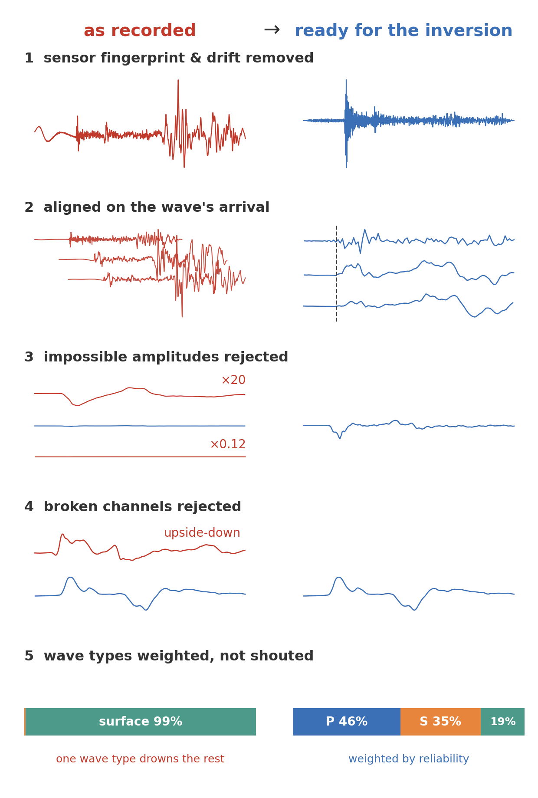
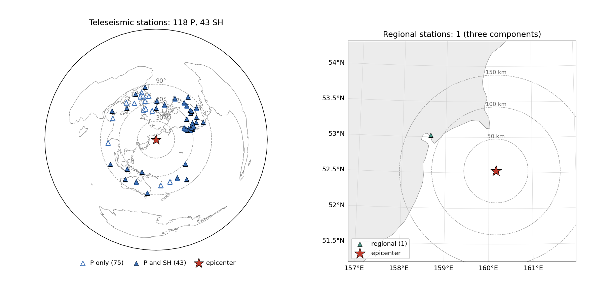
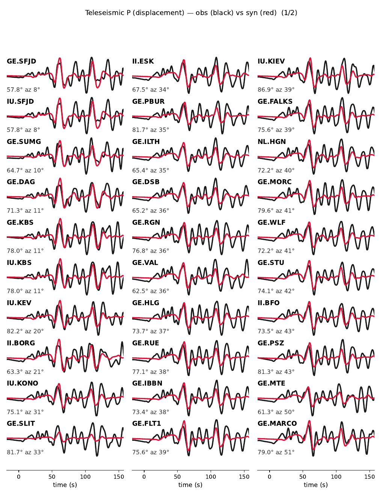
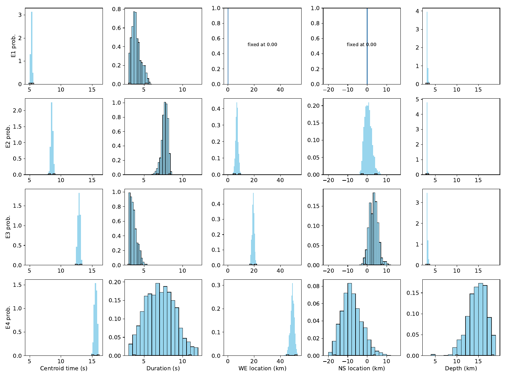

# SubMIT——大地震的贝叶斯多子事件反演

[English](README.md) | [中文](README.zh-CN.md)

SubMIT 把一次大地震描述为**少数几个子事件**（subevent）：每个子事件是一个点源，有各自的时间、位置、深度、持续时间和矩张量（moment tensor，即断层错动的“类型”）。它寻找能最好地解释全球各地和震源附近记录到的数百条地震图的子事件，**用马尔可夫链蒙特卡洛（MCMC）估计它们的不确定性**，并**选择数据真正支持的子事件个数**。

> **全自动流程**。一条命令即可把下载的波形一路处理成最终图件，无需任何人工调参：
>
> * **数据筛选**——自动发现并剔除损坏、幅值标定错误或极性反转的台站；
> * **参数配置**——时间窗、频带、搜索范围、各波型的权重以及基于余震（aftershock）的位置先验（prior），都由地震本身和数据推导得出；
> * **反演**——对 1、2、3……个子事件分别做贝叶斯 MCMC 反演，每个都给出不确定性；
> * **模型选择**——按固定规则选择子事件个数，需要时自动扩展搜索，最多到 7 个子事件；
> * **结果**——地图、矩率函数（moment-rate function）、后验（posterior）直方图、波形拟合、台站分布图以及一份文字总结。
>
> ```bash
> ./submit prepare /data/myevent && ./submit run /data/myevent
> ```

仓库附带四个经过验证的示例地震，每个都可以用一条命令复现。

该方法由 Jia 等（2020a、2020b、2022a、2025a）提出并应用；完整文献见[第 13 节](#13-致谢引用与许可)。


*以 2025 年堪察加 M 8.8 地震的结果说明方法原理。**(1)** 这次地震被描述为七个子事件。**(2)** 每个子事件以一个平滑脉冲释放其地震矩；所有脉冲之和就是这次地震的矩率函数。**(3)** 由于各子事件位于不同位置，破裂朝向的台站看到这些脉冲挤在一起到达，而另一侧的台站看到它们被拉开。在约 100–200 个台站上拟合这些差异，就能在空间和时间上确定子事件的位置。*

---

## v3 的改动

一些同事从零安装 v2，并把它用于 2026 年哥伦比亚 Mw 7.4 地震，报告了六个问题，而且它选出的子事件个数每次运行都不一样。因此，我用全新克隆的代码、在全新的 conda 环境中，把 v2 用于它从未见过的三次近期地震：2026-10-09 巴拿马 Mw 7.7（浅源）、2026-03-24 汤加 Mw 7.5（深 234 km）和 2025-12-08 青森 Mw 7.6。用这种方式发现的十四个问题中，只有两个使流程中断；在其中十个问题下，流程一直运行到最后，并画出了看似合理的图件。每个问题都是失败图谱（failure atlas）[PITFALLS.md](PITFALLS.md) 中的一个条目，附有实测代价、修复方法和回归测试。

| 部分 | v2 | v3 |
|------|----|----|
| 第 1 步，旋转 | 长度不等的水平分量未被旋转，却被当作 SH 拟合（委内瑞拉：56 条 SH 记录中有 26 条） | 先截取到共同时间窗，再旋转 |
| 第 1 步，区域（regional）台站的仪器 | 从不读取 `HH?`；只要存在 `HN?` 就丢弃 `BH?`；一个台站的每个传感器都参与拟合 | 每个台站一条记录，使用宽频带（broadband）记录，除非它限幅（clipping）或不一致（巴拿马：19 个台站中 4 → 17 个） |
| 第 1 步，区域信噪比（SNR） | 水平分量以 P 波尾波（P coda）为噪声来评分 | 所有分量都从 P 波到时开始评分（汤加：5 个台站中 1 → 5 个） |
| 正演模型 | 远震（teleseismic）时间以子事件 1 的深度为参考；sP 被平移两次 | 以震源（hypocenter）为参考，只平移一次（已发表的智利模型：数据失配（misfit）0.854 → 0.824） |
| 先验 | 走廊（corridor）连向它已经剔除的余震簇（堪察加：网格的 40%） | 只在保留下来的余震簇之间连走廊（16%） |
| 采样器 | 各链相互独立；选出的 N 可能取决于一条链 | 热启动（warm start）、重定位移动（relocation move）、种群重采样（population resampling）（第 4.5 节） |
| 子事件个数 | 失配落在最低失配 5% 以内的最小 N，这条规则不对每个子事件收取任何代价（委内瑞拉：三次运行分别选出 6、5 和 6 个子事件） | 赤池信息量准则（Akaike information criterion，AIC）：一个子事件的代价是 5% 的失配，并列（tie）的个数中取最小的（委内瑞拉：每次搜索都是 5 个；加州：三次都是 4 个）；并列会被列出（第 4.6 节） |
| 质心时间范围 | 只由震级决定；主要能量来得更晚的破裂会被截断（哥伦比亚：每条链都停在 31 s 的边界上，而质心时间实为 49.5 s） | 当第一次 1 子事件运行停在边界上时，把范围加倍并重做这次运行（第 5 节）；对更大的 N，最佳模型停在这个边界上的会被标出，且不会被选中（第 4.6 节） |
| 对照 1 子事件模型的台站筛选 | 当该模型不具代表性时整个跳过，九个地震中有六个如此（瓦努阿图：保留了一条漂移记录，占 P 波失配的 68%） | 在反演频带内高出所在组 8 倍以上的记录总会被剔除（第 5 节） |
| 系统 | 全新克隆中没有 `greenFuncDir_disp`，随后清理步骤删除了所有格林函数（Green's function）；数组大小固定为 100 个远震台站；不检查退出码；`-Ofast` 下失配为 NaN | 已修复 |

**三个测试地震的结果**：在全新安装中从原始下载数据开始运行，每次使用 16 个 MPI 进程（即 MPI rank；命令为 `./submit prepare` 和 `./submit run`；v2 与 v3 的失配不可比较，因为两者的数据和时间参考不同）：

| 地震 | v2 | v3 |
|-------|----|----|
| 2026 年巴拿马 Mw 7.7 | 4 个区域台站；N = 2，取决于 16 条链中的 1 条（中位数链的最佳值差 17%） | 17 个区域台站；两个随机种子（seed）都给出 N = 4，两条 L 曲线（L-curve）在每个 N 上相差都在 0.4% 以内，四个子事件相同（第四个位于西 42 km、北 29–30 km，时间为 22–23 s） |
| 2026 年汤加 Mw 7.5，深 234 km | 1 个区域台站；在第 3 步中断（数组上限） | 5 个区域台站；N = 1（第二个子事件使失配上升 1.3%），所有链都在 1% 以内，split R-hat ≤ 1.12 |
| 2025 年青森 Mw 7.6 | 232 个远震台站；在第 3 步中断（数组上限） | 稀疏化到 100 个；N = 3（第四个子事件使失配降低 3.2%），所有链都在 2% 以内，split R-hat ≤ 1.14，Mw 7.59 |

巴拿马的两个随机种子在模型和 N 上都一致：第四个子事件使失配降低 7.2% 和 7.1%，第五个子事件使失配降低 1.9% 和 1.4%（第 4.6 节）。在两次运行中，最佳 4 子事件模型都是在最后一轮重采样之后才找到的，分别由 16 条链中的 1 条和 3 条找到，而且其后验没有收敛（split R-hat 最高达 5.5）。对于这样的破裂，在解读 4 子事件后验之前，应当用 32 个进程或更长的链运行 N ≥ 4。在一台共享的 AMD EPYC 7532 机器上，每次运行分别耗时 67 分钟（青森）、83–89 分钟（巴拿马）和 143 分钟（汤加，其 234 km 的深度需要 64 个深度上的格林函数）。这些运行使用的是下文所述审查修复之前的代码；每项修复都单独测试过。

在这些测试进行的同时，对新代码做了一次独立审查，又报告了十一个缺陷，均已确认并修复（[PITFALLS F](PITFALLS.md#f--found-by-review)）。其中两个继承自 v2，影响所有已发表的后验：违反硬性规则的提议（proposal）被重新抽取，而不是被拒绝；先验向西南偏移了半个网格单元（2 km）。

**第二份报告**（2026-11-16）附带了用 v2 重跑四次地震的文件夹：随附的智利示例和三次中深源地震。在每一个地震中，失配都在某个子事件个数处上升，而且选出的个数在各次运行之间发生变化。用 v3 重新运行（每个地震两个随机种子）之后，这四个案例有三种不同的原因：

| 地震 | 报告中的 v2 重跑 | v3 | 原因 |
|-------|-------------------------|----|-------|
| 2024 年智利 Mw 7.4（随附示例） | N = 3，而已发表的运行用同样的输入选出 4：4 子事件搜索的结果高于 3 子事件（0.948 对比 0.897） | 三次搜索都给出 N = 4：16 个进程，以及 32 个进程下的两个随机种子（4 子事件的失配为 0.731、0.732 和 0.734） | 各链相互独立（[PITFALLS D1](PITFALLS.md#d1--one-lucky-chain-decides-the-number-of-subevents)） |
| 2026 年哥伦比亚 Mw 7.4，深 116 km | N = 1，随后 N = 3；失配为 3.3–4.0 | 2026-11-16 的流程：两个随机种子都给出 N = 1，每条链都停在质心时间范围的上界（31 s）。流程把范围加倍之后：两个随机种子都给出 N = 2，两条 L 曲线在每个 N 上相差都在 0.4% 以内，两个子事件也相同（一个位于震中、持续 24–27 s 的长子事件，和一个在 50 s、位于西南 41 km、持续 5 s 的短子事件） | 质心时间范围在破裂的主要能量之前就结束了（[D4](PITFALLS.md#d4--the-centroid-range-cut-off-a-late-main-rupture)） |
| 2026 年瓦努阿图 Mw 7.3，深 121 km | 两次都是 N = 1，从一个子事件到两个子事件失配上升 | 2026-11-16 的流程：两个随机种子都给出 N = 1，两个子事件时失配高 10–15%。加入记录筛选之后：两个随机种子都给出 N = 1；第二个子事件在一次搜索中使失配降低 3.4%，在另一次中使失配上升 2.3%。三个子事件的拟合好 11%，但第三个子事件位于搜索范围的角落（28 s 范围中的 28.0 s，东向 53 km 范围中的 53 km），拟合的是三个区域台站；这样的模型会被标出，且不会被选中。手动把范围加宽到 55 s 之后，这个子事件停在 31.5 s、深度网格的顶部，它的 P 波到达时间介于前两个子事件的 pP 震相之间 | 一条漂移记录承担了 68% 的 P 波失配（[A6](PITFALLS.md#a6--a-drifting-record-passed-both-station-screens)）；此后，一个停在范围边界上的子事件赢得了选择（[D5](PITFALLS.md#d5--a-subevent-in-the-corner-of-its-search-range-won-the-selection)） |
| 2026 年汤加 Mw 7.5，深 234 km | 两次都是 N = 1，每增加一个子事件失配都上升 | N = 1（16 个进程，用报告中的数据）：第二个子事件使失配上升 3.6%，直到 5 个子事件，没有哪个模型比一个子事件好 1.2% 以上；16 条链全部落在 1% 以内，split R-hat ≤ 1.13 | 无：一个子事件就是答案 |

**启示：“选出的个数不稳定”是一个症状，背后有三种原因；只有逐一测量才能把它们区分开：用两个随机种子检验搜索，检查最佳模型在搜索范围中的位置，以及每条记录在失配中所占的份额。**

正演模型现在是一个文件（`programs/code_SubMIT/forward_model.c`）。把两项时间参考修复也打进 v2 代码之后，两者给出相同的失配（加州 3 子事件模型 1.792850；智利 4 子事件模型 1.074403，对比 1.074404）、相同的矩张量和相同的对齐时移；新代码每次迭代的速度约快一倍（16 个进程上 6,000 次迭代：559 s 对比 1,156 s）。反演核心从 10 个文件、5,626 行（其中包括两份已经分叉的正演代码副本）缩减到 3 个文件、2,169 行；整个流程从 90 个文件、13,800 行（外加一个 42,694 行的数值库，v2 只用到其中几个函数）缩减到 58 个文件、8,971 行。第 3 步和第 4 步各是一个脚本（`step3_do_inversions.sh`、`step4_figures.sh`），而 v2 中有四个；三个 1 子事件校准钩子合并为一个（`calibrate_from_1sub.sh`）。`tests/test_regressions.py` 守护那些不需要 SAC 或 MPI 就能测试的修复。

**随附的示例（第 2 节和第 6 节）是 v3 的运行结果**。每个示例都在 2026-11-17 从原始下载数据出发、用 32 个 MPI 进程重新运行，`examples/<name>/` 中保存的就是这次运行：第 1 步得到的记录、每个反演的配置、最佳模型和图件（`tools/make_example_from_run.py`）。与它们所取代的 v2 结果相比，加州有四个子事件（v2 为三个），委内瑞拉有五个（v2 为六个）；智利和堪察加仍是四个和七个。第 6 节说明了每个模型的变化。

**启示：一条能跑到最后的流程，不等于一条正确工作的流程。这些缺陷大多是通过检查某一步本应产生的性质（一个已旋转的分量、一个时间参考、一个覆盖余震的先验）发现的，而不是通过寻找报错发现的。**

## 目录

0. [v3 的改动](#v3-的改动)
1. [快速开始：用三条命令复现一个示例](#1-快速开始)
2. [四个示例地震](#2-四个示例地震)
3. [安装](#3-安装)
4. [方法原理（含公式）](#4-方法原理)
5. [自动化流程](#5-自动化流程)
6. [示例结果](#6-示例结果)
7. [数据：下载什么、如何下载](#7-数据)
8. [反演你自己的地震](#8-反演你自己的地震)
9. [解读输出结果](#9-解读输出结果)
10. [使用 AI 编程助手](#10-使用-ai-编程助手)
11. [故障排查](#11-故障排查)
12. [仓库结构](#12-仓库结构)
13. [致谢、引用与许可](#13-致谢引用与许可)

---

## 1. 快速开始

在一台装有 SAC、MPI 库、Fortran/C 编译器、Java 和 conda 的 Linux 机器上（[详见安装说明](#3-安装)）：

```bash
git clone https://github.com/jiazhe868/SubMIT.git && cd SubMIT
conda env create -f environment.yml && conda activate submit

./submit check                         # 所有依赖都装好了吗？
./submit build                         # 编译随附的格林函数代码
./submit example california            # 复现 2024 年加州 M7.0 地震的结果（约 10 分钟）
./submit compare california            # 与随附的数字对比
```

图件和一份总结（`RESULTS.md`）会出现在 `work/california/IRIS/figs_and_results/` 中。`./submit compare` 会打印类似下面的表格（来自另一台机器上的一次运行，16 个核心上耗时 6 分钟）：

```
L-curve (best penalized misfit for each number of subevents)
  n  published  reproduced     diff
  1     2.3857      2.3857    +0.0%
  2     1.8898      1.8898    +0.0%
  3     1.6189      1.6189    +0.0%
  ...
selected number of subevents: published 4, reproduced 4

selected 4-subevent model (published -> reproduced)
          time (s)               x,y (km)     depth (km)      dur (s)          Mw  MT sim
E1     5.2->5.2        0,0   ->    0,0       3.0->3.0      3.7->3.7   6.58->6.58 +1.00
E2     8.5->8.5        6,2   ->    6,2       3.0->3.0      8.1->8.1   6.87->6.87 +1.00
E3    12.8->12.8      19,4   ->   19,4       3.1->3.1      3.5->3.5   6.50->6.50 +1.00
E4    15.4->15.4      48,-13 ->   48,-13    16.0->16.0     5.5->5.5   6.73->6.73 +1.00
total Mw: published 7.04, reproduced 7.04
```

表中的 “published” 指随示例附带的数字：即 2026-11-17 从原始下载数据出发、用 32 个 MPI 进程完成的 v3 运行的结果。这个默认模式采用那次运行的 L 曲线和最佳模型，并重新计算格林函数、正演模型和矩张量。

### 复现示例的三种方式

| 模式 | 作用 | 32 核上的耗时 |
|------|--------------|------------------|
| `--mode figures`（默认） | 重建格林函数，并用已发表的最佳模型重新生成所有图件 | 6–13 分钟 |
| `--mode frozen` | 用与发表时完全相同的配置文件重新运行所有 MCMC 反演，然后选择子事件个数 | 1.5–4 小时 |
| `--mode full` | 从处理好的波形开始运行整个自动化流程：筛选、加权、先验、反演、选择、图件 | 1.5–4 小时 |

```bash
./submit example chile --mode frozen      # 重新运行智利示例的反演
./submit example chile --mode full        # 从波形重新推导一切
./submit example chile --mode full --quick   # 10 分钟冒烟测试（数字没有意义）
./submit status chile                     # 正在运行的示例的进度
./submit list                             # 所有随附的示例
```

如果用 `nohup ./submit example kamchatka --mode frozen > kam.log 2>&1 &` 启动，长时间的运行在你退出登录后仍会继续。

用 32 个 MPI 进程在共用服务器（AMD EPYC 7543 和 7552）上实测的耗时如下。随附的各次运行，从原始下载数据到图件（`./submit prepare` 和 `./submit run`），分别用了 1 小时 34 分钟（智利）、1 小时 44 分钟（委内瑞拉）、1 小时 49 分钟（加州）和 3 小时 43 分钟（堪察加，七个子事件个数）。`figures` 模式用了 6 分钟（加州，16 核）、13 分钟（智利）、9 分钟（委内瑞拉）和 9 分钟（堪察加）。`frozen` 模式用了 1 小时 27 分钟（智利）、1 小时 38 分钟（加州）和 1 小时 42 分钟（委内瑞拉），加州的 `full` 模式用了 1 小时 47 分钟。用 v2 时，仅反演就需要约 3 小时（加州）到 14 小时（堪察加）。

`frozen` 模式会重复随附的链。用 32 个 MPI 进程和相同的编译器，在同一台服务器或另一台服务器上重新运行，加州、智利和委内瑞拉的 frozen 模式写出的链文件与随附运行的链文件逐字节相同（分别为 160、160 和 192 个文件），L 曲线与随附的 L 曲线在打印出的每一位数字上都一致。如果进程数（`SUBMIT_NCORE`；默认为物理核数，最多 32）或编译器不同，链就会不同，失配则在第 4.6 节测得的搜索噪声范围内一致。`full` 模式从随附的第 1 步记录（`inputs.tar.gz`）以及存档的余震目录和矩张量（`catalog/`）出发，重新推导其余的一切：台站筛选、权重、搜索范围、格林函数、先验和子事件个数的网格。在另一台服务器上，加州的 `full` 模式最终得到的 L 曲线和 160 个链文件也与随附的运行相同。

---

## 2. 四个示例地震


| 示例 | 地震 | 深度 | 选出的子事件个数 | 总 Mw（目录值） | 最佳失配 |
|---------|-----------|-------|:------------------:|:------------------:|:-----------:|
| `chile` | 2024-07-19 智利–阿根廷边境 | 123 km（板片内，intraslab） | **4** | 7.41（7.4） | 0.732 |
| `california` | 2024-12-05 门多西诺角近海 | 浅源走滑（strike-slip） | **4** | 7.04（7.0） | 1.499 |
| `venezuela` | 2026-06-24 委内瑞拉近海 | 浅源，双震（doublet） | **5** | 7.59（7.2 和 7.5） | 2.056 |
| `kamchatka` | 2025-07-29 堪察加俯冲带大型逆冲断层（megathrust） | 浅源俯冲 | **7** | 8.84（8.8） | 0.819 |

选择这些地震，是为了覆盖本方法必须处理的各类问题：一个深度震相（depth phase）到达较晚的深源地震（智利）、一个有密集区域台网的走滑地震（加州）、一个由相隔 30 s、相距 150 km 的两次地震组成的双震（委内瑞拉），以及一次长度超过 350 km 的俯冲带大型逆冲破裂（堪察加）。失配值只能在*同一个*地震的不同运行之间比较（[原因](#misfit)）。详细结果见[第 6 节](#6-示例结果)。

---

## 3. 安装

SubMIT 运行在 Linux 上（在 Ubuntu 22.04 上测试过）。你需要：

| 依赖 | 用途 | 获取方式 |
|-------------|-----|---------------|
| **SAC**（含 `libsac.a`、`libsacio.a`） | 读写地震图、数据处理 | 向 [IRIS/EarthScope](https://ds.iris.edu/ds/nodes/dmc/forms/sac/) 申请；把 `sac` 加入 `PATH`，并按其安装说明设置 `SACAUX` |
| **MPI** + **C 和 Fortran 编译器** | 反演在每个 MPI 进程上运行一条马尔可夫链 | Open MPI 或 MPICH 加 `gcc`/`gfortran`（`sudo apt install libopenmpi-dev gfortran`），或 Intel oneAPI（`mpiicx`/`mpiifx`，更快） |
| **Java** | TauP 走时（travel time）计算（已随附） | `sudo apt install default-jre` |
| **Perl、gawk** | 格林函数和数据处理脚本 | 通常已预装 |
| **wget、unzip** | 仅用于可选的智利强震（strong-motion）数据下载（`./submit fetch-csn`） | 通常已预装 |
| **Python 3 + 软件包** | 数据准备、筛选、绘图 | `conda env create -f environment.yml` |
| 每个示例约 2–4 GB 磁盘空间 | 格林函数 | |
| 互联网连接 | 对新地震，第 2 步要查询 USGS 目录；地图会下载一次海岸线 | 复现示例时不需要，海岸线除外 |

然后：

```bash
conda activate submit
./submit check     # 列出缺少的任何依赖
./submit build     # 编译 fk、mtel3，并试编译一次反演代码
```

反演代码和正演代码（`finv`、`ffwd`）会在每个运行目录中自动编译，因此它们总是与该次运行的配置一致。编译时如果找到 Intel oneAPI 就使用它，否则使用 GNU 的 MPI 包装器；给 `./submit example` 加上 `--gnu` 可以强制使用 GNU 工具链（本 README 中的所有检查都是用 GNU 完成的）。使用 Intel 时，如果你的 `setvars.sh` 不在 `/opt/intel/oneapi/` 中，请让 `INTEL_SETVARS` 指向它。

有用的环境变量：`SUBMIT_PYTHON`（使用哪个 Python）、`SUBMIT_NCORE`（MPI 进程数；默认为物理核数，最多 32）、`SACHOME`（当 `sac` 不在 `PATH` 中时）。

---

## 4. 方法原理

### 4.1 子事件模型

这种参数化沿用 Jia 等（2020a、2020b、2022a）的做法。每个子事件 $`i = 1 \dots N`$ 具有以下参数：

| 符号 | 含义 | 类型 |
|--------|---------|------|
| $`t_i`$ | 相对发震时刻（origin time）的质心（centroid）时间 | 非线性（搜索） |
| $`x_i, y_i`$ | 相对震中（epicenter）向东/向北的水平位置（有两个或更多子事件时，子事件 1 固定在震中；只有一个子事件时它可以移动） | 非线性 |
| $`z_i`$ | 质心深度 | 非线性 |
| $`T_i`$ | 持续时间 | 非线性 |
| $`\mathbf m_i`$ | 偏矩张量（deviatoric moment tensor）的五个独立分量 | 线性（精确求解） |

因此，$`N`$ 个子事件共有 $`5N`$ 个非线性未知数和 $`5N`$ 个线性未知数。子事件*内部*的破裂方向性（directivity）可以开启，但默认关闭（`Input.model` 中的 `vr = 0.01 km/s` 使每个子事件成为点源）；整个地震的方向性由子事件的空间排列体现出来。

每个子事件以高斯形矩率函数释放其地震矩，该函数在峰值 10% 处的全宽就是子事件的持续时间。在台站 $`j`$ 看来，它被平移一个时间 $`\Delta t_{ij}`$，其大小取决于子事件所在的位置（第 4.2 节）：

```math
s_{ij}(t) = \frac{1}{\sqrt{2\pi}\,\sigma_i}\exp\!\left[-\frac{(t-t_i-\Delta t_{ij})^2}{2\sigma_i^2}\right],
\qquad \sigma_i = \frac{T_i}{2\sqrt{2\ln 10}} .
```

### 4.2 正演问题：预测地震图

台站 $`j`$ 处的预测位移，是各子事件的矩张量分量乘以格林函数、再与该子事件的矩率函数做卷积之后的总和：

```math
u_j(t) \;=\; \sum_{i=1}^{N}\sum_{k=1}^{5} m_{ik}\;\big[\,G_{jk}(z_i,\,t) * s_{ij}(t)\,\big].
```

对于**远震 P 波和 SH 波**（台站距离约 40°–90°），格林函数 $`G_{jk}`$ 用射线理论代码 `mtel3` 在台站的距离上、以 2 km 间隔的深度网格计算（线性插值到 $`z_i`$），震源一侧的地壳采用 CRUST1.0。子事件的位置通过一个相对于震源的时间平移进入计算：

```math
\Delta t_{ij} \;=\; -\,\frac{r_i}{c_j}\cos(\phi_j-\psi_i)\;-\;(z_i-z_0)\,\eta_j,
\qquad \eta_j=\sqrt{v^{-2}-c_j^{-2}},
```

其中 $`(r_i,\psi_i)`$ 是子事件相对震中的距离和方位角，$`z_0`$ 是目录给出的震源深度，$`\phi_j`$ 是台站方位角，$`c_j`$ 是射线的视水平速度（由 TauP 给出），$`\eta_j`$ 是震源处的垂直慢度（P 波或 S 波速度为 $`v`$）。第一项产生了顶部图中脉冲的挤压/拉伸。

参考深度取 $`z_0`$，是因为数据按第 1 步为震源计算的到时（SAC 头段 `t1`）对齐，而 `mtel3` 把每个网格深度的直达波都放在同一时刻。深度震相（pP、sP、sS）在每个深度的格林函数中已经有了正确的延迟，因此整个格林函数只需要这一次平移。直到 v2，参考深度一直是子事件 1 的深度：只要子事件 1 离开目录深度，P 波和 SH 波就会被平移不同的量，而且 sP 还会再受到一次按 S 波计算的平移（[PITFALLS B1, B2](PITFALLS.md#b--forward-model)）。

对于**区域三分量记录**（台站距离可达约 750 km），格林函数用频率-波数（frequency–wavenumber）代码 `fk` 在 1-D CRUST1.0 模型中、在距离-深度网格上计算；每个子事件使用对应其*自身*到台站的距离和方位角的格林函数（双线性插值），因此时间是精确的，而不是近似的。

所有记录都按与数据相同的方式做带通滤波（默认远震 0.005–0.2 Hz，区域 0.02–0.15 Hz；对某些延展较大的破裂会更窄）。

### 4.3 线性步骤：矩张量

对每一组试探的非线性参数 $`\theta`$，矩张量用阻尼最小二乘求得，并附加一个约束：它们的总和要接近整个地震的目录矩张量（GCMT 或 USGS）：

```math
\hat{\mathbf m}(\theta) = \arg\min_{\mathbf m}\;
\big\|\mathbf W\big(\mathbf G(\theta)\,\mathbf m-\mathbf d\big)\big\|^2
\;+\;\alpha^2\|\mathbf m\|^2
\;+\;\lambda^2\Big\|\sum_{i=1}^N \mathbf m_i-\mathbf m_{\mathrm{CMT}}\Big\|^2 ,
\qquad \lambda = \kappa_{\mathrm{CMT}}\,\frac{\|\mathbf W\mathbf d\|}{M_0^{\mathrm{CMT}}} .
```

$`\mathbf W`$ 包含三种波型（P、SH、区域；[第 5 节](#5-自动化流程)）的权重，$`\alpha`$ 是一个小的 Tikhonov 阻尼（`Tikhonov_alpha`），$`\kappa_{\mathrm{CMT}}`$（`CMTscaling`，默认 3；如需修改，在第 2 步之前设置 `SUBMIT_CMTSCALING`）决定总矩张量被锚定的牢固程度；它按数据范数缩放，因此同一个值对 M 6.9 和 M 8.8 的地震都适用。这个问题在不到一秒内就能精确求解（Cholesky 分解），所以矩张量不需要采样。

### 4.4 失配与物理惩罚项 <a name="misfit"></a>

每条预测波形通过互相关与数据对齐（时移 $`|\tau_j|\le\tau_{\max}`$：P 波 2 s，SH 波 5 s，区域记录按距离缩放），失配同时考虑振幅和波形形状的吻合程度：

```math
\chi(\theta) \;=\; \frac{\displaystyle\sum_j \big\|d_j(t+\tau_j)-u_j(t)\big\|^2\; e^{\,|1-C_j|}}
                        {\displaystyle\sum_j \|d_j\|\,\|u_j\|},
```

其中 $`C_j`$ 是相关系数。接近 1 的值意味着“残差能量与信号相当”；这些值取决于台站集合、时间窗和权重，因此只能在同一个地震的不同运行之间比较失配。

两个惩罚项使解保持物理上合理：

```math
\Phi(\theta) \;=\; \chi(\theta)\;
\exp\!\Big(\frac{\bar\epsilon}{\kappa}\Big)\;
\exp\!\Big(\max\!\big(0,\tfrac{\Theta_P}{30^\circ}-1\big)+\max\!\big(0,\tfrac{\Theta_T}{30^\circ}-1\big)\Big).
```

* **双力偶惩罚**。$`\bar\epsilon=\sum_i \sqrt{\epsilon_i}\,M_{0,i}/\sum_i M_{0,i}`$ 是按地震矩加权的非双力偶（CLVD）成分；$`\kappa`$ 即 `DCconstrain`（默认 1）。
* **应力一致性惩罚**。$`\Theta_P`$（$`\Theta_T`$）是在*所有*子事件中，子事件的压力轴（张力轴）与总矩张量的压力轴（张力轴）之间的最大夹角。各子事件的机制可以在整体机制的 30° 范围内自由旋转；超出这一范围，失配按指数增长。每个子事件都计入，无论多小，因此一个很小的子事件无法用一个不合理的、相反的机制去“吸收”无法解释的能量。

### 4.5 贝叶斯采样

非线性参数的后验概率为

```math
p(\theta\mid\mathbf d)\;\propto\;\exp\!\left[-\frac{\Phi(\theta)}{2\sigma^2\,\Phi_{\min}}\right]\pi(\theta),
\qquad \sigma = 0.05 ,
```

也就是说，失配比已找到的最佳值（$`\Phi_{\min}`$）高出几个百分点的模型仍然是合理的。先验 $`\pi(\theta)`$ 为

```math
\pi(\theta) \;\propto\; \prod_{i=1}^N \rho(x_i,y_i)\;\times\;
\mathbb 1\!\left[\;t_{i+1}-t_i \ge 2.5\,\mathrm s,\;\; t_i \ge T_i/2,\;\;
|\mathbf x_i-\mathbf x_1| \le v_{\max}\,(t_i-t_1),\;\; \theta\in\text{bounds}\right],
```

其中 $`\rho`$ 是平滑后的余震分布图（在发生过余震的地方，子事件出现的可能性更大），子事件按时间顺序编号，因果性条件（默认 $`v_{\max}=1.5\,V_S`$）禁止那些要求破裂传播速度快于合理范围的子事件。

后验用**最多 32 条并行马尔可夫链**（每个 MPI 进程一条）采样，采用 Metropolis–Hastings 算法，包括单参数移动、沿学习到的后验协方差的自适应联合移动（Haario 等，2001，调节到 23% 的接受率），以及沿其主方向的一维移动。

**为什么要用链的种群**。通常的做法是让各条链独立运行，再把收敛的链合并起来。这个后验的峰太尖，这种做法行不通：一个失配差 1% 的模型，其概率密度是最佳模型的 $`e^{-2}`$，每条链都会停在它找到的第一个好的众数（mode）上。在加州 3 子事件配置上，16 条独立链运行结束时，有 1 条链落在最佳失配的 2% 以内，中位数链差 34%；在已发表的 v2 运行中，32 条链里通常有 2–6 条进入最佳值的 2% 以内。因此，我把这些链组织成一个种群（`programs/code_SubMIT/finv.f90`）：

```
重定位：    5% 的提议把一个子事件移到从先验中抽取的位置
热启动：    一半的链从最佳 (N-1) 子事件模型加一个新子事件开始
重采样：    在预烧期（burn-in）的 25、50 和 75% 处，每条链从它所在的 8 链岛（island）中按权重
            exp(-dPhi / (2 sigma^2 Phi_min)) 抽取一条链并复制它；最后一轮从所有链中抽取
硬性规则：  违反某条硬性规则的随机游走提议记为一次拒绝（v2 会重新抽取直到满足规则，
            这样采样的是后验乘以可行提议所占的比例，低估了靠近边界以及靠近时间间隔
            规则和因果性规则的状态）
```

加入重采样后，在八次 12,000 次迭代的测试运行中，有七次的 16 条链里有 10–16 条落在最佳值的 2% 以内。各条链仍然没有全部找到同一个众数。最终版本的采样器用两个随机种子得到的最佳失配为 1.840 和 1.844；它的一个早期版本（会重新抽取不可行的提议）得到 1.761、1.840 和 1.847，其中最低的那个解的第三个子事件位于震中以东，而不是以西。一个比通常众数低 4.5% 的众数在 5 次运行中出现了 1 次，这个差距几乎和第 4.6 节要求一个子事件带来的 5% 一样大。最后一轮之后，每条链都源自同一个岛，因此各链之间的一致并不能说明这种离散。在那一轮之前，各个岛是相互独立的搜索，`lcurve.txt` 对每个 $`N`$ 都列出它们的最佳失配（`island_best_misfits.txt`）。

链长随 $`N`$ 增长：预烧期 3000·N 次迭代，采样 1000·N 个。集体步骤发生在固定的迭代次数处，因此用相同的进程数、编译器和机器重新运行，会重复出相同的链（在不同机器负载下的两次 4 进程运行，分别耗时 47 s 和 83 s，写出了完全相同的文件）。在装有相同编译器的另一台机器上也是如此：从原始下载数据开始的整个加州运行（32 个进程、五个子事件个数），在两台服务器上写出了 160 个逐字节相同的链文件。

### 4.6 需要多少个子事件？

子事件越多，对数据的拟合总是至少一样好，因此反演对 $`N = 1, 2, 3, \dots`$ 逐一重复，还需要一条规则来判定哪些子事件是数据真正支持的。

**规则**。通常的做法是取 L 曲线的拐点（elbow），v2 也是这样做的：选最佳失配落在所有 $`N`$ 中最低失配 5% 以内的最小 $`N`$。这条规则不对每个子事件收取任何代价，而且它把每个 $`N`$ 都拿去和最大的那些 $`N`$ 比较，而后者的搜索最难完成。在委内瑞拉示例的 32 进程 v3 运行中，它舍弃了 5 个子事件，原因是 7 个子事件的拟合好 6.5%，折合每增加一个子事件 3.3%；在该示例的三次运行中，它分别选出 6、5 和 6 个子事件。因此，我用赤池信息量准则（AIC；Akaike，1974）来选择 $`N`$，它对每个自由参数都收取代价。

第 4.5 节的后验已经规定了失配的变化值多少。其中的 $`\sigma = 0.05`$ 是一个相对噪声水平：失配高 1% 的模型，概率密度是最佳模型的 $`e^{-2}`$，相当于数据中有 $`n = 1/\sigma^2 = 400`$ 个独立的值。对噪声水平未知的最小二乘问题，这个准则是 $`\mathrm{AIC} = n\ln(\mathrm{RSS}) + 2K`$（Burnham & Anderson，2002），其中 RSS 是残差平方和，$`K`$ 是自由参数的个数。一个子事件有 $`k = 10`$ 个自由参数：五个矩张量分量、质心时间、持续时间、深度和两个水平坐标。用失配代替 RSS，

```math
\mathrm{AIC}(N) \;=\; \frac{\ln \Phi_N}{\sigma^2} + 2kN ,
```

其中 $`\Phi_N`$ 是用 $`N`$ 个子事件找到的最佳失配（`programs/prepare_SubMIT/plot_lcurve.py`）。换句话说：**一个子事件的代价是 $`2k\sigma^2 = 5\%`$ 的失配**（准确地说：$`\ln\Phi`$ 必须降低 0.05，即失配降低 4.9%，AIC 才保持不变）。5% 不再是一个单独设定的数：它由后验所假设的噪声水平和一个子事件的参数个数决定。失配并不是单纯的平方和（第 4.4 节），$`\sigma`$ 也是一个假设的噪声水平，因此这是给一个子事件定的一个自洽的代价，而不是一项精确的统计检验。

**并列**。AIC 的通常用法是取值最低的那个 $`N`$。加州的两次 32 进程搜索只在链的随机种子上不同，它们表明这样做还不够。第五个子事件在一次搜索中使失配降低 4.8%，在另一次中降低 5.0%，正好落在它的代价 4.9% 的两侧，于是 AIC 最低的在第一次搜索中是 4 个子事件，在第二次中是 5 个。AIC 相差不到 2 的模型得到的支持相当（Burnham & Anderson，2002）。因此，凡是 AIC 与最低值相差不到 2 的 $`N`$ 都算并列，`lcurve.txt` 会把它们列出来，而**选出的是并列的 $`N`$ 中最小的那个**：更大的 $`N`$ 必须明显更好才会被选中。加州的两次搜索都列出了 4 和 5 的并列，也都选出 4。在另外两次搜索中，第五个子事件使失配变化 −1.8%（16 个进程）和 +1.3%（32 个进程，质心时间范围更宽；[第 6 节](#6-示例结果)）。这些模型说明了同一件事。两个 4 子事件模型在时间和位置上一致：每个子事件与另一个模型中对应的子事件相差不超过 0.35 s 和 9 km（第四个子事件的深度不同，分别为 16 km 和 4 km）。两个 5 子事件模型的第四个子事件则相距 46 km。委内瑞拉的第六个子事件是示例中的另一处并列（32 个进程：它使失配降低 4.8%，AIC 比五个子事件高 0.2）。每个 $`N`$ 的最佳失配是一次随机搜索找到的值，因此它是真实最小值的上界，而且 $`N`$ 越大越难搜索。因此，一处并列在更深入的搜索中可能分出高下，并列的几个个数都应当报告。

四个示例每次运行选出的 $`N`$，分别按 5% 选择带和按上述规则：

| 示例 | 已发表的 v2 运行 | v3，16 个进程 | v3，32 个进程 | v3，32 个进程，另一组种子 |
|---------|:----------------:|:------------:|:------------:|:-------------------------:|
| 加州 | 3 → 3 | 4 → 4 | 5 → **4** | 5 → **4** |
| 智利 | 4 → 4 | 4 → 4 | 4 → 4 | 4 → 4 |
| 委内瑞拉 | 6 → **5** | 5 → 5 | 6 → **5** | 5 → 5 |
| 堪察加 | 7 → 7 | 7 → 7 | 7 → 7 | 7 → 7 |

按选择带，加州和委内瑞拉各自的几次独立 v3 搜索给出了不同的结果。按上述规则，每个示例的所有搜索都给出相同的 $`N`$。在迄今对九次地震完成的 21 次 v3 运行中（四个示例，以及[v3 的改动](#v3-的改动)中的五个测试地震），每个被保留的子事件都使失配至少降低 7.0%，而第一个被舍弃的子事件最多使失配降低 5.0%。

如果 AIC 最低的 $`N`$ 就是已尝试的最大 $`N`$，网格会自动扩展，上限为 7 个子事件（`./submit` 中的 `max_subevent_count`）。决定是否扩展的是最低的 AIC，而不是选择结果：如果网格止于 5，而 4 和 5 并列，这时停下来就永远不会尝试可能明显好于两者的 6 个子事件。子事件多于 7 个的模型很难解释为相互独立的破裂：在 Mw 8.8 堪察加示例的 v3 重跑中，两次独立的 8 子事件搜索结果不一致（0.775 和 0.801），而 7 子事件的两次搜索结果一致（0.8197 和 0.8198）。如果 AIC 在上限处仍然最低，`lcurve.txt` 会把选择结果报告为一个下限。

**停在范围边界上的最佳模型**。在使用 AIC 之前，还有一个条件。在[v3 的改动](#v3-的改动)中的瓦努阿图测试地震里，三个子事件的拟合比一个子事件好 11%，而且两次搜索的结果一致。两次搜索都把第三个子事件放在 28.0 s，而质心时间范围止于 28 s；它同时位于搜索范围的东边界上。从两个到三个子事件，P 波和 SH 波的失配上升，三个区域台站的失配则从 0.54 降到 0.31。位于搜索范围角落的子事件是一个受约束的最优解：它从范围所允许的边缘去拟合更晚的矩释放，或者模型没有预测到的震相。因此，如果某个 $`N`$ 的最佳模型的最后一个子事件落在质心时间范围的最后 1% 以内，这个 $`N`$ 在表中的 AIC 位置会写成 `bound`，在 `lcurve.pdf` 中画成空心点，并且不会被选中。这样，瓦努阿图在两次搜索中都选出一个子事件。对一个子事件的情形，流程会自行加宽范围（[第 5 节](#5-自动化流程)）；对更多的子事件，则需要手动加大范围和时间窗（[第 11 节](#11-故障排查)），因为更宽的范围也会给这样的子事件更多空间。在瓦努阿图，把范围加宽到 55 s 之后，它停在 31.5 s、深度网格的顶部，比前两个子事件浅 60 km，它的 P 波到达时间介于这两个子事件的 pP 震相之间（[PITFALLS D5](PITFALLS.md#d5--a-subevent-in-the-corner-of-its-search-range-won-the-selection)）：它看起来像是模型没有预测到的深度震相能量，是否保留它要由用户决定。**两次搜索结果一致，说明搜索可以重复，并不说明最佳模型没有靠在边界上。**

**每个 $`N`$ 搜索得有多充分？** `lcurve.txt` 对每个 $`N`$ 列出两项：落在最佳值 1% 以内的链数，以及每个岛在最后一轮重采样之前的最佳失配（第 4.5 节）。岛的最佳值可能略低于同一行的最佳失配（加州的第二次搜索，6 个子事件：1.3504 对 1.3572），因为最佳失配是预烧期结束之后的最佳样本，而预烧期经过的一些模型，采样阶段不会再次访问。热启动需要空位。新子事件在时间上必须与相邻子事件相隔 2.5 s，而加州的 4 子事件模型（质心时间 5.2、8.5、12.8 和 15.4 s，搜索范围止于 16 s）没有留下这样的空位。因此，它的 5 子事件和 6 子事件搜索中，每条链都从先验开始（第 3 步在每次反演后打印这个数目），各岛的结果相差 15% 以上，从 5 个到 6 个子事件失配上升。加州的这两次搜索还量出了一次搜索离最小值有多远：数据和配置相同、种子不同，它们的最佳失配在 2 个子事件时相差 5.4%（1.890 和 1.792，两次搜索都从先验开始），在 4 个和 5 个子事件时相差 1.4–1.6%。L 曲线上每一步的精度不会比这更高，这也是要求更大的 $`N`$ 必须有明显改进的又一个理由。v2 对每个 $`N`$ 都从先验开始，它的曲线随 $`N`$ 时升时降：用 v2 重跑随附的智利示例时，4 子事件搜索止于 0.948，高于 3 子事件的 0.897，于是选出 3 个子事件，而已发表的运行用同样的输入选出的是 4 个。

**启示：子事件个数是一个模型选择问题，它的阈值不是可以随意设定的。后验已经假设的噪声水平，决定了一个子事件的代价；当两个个数并列时，较小的那个才是几次独立搜索都认同的模型。**

**是什么在推动 L 曲线？** 这条规则比较的是带惩罚的失配，而带惩罚的失配是三个因子的乘积（第 4.4 节）：数据失配 $`\chi`$、CLVD 因子 $`e^{\bar\epsilon/\kappa}`$ 和应力因子。所以，从 $`N`$ 到 $`N+1`$ 的下降既可能来自对数据更好的拟合，也可能来自更小的惩罚，而两者的含义不同。因此，在每次反演之后，第 3 步用正演代码重新计算每条链的最佳样本，并把它的三个因子写入 `misfit_components.txt`（`programs/prepare_SubMIT/evaluate_misfit_components.sh`）。`lcurve.txt` 列出每个 $`N`$ 的最佳模型的三个因子，`lcurve.pdf` 把它们画在 L 曲线旁边，并附上应力惩罚所作用的最大 P/T 轴旋转角。如果一次运行是用别的代码采样的，那么每条链重新计算出的失配都会不同，三个因子的乘积也就不等于 L 曲线上的值；因此，只有当中位数链重新计算的失配与采样时的失配相差不超过 1% 时，才写出这张表。在四个示例的 v3 重跑（16 和 32 个 MPI 进程）的 944 个链最佳值中，除一个之外都相差不到 0.1%；那一个（0.15%，委内瑞拉 32 进程运行的一个 1 子事件样本）以 4 位小数存储，恰好位于失配的一个跳变旁边。在这些重跑中，这些因子显示了三件事：

- 每个示例、每个 $`N`$ 的最佳模型的应力因子都是 1.000，而最大轴旋转角在加州和委内瑞拉从 2 个子事件起、在智利从 4 个子事件起处于 26–30°（堪察加为 15–21°）。30° 锥体起的是界限的作用：最佳模型靠在这个界限上，而不是为它付出代价。
- 加州在 4 个和 5 个子事件之间的选择完全取决于数据失配。从 4 个到 5 个子事件，数据失配下降 6.6%，CLVD 因子上升 1.9%。两次独立搜索（16 和 32 个进程）在这两个 $`N`$ 上的 CLVD 因子相差不到 0.2%，但它们的数据失配在 $`N = 4`$ 时相差 2.3%，在 $`N = 5`$ 时相差 5.4%：5 子事件的搜索没有收敛。
- CLVD 惩罚可能造成第二个解。在 3 个子事件时，智利的 16 进程搜索让三个机制保持一致（最大轴旋转角 6°），但不是双力偶（数据失配 0.697 × CLVD 因子 1.150 = 0.802）；32 进程搜索把它们变成双力偶，并把其中一个转到 30° 界限（0.835 × 1.005 = 0.840）。智利从 2 个到 4 个子事件 26% 的下降中，18% 来自数据失配，10% 来自 CLVD 因子（1.146 → 1.032）：几个双力偶子事件可以叠加成非双力偶的总矩张量，而单个子事件做不到。

**惩罚项决定最佳模型落在哪里；一个选择是否稳定，取决于搜索在起决定作用的 $`N`$ 上对数据拟合得有多好。**


*失配（相对于各地震自身的最佳值）随子事件个数的变化。星号标出选择结果。由于惩罚项的作用，一旦额外的子事件不再得到数据支持，曲线就变平或上升。*

---

## 5. 自动化流程


每个自动决策做了什么，以及它为什么重要：

| 阶段 | 做了什么 | 原因 |
|-------|--------------|-----|
| **积分** | 远震速度记录转换为位移 | 反演拟合的是位移 |
| **筛选，第 1 阶段** | 剔除以下记录：振幅偏离台网中位数超过 8 倍（稳健的中位数/MAD）、信噪比过低（远震 5.5，区域 3）、通道失效，或区域记录被长周期漂移主导 | 一个损坏的传感器就可能使整个解产生偏差 |
| **格林函数** | 以目录深度为中心的深度网格，深源地震的网格更宽（半宽由 Wells & Coppersmith（1994）的破裂长度确定） | 深源破裂的子事件在深度上可能相距 50 km |
| **余震先验** | 取高于某一震级下限的 USGS 余震；用与前一年对比的泊松检验去除背景地震活动；去掉小的余震簇；在保留下来的簇之间用弱的平滑走廊连接 | 让子事件留在断层真正滑动过的地方；连向已剔除簇的走廊曾使先验覆盖堪察加网格的 40%，而不是 16%（[PITFALLS C1](PITFALLS.md#c--prior)） |
| **时间窗** | 足够覆盖整个破裂，对深源地震还要覆盖深度震相（pP、sP） | 一个 120 km 深的地震，其 sS 在 S 之后约 60 s 到达 |
| **1 子事件校准** | 用 1 子事件解确定 N ≥ 2 时搜索的时间范围和时间窗长度。如果它的质心时间落在由震级给出的范围的上界上，就先把每个 N 的这个范围加倍，并重做 1 子事件反演 | 防止晚到的子事件去拟合噪声；否则，主要能量比震级所暗示的来得更晚的破裂会被截断（2026 年哥伦比亚：范围止于 31 s，每条链都停在这个边界上；范围放宽之后，1 子事件的质心时间为 49.5 s） |
| **波型权重** | 迭代调整 P、SH 和区域记录的权重，直到它们对失配的贡献约为 1.2 : 1 : 1 | 否则最近、最大的记录会淹没其余记录 |
| **筛选，第 2 阶段** | 剔除与 1 子事件预测反相关（极性反转）或振幅相差 ×4（增益错误）的台站。在反演所用的频带和时间窗内，均方根（rms）超过所在组中位数 8 倍的记录也被剔除，这项检验不需要模型 | 前两类错误只有与模型对比时才会显现；第三项检验剔除了一条承担了 68% P 波失配的漂移记录（2026 年瓦努阿图，IM.IL31） |
| **一致的评分** | 用校准后的时间窗、权重和台站重新做 1 子事件反演 | 子事件个数是通过比较失配来选择的，只有每个 N 都在相同的数据上评分，这种比较才公平 |



*数据处理对这些地震真实记录的作用示例：去除漂移、按到时对齐、剔除不可能的振幅和一个极性反转的传感器，以及三种波型的加权。*

这条流程由一组 shell 步骤组成，你也可以在 `IRIS/` 文件夹中手动运行它们（`./submit` 做的就是这件事）：

```bash
bash ../programs/step2_prepare_inversions.sh        # 筛选、格林函数、先验、配置
bash ../programs/step3_do_inversions.sh             # N = 1、1 子事件校准、N = 1..5
bash ../programs/step3_do_inversions.sh 6           # 只跑 N = 6（文件夹 inv_<event>_6sub 必须已存在）
python ../programs/prepare_SubMIT/plot_lcurve.py    # L 曲线和选出的 N
bash ../programs/step4_figures.sh 4                 # N = 4 的正演模型 + 图件
```

当 AIC 最低的 $`N`$ 就是已尝试的最大 $`N`$ 时，`./submit run` 会自行创建下一个 $`N`$ 的文件夹。任何阶段失败都会使流程停止；v2 通过 `awk ... | sh` 运行各阶段，丢弃了它们的退出码（[PITFALLS E3](PITFALLS.md#e--systems)）。

---

## 6. 示例结果

这些是 v3 的结果。每个示例都在 2026-11-17 从原始下载数据出发运行（先 `./submit prepare`，再 `./submit run`，32 个 MPI 进程），`examples/<name>/` 中保存的就是这次运行。它们取代了本节此前展示的 v2 结果，每个小节都说明了有哪些变化。

| 示例 | 子事件个数（v2） | 最佳失配 | 落在最佳值 2% 以内的链数 | 最大 split R-hat | 平均相关系数 P / SH / 区域 |
|---------|:--------------:|:-----------:|:----------------------------:|:-------------------:|:----------------------------------:|
| `chile` | 4（4） | 0.732 | 32 条中的 26 条 | 2.4 | 0.72 / 0.91 / 0.59 |
| `california` | 4（3） | 1.499 | 32 条中的 32 条 | 2.1 | 0.50 / 0.74 / 0.35 |
| `venezuela` | 5（6） | 2.056 | 32 条中的 17 条 | 2.8 | 0.51 / 0.38 / 0.63 |
| `kamchatka` | 7（7） | 0.819 | 32 条中的 21 条 | 7.2 | 0.69 / 0.69 / 0.04 |

相关系数是指某一类波的所有记录与其预测之间相关系数的平均值（`reference/sta_residual.dat`）。split R-hat 对每个参数比较各条链之间的差异（`reference/RESULTS.md`）；大于 1.1 说明各链不一致。在四个示例中，大多数链都达到了最佳失配的 2% 以内，但各链在某些参数上仍不一致（堪察加：第五和第六个子事件的质心时间，这两个子事件在时间上重叠）。下面的最佳模型是各次搜索一致得到的结果；R-hat 较大的参数，其误差棒没有收敛。

对每个示例，主图给出子事件的平面图（震源球 = 矩张量，误差棒 = MCMC 样本集给出的 95% 区间，★ = 震中）、矩率函数、总矩张量和一个深度剖面。台站分布图显示所用的数据：远震台站画在以震中为中心的地球投影上（每 30° 一圈），并按它们提供的是 P、SH 还是两者都有加以标记；区域台站画在震中周围。一个可折叠区块中给出诊断信息：

* **后验直方图**——每个子事件一行（E1、E2……），每个参数一列（质心时间、持续时间、东向和北向位置、深度）。窄而单峰的直方图表示该参数分辨得好；宽或多峰的直方图显示数据所允许的参数权衡（trade-off）。有两个或更多子事件时，E1 的水平位置固定在震中。
* **波形拟合**——每个台站记录的（黑色）和预测的（红色）地震图，并标有台站名、震中距和方位角。完整图版（所有台站、所有页面）以及每条马尔可夫链的收敛情况都在 `examples/<name>/reference/` 中，并可以用 `./submit example <name>` 重新生成。

### 2024 年智利–阿根廷边境 Mw 7.4 地震（深 123 km）


约 19 s 内有四个 Mw 6.9–7.1 的子事件。前三个都在震中 10 km 以内，深度分别为 142、153 和 170 km：破裂主要穿过俯冲板片**向下**扩展。第四个位于东北东方向 23 km 处，深度 163 km。Jia 等（2025a）曾用 SubMIT 详细研究过这次地震（“2024 年 Mw 7.4 卡拉马地震”），发现在 125–174 km 深度、约 20 s 内有五个子事件。在这里，第五个子事件并没有使失配降低（0.737 对 0.732），三次 v3 搜索都是如此。

*与 v2 相比：*子事件个数相同，同样是向下扩展。第一个子事件更深（142 km，v2 为 126 km）；第四个子事件距震中 23 km，而 v2 把它放在震中以北 15 km 处。


<details>
<summary><b>不确定性与波形拟合（智利）</b></summary>

MCMC 样本集给出的各子事件参数的**后验分布**：


**远震 P 波**（位移；共 2 页中的第一页）：


**远震 SH 波**（位移；共 2 页中的第一页）：


**区域三分量记录**（共 4 页中的第一页）：


</details>

### 2025 年堪察加俯冲带大型逆冲地震，Mw 8.8


约 175 s 内有七个逆冲型子事件（Mw 8.0–8.4）。破裂沿海沟**向西南方向传播约 370 km**：第一个子事件在 32 s 位于震中，第二个在 63 s 位于 61 km 处，两个在 96–112 s 位于 210–220 km 附近，两个在 116–133 s 位于 320 km 附近，最后一个在 156 s 位于 368 km 处。矩率在约 115 s 达到峰值。七个机制中有六个与总体逆冲机制一致（张量相似度 ≥ 0.95；第二个为 0.78）。七个是网格的上限：AIC 在这里仍在下降，因此七个是一个下限（[第 4.6 节](#46-需要多少个子事件)）。用另一组链种子做的第二次搜索止于相同的失配（0.8189 对 0.8193），前三个子事件也相同，相差不超过 2 s 和 30 km。其余四个子事件覆盖的是海沟上的同一段，距震中 220 到 390 km、时间在 112–161 s，两次搜索对这一段的划分不同。

*与 v2 相比：*v2 模型的第二个子事件位于震中以北约 80 km 处，落在其余震先验的 141 条虚假走廊之一上（[PITFALLS C1](PITFALLS.md#c1--prior-corridors-re-attached-to-zeroed-speckle)），最后一个子事件在 212 s、位于南南西方向 450 km 处。改正后的先验只覆盖搜索网格的 16%（原为 40%），七个子事件全部沿海沟分布在西南方向，没有一个晚于 156 s。16 进程的 v3 运行与此一致：它的 7 子事件和 8 子事件模型分别止于 162 s 和 163 s。



<details>
<summary><b>不确定性与波形拟合（堪察加）</b></summary>

MCMC 样本集给出的各子事件参数的**后验分布**：


**远震 P 波**（位移；共 2 页中的第一页）：


**远震 SH 波**（位移；共 2 页中的第一页）：


**区域三分量记录**；只有一个区域台站（IU.PET），权重很小，因此这次地震依靠的是远震数据：


</details>

### 2026 年委内瑞拉近海地震，Mw 7.2


约 110 s 内有五个子事件。这次地震是一个**双震（doublet）**：USGS 目录在震中列出一次 Mw 7.2 的地震，并在 30 s 之后、以东 147 km 处列出一次 M 7.5 的地震。流程在获取矩张量时发现了这一对地震，用两个矩张量之和作为参考机制，并把体波的拐角频率降到 0.1 Hz（`programs/prepare_SubMIT/gen_totalmt.py`）。模型在 16 s 时把一个小的子事件（Mw 6.5）放在震中，把大部分地震矩放在 39–60 s、东北东方向 127–145 km 处的三个子事件上（Mw 7.4、7.2 和 6.9；合计 Mw 7.55），它们距第二个震中 33–37 km。其中最大的一个持续 24 s。第五个子事件（Mw 7.0）出现在 108 s，距震中 177 km。总矩 Mw 7.59，等于目录中两次地震的地震矩之和。六个子事件与五个并列（[第 4.6 节](#46-需要多少个子事件)）。

*与 v2 相比：*v2 选出六个子事件，并把它们分散在这 170 km 上：它在 35–43 s 的子事件位于震中 45 km 以内，六个中有四个只持续 3–5 s，SH 波的拟合也很差（平均相关系数 0.26）。我曾把这解读为：在短促的凹凸体（asperity）破坏的背景中，还有一个平滑的破裂。这一解读不能成立：该模型的 56 条 SH 记录中，有 26 条是未经旋转的北向或东向分量（[PITFALLS A1](PITFALLS.md#a1--horizontals-of-unequal-length-left-unrotated)）。所有水平分量都经过旋转之后，39–60 s 释放的地震矩位于距震中 127–145 km 处，也就是目录中第二次地震所在的位置；最大的子事件持续时间较长（24 s），SH 的相关系数为 0.38。这仍是四个示例中最低的：对这个双震，点源对 SH 波的描述不如对 P 波（0.51）。


<details>
<summary><b>不确定性与波形拟合（委内瑞拉）</b></summary>

MCMC 样本集给出的各子事件参数的**后验分布**：


**远震 P 波**（位移；共 2 页中的第一页）：



**远震 SH 波**（位移；共 2 页中的第一页）：


**区域三分量记录**：


</details>

### 2024 年加州门多西诺角近海地震，Mw 7.0


约 18 s 内有四个子事件。三个 Mw 6.5–6.9 的浅源走滑子事件在 5–13 s 位于震中以东 20 km 以内；第二个最大，持续 8 s。第四个（Mw 6.7）在发震后 15 s，位于东南东方向约 50 km 处，深度 16 km。它的南北向位置、持续时间和深度是模型中最不确定的参数。五个子事件与四个并列（[第 4.6 节](#46-需要多少个子事件)），而找到五个子事件的两次搜索在其中一个子事件的位置上相差 46 km，因此应当解读的是 4 子事件模型。

搜索范围的两个界限碰到了这个模型。前三个子事件位于 3 km，即深度网格的顶部。最后一个子事件在 15.4 s，比质心时间范围的终点（16 s，由 1 子事件校准设定）早 0.6 s，因此它之后不可能再有子事件。因此，我把这个范围加宽到 22 s，重新运行了 4 个和 5 个子事件的反演。四个子事件留在原处（最后一个在 15.8 s，失配低 0.25%），而位于 17.6 s 的第五个子事件使失配上升 1.3%。这个范围并没有掩盖更晚的子事件。

*与 v2 相比：*v2 选出三个子事件：两个在 4.5 s 和 7.7 s 位于震中附近，一个在 14.9 s 位于东南东方向约 50 km 处。v3 保留了这三个，并在它们之间增加了一个，在 12.8 s、震中以东 20 km 处。


<details>
<summary><b>不确定性与波形拟合（加州）</b></summary>

MCMC 样本集给出的各子事件参数的**后验分布**：



**远震 P 波**（位移；共 2 页中的第一页）：


**远震 SH 波**（位移；共 2 页中的第一页）：


**区域三分量记录**（共 8 页中的第一页）：


</details>

---

## 7. 数据

SubMIT 拟合同一次地震的两组地震图：来自远处台站的**远震**记录，以及来自地震附近台站的**区域**记录。两者都可以免费获取。用 [Wilber 3](https://ds.iris.edu/wilber3/) 下载它们，这是 EarthScope（前身为 IRIS）数据管理中心基于事件的下载工具，它也会从其他数据中心（GEOFON、RESIF、NCEDC……）收集数据。四个示例都同时使用这两组数据，而且这条流程只在两组数据都有的情况下测试过。

| | 远震 | 区域 |
|---|---|---|
| 约束什么 | 从各个方向看到的 P 波和 SH 波：每个子事件何时、何地、如何滑动 | 靠近破裂的三分量波形：使位置和时间更精确 |
| 距震中的距离 | **40°–90°** | **最远约 6.5°（约 750 km）** |
| 通道 | **`BH?`**（宽频带地震计） | **`HN?`**（强震加速度计）**或** **`BH?`**，见下文 |
| 时间窗 | P 波到时前 5 分钟到 P 波到时后 30 分钟 | 发震时刻前 5 分钟到发震后 20 分钟 |
| 示例中的台站 | 下载 100–150 个，保留 58–75 个 | 使用了 2 个（堪察加）到 96 个（加州） |
| SubMIT 拟合什么 | 垂直分量上的 P 波和切向分量上的 SH 波 | 全部三个分量 |

为什么是这些距离：近于约 40° 时，远震 P 波和 S 波穿过上地幔，上地幔的分层结构会把它们分裂成多个到时，而简单的远震格林函数不模拟这些到时；超过约 90° 时，它们会绕地核发生衍射。远于约 750 km 的区域台站会被自动忽略：区域格林函数是在震源区的单一 1-D 模型中计算的，并且只算到 950 km，其中包括为偏离震中的子事件留出的 200 km 余量。

### 7.1 强震（`HN?`）与宽频带（`HH?`、`BH?`）区域台站

通道代码由三个字母组成：第一个是采样频带，第二个是传感器类型，第三个是分量（`Z`、`N`、`E` 或 `1`、`2`）。

* **`HN?` = 加速度计（“强震”传感器）**，通常每秒 100–200 个采样点。它们的设计目标是在最强烈的震动中也不超出量程，因此即使距断层只有几十千米，也能干净地记录大地震。它们的灵敏度远低于宽频带传感器。智利、加州、日本、台湾……都有密集的强震台网；`chile`、`california` 和 `venezuela` 示例使用了它们。
* **`BH?` 和 `HH?` = 宽频带地震计**，每秒 20–50 个（`BH?`）或 100–200 个（`HH?`）采样点。它们灵敏得多，但在大地震附近可能**限幅**（信号超出传感器的量程），或受到倾斜的干扰。许多台网只分发 `BH?` 和 `HH?` 中的一种。`kamchatka` 示例使用 `BH?`。
* 第 1 步对每种类型都去除仪器响应，得到地面速度，并对区域记录做 0.02 Hz 以上的滤波（周期短于 50 s），从而去除加速度计记录中常带有的长周期漂移。

**三种类型都要申请**。第 1 步处理每一条 `HN?`、`HH?` 和 `BH?` 记录，并且**每个台站只保留一条记录**（`programs/select/choose_regional_instruments.py`）。它保留宽频带记录（`HH?` 优先于 `BH?`），除非该记录限幅，或在 0.02–0.1 Hz 上与同一台站的强震记录不一致（相关系数低于 0.9，或振幅比在 0.8–1.25 之外）；这时它保留强震记录。如果一条记录在其峰值上停留 3 个或更多采样点，并且该峰值超过 2²³ counts（计数）的 10%，就视为限幅。每次选择都列在 `IRISloc/<event>_loc/regional_instrument_choice.log` 中。其他通道类型（`HL?`、`EN?`、`LH?`……）不会被读取。

直到 v2，只要下载数据中有任何 `HN?` 通道，第 1 步就只用 `HN?`，而且从不读取 `HH?`。对 2026 年巴拿马 Mw 7.7 地震的同一份下载数据，v2 在 19 个区域台站中保留了 4 个，v3 保留 17 个。v2 还会拟合一个台站的每个传感器：对 2025 年青森 Mw 7.6 地震，拟合了来自 7 个台站的 11 条记录（[PITFALLS A2, A4](PITFALLS.md#a--data-integrity)）。

经验法则：申请地震周围约 6.5° 以内的 `HN?`、`HH?` 和 `BH?`。

### 7.2 用 Wilber 3 逐步下载数据

1. **找到地震**。打开 <https://ds.iris.edu/wilber3/>，在地图上或地图下方的列表中找到该事件（较早的事件用 **Custom Query** 查找），点击它的地区名称，台站页面就会打开。
2. **远震数据申请**。在台站页面上设置
   * **Networks**：保留默认的 `_GSN`（全球地震台网，Global Seismographic Network），并加入其他永久宽频带台网，例如 `G`（GEOSCOPE）、`GE`（GEOFON）、`MN`、`IM`、`CN`、`AU`、`PS`。目标是让台站在地震周围按方位角均匀分布。如果某个地区台站很多，**All**/**None** 旁边的下拉菜单可以每隔 X 度只保留一个台站。
   * **Channels**：`BH?`
   * **Distance Range**：40 到 90（度）

   点击 **Request Data**，并填写对话框：
   * **Time Range**：Starting 为 `P arrival` 之前 `5` 分钟；Ending 为 `P arrival` 之后 `30` 分钟
   * **Output Format**：`SAC binary (little-endian)`；**Bundle As**：`tar archive`
   * **Request Label**：保留默认值，例如 `2024-07-19 mww7.4 Chile-Argentina Border Region`
   * 填写你的姓名和电子邮件地址，然后点击 **Submit**。
3. **区域数据申请**。回到同一事件的台站页面，设置
   * **Networks**：删除 `_GSN`，以显示所有台网
   * **Channels**：`HN?,HH?,BH?`（见 [7.1](#71-强震hn与宽频带hhbh区域台站)）
   * **Distance Range**：0 到 6.5

   **Request Data**：Starting 为 `event time` 之前 `5` 分钟；Ending 为 `event time` 之后 `20` 分钟；输出格式和打包方式与上面相同；**Request Label** 填写远震标签后面加上 `_loc`，例如 `2024-07-19 mww7.4 Chile-Argentina Border Region_loc`。
4. **下载**。每个申请准备好后，Wilber 会给你发电子邮件。从邮件中的链接下载这两个 `.tar` 文件（它们存放在一个以你的姓名和标签命名的公开文件夹中）。

示例使用了类似的设置：远震时间窗从 P 波前 5 分钟（堪察加：10 分钟）开始，到 P 波后 17–31 分钟结束；区域时间窗从发震时刻前 3–7 分钟开始，到发震后 11–25 分钟结束。第 1 步要求在初至之前至少有 50 s 的记录（用于测量噪声），对区域记录还要求发震后至少有 10 分钟的记录。

### 7.3 下载文件的存放位置

把两个 tar 文件原封不动（不要解包）放进一个路径较短的新文件夹：

```text
/data/myevent/
├── IRIS/       2024-07-19-mww74-chile-argentina-border-region.tar       （远震）
└── IRISloc/    2024-07-19-mww74-chile-argentina-border-region_loc.tar   （区域）
```

每个 tar 文件包含一个以申请标签命名的文件夹，例如 `2024-07-19-mww74-chile-argentina-border-region/`。其中每个通道有一个 SAC 文件（`NET.STA.LOC.CHA.Q.YYYY.DDD.HHMMSS.SAC`），仪器响应文件则按数据中心各放在一个子文件夹中（`IRISDMC/SACPZ.NET.STA.LOC.CHA`……）。文件夹名称很重要：

* 它们必须以 Wilber 给出的日期和震级开头，即 `YYYY-MM-DD-mwwXY-`。震级（`mww74` = 7.4）决定反演搜索的范围；
* 区域文件夹的名称必须是远震文件夹名称后面加上 `_loc`。远震文件夹也可以以 `_tel…` 结尾（例如 `…-northern_tel-california`）；第 1 步会去掉这个后缀。

震中、深度和发震时刻从 Wilber 写入的 SAC 头段中读取（`evla`、`evlo`、以 km 为单位的 `evdp`，发震时刻 `o`），也就是 Wilber 中显示的目录解。

**来自其他来源的数据**（FDSN 网络服务、ObsPy、你自己的台网）只要按同样的方式组织也可以使用：文件夹顶层放按上述规则命名的 SAC 文件，其头段中包含台站坐标、分量方向（`cmpaz`、`cmpinc`）以及事件的位置、深度和发震时刻；下一级子文件夹中放 SACPZ 响应文件（单位为每米位移对应的计数，与 FDSN 服务提供的一致）。把该文件夹打包成一个 `.tar` 文件，或者直接把文件夹本身放进 `IRIS/` 或 `IRISloc/`。

### 7.4 可选：智利强震记录（CSN）

对于智利的地震，智利国家地震中心（Centro Sismológico Nacional，CSN，<https://evtdb.csn.uchile.cl>）的数据库中有加速度记录，台站数远多于 Wilber 所分发的。对 `chile` 示例，它提供了 53 个台站；Wilber 有 7 个可用台站，其中 4 个也在 CSN 数据集中。使用方法：在 CSN 网站上找到该地震，复制其网址末尾的 32 个字符的 id（`https://evtdb.csn.uchile.cl/event/<EVENT_ID>`）。然后在 `prepare` **之前**运行：

```bash
./submit fetch-csn /data/myevent 030cd73d4cf743e322b7bc88f1166a4c   # chile 示例的地震
./submit prepare /data/myevent
```

`fetch-csn` 需要 `wget` 和 `unzip`。它下载该事件的所有台站，把加速度积分为速度，做 0.01 Hz 以上的滤波，重采样到每秒 1 个采样点，并把记录写入 `myevent/StrongMotionData/`。之后 `prepare` 把它们并入区域数据；如果某个台站在两者中都有，就用 CSN 记录替换 Wilber 记录。CSN 数据库还在不断增长：2026 年 10 月的一次下载返回了 57 个台站，而 `chile` 示例使用的是 53 个（这 53 个都与已发表的记录完全相同）。随附的 `examples/chile/inputs.tar.gz` 保留的是已发表时的数据集。

### 7.5 第 1 步（`./submit prepare`）做了什么

`prepare` 解开 tar 文件，并把每条记录转换成反演可以读取的文件：

1. 把文件重命名为 `NET.STA.LOC.CHA`，以发震时刻作为时间参考（`o = 0`，跨越午夜和新年时也是如此），并在头段缺少距离和方位角时计算它们；
2. 用 SACPZ 文件去除仪器响应，得到以 m/s 为单位的地面速度（SAC `transfer … to vel freq 0.001 0.005 10 20`），然后去均值、去趋势并对两端做尖灭（taper）；区域记录还要做 0.02 Hz 的高通滤波；
3. 用 TauP 在 iasp91 地球模型中计算 P 波初至（垂直分量）和 S 波到时（水平分量），并存入头段 `t1`；
4. 校正元数据中夹角不严格为 90° 的水平分量；
5. 旋转水平分量：远震旋转为径向和切向（`.r`、`.t`、`.z`）；区域的 `1`/`2` 分量旋转为东向和北向（`.e`、`.n`、`.z`）。长度不同的两个水平分量先截取到它们共同的时间窗：SAC 拒绝旋转这样的一对分量，而直到 v2，未旋转的东向和北向记录随后被当作径向和切向写出（[PITFALLS A1](PITFALLS.md#a1--horizontals-of-unequal-length-left-unrotated)）；
6. 只保留信噪比达标的台站。信噪比是到时后 50 s 内的方差除以到时前 50 s 内的方差，再取 10·log₁₀；远震的垂直和切向分量要求至少 3 dB，区域的全部三个分量要求至少 2 dB。对区域记录，所有分量的到时都取 P 波到时：深源地震的 S 波到时之前是 P 波尾波，而不是噪声（[PITFALLS A3](PITFALLS.md#a3--regional-signal-to-noise-measured-against-the-p-coda)）；
7. 剔除缺少分量的台站；仅对远震，还剔除峰值速度超过 1 mm/s 的记录（通常是响应错误或毛刺）以及同一台站的重复传感器（位置码 `00` 优先于 `10`，以此类推）；仅对区域，每个台站保留一台仪器（[第 7.1 节](#71-强震hn与宽频带hhbh区域台站)）；
8. 用 SAC 的抗混叠 `decimate`，把每秒 500、200、100、80、50、40、25 或 20 个采样点的记录重采样到每秒 1 个采样点；其他采样率的记录会被放到一边，并给出警告；
9. 仅对区域：把记录截取为发震时刻前 50 s 到发震后 600 s（记录较短时补零），并把台网 `C` 重命名为 `C1`。

结果位于 `IRIS/<event>/data/`（`*.r`、`*.t`、`*.z`）和 `IRISloc/<event>_loc/data/`（`*.e`、`*.n`、`*.z`）。被剔除的记录会保留下来，便于查看删掉了什么：信噪比低的记录在事件文件夹内的 `Vel/rtr/bad_data/`（远震）或 `Vel/enz/bad_data/`（区域）中，其他的在 `Vel/rtr/others/` 或 `Vel/enz/others/` 中。示例就是以这种形式打包的（`examples/<name>/inputs.tar.gz`）：它们是各示例 v3 运行的第 1 步结果。对四个示例的原始 Wilber 下载数据运行 `prepare`（对 `chile` 再加上 `fetch-csn`），可以重现这些文件。在 v3 修正了第 1 步的地方，它们与 v2 随附的输入不同。长度不等的水平分量对现在会被旋转，这改变了 13 个（智利）、11 个（加州）、60 个（委内瑞拉）和 8 个（堪察加）文件中的径向和切向记录，并使少数台站越过信噪比阈值（委内瑞拉 GE.KBS 进入、GE.MATE 移出；堪察加 G.CAN 进入）。区域数据集增加了台站（加州 CE.89688、智利 C1.GO02，以及堪察加 750 km 以外的 12 个台站，反演会忽略它们），并且每个站点只保留一个传感器（堪察加只保留 IU.PET.00）。`python tools/compare_step1_outputs.py /data/rerun examples/<name>/inputs.tar.gz` 会列出一次重跑与随附文件之间的差异，以及未经旋转的径向和切向记录（v2 随附的委内瑞拉记录中有 62 条，现在没有）。之后第 2 步会再次、更严格地筛选这些记录（[第 5 节](#5-自动化流程)）。

### 7.6 流程自动下载的数据

| 内容 | 来源 | 用途 | 能否离线？ |
|------|--------|----------|----------|
| 余震（前 7 天）以及前一年的地震活动 | [USGS ComCat](https://earthquake.usgs.gov/fdsnws/event/1/) | 基于余震的位置先验 | 示例回放存档在 `examples/<name>/catalog/` 中的副本 |
| 目录矩张量 | Global CMT 目录 1990–2023，已随附（`programs/mt_SubMIT/1990_2023_gcmt.dat`）；更晚的事件用 USGS ComCat 的矩张量 | 总矩张量约束 | 已随附，或为示例存档 |
| 地壳结构 | CRUST1.0，已随附 | 格林函数 | 能 |
| 海岸线和国界 | [Natural Earth](https://www.naturalearthdata.com/)，由 cartopy 下载一次 | 地图 | 没有网络时，地图不画海岸线 |

### 7.7 四个示例的数据

| 示例 | 远震（`BH?`） | 区域 | 区域台网 |
|---------|---------------------|----------|-------------------|
| `chile` | 41°–88° 的 103 个 `BHZ` 通道 → 保留 59 个台站 | `HN?`，来自 Wilber 的 0.4°–4.8° 的 8 个台站 + 来自 CSN 的 53 个 → 保留 57 个 | C1 |
| `california` | 42°–90° 的 129 个 `BHZ` 通道 → 保留 75 个台站 | `HN?`，0.5°–2° 的 98 个台站 → 保留 97 个 | BK、CE、NC、RE、UO、UW |
| `venezuela` | 42°–90° 的 117 个 `BHZ` 通道 → 保留 67 个台站 | `HN?`，2.5°–8° 的 26 个台站 → 保留 22 个 | CM、PR |
| `kamchatka` | 40°–90° 的 152 个 `BHZ` 通道 → 保留 59 个台站 | `BH?`（附近没有强震台站），1°–14.6° 的 54 个台站 → 保留 38 个，其中只有 IU.PET 在 750 km 以内 | AV、IM、IU |

远震台网：AU、BK、CI、CN、CU、G、GE、GT、IC、II、IM、IU、MN、NL、PS。所有台网及其 DOI 都列在[第 13 节](#13-致谢引用与许可)中。发表基于这些台网数据的结果时，请引用它们。

---

## 8. 反演你自己的地震

1. 按[第 7 节](#7-数据)的说明**下载数据**：一个远震申请（`BH?`，40°–90°）和一个区域申请（`HN?`、`HH?` 和 `BH?`，约 6.5° 以内），都以 SAC tar 文件的形式下载。
2. **把下载的文件放进一个新文件夹**（路径要短，见[故障排查](#11-故障排查)）：

   ```text
   /data/myevent/
   ├── IRIS/       远震 .tar 文件
   └── IRISloc/    区域 .tar 文件
   ```

3. **运行：**

   ```bash
   ./submit prepare /data/myevent     # 第 1 步：仪器响应、旋转、到时拾取、每秒 1 个采样点、信噪比筛选
   ./submit run /data/myevent         # 第 2-4 步：其余所有工作，包括选择 N
   ```

   对智利的地震，在 `prepare` 之前运行 `./submit fetch-csn /data/myevent EVENT_ID`，以加入 CSN 强震记录（[第 7.4 节](#74-可选智利强震记录csn)）。第 2 步要从 USGS 下载余震目录（对 2023 年以后的事件还要下载目录矩张量），因此机器需要能访问互联网。结果出现在 `/data/myevent/IRIS/figs_and_results/` 中。如果想先用 10 分钟检查一切是否正常，可以先给 `run` 加上 `--quick`。

之后你可能想修改的设置位于每个 `IRIS/inv_<event>_<N>sub/` 文件夹中的 `Par.file`（时间窗、频带、权重、正则化）和 `search_par.file`（搜索边界、链长，以及决定子事件个数的 `neq_min`/`neq_max`）；`programs/submit.conf` 保存采样间隔。修改后，在 `IRIS/` 中用 `bash ../programs/step3_do_inversions.sh N` 重跑一个子事件个数，然后运行 `python ../programs/prepare_SubMIT/plot_lcurve.py` 和 `bash ../programs/step4_figures.sh N`。有两个可选的环境变量会改变自动配置：`SUBMIT_CMTSCALING`（默认 3）决定总矩张量与目录矩张量绑定的牢固程度（第 4.3 节）；`SUBMIT_MAX_TELESEISMIC_STATIONS`（默认 100）是一个远震台站数阈值，台站数超过它时，第 2 步会对最密集的台网做稀疏化。

---

## 9. 解读输出结果

`IRIS/figs_and_results/` 汇集了所选模型的全部结果：

| 文件 | 内容 |
|------|---------|
| `RESULTS.md` | 总结：选出的 N、失配、带不确定性的子事件表、总地震矩 |
| `subevents.png/.pdf` | 第 6 节中展示的图 |
| `stations.png/.pdf` | 所用台站：远震 P 和 SH（全球地图）与区域台站（局部地图） |
| `lcurve.pdf/.txt` | 失配随子事件个数的变化、每个子事件使失配降低了多少、用来选择 N 的 AIC（图中的星号；穿过它的虚线每个子事件下降 5%，即一个子事件的代价；空心点是不能被选中的 N）、各岛的最佳值，以及每个最佳失配的三个因子（数据失配、CLVD 因子、应力因子）和最大轴旋转角（第 4.6 节） |
| `fits_P.pdf`、`fits_SH.pdf`、`fits_Pvel.pdf`、`fits_rayl.pdf` | 每个台站的数据（黑色）与预测（红色），并标有相关系数 |
| `histoplot_py.pdf` | 每个子事件参数的后验分布 |
| `misfit_evolution.pdf` | 每条马尔可夫链上失配的演化 |
| `convergence.txt` | 落在最佳失配 1、2 和 5% 以内的链数，以及每个参数的 split R-hat（明显大于 1.1 的值意味着各链不一致） |

每个 N 的详细结果在 `IRIS/inv_<event>_<N>sub/`（`best_model_hybrid.dat`、各条链、日志、`island_best_misfits.txt`、`misfit_components.txt`）和 `IRIS/fwd_<event>_<N>sub/` 中（`fm.dat` = 以 10²⁷ dyne·cm 为单位的矩张量，顺序为 Mxx Mxy Mxz Myy Myz Mzz，x 向北、y 向东、z 向下；`Input.model` = 时间、x 向东、y 向北、持续时间、vr、θ、深度）。

---

## 10. 使用 AI 编程助手

上面的一切都由 `./submit` 命令驱动，因此一个能运行 shell 命令的 AI 编程助手可以按照本 README 替你安装、运行和检查 SubMIT。在助手中打开本仓库，然后提出请求，例如：

* *“检查我的机器是否具备 SubMIT 所需的一切，并帮我安装缺少的部分。”*
* *“复现加州示例，并告诉我它是否与已发表的结果一致。”*
* *“在后台以 frozen 模式重新运行智利示例的反演，完成后告诉我。”*
* *“解释堪察加示例的 L 曲线和所选模型。”*
* *“为 Wilber 下载数据位于 ~/data/myevent 的地震设置一次新的运行。”*

---

## 11. 故障排查

| 现象 | 解决办法 |
|---------|-----|
| SAC 报告有文件无法读取，或积分后的记录没有变化 | SAC 无法处理长于约 120 个字符的文件名：请使用较短的工作路径（`--workdir /data/w`） |
| `COMPILE FAILED` | 运行 `./submit check`；使用 GNU 编译器时试试 `./submit example … --gnu` |
| 用 GNU 编译后 `mpirun` 立即失败 | 调用到了 Intel 的 `mpirun`；使用 `--gnu`（会设置 `SUBMIT_NO_INTEL=1`） |
| `ERROR: missing Green's function file` | 某个台站缺少格林函数；重新运行格林函数阶段，或从 `stations*.info` 中删除该台站，并更新 `Par.file` 中的 `num_sta_*` 计数 |
| 关于 `numpy`/`obspy` 的 Python 错误 | 运行 `conda activate submit`，或把 `SUBMIT_PYTHON` 设为该环境中的 `python3` |
| `./submit check` 报告 `mpirun` 在 20 s 内没有启动 `true` | MPI 启动器卡住了（测试机器上的 Open MPI 启动器连 `hostname` 都会卡住）；请使用另一套 MPI，例如 Intel oneAPI |
| `lcurve.txt` 报告 `NOTE: a tie` | 两个或更多的子事件个数得到的支持相当，选出的是其中最小的（第 4.6 节）：它们都应报告。用更多 MPI 进程（`SUBMIT_NCORE`）运行，可以把较大的那些搜索得更充分 |
| `lcurve.txt` 报告某些 N `cannot be selected` | 这些 N 的最佳模型的最后一个子事件停在质心时间范围的上边界上（第 4.6 节）。如果破裂的持续时间可能超过这个范围，就在每个 `inv_<event>_<N>sub` 文件夹中，把 `search_par.file` 里的 `cen_max` 以及 `Par.file` 里的 `nd_timeP`、`nd_timeSH`、`nd_timeRayl` 和 `stf_etime` 加大相同的秒数，然后用第 5 节的命令把每个 N、L 曲线和图件重新运行一遍（在 `IRIS/` 中运行 `bash ../programs/step3_do_inversions.sh 1 2 3 4 5`，再运行 `plot_lcurve.py` 和 `step4_figures.sh`） |
| `convergence.txt` 列出明显大于 1.1 的 split R-hat 值 | 各链在该参数上不一致：该参数分辨不佳，或者链太短（`search_par.file` 中的 `burn_in`、`nsample`） |
| 需要停止一次运行 | `sh programs/stop_step3.sh work/<name>/IRIS`（会停止第 3 步的驱动脚本*以及*它的 MPI 作业；只杀掉 shell 会让这些作业继续运行） |

---

## 12. 仓库结构

```text
submit                  命令行驱动程序（check、build、example、status、compare、
                        prepare、fetch-csn、run）
environment.yml         Python 环境
PITFALLS.md             失败图谱：v2 中发现的每个缺陷、其代价、修复和测试
tests/                  回归测试（python tests/test_regressions.py，几秒钟）
examples/<name>/        四个经过验证的地震
  inputs.tar.gz           处理后的波形（第 1 步的输出，见第 7 节）
  catalog/                存档的余震目录和矩张量（用于精确复现）
  gf_inputs/              速度模型 + 已发表格林函数的网格
  frozen/<N>sub/          每次已发表反演的精确配置 + 最佳模型
  reference/              已发表的图件、L 曲线、矩张量、最佳模型
programs/               软件包（内部路径是相对路径：请保持此结构）
  step1_* ... step4_*     流程步骤（step3_do_inversions.sh、step4_figures.sh）
  compiler_environment.sh 第 3、4 步共用的 MPI 进程数、Python 和编译器
  MyExtractSeed*.sh       第 1 步对 Wilber 下载数据的处理（远震 / 区域）
  select/                 第 1 步辅助脚本：到时、信噪比筛选、每个台站选择一台
                          区域仪器、抽取到每秒 1 个采样点
  ChileArray/             可选：智利 CSN 强震记录的下载和转换
  code_SubMIT/            反演代码：finv.f90（MCMC）、forward_model.c（数据、格林
                          函数、正演模型、矩张量、失配）、ffwd.f90（为绘图和失配
                          分量做正演）、prepare_stationinfo.py（台站列表）
  fwd_SubMIT/             图件和 RESULTS.md
  prepare_SubMIT/         筛选、先验、权重、边界、1 子事件校准、选择、失配分量
  gf_SubMIT/              格林函数驱动脚本
  hist/                   后验直方图、失配演化、收敛诊断
  fk3.2/ mtel3/ crust1.0/ TauP-2.0/   随附的第三方代码和模型
tools/                  与已发表结果及随附的第 1 步输入做对比，
                        把一次完成的运行打包成示例，README 图件脚本
docs/figures/           本 README 使用的图件
```

---

## 13. 致谢、引用与许可

SubMIT 由 Zhe Jia 开发。如果你使用它，请引用方法论文（Jia 等，2020a、2020b、2022a）以及 Jia 等（2025a），后者用本代码研究了 2024 年 Mw 7.4 卡拉马地震（即 `chile` 示例）。

### 多子事件反演的方法与应用

* Jia, Z., Shen, Z., Zhan, Z., Li, C., Peng, Z., & Gurnis, M. (2020a). The 2018 Fiji Mw 8.2 and 7.9 deep earthquakes: One doublet in two slabs. *Earth and Planetary Science Letters*, 531, 115997. https://doi.org/10.1016/j.epsl.2019.115997
* Jia, Z., Wang, X., & Zhan, Z. (2020b). Multifault models of the 2019 Ridgecrest sequence highlight complementary slip and fault junction instability. *Geophysical Research Letters*, 47(17), e2020GL089802. https://doi.org/10.1029/2020GL089802
* Jia, Z., Zhan, Z., & Kanamori, H. (2022a). The 2021 South Sandwich Island Mw 8.2 earthquake: A slow event sandwiched between regular ruptures. *Geophysical Research Letters*, 49(3), e2021GL097104. https://doi.org/10.1029/2021GL097104
* Jia, Z., Mao, W., Flores, M. C., Barra, S., Ruiz, S., Potin, B., Becker, T. W., Moreno, M., Baez, J. C., Ceroni, D., & Cabrera, L. (2025a). Deep intra-slab rupture and mechanism transition of the 2024 Mw 7.4 Calama earthquake. *Nature Communications*, 16, 8140. https://doi.org/10.1038/s41467-025-63480-5
* Kutschera, F., Jia, Z., Oryan, B., Wong, J. W. C., Fan, W., & Gabriel, A.-A. (2024). The multi-segment complexity of the 2024 Mw 7.5 Noto Peninsula earthquake governs tsunami generation. *Geophysical Research Letters*, 51(21), e2024GL109790. https://doi.org/10.1029/2024GL109790

### 相关研究

* Jia, Z., Zhan, Z., & Helmberger, D. (2022b). Bayesian differential moment tensor inversion: Theory and application to the North Korea nuclear tests. *Geophysical Journal International*, 229(3), 2034–2046. https://doi.org/10.1093/gji/ggac053
* Jia, Z., Jin, Z., Marchandon, M., Ulrich, T., Gabriel, A.-A., Fan, W., Shearer, P., Zou, X., Rekoske, J., Bulut, F., Garagon, A., & Fialko, Y. (2023). The complex dynamics of the 2023 Kahramanmaraş, Turkey, Mw 7.8–7.7 earthquake doublet. *Science*, 381(6661), 985–990. https://doi.org/10.1126/science.adi0685
* Jia, Z., Fan, W., Mao, W., Shearer, P. M., & May, D. A. (2025b). Dual mechanism transition controls rupture development of large deep earthquakes. *AGU Advances*, 6(3), e2025AV001701. <https://doi.org/10.1029/2025AV001701>（用一种相关的网格搜索子事件方法得到的 40 个深源地震的子事件模型）
* Li, J., & Jia, Z. (2026). The 2025 Mw 8.8 Kamchatka megathrust: A rapid recurrence with complex heterogeneous rupture. *Geophysical Research Letters*, 53(9), e2026GL121923. <https://doi.org/10.1029/2026GL121923>（`kamchatka` 示例地震的有限断层模型）

### 本 README 引用的其他文献

* Akaike, H. (1974). A new look at the statistical model identification. *IEEE Transactions on Automatic Control*, 19(6), 716–723. https://doi.org/10.1109/TAC.1974.1100705
* Burnham, K. P., & Anderson, D. R. (2002). *Model Selection and Multimodel Inference: A Practical Information-Theoretic Approach* (2nd ed.). Springer. https://doi.org/10.1007/b97636
* Haario, H., Saksman, E., & Tamminen, J. (2001). An adaptive Metropolis algorithm. *Bernoulli*, 7(2), 223–242. https://doi.org/10.2307/3318737
* Kennett, B. L. N., & Engdahl, E. R. (1991). Traveltimes for global earthquake location and phase identification. *Geophysical Journal International*, 105(2), 429–465. <https://doi.org/10.1111/j.1365-246X.1991.tb06724.x>（计算到时所用的 iasp91 模型）
* Wells, D. L., & Coppersmith, K. J. (1994). New empirical relationships among magnitude, rupture length, rupture width, rupture area, and surface displacement. *Bulletin of the Seismological Society of America*, 84(4), 974–1002.

### 随附的第三方软件与模型（各有其许可条款）

* **fk**——Lupei Zhu（圣路易斯大学），频率-波数法合成地震图：Zhu, L., & Rivera, L. A. (2002). A note on the dynamic and static displacements from a point source in multilayered media. *Geophysical Journal International*, 148(3), 619–627. <https://doi.org/10.1046/j.1365-246X.2002.01610.x>。版权声明见 `programs/fk3.2/README`（附带该声明即可再分发；作者希望在再分发时得到告知）。
* **TauP 2.0**——Crotwell, H. P., Owens, T. J., & Ritsema, J. (1999). The TauP Toolkit: Flexible seismic travel-time and ray-path utilities. *Seismological Research Letters*, 70(2), 154–160. <https://doi.org/10.1785/gssrl.70.2.154>。GPL-3.0（`programs/TauP-2.0/gpl-3.0.txt`，含源代码）；随附的副本省略了文档和可选的 Jython 控制台。
* **CRUST1.0**——Laske, G., Masters, G., Ma, Z., & Pasyanos, M. (2013). Update on CRUST1.0 — A 1-degree global model of Earth's crust. *Geophysical Research Abstracts*, 15, EGU2013-2658.
* SAC 是必需的，但**不**包含在本仓库中；请从 IRIS/EarthScope 获取。

### 数据

示例的波形是用 Wilber 3 从 EarthScope Consortium 数据管理中心（前身为 IRIS DMC）下载的，该中心通过 FDSN 网络服务从 EarthScope、GEOFON、INGV、NCEDC、NRCAN、ORFEUS、RESIF 和 SCEDC 获取了这些数据。智利强震记录来自智利大学（Universidad de Chile）的智利国家地震中心（CSN）。请向你所使用数据的台网致谢：

| 代码 | 台网 | DOI |
|------|---------|-----|
| AU | Australian National Seismograph Network | [10.26186/144675](https://doi.org/10.26186/144675) |
| AV | Alaska Volcano Observatory | [10.7914/SN/AV](https://doi.org/10.7914/SN/AV) |
| BK | Berkeley Digital Seismograph Network | [10.7932/BDSN](https://doi.org/10.7932/BDSN) |
| C1 | Red Sismológica Nacional (Chile) | [10.7914/SN/C1](https://doi.org/10.7914/SN/C1) |
| CE | California Strong Motion Instrumentation Program | [10.7914/b34q-bb70](https://doi.org/10.7914/b34q-bb70) |
| CI | Southern California Seismic Network | [10.7914/SN/CI](https://doi.org/10.7914/SN/CI) |
| CM | Red Sismológica Nacional de Colombia | [10.7914/SN/CM](https://doi.org/10.7914/SN/CM) |
| CN | Canadian National Seismograph Network | [10.7914/SN/CN](https://doi.org/10.7914/SN/CN) |
| CU | Caribbean Network | [10.7914/SN/CU](https://doi.org/10.7914/SN/CU) |
| G | GEOSCOPE | [10.18715/GEOSCOPE.G](https://doi.org/10.18715/GEOSCOPE.G) |
| GE | GEOFON | [10.14470/TR560404](https://doi.org/10.14470/TR560404) |
| GT | Global Telemetered Seismograph Network (USAF/USGS) | [10.7914/SN/GT](https://doi.org/10.7914/SN/GT) |
| IC | New China Digital Seismograph Network | [10.7914/SN/IC](https://doi.org/10.7914/SN/IC) |
| II | Global Seismograph Network (IRIS/IDA) | [10.7914/SN/II](https://doi.org/10.7914/SN/II) |
| IM | International Miscellaneous Stations | [10.7914/vefq-vh75](https://doi.org/10.7914/vefq-vh75) |
| IU | Global Seismograph Network (IRIS/USGS) | [10.7914/SN/IU](https://doi.org/10.7914/SN/IU) |
| MN | Mediterranean Very Broadband Seismographic Network | [10.13127/sd/fbbbtdtd6q](https://doi.org/10.13127/sd/fbbbtdtd6q) |
| NC | USGS Northern California Seismic Network | [10.7914/SN/NC](https://doi.org/10.7914/SN/NC) |
| NL | Netherlands Seismic and Acoustic Network | [10.21944/e970fd34-23b9-3411-b366-e4f72877d2c5](https://doi.org/10.21944/e970fd34-23b9-3411-b366-e4f72877d2c5) |
| PR | Puerto Rico Seismic Network & Puerto Rico Strong Motion Program | [10.7914/SN/PR](https://doi.org/10.7914/SN/PR) |
| PS | Pacific21 | 无（[FDSN 页面](https://www.fdsn.org/networks/detail/PS/)） |
| RE | US Bureau of Reclamation Seismic Networks | 无（[FDSN 页面](https://www.fdsn.org/networks/detail/RE/)） |
| UO | Pacific Northwest Seismic Network, University of Oregon | [10.7914/SN/UO](https://doi.org/10.7914/SN/UO) |
| UW | Pacific Northwest Seismic Network, University of Washington | [10.7914/SN/UW](https://doi.org/10.7914/SN/UW) |

地震目录与数据来源：

* Barrientos, S., & National Seismological Center (CSN) Team (2018). The seismic network of Chile. *Seismological Research Letters*, 89(2A), 467–474. https://doi.org/10.1785/0220160195
* Dziewonski, A. M., Chou, T.-A., & Woodhouse, J. H. (1981). Determination of earthquake source parameters from waveform data for studies of global and regional seismicity. *Journal of Geophysical Research*, 86(B4), 2825–2852. https://doi.org/10.1029/JB086iB04p02825
* Ekström, G., Nettles, M., & Dziewoński, A. M. (2012). The global CMT project 2004–2010: Centroid-moment tensors for 13,017 earthquakes. *Physics of the Earth and Planetary Interiors*, 200–201, 1–9. https://doi.org/10.1016/j.pepi.2012.04.002
* U.S. Geological Survey (2017). Advanced National Seismic System (ANSS) Comprehensive Catalog (ComCat). https://doi.org/10.5066/F7MS3QZH
* 地图使用来自 [Natural Earth](https://www.naturalearthdata.com/) 的海岸线和国界（公有领域）。
