# SubMIT——大地震的贝叶斯多子事件反演

[English](README.md) | [中文](README.zh-CN.md)

一次大地震并不是一个点。破裂从一个地方开始，即震源（hypocenter），然后沿着断层扩展。破裂可以延伸几十或几百公里，持续几十秒或更久。断层的不同部分在不同的时刻滑动，有时滑动的方式也略有不同。

SubMIT 用**少数几个子事件**（subevent）来描述这样的地震。子事件是一个点源。每个子事件都有各自的时间、位置、深度和持续时间。每个子事件还有各自的矩张量（moment tensor），它描述断层错动的类型，例如走滑或逆冲。这些子事件合在一起，就给出了一幅破裂如何发展的简单图像。

SubMIT 从地震图中求出这些子事件。它使用数百条记录：既有全球各地远处台站的记录（远震台站，teleseismic stations），也有地震附近台站的记录（区域台站，regional stations）。它做三件事：

1. 它找出最能解释所记录波形的子事件。
2. 它**估计每个子事件的不确定性**。为此，它使用一种叫作马尔可夫链蒙特卡洛（MCMC）的贝叶斯方法。
3. 它**判断数据真正支持多少个子事件**，使模型不会比数据所能支撑的更复杂。

> **全自动流程**。一条命令就能把下载的波形一路处理成最终图件。你不需要手动调任何参数。流程完成以下工作：
>
> * **数据筛选**——找出损坏、幅值标定错误或极性反转的台站，并把它们剔除；
> * **参数配置**——根据地震本身和数据，推导出时间窗、频带、搜索范围以及不同波型的权重。它还根据余震（aftershock）建立子事件位置的先验（prior）；
> * **反演**——对 1、2、3……个子事件分别运行贝叶斯 MCMC 搜索，每个都给出不确定性；
> * **模型选择**——按固定规则选择子事件个数。需要时，它会自动扩展搜索，最多到 7 个子事件；
> * **结果**——绘制地图、矩率函数（moment-rate function）、后验（posterior）直方图、波形拟合和台站分布图，并写出一份简短的总结。
>
> ```bash
> ./submit prepare /data/myevent && ./submit run /data/myevent
> ```

代码附带四个示例地震。每一个都可以用一条命令复现（[第 1 节](#1-快速开始)）。

该方法由 Jia 等（2020a、2020b、2022a、2025a）提出并应用。完整的文献见[第 13 节](#13-致谢引用与许可)。

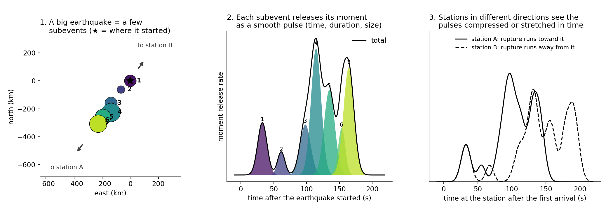

*以 2025 年堪察加 M 8.8 地震的结果说明方法原理。**(1)** 这次地震被描述为七个子事件。**(2)** 每个子事件以一个平滑脉冲释放其地震矩。所有脉冲之和就是整个地震的矩率函数。**(3)** 各个子事件位于不同的位置。因此，破裂朝向的台站看到这些脉冲挤在一起到达。另一侧的台站则看到它们在时间上被拉开。SubMIT 在约 100–200 个台站上拟合这些差异，正是这一点在空间和时间上确定了子事件的位置。*

---

## v3 的改动

第 3 版（v3）是对 SubMIT 的一次大修订。本节说明为什么需要这次修订、问题是如何发现的、改了什么，以及结果有了哪些变化。这里提到的每个问题，在失败图谱（failure atlas）[PITFALLS.md](PITFALLS.md) 中都有自己的条目。每个条目给出这个问题的实测代价、修复方法，以及现在用来防止它再次出现的测试。

### 为什么需要新版本

一组用户从零安装了 v2，并把它用于 2026 年哥伦比亚 Mw 7.4 地震。他们报告了六个问题。其中最令人担忧的是：选出的子事件个数每次运行都不一样，即使设置几乎没有任何改变。

为了弄清这类问题有多普遍，我在一个全新的环境中安装了 v2（全新克隆的代码和全新的 conda 环境）。然后，我把它用于三次它从未见过的近期地震：

- 2026-10-09 巴拿马地震，Mw 7.7，浅源；
- 2026-03-24 汤加地震，Mw 7.5，深 234 km；
- 2025-12-08 青森地震，Mw 7.6。

这些运行发现了十四个问题。其中只有两个使流程报错中断。在十种情况下，流程一直运行到最后，并画出了看似合理的图件。这是整个修订中最重要的教训：一次能跑完的运行，不等于一次正确工作的运行。

### 做了哪些改动

下表按流程的顺序列出这些改动。最后一列举例说明每个问题在 v2 中造成了什么后果。从“第一个子事件”到“深度网格”的四行是后来加上的，来自一次复查：把示例与每次地震的已知情况做对照（见[下文](#对照已知情况复查示例)）。

| 流程环节 | v2 的做法 | v3 的做法 | 这个问题在 v2 中造成的后果 |
|----------------------|-------------|--------------|----------------------------|
| 第 1 步：旋转水平分量记录 | 长度不等的水平分量记录没有被旋转，随后却被当作 SH 波来拟合 | 先把记录截取到共同的时间窗，再旋转 | 委内瑞拉：56 条 SH 记录中有 26 条其实是北向或东向分量 |
| 第 1 步：选择区域台站的仪器 | 从不读取宽频带（broadband）`HH?` 通道。只要存在强震 `HN?` 通道，就丢弃 `BH?` 通道。一个台站的每个传感器都参与拟合 | 每个台站一条记录，来自宽频带传感器，除非它限幅（clipping）或不一致 | 巴拿马：19 个区域台站中用了 4 个；现在是 17 个 |
| 第 1 步：区域记录的信噪比检验 | 水平分量是与 P 波尾波（P coda）比较，而不是与噪声比较 | 每个分量都从 P 波到时开始评分 | 汤加：5 个区域台站中保留了 1 个；现在 5 个全部保留 |
| 正演模型：时间参考 | 远震时间以第一个子事件的深度为参考，而且 sP 震相被平移了两次 | 时间以震源为参考，只平移一次 | 已发表的智利模型：数据失配（misfit）为 0.854；修复后为 0.824 |
| 子事件位置的先验 | 走廊（corridor）连向已经被剔除的余震簇 | 走廊只连接保留下来的余震簇 | 堪察加：先验覆盖了搜索网格的 40%；现在是 16% |
| 采样器 | 每条链各自独立搜索，所以选出的子事件个数可能取决于一条走运的链 | 热启动（warm start）、重定位移动（relocation move）和种群重采样（population resampling）（[第 4.5 节](#45-贝叶斯采样)） | — |
| 选择子事件个数 | 取失配在最低失配 5% 以内的最小个数。这条规则不对多出的子事件收取任何代价 | 赤池信息量准则（Akaike information criterion，AIC）：每个子事件的代价约为 5% 的失配。在并列（tie）的个数中选最小的，并报告这个并列（[第 4.6 节](#46-需要多少个子事件)） | 委内瑞拉：三次运行分别选出 6、5 和 6 个子事件；现在每次搜索都是 5 个 |
| 质心时间范围 | 只由震级决定，所以主要能量来得晚的破裂会被截断 | 当 1 子事件模型停在范围上界时，自动把范围加倍。如果某个更大的个数的最佳模型停在这个上界上，这个个数就不能被选中（[第 4.6 节](#46-需要多少个子事件)，[第 5 节](#5-自动化流程)） | 哥伦比亚：每条链都停在 31 s 的边界上，而质心在 49.5 s |
| 剔除坏记录 | 当 1 子事件模型看起来不具代表性时，对照这个模型的检验就被整个跳过；九个地震中有六个是这样 | 比所在组其余记录强 8 倍以上的记录总会被剔除（[第 5 节](#5-自动化流程)） | 瓦努阿图：一条漂移的记录被保留下来，它承担了 68% 的 P 波失配 |
| 第一个子事件 | 固定在震中，深度参与搜索 | 固定在震源：即震中位置和目录深度（[第 4.1 节](#41-子事件模型)） | 智利：第一个子事件位于 142 km，而震源在 123 km |
| 破裂速度上限 | 从第一个子事件的质心算起。对浅源走滑地震，允许达到 S 波速度的 1.5 倍 | 从第一个子事件开始的时刻算起。上限为所搜索深度上的平均 S 波速度（[第 4.5 节](#45-贝叶斯采样)） | 委内瑞拉：前两个子事件之间为 5.5 km/s |
| 子事件的机制 | 在总机制 30° 以内自由变化 | 对子事件与总机制之间的夹角施加 10° 的高斯先验，仍在同样的 30° 上限之内（[第 4.3 节](#43-线性步骤矩张量)） | 加州：子事件走向为 120° 和 127°，而断层走向为 96–100° |
| 深度网格 | 从 3 km 开始，不管那里是什么介质 | 从岩石中开始，位于水层和松软沉积层之下（[第 5 节](#5-自动化流程)） | 加州：一个网格节点位于 0.63 km 厚的沉积层内 |
| 软件 | 全新克隆中没有 `greenFuncDir_disp` 文件夹，随后清理步骤删除了所有格林函数（Green's function）。数组大小固定为 100 个远震台站。不检查退出码。在 `-Ofast` 下失配变成 NaN | 已修复 | 汤加和青森在第 3 步中断 |

### 三个测试地震的结果

我在全新安装中，从原始下载数据开始运行了这三个地震，每个都用 16 个 MPI 进程（MPI rank）。一个 MPI 进程运行一条马尔可夫链，所以每次搜索用了 16 条链。v2 和 v3 的失配不能直接比较，因为两个版本准备数据和计算时间的方式不同。因此，下表比较的是每个版本能做到什么，以及它选出了什么。

| 地震 | v2 | v3 |
|------------|----|----|
| 2026 年巴拿马，Mw 7.7 | 4 个区域台站。选出 2 个子事件，但 16 条链中只有 1 条到达了这个模型；中位数链的最终结果差 17% | 17 个区域台站。用两组不同的链随机种子都选出 4 个子事件。两条 L 曲线（L-curve）在每个子事件个数上相差都在 0.4% 以内，四个子事件也相同：第四个位于西 42 km、北 29–30 km 处，时间为 22–23 s |
| 2026 年汤加，Mw 7.5，深 234 km | 1 个区域台站。在第 3 步中断，因为一个固定大小的数组太小 | 5 个区域台站。选出 1 个子事件：第二个子事件使失配变差 1.3%。所有链的最终结果都在最佳值的 1% 以内，split R-hat 最大为 1.12 |
| 2025 年青森，Mw 7.6 | 232 个远震台站。在第 3 步中断，因为一个固定大小的数组太小 | 台站被稀疏化到 100 个。选出 3 个子事件：第四个子事件只能使失配降低 3.2%。所有链的最终结果都在最佳值的 2% 以内，split R-hat 最大为 1.14，总震级为 Mw 7.59 |

表中的几个术语：

- **L 曲线**是最佳失配随子事件个数变化的曲线（[第 4.6 节](#46-需要多少个子事件)）。
- **链随机种子**（chain seed）决定各条链所用的随机数。种子不同的两次运行，是对同一数据的两次独立搜索。
- **split R-hat** 把各条链相互比较。接近 1 的值表示各条链一致；大于 1.1 的值表示它们不一致。

巴拿马的结果有一点需要注意。在两次搜索中，第四个子事件使失配分别降低 7.2% 和 7.1%，第五个子事件只降低 1.9% 和 1.4%，所以两次搜索都选出四个。但在两次搜索中，最佳 4 子事件模型都找到得很晚：直到最后一轮重采样之后才找到，而且只有 16 条链中的 1 条和 3 条找到了它。它的后验没有收敛：split R-hat 高达 5.5。对于这样的破裂，请先用 32 个进程或更长的链运行四个或更多子事件的搜索，再解读 4 子事件模型的误差棒。

在一台共享的 AMD EPYC 7532 机器上，每次运行分别耗时 67 分钟（青森）、83–89 分钟（巴拿马）和 143 分钟（汤加）。汤加耗时最长，因为它 234 km 的深度需要 64 个深度上的格林函数。这些运行使用的是下文所述审查修复之前的代码。每项修复都单独测试过。

### 对代码的独立审查

在这些测试进行的同时，一位独立审查者阅读了新代码。审查者又报告了十一个缺陷。我确认并修复了全部缺陷（[PITFALLS F](PITFALLS.md#f--found-by-review)）。其中两个继承自 v2，影响 v2 发表过的所有后验：

- 违反搜索硬性规则的提议（proposal）被重新抽取，而不是被拒绝。这会让各条链采样到错误的分布。
- 位置先验向西南偏移了半个网格单元，即 2 km。

### 子事件个数不稳定的四个地震

第二份报告在 2026-11-16 送达。它附带了用 v2 重跑四次地震的文件夹：随附的智利示例和三次中深源地震。在每一个地震中，随着子事件的增加，失配都在某处上升了，而且选出的个数在各次运行之间发生变化。我用 v3 把每个地震重新运行了一遍，各用两组链随机种子。结果发现，同一个症状有三种不同的原因：

- **2024 年智利，Mw 7.4（随附的示例）**。v2 的重跑选出 3 个子事件，而用同样输入的已发表运行选出的是 4 个。它的 4 子事件搜索最终的失配（0.948）高于 3 子事件搜索（0.897）。原因在于 v2 的采样器：每条链各自独立搜索，可能停留在一个较差的局部解里（[PITFALLS D1](PITFALLS.md#d1--one-lucky-chain-decides-the-number-of-subevents)）。用 v3 时，三次搜索（一次用 16 个进程，两次用 32 个进程和不同的种子）都选出 4 个子事件，失配分别为 0.731、0.732 和 0.734。
- **2026 年哥伦比亚，Mw 7.4，深 116 km**。v2 的重跑先选出 1 个子事件，后来又选出 3 个，失配为 3.3–4.0。原因在于质心时间的范围。这个范围止于 31 s，那时破裂的大部分能量还没有到来（[D4](PITFALLS.md#d4--the-centroid-range-cut-off-a-late-main-rupture)）。用 v3 和旧的范围时，两组种子都选出 1 个子事件，每条链都停在 31 s 的边界上。现在，遇到这种情况时流程会把范围加倍。此后两组种子都选出 2 个子事件，它们的 L 曲线在每个子事件个数上相差都在 0.4% 以内。两个子事件也相同：一个是位于震中的长子事件（24–27 s），另一个是在 50 s、位于西南方向 41 km 处的短子事件（5 s）。
- **2026 年瓦努阿图，Mw 7.3，深 121 km**。v2 的重跑两次都选出 1 个子事件，而且从一个子事件到两个子事件失配上升。这里有两个原因先后出现。第一，一条记录发生了漂移。它承担了 68% 的 P 波失配，而两道台站筛选都放过了它（[A6](PITFALLS.md#a6--a-drifting-record-passed-both-station-screens)）。第二，剔除这条记录之后，三个子事件的拟合比一个子事件好 11%。但第三个子事件位于其搜索范围的角落：时间为 28.0 s，而范围止于 28 s；位置在东 53 km，正处在搜索框的边缘。它拟合的是那三个区域台站。现在，这样的模型会被标出，且不能被选中（[D5](PITFALLS.md#d5--a-subevent-in-the-corner-of-its-search-range-won-the-selection)）。两项修复都加上之后，两组种子都选出 1 个子事件。第二个子事件在一次搜索中使失配降低 3.4%，在另一次中使失配上升 2.3%。当我手动把范围加宽到 55 s 时，第三个子事件停在 31.5 s、深度网格的顶部。它的 P 波到达时间介于前两个子事件的 pP 深度震相之间，因此它可能是模型没有预测到的深度震相能量。
- **2026 年汤加，Mw 7.5，深 234 km**。v2 的重跑两次都选出 1 个子事件，而且每增加一个子事件失配都上升。这里没有缺陷。用 v3（16 个进程，用报告中的数据）时，第二个子事件使失配变差 3.6%，在不超过五个子事件的模型中，没有哪个比一个子事件好 1.2% 以上。16 条链最终全部落在最佳值的 1% 以内，split R-hat 最大为 1.13。一个子事件就是答案。

**启示：“选出的个数不稳定”是一个症状，背后有三种原因。只有分别测量每一种原因，才能把它们区分开：两组种子检验了搜索，最佳模型在搜索范围中的位置检验了范围，每条记录在失配中所占的份额检验了数据。**

### 对照已知情况复查示例

在 2026-11-17，四个 v3 示例都能复现，独立的搜索在它们的子事件个数上也一致。但我还没有把这些模型与每次地震的已知情况做过对照。我做了对照之后，四个示例中有三个没有通过：

| 示例 | 第一个 v3 模型 | 已知的情况 | 原因 | 现在的模型 |
|---------|--------------------|---------------|-------|---------------|
| 智利 | 第一个子事件位于 142 km | 震源在 123 km | 只固定了第一个子事件的水平位置；它的深度参与搜索（[D6](PITFALLS.md#d6--the-first-subevent-was-fixed-at-the-epicentre-only-and-the-rupture-clock-at-its-centroid)） | 第一个子事件位于 123 km，其余的位于 136、148 和 169 km：破裂在 10 s 内沿板片向下走了 46 km |
| 委内瑞拉 | 第一个子事件在 15.8 s，第二个在 127 km 之外、38.7 s：两个质心之间为 5.5 km/s | 破裂在约 60 s 内向东传播了约 200 km（Celis 等，2026） | 速度从第一个子事件的质心算起，上限是 S 波速度的 1.5 倍（D6） | 第一个子事件在最初 7 s 内释放它的地震矩。三个大的子事件在 32–51 s 位于以东 121–140 km 处，从破裂开始算起，速度分别为 3.8、3.2 和 2.8 km/s |
| 加州 | 两个子事件的走向为 120° 和 127° | 门多西诺转换断层的走向为 96–100° | 机制在总机制 30° 以内自由变化（[B4](PITFALLS.md#b4--subevent-mechanisms-sat-on-the-30-cone)），而且三个子事件位于沉积层内的一个深度节点上（[B5](PITFALLS.md#b5--the-top-of-the-depth-grid-was-a-source-in-the-sediment-layer)） | 每个子事件的走向都在 96–102°。两个大的子事件的倾角仍为 67° 和 50° |

每条新规则在采用之前，我都先在示例上测量过。只固定第一个子事件的深度，就使智利的失配变差 26%。原因在于当时的速度规则。最深处的地震矩在 10 s 后位于 168 km；从一个持续 7 s 的第一个子事件的质心出发，以 S 波速度无法到达那里。从这个子事件开始的时刻出发，则可以到达。所以，破裂的时钟现在从第一个子事件开始的时刻起算。

我还试过一条更严格的规则，即第一个子事件必须从发震时刻开始，后来我放弃了它。哥伦比亚地震第一段清晰的地震矩释放在发震时刻之后 17 s 才开始。在这条严格的规则下，哥伦比亚两个子事件的拟合变差 11%，三个子事件的拟合变差 17%（1.62 和 1.64，对比 1.47 和 1.40）。

**重新运行又发现了一个缺陷**。第一个子事件固定在震源之后，智利的各个子事件在时间上一个紧接一个。于是，从先验中抽取的新子事件只有接在最后一个之后才能拟合。结果，一组链随机种子选出了 3 个子事件，另一组选出了 5 个。现在，当模型在时间上没有留出空位时，热启动会把新子事件插入两个相邻的子事件之间（[D7](PITFALLS.md#d7--a-model-without-a-free-slot-in-time-could-only-grow-at-its-end)，[第 4.6 节](#46-需要多少个子事件)）。有了这项改动，智利的两次搜索在每个子事件个数上相差都在 0.6% 以内，并且都选出 4 个。

还剩下两个局限。每一个都是这些数据和这个模型所能说明的事情的边界：

- **速度上限被碰到了，但代价很小**。智利最深的子事件的速度为 4.49 km/s，略低于 4.51 km/s 的上限。委内瑞拉第一个大的子事件的速度为 3.82 km/s，低于 3.83 的上限。调高上限的影响很小。上限取 5.5 km/s 时，委内瑞拉五个子事件的拟合好 0.5%，大的子事件留在原处。上限取 6 km/s 时，智利五个子事件的拟合好 1.0%，深度不变（[第 6 节](#6-示例结果)）。两次破裂都大约以 S 波速度传播，至于是略低于还是略高于 S 波速度，这些数据无法判定。对委内瑞拉地震，已有研究提出其中一段是超剪切破裂（Celis 等，2026）。你可以调高 `vmax_cau` 来检验这种可能（[第 11 节](#11-故障排查)）。
- **加州的 P 波没有被重现**。在北面的台站上，P 波是一个周期为 15.6 s 的振荡。在五个层状速度模型中，岩石中的走滑震源都没有产生出这个振荡。两个大的子事件向相反方向倾斜来拟合它。因此，子事件的个数取决于先验允许它们倾斜多少：默认的 `MechanismSigma= 10` 下是四个，取 5 时是一个（[第 6 节](#6-示例结果)）。

我还用这些规则重新运行了第二份报告中的三次地震（每次地震一次搜索，用 32 个进程）。它们选出的个数都没有变。哥伦比亚选出 2 个子事件，与 3 个并列。它的第一个子事件现在位于震源处，深 116 km，时间为 25.7 s；第二个在 49.9 s，位于南南西方向 34 km 处。瓦努阿图选出 1 个子事件。汤加选出 1 个：三个子事件比一个子事件好 3.8%，低于多出两个子事件的代价。

### 更小、更快的代码

用来预测地震图的正演模型，现在是一个文件（`programs/code_SubMIT/forward_model.c`）。为了检验它，我还把两项时间参考修复打进了旧的 v2 代码。这样，两个版本给出相同的失配（加州 3 子事件模型：1.792850；智利 4 子事件模型：1.074403，对比 1.074404）、相同的矩张量和相同的对齐时移。新代码的运行速度约快一倍：16 个进程上 6,000 次迭代耗时 559 s，而不是 1,156 s。

反演核心从 10 个文件、5,626 行缩减到 3 个文件、2,169 行。旧的核心里有两份已经分叉的正演代码副本。整个流程从 90 个文件、13,800 行缩减到 58 个文件、8,971 行。v2 还带着一个 42,694 行的数值库，却只用到其中几个函数。第 3 步和第 4 步现在各是一个脚本（`step3_do_inversions.sh` 和 `step4_figures.sh`），而 v2 中有四个。在 1 子事件搜索之后运行的三个校准钩子，现在合并为一个（`calibrate_from_1sub.sh`）。`tests/test_regressions.py` 中的测试守护着每一项不需要 SAC 或 MPI 就能测试的修复。

### 随附的示例是 v3 的运行结果

[第 2 节](#2-四个示例地震)和[第 6 节](#6-示例结果)中的示例都是 v3 的运行结果。在上述复查之后，我于 2026-11-17 从原始下载数据出发、用 32 个 MPI 进程把每个示例重新运行了一遍。文件夹 `examples/<name>/` 保存的就是这次运行：第 1 步得到的记录、每个反演的配置、最佳模型和图件（`tools/make_example_from_run.py`）。与它们所取代的 v2 结果相比，加州有四个子事件，而 v2 是三个；委内瑞拉有五个，而 v2 是六个。智利和堪察加仍是四个和七个。第 6 节说明了每个模型的变化。

**启示：一条能跑到最后的流程，不等于一条正确工作的流程。这些缺陷大多是通过检查某一步本应产生的性质——一个已旋转的分量、一个时间参考、一个覆盖余震的先验——发现的，而不是通过寻找报错发现的。**

## 目录

0. [v3 的改动](#v3-的改动)
1. [快速开始：用三条命令复现一个示例](#1-快速开始)
2. [四个示例地震](#2-四个示例地震)
3. [安装](#3-安装)
4. [方法原理（含公式）](#4-方法原理)
5. [自动化流程](#5-自动化流程)
6. [示例结果](#6-示例结果)
7. [数据：下载什么、如何下载](#7-数据)
8. [反演你自己的地震](#8-反演你自己的地震)
9. [解读输出结果](#9-解读输出结果)
10. [使用 AI 编程助手](#10-使用-ai-编程助手)
11. [故障排查](#11-故障排查)
12. [仓库结构](#12-仓库结构)
13. [致谢、引用与许可](#13-致谢引用与许可)

---

## 1. 快速开始

本节说明如何复现一个随附的示例。你需要一台装有 SAC、MPI 库、Fortran 和 C 编译器、Java 以及 conda 的 Linux 机器。[第 3 节](#3-安装)说明了如何获取它们。

```bash
git clone https://github.com/jiazhe868/SubMIT.git && cd SubMIT
conda env create -f environment.yml && conda activate submit

./submit check                         # 所有依赖都装好了吗？
./submit build                         # 编译随附的格林函数代码
./submit example california            # 复现 2024 年加州 M7.0 地震的结果（约 10 分钟）
./submit compare california            # 与随附的数字对比
```

图件和一份文字总结（`RESULTS.md`）会出现在 `work/california/IRIS/figs_and_results/` 中。

随后，`./submit compare` 会打印一张类似下面的表格。这张表来自一次在 32 个核心上耗时 5 分钟的运行。

```
L-curve (best penalized misfit for each number of subevents)
  n  published  reproduced     diff
  1     4.7984      4.7984    +0.0%
  2     4.2606      4.2606    +0.0%
  3     4.3285      4.3285    +0.0%
  ...
selected number of subevents: published 4, reproduced 4

selected 4-subevent model (published -> reproduced)
          time (s)               x,y (km)     depth (km)      dur (s)          Mw  MT sim
E1     5.2->5.2        0,0   ->    0,0       4.0->4.0      5.3->5.3   6.20->6.20 +1.00
E2     7.7->7.7       14,11  ->   14,11     12.3->12.3     3.0->3.0   6.89->6.89 +1.00
E3    11.9->11.9      29,13  ->   29,13     13.5->13.5     3.1->3.1   6.83->6.83 +1.00
E4    17.4->17.4      -5,-5  ->   -5,-5      4.0->4.0      3.5->3.5   5.64->5.64 +1.00
total Mw: published 7.04, reproduced 7.04
```

如何解读这张表：

- “published”指随示例附带的数字。它们是这个示例在 2026-11-17 的 v3 运行的结果，这次运行从原始下载数据出发，使用了 32 个 MPI 进程。
- “reproduced”指你这次运行得到的数字。
- 第一块是 L 曲线：每个子事件个数下的最佳失配。
- 第二块逐个子事件地比较选出的模型。“MT sim”是两个矩张量的相似度；+1.00 表示两者相同。

这个默认模式不会重新运行搜索。它采用随附运行的 L 曲线和最佳模型，并重新计算格林函数、预测地震图和矩张量。所以它很快。

### 复现示例的三种方式

共有三种模式。它们的区别在于重复多少工作。

| 模式 | 作用 | 32 核上的耗时 |
|------|--------------|------------------|
| `--mode figures`（默认） | 重建格林函数，并用已发表的最佳模型重新绘制每一幅图件 | 5–11 分钟 |
| `--mode frozen` | 用与发表时完全相同的配置文件重新运行所有 MCMC 反演，然后选择子事件个数 | 1.5–4 小时 |
| `--mode full` | 从处理好的波形出发，重新运行整个自动化流程：筛选、加权、先验、反演、选择和图件 | 1.5–4 小时 |

```bash
./submit example chile --mode frozen      # 重新运行智利示例的反演
./submit example chile --mode full        # 从波形重新推导一切
./submit example chile --mode full --quick   # 10 分钟冒烟测试（数字没有意义）
./submit status chile                     # 正在运行的示例的进度
./submit list                             # 所有随附的示例
```

如果像下面这样启动，长时间的运行在你退出登录后仍会继续：`nohup ./submit example kamchatka --mode frozen > kam.log 2>&1 &`。

**耗时多久**。我用 32 个 MPI 进程在共用服务器（AMD EPYC 7532、7543、7552 和 7F72）上测量了耗时：

- 随附的各次运行从原始下载数据一直跑到图件（先 `./submit prepare`，再 `./submit run`），智利用了 1 小时 31 分钟，委内瑞拉用了 1 小时 34 分钟。加州用了 2 小时 27 分钟，它所在的服务器同时在跑三个这样的任务。堪察加用了 3 小时 20 分钟，因为它要反演七个子事件个数。
- `figures` 模式用了 5 分钟（加州）、6 分钟（堪察加）、7 分钟（委内瑞拉）和 11 分钟（智利）。
- `frozen` 模式用了 1 小时 22 分钟（智利）、1 小时 40 分钟（委内瑞拉）、2 小时 11 分钟（加州）和 3 小时 24 分钟（堪察加）。
- 智利的 `full` 模式用了 1 小时 22 分钟。
- 作为对比，用 v2 时，仅反演本身就需要约 3 小时（加州）到 14 小时（堪察加）。

**每种模式下“复现”的含义**。

- `frozen` 模式会精确地重复随附的链。我用 32 个 MPI 进程和相同的编译器，在一台处理器型号不同的服务器上重新运行了它。对全部四个示例，它写出的链文件都与随附运行的链文件逐字节相同：智利和加州各 160 个文件，委内瑞拉 192 个，堪察加 224 个。L 曲线与随附的 L 曲线在打印出的每一位数字上都一致。
- 如果你使用不同的进程数（`SUBMIT_NCORE`；默认为物理核数，最多 32）或不同的编译器，链就会不同。这时，失配在[第 4.6 节](#46-需要多少个子事件)测得的搜索噪声范围内一致，但不会每一位数字都相同。
- `full` 模式从随附的第 1 步记录（`inputs.tar.gz`）以及存档的余震目录和矩张量（`catalog/`）出发。它重新推导其余的一切：台站筛选、权重、搜索范围、格林函数、先验和子事件个数的网格。智利的 `full` 模式最终也得到了与随附运行相同的 L 曲线和相同的 160 个链文件。

---

## 2. 四个示例地震

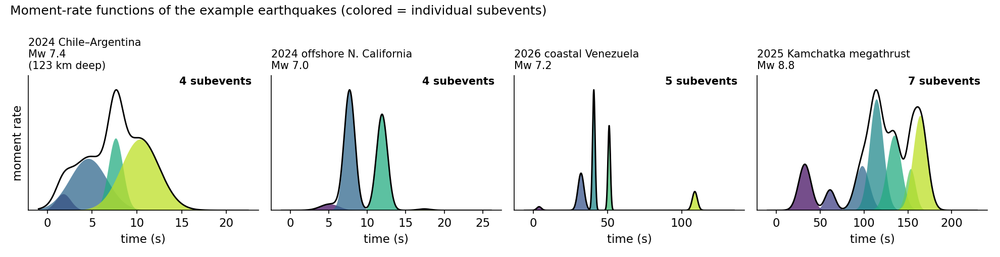

这幅图显示每个示例的矩率函数，即地震随时间释放地震矩的快慢。每块彩色区域是一个子事件，黑线是它们的总和。

| 示例 | 地震 | 深度 | 选出的子事件个数 | 总 Mw（目录值） | 最佳失配 |
|---------|-----------|-------|:------------------:|:------------------:|:-----------:|
| `chile` | 2024-07-19 智利–阿根廷边境 | 123 km（位于俯冲板片内部） | **4** | 7.41（7.4） | 0.812 |
| `california` | 2024-12-05 门多西诺角近海 | 浅源，走滑（strike-slip） | **4** | 7.04（7.0） | 3.790 |
| `venezuela` | 2026-06-24 委内瑞拉近海 | 浅源，双震（doublet） | **5** | 7.59（7.2 和 7.5） | 2.243 |
| `kamchatka` | 2025-07-29 堪察加俯冲带大型逆冲地震（megathrust） | 浅源俯冲 | **7** | 8.83（8.8） | 0.882 |

我选择这四个地震，是因为每一个都检验本方法的一种不同难点：

- **智利**地震很深。它的深度震相（depth phase）到达较晚，并与直达波重叠。深度震相是这样一种波：它先向上传播到震源上方的地表，在那里反射，然后才传播到台站。
- **加州**地震是一次有密集区域台网的走滑地震。
- **委内瑞拉**地震是一个双震：两次地震相隔约 30 s、相距约 150 km。
- **堪察加**地震是一次长度超过 350 km 的俯冲带大型逆冲破裂。

失配值只能与*同一个*地震的其他运行相比较。原因见[第 4.4 节](#misfit)。每个示例的详细结果见[第 6 节](#6-示例结果)。

---

## 3. 安装

SubMIT 运行在 Linux 上。它在 Ubuntu 22.04 上测试过。你需要以下这些：

| 依赖 | 为什么需要 | 获取方式 |
|-------------|------------------|---------------|
| **SAC**（含 `libsac.a` 和 `libsacio.a`） | 读取、写入和处理地震图 | 向 [IRIS/EarthScope](https://ds.iris.edu/ds/nodes/dmc/forms/sac/) 申请。把 `sac` 加入 `PATH`，并按其安装说明设置 `SACAUX` |
| **MPI**，以及 **C 和 Fortran 编译器** | 反演在每个 MPI 进程上运行一条马尔可夫链 | Open MPI 或 MPICH，加上 `gcc` 和 `gfortran`（`sudo apt install libopenmpi-dev gfortran`）；或 Intel oneAPI（`mpiicx` 和 `mpiifx`，速度更快） |
| **Java** | 随附的 TauP 代码用它计算走时（travel time） | `sudo apt install default-jre` |
| **Perl** 和 **gawk** | 格林函数脚本和数据脚本 | 通常已预装 |
| **wget** 和 **unzip** | 仅用于可选的智利强震（strong-motion）数据下载（`./submit fetch-csn`） | 通常已预装 |
| **Python 3** 及其软件包 | 数据准备、筛选和绘图 | `conda env create -f environment.yml` |
| 每个示例约 2–4 GB 磁盘空间 | 格林函数 | |
| 互联网连接 | 第 2 步要向 USGS 目录查询新地震，地图会下载一次海岸线 | 复现示例时不需要，海岸线除外 |

然后编译并检查：

```bash
conda activate submit
./submit check     # 列出缺少的任何依赖
./submit build     # 编译 fk、mtel3，并试编译一次反演代码
```

反演代码（`finv`）和正演代码（`ffwd`）会在每个运行文件夹中重新编译。这样，它们总是与该次运行的配置一致。编译时如果找到 Intel oneAPI 就使用它，否则使用 GNU 的 MPI 包装器。要强制使用 GNU 工具，给 `./submit example` 加上 `--gnu`。2026-11-17 的随附运行和本 README 中的检查都使用了 Intel oneAPI。如果你使用 Intel，而你的 `setvars.sh` 不在 `/opt/intel/oneapi/` 中，请让 `INTEL_SETVARS` 指向它。

有三个环境变量很有用：

- `SUBMIT_PYTHON`：使用哪个 Python；
- `SUBMIT_NCORE`：MPI 进程数（默认为物理核数，最多 32）；
- `SACHOME`：SAC 的安装位置，在 `sac` 不在你的 `PATH` 中时使用。

---

## 4. 方法原理

本节一步一步地解释这个方法。首先说明什么是子事件（4.1）。然后说明 SubMIT 如何由一组子事件预测地震图（4.2），以及如何求出矩张量（4.3）。接着定义如何对照数据给一个预测打分（4.4）、搜索如何探索可能的模型（4.5），以及如何选择子事件个数（4.6）。

### 4.1 子事件模型

子事件的描述方式沿用 Jia 等（2020a、2020b、2022a）的做法。每个子事件 $`i = 1 \dots N`$ 由下表中的量来描述：

| 符号 | 含义 | 类型 |
|--------|---------|------|
| $`t_i`$ | 质心（centroid）时间，从发震时刻（origin time）起算 | 非线性（搜索） |
| $`x_i, y_i`$ | 水平位置，相对震中（epicenter）向东和向北 | 非线性 |
| $`z_i`$ | 质心深度 | 非线性 |
| $`T_i`$ | 持续时间 | 非线性 |
| $`\mathbf m_i`$ | 偏矩张量（deviatoric moment tensor）的五个独立分量 | 线性（精确求解） |

这张表把未知数分成两类。时间、位置、深度和持续时间以非线性的方式改变地震图，因此必须搜索它们（第 4.5 节）。矩张量线性地改变地震图，因此对其他参数的每一组试探值，都可以精确地求解它（第 4.3 节）。

**子事件 1 是破裂开始的地方**。有两个或更多子事件时，子事件 1 固定在震源（hypocenter）处。也就是说，它位于震中，深度取目录深度。如果目录深度落在深度网格之外，就使用最近的网格深度。子事件 1 的质心时间和持续时间仍然参与搜索。破裂前沿在子事件 1 开始释放地震矩的时刻从它那里出发，[第 4.5 节](#45-贝叶斯采样)的速度上限就从那里算起。只有一个子事件的模型则不同：这一个子事件代表整个破裂的质心，因此可以自由移动。

因此，一个有 $`N \ge 2`$ 个子事件的模型有 $`5N-3`$ 个非线性未知数和 $`5N`$ 个线性未知数。

一个子事件*内部*的破裂方向性（directivity）可以开启，但默认是关闭的。`Input.model` 中的 `vr = 0.01 km/s` 这个值使每个子事件成为点源。整个地震的方向性仍然会体现出来，因为它来自子事件在空间和时间上的排列。

每个子事件以一个高斯脉冲释放其地震矩。持续时间 $`T_i`$ 是这个脉冲在峰值 10% 处的全宽。在台站 $`j`$，这个脉冲被平移一个时间 $`\Delta t_{ij}`$，其大小取决于子事件所在的位置（第 4.2 节）：

```math
s_{ij}(t) = \frac{1}{\sqrt{2\pi}\,\sigma_i}\exp\!\left[-\frac{(t-t_i-\Delta t_{ij})^2}{2\sigma_i^2}\right],
\qquad \sigma_i = \frac{T_i}{2\sqrt{2\ln 10}} .
```

### 4.2 正演问题：预测地震图

正演问题要回答的是：给定一组子事件，每个台站应当记录到什么样的地震图？台站 $`j`$ 处的预测位移是对各子事件的求和。对每个子事件，矩张量分量乘以格林函数，结果再与该子事件的矩率脉冲做卷积：

```math
u_j(t) \;=\; \sum_{i=1}^{N}\sum_{k=1}^{5} m_{ik}\;\big[\,G_{jk}(z_i,\,t) * s_{ij}(t)\,\big].
```

格林函数 $`G_{jk}`$ 是一个单位矩张量分量在该台站会产生的地震图。SubMIT 使用两种格林函数，一种用于远处的台站，一种用于近处的台站。

**远震 P 波和 SH 波**由距离约 40°–90° 的台站记录。它们的格林函数用射线理论代码 `mtel3`，在每个台站的距离上、在间隔为 2 km 的深度网格上计算。在网格深度之间做线性插值。震源一侧的结构是取自 CRUST1.0 的层状地壳。

子事件的位置以一个相对于震源的时间平移进入计算：

```math
\Delta t_{ij} \;=\; -\,\frac{r_i}{c_j}\cos(\phi_j-\psi_i)\;-\;(z_i-z_0)\,\eta_j,
\qquad \eta_j=\sqrt{v^{-2}-c_j^{-2}},
```

各符号的含义如下：

- $`(r_i,\psi_i)`$：子事件相对震中的距离和方位角；
- $`z_0`$：目录给出的震源深度；
- $`\phi_j`$：台站的方位角；
- $`c_j`$：射线的视水平速度，用 TauP 计算；
- $`\eta_j`$：震源处的垂直慢度，其中 $`v`$ 是那里的 P 波或 S 波速度。

第一项就是本 README 顶部图中脉冲挤压和拉伸的来源。位于朝向某个台站一侧的子事件，它的波会更早到达那个台站。

平移从目录深度 $`z_0`$ 算起，原因很简单。第 1 步按为震源计算的到时（SAC 头段 `t1`）对齐数据。`mtel3` 代码把每个网格深度的直达波都放在同一时刻。深度震相（pP、sP 和 sS）在每个深度的格林函数中已经有了正确的延迟。因此，整个格林函数只需要这一次平移。直到 v2，参考深度一直是子事件 1 的深度。每当子事件 1 离开目录深度，P 波和 SH 波就会被平移不同的量，而且 sP 震相还会再受到一次按 S 波计算的平移（[PITFALLS B1, B2](PITFALLS.md#b--forward-model)）。

**区域三分量记录**来自距离可达约 750 km 的台站。它们的格林函数用频率-波数（frequency–wavenumber）代码 `fk`，在层状（1-D）CRUST1.0 模型中、在距离和深度的网格上计算。每个子事件使用与它*自身*到台站的距离和方位角对应的格林函数，并在网格点之间插值。因此，区域台站上的时间是精确的，而不是用一个平移来近似的。

所有预测记录都用与数据相同的带通滤波器滤波。默认频带为：远震记录 0.005–0.2 Hz，区域记录 0.02–0.15 Hz。一些长的破裂使用更窄的频带。

### 4.3 线性步骤：矩张量

对非线性参数 $`\theta`$（时间、位置、深度和持续时间）的每一组试探值，矩张量都用阻尼最小二乘求得。其中加入了两条先验知识：

- 各矩张量之和应当接近整个地震的目录矩张量（来自 GCMT 或 USGS）；
- 每个矩张量都应当接近整个地震的震源机制。

写成一个公式就是：

```math
\hat{\mathbf m}(\theta) = \arg\min_{\mathbf m}\;
\big\|\mathbf W\big(\mathbf G(\theta)\,\mathbf m-\mathbf d\big)\big\|^2
\;+\;\alpha^2\|\mathbf m\|^2
\;+\;\lambda^2\Big\|\sum_{i=1}^N \mathbf m_i-\mathbf m_{\mathrm{CMT}}\Big\|^2
\;+\;\frac{\sigma^2 R}{\sigma_m^2}\sum_{i=1}^N \sin^2\gamma_i ,
\qquad \lambda = \kappa_{\mathrm{CMT}}\,\frac{\|\mathbf W\mathbf d\|}{M_0^{\mathrm{CMT}}} .
```

这四项分别是：

1. **数据项**。$`\mathbf W`$ 包含三种波型的权重：P、SH 和区域（[第 5 节](#5-自动化流程)）。
2. **一个小的阻尼**。$`\alpha`$ 是一个 Tikhonov 阻尼（`Tikhonov_alpha`），使解保持稳定。
3. **对目录矩张量的锚定**。$`\kappa_{\mathrm{CMT}}`$（`CMTscaling`，默认 3）决定各矩张量之和与目录矩张量绑得有多紧。如需修改，在第 2 步之前设置 `SUBMIT_CMTSCALING`。它按数据的大小缩放，因此同一个值对 M 6.9 和 M 8.8 的地震都适用。
4. **机制先验**。这一项使每个子事件的机制接近整个地震的机制。下面会解释它。

**机制先验**。$`\gamma_i`$ 是子事件 $`i`$ 的矩张量与目录矩张量的双力偶之间的夹角。两个张量都被看作由各自九个分量构成的向量。两个例子有助于理解这个夹角：把直立走滑断层的走向转动 10°，得到 $`\gamma = 20°`$；滑动方向相反，则得到 180°。先验是这个夹角的高斯分布，标准差为 $`\sigma_m`$（`MechanismSigma`，默认 10°）。

这一项中的其他符号把先验换算成最小二乘的单位。$`\sigma = 0.05`$ 是采样器所用后验的宽度（[第 4.5 节](#45-贝叶斯采样)），$`R`$ 是残差能量。

这个最小二乘问题要求解两次。[第 4.4 节](#misfit)的对齐本来就需要求解两次。第一次求解不加先验，得到 $`R`$ 和每个张量的大小。有了它们，$`\sin^2\gamma_i`$ 就成为未知数的二次函数，所以第二次求解仍然是一个普通的最小二乘问题。每次求解都是精确的（Cholesky 分解），耗时不到一秒。这就是矩张量不需要采样的原因。

*为什么需要先验*。通常的做法是让每个子事件的全部五个分量完全自由。v2 只是在它们周围围了一道墙：子事件的压力轴和张力轴可以偏离总矩张量的相应轴最多 30°，而没有任何代价。在 v3 的第一批运行中，四个示例里有三个的最差轴偏离了 28.8–29.9°。加州有两个子事件的走向是 120° 和 127°，而它们所在的转换断层走向为 96–100°（[PITFALLS B4](PITFALLS.md#b4--subevent-mechanisms-sat-on-the-30-cone)）。当每个最佳模型都碰到同一个约束时，是这个约束在选择模型。有了先验，偏离就有了一个平滑增长的代价。偏离参考机制 20° 的子事件，代价是 1% 的失配。偏离 45° 的代价是 5%，相当于一整个子事件的代价。先验是相对于每个子事件自身的地震矩来定的，因此小的子事件和大的子事件受到同样强的约束。

### 4.4 失配与物理惩罚项 <a name="misfit"></a>

本节定义一个数，用它来衡量模型对数据拟合得有多好。

首先，每条预测波形通过互相关与记录波形对齐。时移 $`|\tau_j|`$ 最多为 $`\tau_{\max}`$：P 波为 2 s，SH 波为 5 s，区域记录则取一个随距离增大的值。然后，失配同时考虑振幅的吻合程度和波形形状的吻合程度：

```math
\chi(\theta) \;=\; \frac{\displaystyle\sum_j \big\|d_j(t+\tau_j)-u_j(t)\big\|^2\; e^{\,|1-C_j|}}
                        {\displaystyle\sum_j \|d_j\|\,\|u_j\|},
```

其中 $`C_j`$ 是记录与预测之间的相关系数。失配接近 1，意味着残差的能量与信号的能量大致相当。

失配的数值取决于台站集合、时间窗和权重。这些因地震而异。**所以，只在同一个地震的不同运行之间比较失配。**

三个惩罚项使解保持物理上合理。搜索所最小化的带惩罚的失配为

```math
\Phi(\theta) \;=\; \chi(\theta)\;
\exp\!\Big(\frac{\bar\epsilon}{\kappa}\Big)\;
\exp\!\Big(\sigma^2\sum_i \frac{\gamma_i^2}{\sigma_m^2}\Big)\;
\exp\!\Big(\max\!\big(0,\tfrac{\Theta_P}{30^\circ}-1\big)+\max\!\big(0,\tfrac{\Theta_T}{30^\circ}-1\big)\Big).
```

* **双力偶惩罚**。大多数地震都接近双力偶，即在一个平面上的滑动。$`\bar\epsilon=\sum_i \sqrt{\epsilon_i}\,M_{0,i}/\sum_i M_{0,i}`$ 衡量各子事件偏离双力偶的程度（即它们的 CLVD 成分），按各自的地震矩加权。$`\kappa`$ 即 `DCconstrain`（默认 1）。
* **机制先验**。这就是[第 4.3 节](#43-线性步骤矩张量)的高斯先验，现在计入被采样的失配中。$`\gamma_i = 2\sigma_m`$ 的子事件使失配增加 1%。
* **应力一致性限制**。$`\Theta_P`$ 是在*所有*子事件中，子事件的压力轴与总矩张量的压力轴之间的最大夹角。$`\Theta_T`$ 是张力轴的相应夹角。超过 30° 后，失配按指数增长。这是先验之外的硬性限制。在这里，每个子事件都计入，无论多小。因此，一个很小的子事件无法用一个不合理的、相反的机制去“吸收”无法解释的能量。在 `lcurve.txt` 中，后两个因子的乘积列为 `stress_factor`。

### 4.5 贝叶斯采样

搜索不只寻找唯一的最佳模型。它还估计每个参数的不确定性有多大。为此，它对非线性参数的后验概率进行采样：

```math
p(\theta\mid\mathbf d)\;\propto\;\exp\!\left[-\frac{\Phi(\theta)}{2\sigma^2\,\Phi_{\min}}\right]\pi(\theta),
\qquad \sigma = 0.05 .
```

其中 $`\Phi_{\min}`$ 是已找到的最佳失配。取 $`\sigma = 0.05`$ 时，失配比最佳值高几个百分点的模型仍然是合理的。失配差 1% 的模型，概率密度是最佳模型的 $`e^{-2}`$，约 14%。

先验 $`\pi(\theta)`$ 说明在使用数据之前，哪些模型是允许的，哪些模型的可能性更大：

```math
\pi(\theta) \;\propto\; \prod_{i=2}^N \rho(x_i,y_i)\;\times\;
\mathbb 1\!\left[\;t_{i+1}-t_i \ge 2.5\,\mathrm s,\;\; t_i \ge T_i/2,\;\;
|\mathbf x_i-\mathbf x_1| \le v_{\max}\,\big(t_i-(t_1-T_1/2)\big),\;\; \theta\in\text{bounds}\right],
```

它由两部分组成：

- $`\rho`$ 是平滑后的余震分布图。在发生过余震的地方，子事件出现的可能性更大。
- 方括号里是硬性规则。违反其中任何一条的模型，概率为零。子事件按时间顺序编号，它们的质心之间必须至少相隔 2.5 s。任何子事件都不能在发震时刻之前释放地震矩（$`t_i \ge T_i/2`$）。每个参数都必须留在自己的搜索范围之内。此外，下面要解释的因果性规则限制了破裂能传播多快。

**因果性**。子事件 1 位于震源处。它的地震矩释放开始于 $`t_1-T_1/2`$ 时刻，比它的质心早半个持续时间。这条规则要求：任何质心都不能位于破裂前沿的前方；这个破裂前沿在该时刻离开震源，以 $`v_{\max}`$ 传播。速度 $`v_{\max}`$ 是震源一侧速度模型在搜索深度范围内的平均 S 波速度。在四个示例中，它为 3.8–4.5 km/s。它在 `search_par.file` 中写作 `vmax_cau`。

对每个子事件，`RESULTS.md` 都列出这条规则所限制的速度：它到震源的距离，除以自子事件 1 开始以来经过的时间。注意，从图上读出的*两个质心之间*的速度是另一个数。两个在时间上重叠的子事件，质心之间可以相距 21 km、相隔 2.7 s，智利示例的最后两个子事件就是这样。

这条规则限制的是质心，而不是每个子事件的开始。子事件的地震矩在其质心之前半个持续时间就开始释放，所以地震矩释放可以略微领先于一个以 S 波速度传播的前沿。

*为什么时钟从子事件 1 开始的时刻算起，为什么上限取 S 波速度*。在 v2 和 v3 的第一批运行中，时钟从子事件 1 的质心算起，它的深度是自由的，而浅源走滑地震被允许达到 1.5 倍的 S 波速度。这带来了三个后果（[PITFALLS D6](PITFALLS.md#d6--the-first-subevent-was-fixed-at-the-epicentre-only-and-the-rupture-clock-at-its-centroid)）：

- 智利的第一个子事件在每次运行中都位于震源下方 14–23 km。
- 固定它的深度之后，旧的时钟使智利的失配变差 26%。最深处的地震矩在 10 s 之后位于 168 km，从一个持续 7 s 的子事件的质心出发，以 S 波速度到不了那里。而从这个子事件开始的时刻出发，就能到达。
- 委内瑞拉的最佳模型用足了这个余量：5.5 km/s，而且是从一个只贡献 0.1% 失配的第一个子事件算起的。

因此，默认情况下不允许超剪切破裂。要检验超剪切破裂，请手动调高 `vmax_cau`，然后比较失配。

**采样器**。后验用**最多 32 条并行马尔可夫链**采样，每个 MPI 进程一条。每条链都使用 Metropolis–Hastings 算法，包括三种移动：

- 一次只改变一个参数的移动；
- 沿该链到目前为止学到的后验协方差进行的自适应联合移动（Haario 等，2001），调节到 23% 的接受率；
- 沿该协方差主方向的一维移动。

**为什么要用链的种群**。通常的做法是让各条链独立运行，再把收敛的链合并起来。这个后验的峰太尖，这种做法行不通。由于失配差 1% 的模型只有 $`e^{-2}`$ 的概率密度，每条链都会停在它找到的第一个好解上，并一直留在那里。在加州 3 子事件配置上，16 条独立链运行结束时，只有 1 条链落在最佳失配的 2% 以内，中位数链最终差 34%。在已发表的 v2 运行中，32 条链里通常有 2–6 条进入最佳值的 2% 以内。

因此，我让这些链作为一个种群来工作（`programs/code_SubMIT/finv.f90`）。这由四种机制实现：

```
重定位：    5% 的提议把一个子事件移到从先验中抽取的位置
热启动：    一半的链从最佳 (N-1) 子事件模型加一个新子事件开始；新子事件从先验中抽取，
            当该模型在时间上没有空位时，则插入到它的两个相邻子事件之间（第 4.6 节）
重采样：    在预烧期（burn-in）的 25、50 和 75% 处，每条链从它所在的由 8 条链组成的岛（island）中
            按权重 exp(-dPhi / (2 sigma^2 Phi_min)) 抽取一条链并复制它；最后一轮从所有链中抽取
硬性规则：  违反某条硬性规则的随机游走提议记为一次拒绝（v2 会重新抽取直到满足规则，
            这样采样的是后验乘以可行提议所占的比例，低估了靠近边界以及靠近时间间隔
            规则和因果性规则的状态）
```

用文字来说：重定位让一条链可以跳到搜索空间中很远的区域。热启动让 $`N`$ 个子事件的搜索，从 $`N-1`$ 个子事件时已经找到的结果开始。重采样用较好的链的副本，替换陷在差解里的链。另一半的链从先验开始，不使用热启动。

**得到了什么**。有了重采样，在八次各 12,000 次迭代的测试运行中，有七次的 16 条链里有 10–16 条最终落在最佳值的 2% 以内。用不同随机种子的两次搜索现在通常一致：例如，加州的两次搜索给出的四个子事件，彼此相差不超过 0.2 s 和 4 km。

**放弃了什么**。种群用一部分多样性换来了这种一致。有三样东西让搜索保持多样：

- 从先验开始的那一半链；
- 岛：在最后一轮重采样之前，四个各由 8 条链组成的岛相互独立地搜索；
- 重定位移动。

但在一个岛内，重采样会很快复制最好的链，因为差 1% 的链只保留 $`e^{-2}`$ 的权重。而在最后一轮之后，每条链都源自同一个岛。这时，后验样本描述的是一个解，split R-hat 只说明各链在这个解内部混合得有多好。不同的解仍然存在。最终版本的采样器用两个随机种子得到的最佳失配为 1.840 和 1.844。一个早期版本得到 1.761、1.840 和 1.847；其中最低的那个模型，第三个子事件位于震中以东，而不是以西。这个解比通常的解好 4.5%，但在 5 次运行中只找到了 1 次。4.5% 几乎和[第 4.6 节](#46-需要多少个子事件)对一个额外子事件要求的 5% 一样大。

出于这个原因，对每个 $`N`$，`lcurve.txt` 都列出每个岛在最后一轮之前的最佳失配（`island_best_misfits.txt`）。在那一轮之前，各个岛是相互独立的搜索，所以它们的最佳值显示了搜索结果的变化有多大。用其他随机种子再做一次搜索，能更完整地显示同样的情况。

**可重复性**。链长随 $`N`$ 增加：预烧期 3000·N 次迭代，然后采样 1000·N 个。各链交换状态的那些步骤，发生在固定的迭代次数处。所以，用相同的进程数、相同的编译器和同一台机器重新运行，会重复出相同的链。在不同机器负载下的两次 4 进程运行分别耗时 47 s 和 83 s，写出了完全相同的文件。装有相同编译器的另一台机器也重复出了这些链：从原始下载数据开始的整个加州运行，用 32 个进程和五个子事件个数，在两台服务器上写出了 160 个完全相同的链文件。

### 4.6 需要多少个子事件？

子事件更多的模型，对数据的拟合总是至少和子事件更少的模型一样好。所以，仅凭失配无法判断一次地震有多少个子事件。因此，SubMIT 对 $`N = 1, 2, 3, \dots`$ 个子事件分别做反演，再由一条规则判定哪些子事件是数据真正支持的。

除非句中另有说明，本节引用的运行都是在对示例的复查（[v3 的改动](#v3-的改动)）之前完成的。这次复查改变了示例的模型，但没有改变这条规则。

**通常的规则，以及它为什么失败**。通常的做法是取 L 曲线的拐点（elbow），v2 也是这样做的。L 曲线画的是最佳失配随 $`N`$ 的变化。拐点规则选取最佳失配落在所有 $`N`$ 中最低失配 5% 以内的最小 $`N`$。这条规则有两个弱点：

- 它对多出来的一个子事件不收取任何代价。
- 它把每个 $`N`$ 都拿去和最大的几个比较，而子事件最多的搜索最难完成。

在委内瑞拉示例的 32 进程 v3 运行中，拐点规则舍弃了 5 个子事件，原因是 7 个子事件的拟合好 6.5%。这折合每增加一个子事件只好 3.3%。在该示例的三次运行中，这条规则分别选出 6、5 和 6 个子事件。因此，我现在用赤池信息量准则（AIC；Akaike，1974）来选择 $`N`$，它对每个自由参数都收取一份代价。

**现在使用的规则：赤池准则**。第 4.5 节的后验已经规定了失配的变化值多少。其中的 $`\sigma = 0.05`$ 是一个相对噪声水平。失配高 1% 的模型，概率密度是最佳模型的 $`e^{-2}`$。如果数据中有 $`n = 1/\sigma^2 = 400`$ 个独立的值，得到的正是这个结果。

对噪声水平未知的最小二乘问题，这个准则是 $`\mathrm{AIC} = n\ln(\mathrm{RSS}) + 2K`$（Burnham & Anderson，2002）。其中 RSS 是残差平方和，$`K`$ 是自由参数的个数。一个子事件有 $`k = 10`$ 个自由参数：五个矩张量分量、质心时间、持续时间、深度和两个水平坐标。用失配代替 RSS，这个准则就变成

```math
\mathrm{AIC}(N) \;=\; \frac{\ln \Phi_N}{\sigma^2} + 2kN ,
```

其中 $`\Phi_N`$ 是用 $`N`$ 个子事件找到的最佳失配（`programs/prepare_SubMIT/plot_lcurve.py`）。

换句话说：**一个子事件的代价是 $`2k\sigma^2 = 5\%`$ 的失配**。更准确地说，$`\ln\Phi`$ 必须降低 0.05，AIC 才保持不变。这相当于失配降低 4.9%。所以，只有当多出的一个子事件使失配降低超过 4.9% 时，才值得加入它。

这个 5% 不再是一个单独设定的数。它由后验已经假设的噪声水平和一个子事件的参数个数决定。需要注意一点：失配并不是单纯的平方和（第 4.4 节），$`\sigma`$ 也是一个假设的噪声水平。所以，这条规则给一个子事件定了一个自洽的代价，但它不是一项精确的统计检验。

**并列**。AIC 的通常用法是取值最低的那个 $`N`$。加州的两次 32 进程搜索表明，这样做还不够。这两次搜索只在链随机种子上不同。第五个子事件在一次搜索中使失配降低 4.8%，在另一次中降低 5.0%。这两个值分别落在一个子事件的代价 4.9% 的两侧。所以，AIC 最低的在第一次搜索中是 4 个子事件，在第二次搜索中是 5 个。

AIC 相差不到 2 的模型得到的支持相当（Burnham & Anderson，2002）。因此，凡是 AIC 与最低值相差不到 2 的 $`N`$ 都算并列。`lcurve.txt` 会列出这些并列的个数，而**选出的是并列的 $`N`$ 中最小的那个**。更大的 $`N`$ 必须明显更好，才会被选中。

按这条规则，加州的两次搜索都列出了 4 和 5 的并列，也都选出 4。另外两次搜索也一致：在这两次搜索中，第五个子事件使失配分别变化 −1.8%（16 个进程）和 +1.3%（32 个进程，质心时间范围更宽）。模型也支持这一结论。在两个 4 子事件模型中，每个子事件与另一个模型中对应的子事件相差不超过 0.35 s 和 9 km；只有第四个子事件的深度不同（16 km 对比 4 km）。相反，两个 5 子事件模型的第四个子事件相距 46 km。

委内瑞拉的第六个子事件是示例中的另一处并列。在 32 进程运行中，它使失配降低 4.8%，因此它的 AIC 只比五个子事件高 0.2。

为什么要报告一处并列中的两个个数？每个 $`N`$ 的最佳失配，是一次随机搜索碰巧找到的值。它是真实最小值的上界，而且 $`N`$ 越大越难搜索。因此，更深入的搜索可能让这处并列朝任何一个方向分出高下。

**选择结果能重复吗？** 下表给出四个示例每次运行选出的子事件个数。每一格先给出旧的 5% 选择带选出的个数，再给出上述规则选出的个数。

| 示例 | 已发表的 v2 运行 | v3，16 个进程 | v3，32 个进程 | v3，32 个进程，另一组种子 |
|---------|:----------------:|:------------:|:------------:|:-------------------------:|
| 加州 | 3 → 3 | 4 → 4 | 5 → **4** | 5 → **4** |
| 智利 | 4 → 4 | 4 → 4 | 4 → 4 | 4 → 4 |
| 委内瑞拉 | 6 → **5** | 5 → 5 | 6 → **5** | 5 → 5 |
| 堪察加 | 7 → 7 | 7 → 7 | 7 → 7 | 7 → 7 |

按选择带，加州和委内瑞拉各自的几次独立 v3 搜索结果不一致。按上述规则，每个示例的所有搜索都给出相同的 $`N`$。在迄今对九次地震完成的 21 次 v3 运行中（四个示例，以及 [v3 的改动](#v3-的改动)中的五个测试地震），每个被保留的子事件都使失配至少降低 7.0%。第一个被舍弃的子事件最多使失配降低 5.0%。

现在的示例采用了复查之后的规则，每个示例都用 32 个进程搜索了两次。两次搜索选出的个数相同：智利 4 和 4，加州 4 和 4，委内瑞拉 5 和 5，堪察加 7 和 7（上限）。

**扩展网格**。如果 AIC 在已尝试的最大 $`N`$ 处最低，流程会自动扩展网格。上限为 7 个子事件（`./submit` 中的 `max_subevent_count`）。决定是否扩展的是最低的 AIC，而不是选择结果。原因如下：假设网格止于 5，而 4 和 5 并列。如果流程在这里停下，它就永远不会尝试 6 个子事件，而它们可能明显好于两者。

为什么止于 7？子事件多于 7 个的模型，很难解读为破裂中相互独立的部分。在 Mw 8.8 堪察加示例的 v3 重跑中，两次独立的 8 子事件搜索结果不一致（0.775 和 0.801），而 7 子事件的两次搜索结果一致（0.8197 和 0.8198）。如果 AIC 在上限处仍然最低，`lcurve.txt` 会把选择结果报告为一个下限。

**停在范围边界上的最佳模型**。在使用 AIC 之前，要先检查一个条件。在 [v3 的改动](#v3-的改动)中的瓦努阿图测试地震里，三个子事件的拟合比一个子事件好 11%，而且两次搜索在这三个子事件上一致。但两次搜索都把第三个子事件放在 28.0 s，而质心时间范围止于 28 s；同时，它还位于搜索区域的东边界上。从两个到三个子事件，P 波和 SH 波的失配上升了。只有三个区域台站的失配下降了，从 0.54 降到 0.31。

位于搜索范围角落的子事件，是一个受约束的最优解。它从范围所允许的边缘，去拟合更晚的矩释放，或者模型没有预测到的震相。因此，对于最佳模型的最后一个子事件落在质心时间范围最后 1% 以内的 $`N`$，会做特别处理：

- `lcurve.txt` 列出它时，在它的 AIC 位置写的是 `bound`；
- `lcurve.pdf` 把它画成空心点；
- 它不能被选中。

这样，瓦努阿图在两次搜索中都选出一个子事件。对单个子事件的情形，流程会自行加宽范围（[第 5 节](#5-自动化流程)）。对更多的子事件，则需要你手动加大范围和时间窗（[第 11 节](#11-故障排查)），因为更宽的范围也会给这样的子事件更多空间。在瓦努阿图，把范围加宽到 55 s 之后，这个子事件停在 31.5 s、深度网格的顶部，比前两个子事件浅 60 km。它的 P 波到达时间介于这两个子事件的 pP 震相之间（[PITFALLS D5](PITFALLS.md#d5--a-subevent-in-the-corner-of-its-search-range-won-the-selection)）。它看起来像是模型没有预测到的深度震相能量。是否保留它，要由用户决定。

**两次结果一致的搜索，说明搜索可以重复。它们并不说明搜索的最佳模型没有靠在边界上。**

**每个 $`N`$ 搜索得有多充分？** 对每个 $`N`$，`lcurve.txt` 列出两项：

- 最终落在最佳值 1% 以内的链数；
- 每个岛在最后一轮重采样之前的最佳失配（第 4.5 节）。

岛的最佳值可能略低于同一行的最佳失配。例如，在加州第二次搜索的 6 子事件结果中，有一个岛达到了 1.3504，而这一行写的是 1.3572。这是因为这一行给出的是预烧期结束之后的最佳样本，而预烧期经过的一些模型，采样阶段不会再次访问。

热启动需要空位。新子事件在时间上必须与相邻子事件相隔 2.5 s。在早期的一次 32 进程加州运行中，4 子事件模型（质心时间 5.2、8.5、12.8 和 15.4 s，搜索范围止于 16 s）完全没有留下空位。因此，它的 5 子事件和 6 子事件搜索中，每条链都从先验开始；第 3 步在每次反演后会打印这个数目。这两次搜索中各岛的结果最终相差 15% 或更多，而且从 5 个到 6 个子事件，失配上升了。

加州的两次搜索还显示出，一次搜索可能离真实最小值有多远。数据和配置相同、只是种子不同，它们的最佳失配在 2 个子事件时相差 5.4%（1.890 和 1.792；这两次搜索都从先验开始），在 4 个和 5 个子事件时相差 1.4–1.6%。L 曲线上每一步的精度不会比这更高。这也是要求更大的 $`N`$ 必须带来明显改进的又一个理由。

v2 对每个 $`N`$ 都从先验开始，它的曲线随 $`N`$ 时升时降。用 v2 重跑随附的智利示例时，4 子事件搜索止于 0.948，高于 3 子事件搜索的 0.897。这次重跑选出了 3 个子事件，而已发表的运行用同样的输入选出的是 4 个。

**没有空位的模型**。在对示例的复查之后，同一个弱点改变了一次选择。智利的四个子事件依次出现在 3.6、6.1、9.8 和 14.2 s。其中任意两个之间都没有留出一个新子事件所需的 5 s。所以，每一次热启动都把新子事件放在了最后一个之后：

- 用一组链随机种子时，5 子事件搜索就从那里开始，起点是 0.8716，高于四个子事件的 0.8599。它最后停在 0.8714，这次运行选出了 3 个子事件。
- 用另一组随机种子时，有一个链岛找到了 0.7819，新子事件位于第二个和第三个子事件之间。这次运行选出了 5 个。

因此，当 $`(N-1)`$ 子事件模型中任意两个子事件之间都没有空位时，现在一半的热启动会把新子事件插入两个相邻子事件之间。其余子事件的质心时间会被推开，直到每个间隔重新达到 2.5 s（`programs/code_SubMIT/finv.f90`）。从同一个 4 子事件模型出发，三组随机种子随后分别停在 0.7795、0.7801 和 0.7827。全部十二个链岛在最后一轮重采样之前都已经找到了这个模型。确实留有空位的模型，仍按原来的方式抽取：加州的 3 子事件搜索写出的链文件逐字节相同（[PITFALLS D7](PITFALLS.md#d7--a-model-without-a-free-slot-in-time-could-only-grow-at-its-end)）。

在智利的完整重跑中，插入提前一步起作用：它作用在 3 子事件模型上，而这个模型同样没有空位。于是，两次搜索找到了相同的四个子事件，失配为 0.8124 和 0.8102。用原来的起点时，它们最后停在 0.8599 和 0.8595。第五个子事件使失配降低 3.5% 和 3.8%，低于它的代价，两次搜索都选出 4 个。

**启示：子事件个数是一个模型选择问题，它的阈值不是可以随意设定的。后验已经假设的噪声水平，决定了一个子事件的代价。当两个个数并列时，较小的那个才是几次独立搜索都认同的模型。**

**是什么在推动 L 曲线？** 这条规则比较的是带惩罚的失配。带惩罚的失配是三个因子的乘积（第 4.4 节）：数据失配 $`\chi`$、CLVD 因子 $`e^{\bar\epsilon/\kappa}`$ 和应力因子。所以，从 $`N`$ 到 $`N+1`$ 的下降，既可能来自对数据更好的拟合，也可能来自更小的惩罚。两者的含义不同。

因此，在每次反演之后，第 3 步用正演代码重新计算每条链的最佳样本。它把三个因子写入 `misfit_components.txt`（`programs/prepare_SubMIT/evaluate_misfit_components.sh`）。`lcurve.txt` 列出每个 $`N`$ 的最佳模型的这三个因子。`lcurve.pdf` 把它们画在 L 曲线旁边，并附上 P 轴或 T 轴的最大旋转角，应力惩罚作用的正是这个角度。

这里有一项安全检查。如果一次运行是用别的代码采样的，那么重新计算时每条链都会得到不同的值，它的三个因子相乘也就不等于 L 曲线上的值。因此，只有当中位数链重新计算的失配与采样时的失配相差不超过 1% 时，才写出这张表。在四个示例的 v3 重跑（16 和 32 个 MPI 进程）的 944 个链最佳值中，除一个之外都相差不到 0.1%。唯一的例外（0.15%，委内瑞拉 32 进程运行的一个 1 子事件样本）以 4 位小数存储，位于失配的一个跳变旁边。

在这些重跑中，这些因子显示了三件事：

- **30° 锥体是一个界限，而不是一项代价**。每个示例、每个 $`N`$ 的最佳模型的应力因子都是 1.000。与此同时，最大轴旋转角在加州和委内瑞拉从 2 个子事件起、在智利从 4 个子事件起处于 26–30°（堪察加为 15–21°）。最佳模型靠在这个界限上，却没有为它付出代价。
- **加州在 4 个和 5 个子事件之间的选择，完全取决于数据失配**。从 4 个到 5 个子事件，数据失配下降 6.6%，CLVD 因子上升 1.9%。两次独立搜索（16 和 32 个进程）在这两个 $`N`$ 上的 CLVD 因子相差不到 0.2%。但它们的数据失配在 $`N = 4`$ 时相差 2.3%，在 $`N = 5`$ 时相差 5.4%：5 子事件的搜索没有收敛。
- **CLVD 惩罚可能造成第二个解**。在 3 个子事件时，智利的 16 进程搜索让三个机制保持一致（最大轴旋转角 6°），但它们不是双力偶：数据失配 0.697 × CLVD 因子 1.150 = 0.802。32 进程搜索把它们变成双力偶，并把其中一个转到 30° 界限：0.835 × 1.005 = 0.840。智利从 2 个到 4 个子事件 26% 的下降中，18% 来自数据失配，10% 来自 CLVD 因子（1.146 → 1.032）。几个双力偶子事件可以叠加成总矩张量，而总矩张量不是双力偶。单个子事件做不到这一点。

上面第一条观察促成了第 4.3 节的机制先验（[PITFALLS B4](PITFALLS.md#b4--subevent-mechanisms-sat-on-the-30-cone)）。它用一个随夹角增大的代价，取代了一个在碰到之前不收取任何代价的界限。在现在各示例选出的模型中，应力因子在智利为 1.01，在委内瑞拉和堪察加为 1.03，在加州为 1.06。

**惩罚项决定最佳模型落在哪里。一个选择是否稳定，取决于搜索在起决定作用的 $`N`$ 上对数据拟合得有多好。**

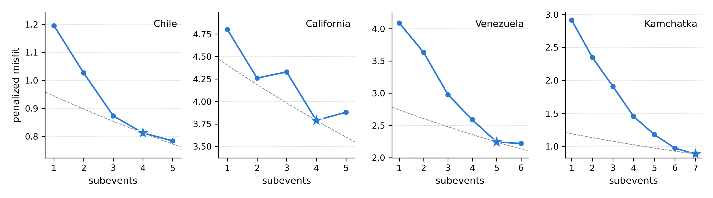

*惩罚后的失配随子事件个数的变化，每个示例一幅。星号标出选择结果。穿过每个星号的虚线每增加一个子事件下降 5%，这就是一个子事件的代价。一旦额外的子事件不再得到数据支持，曲线就会变平，或者升到这条线之上。*

---

## 5. 自动化流程

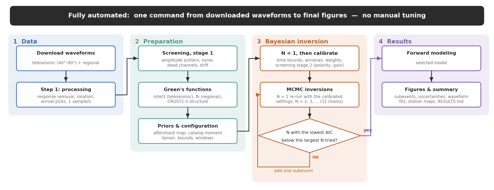

这条流程会做出许多过去需要手动做出的决定。本节按发生的先后顺序列出这些决定。对每个阶段，都说明它做了什么，以及为什么重要。

1. **积分**。远震记录原本是速度记录。它们被积分成位移，因为反演拟合的是位移。

2. **筛选，第 1 阶段**。只要满足下列任意一条，记录就会被剔除：
   - 它的振幅比台网中位数偏大或偏小 8 倍以上（用稳健的中位数和 MAD 衡量）；
   - 它的信噪比过低（远震记录低于 5.5，区域记录低于 3）；
   - 它的通道失效；
   - 它是被长周期漂移主导的区域记录。

   *原因*：一个损坏的传感器就可能使整个解产生偏差。

3. **格林函数**。深度网格以目录深度为中心。对深源地震，网格更宽；它的半宽由 Wells & Coppersmith（1994）针对该震级给出的破裂长度确定。网格从岩石中开始：它至少位于 CRUST1.0 柱状模型的水层和软沉积层之下 0.5 km，也就是位于每一个 S 波速度低于 2 km/s 的层之下。

   *原因*：深源破裂的子事件在深度上可能相距 50 km，所以网格必须覆盖这个范围。而且，软沉积层里的网格节点不是地震释放地震矩的地方，却可能因为错误的原因拟合得很好。在加州，3 km 节点位于一层 0.63 km 厚的沉积层内。那里的 P 波格林函数是岩石中的 11–29 倍，v3 第一批模型的每个浅部子事件都落在这个节点上（[PITFALLS B5](PITFALLS.md#b5--the-top-of-the-depth-grid-was-a-source-in-the-sediment-layer)）。

4. **余震先验**。流程选取震级高于某一下限的 USGS 余震。它用泊松检验与地震前一年的地震活动对比，去除背景地震活动。它去掉小的余震簇。然后，它用弱而平滑的走廊，连接剩下的簇之间的空隙。

   *原因*：先验让子事件留在断层真正滑动过的地方。在 v2 中，走廊还会连向已经去掉的簇。对堪察加，这使先验覆盖了搜索网格的 40%，而不是 16%（[PITFALLS C1](PITFALLS.md#c--prior)）。

5. **时间窗**。时间窗的长度足以覆盖整个破裂。对深源地震，时间窗还要包括深度震相（pP 和 sP）。

   *原因*：对一个深 120 km 的地震，sS 震相在 S 之后约 60 s 到达。

6. **1 子事件校准**。流程先用一个子事件做反演。这个解随后确定两个或更多子事件时搜索的质心时间范围，以及时间窗的长度。如果 1 子事件的质心落在由震级给出的范围的上界上，就先把每个 $`N`$ 的这个范围加倍，再重做 1 子事件反演。

   *原因*：有限的范围可以防止晚到的子事件去拟合噪声。但如果不这样做，主要能量比震级所暗示的来得更晚的破裂就会被截断。在 2026 年哥伦比亚地震中，范围止于 31 s，每条链都停在这个边界上。一旦范围允许，1 子事件的质心就位于 49.5 s。

7. **波型权重**。P 波、SH 波和区域记录的权重会被逐步调整，直到它们对失配的贡献约为 1.2 : 1 : 1。

   *原因*：如果不这样做，最近、最大的记录会淹没其余记录。

8. **筛选，第 2 阶段**。另外三项检验会剔除记录：
   - 记录与 1 子事件预测反相关的台站（极性反转）；
   - 振幅比该预测过大或过小 4 倍的台站（增益错误）；
   - 在反演所用的频带和时间窗内，均方根（rms）超过所在组中位数 8 倍的任何记录。这项检验不需要模型。

   *原因*：前两类错误只有在把数据与模型对比时才会显现。第三项检验剔除了一条承担了 68% P 波失配的漂移记录（2026 年瓦努阿图，台站 IM.IL31）。

9. **一致的评分**。用校准后的时间窗、权重和台站，再做一次 1 子事件反演。

   *原因*：子事件个数是通过比较失配来选择的。只有每个 $`N`$ 都在相同的数据上评分，这种比较才公平。


*数据处理对这些地震真实记录的作用示例：去除漂移、按到时对齐记录、剔除不可能的振幅和一个极性反转的传感器，以及对三种波型加权。*

这条流程由一组 shell 步骤组成。`./submit` 会替你运行它们，但你也可以在 `IRIS/` 文件夹中手动运行：

```bash
bash ../programs/step2_prepare_inversions.sh        # 筛选、格林函数、先验、配置
bash ../programs/step3_do_inversions.sh             # N = 1、1 子事件校准、N = 1..5
bash ../programs/step3_do_inversions.sh 6           # 只跑 N = 6（文件夹 inv_<event>_6sub 必须已存在）
python ../programs/prepare_SubMIT/plot_lcurve.py    # L 曲线和选出的 N
bash ../programs/step4_figures.sh 4                 # N = 4 的正演模型 + 图件
```

当 AIC 在已尝试的最大 $`N`$ 处最低时，`./submit run` 会自行创建下一个 $`N`$ 的文件夹。任何阶段失败，流程都会停止。v2 通过 `awk ... | sh` 运行各阶段，丢弃了它们的退出码，所以失败没有被发现（[PITFALLS E3](PITFALLS.md#e--systems)）。

---

## 6. 示例结果

这些是 v3 的结果，采用的是对示例复查之后得出的规则（[v3 的改动](#v3-的改动)）。我在 2026-11-17 从原始下载数据出发运行了每个示例（先 `./submit prepare`，再 `./submit run`，使用 32 个 MPI 进程）。文件夹 `examples/<name>/` 中保存的就是这次运行。下面每个小节都说明了与第一个 v3 模型相比、与 v2 相比有哪些变化。

| 示例 | 子事件个数（v2） | 最佳失配 | 落在最佳值 2% 以内的链数 | 最大 split R-hat | 平均相关系数 P / SH / 区域 |
|---------|:--------------:|:-----------:|:----------------------------:|:-------------------:|:----------------------------------:|
| `chile` | 4（4） | 0.812 | 32 条中的 31 条 | 1.4 | 0.69 / 0.91 / 0.59 |
| `california` | 4（3） | 3.790 | 32 条中的 23 条 | 4.4 | 0.49 / 0.74 / 0.32 |
| `venezuela` | 5（6） | 2.243 | 32 条中的 23 条 | 1.7 | 0.46 / 0.35 / 0.67 |
| `kamchatka` | 7（7） | 0.882 | 32 条中的 19 条 | 2.2 | 0.70 / 0.68 / 0.11 |

各列的读法：

- **平均相关系数**：对每一类波，计算每条记录与其预测之间的相关系数，再在所有记录上取平均（`reference/sta_residual.dat`）。值为 1 意味着波形形状完全拟合。
- **split R-hat**：逐个参数比较各条链之间的差异（`reference/RESULTS.md`）。大于 1.1 时，说明各链不一致。

在四个示例中，大多数链都达到了最佳失配的 2% 以内。但各链在某些参数上仍不一致。在加州，这是第四个子事件的东向位置，它只占不到 1% 的地震矩。在堪察加，这是第四个子事件的深度。下面给出的最佳模型，是各次搜索一致得到的结果。R-hat 较大的参数，其误差棒没有收敛。

**图中显示了什么**。对每个示例，主图有四个部分：

- 子事件的平面图。震源球表示矩张量，误差棒是 MCMC 样本集给出的 95% 区间，星号标出震中；
- 矩率函数；
- 总矩张量；
- 一个深度剖面。

台站分布图显示所用的数据。远震台站画在以震中为中心的地球投影上，每 30° 一圈，并按它们提供的是 P、SH 还是两者都有加以标记。区域台站画在震中周围。

每个示例下面有一个可折叠区块，其中给出诊断信息：

* **后验直方图**。每个子事件一行（E1、E2……），每个参数一列：质心时间、持续时间、东向和北向位置，以及深度。窄而单峰的直方图表示该参数分辨得好。宽的直方图或多峰的直方图，显示的是数据所允许的参数权衡（trade-off）。有两个或更多子事件时，E1 固定在震源处，所以它的位置和深度两格显示的只是这个固定值。
* **波形拟合**。这些是每个台站记录的地震图（黑色）和预测的地震图（红色）。每条波形都标有台站名、震中距和方位角。完整图版（包含所有页面上的所有台站）以及每条马尔可夫链的收敛情况，都在 `examples/<name>/reference/` 中。`./submit example <name>` 会重新画出它们。

### 2024 年智利–阿根廷边境 Mw 7.4 地震（深 123 km）

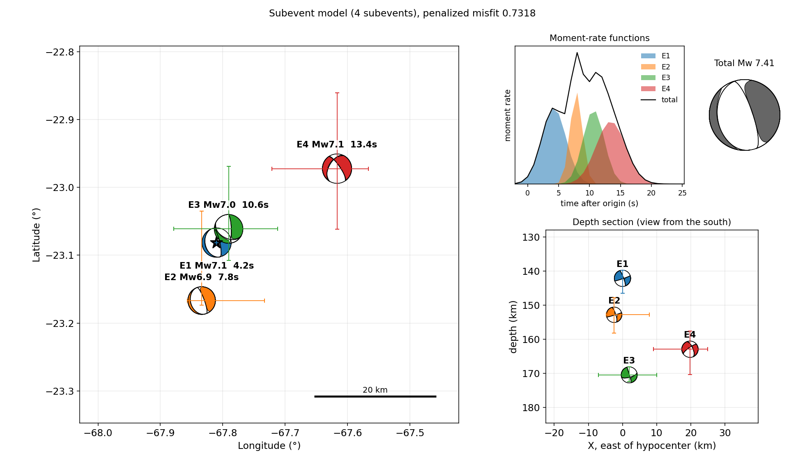

模型有四个子事件（Mw 6.5–7.2），都在约 15 s 之内。

**位置与时间**。第一个子事件位于震源处，深 123 km。其余子事件位于 136、148 和 169 km 深处，全部在震中 10 km 以内。所以，破裂穿过俯冲板片**向下**扩展：10 s 内走了 46 km。四个子事件都是正断层机制，与总机制相差不超过 14°。

**速度**。从破裂开始的时刻算起，较深的三个子事件的速度分别为 3.0、3.4 和 4.5 km/s。最后一个停在搜索的速度上限上，即 4.51 km/s，这是这些深度上震源区模型的平均 S 波速度。为了看这个上限的代价有多大，我把上限调到 6 km/s，重新运行了五个子事件的反演。失配只下降了 1.0%（0.776 对比 0.784）。深度没有变，第三个和第四个子事件分别提前了 0.8 s 和 0.4 s，速度为 4.8 和 5.0 km/s。所以，破裂大约以 S 波速度向下传播。这些数据无法判定它是略低于还是略高于 S 波速度。

**个数**。这次地震就是“2024 年 Mw 7.4 卡拉马地震”，Jia 等（2025a）曾用 SubMIT 详细研究过它。他们发现，在 125–174 km 深度、约 20 s 内有五个子事件。在这里，第五个子事件在两次搜索中使失配降低 3.5% 和 3.8%。这低于一个子事件的代价 4.9%（[第 4.6 节](#46-需要多少个子事件)），所以选出四个。两次搜索给出的四个子事件相差不超过 0.3 s 和 5 km，失配分别为 0.8124 和 0.8102。

*与第一个 v3 模型相比*：在那个模型里，第一个子事件位于 142 km，比震源深 19 km，因为它只有水平位置是固定的（[PITFALLS D6](PITFALLS.md#d6--the-first-subevent-was-fixed-at-the-epicentre-only-and-the-rupture-clock-at-its-centroid)）。在相同的权重和时间窗下，现在的模型对数据的拟合与第一个模型一样好：数据失配 0.702 对比 0.709。它的惩罚后失配更高（0.812 对比 0.732），原因在于机制。在第一个模型中，机制转到了 30° 锥面的边缘。在那里，几个双力偶子事件可以叠加成有 31% 非双力偶成分的目录矩张量，从而避开 CLVD 惩罚。CLVD 因子当时是 1.03，现在是 1.15。

*与 v2 相比*：子事件个数相同，同样是向下扩展。在 v2 中，第一个子事件位于 126 km。

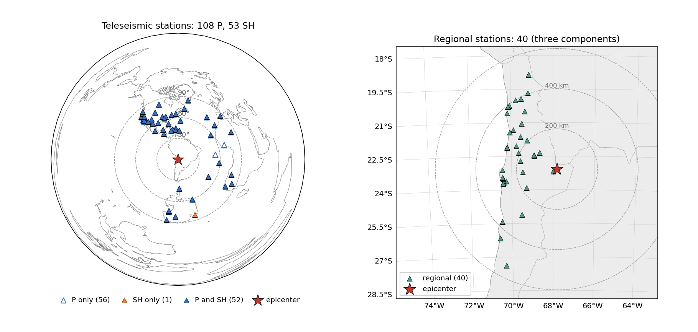

<details>
<summary><b>不确定性与波形拟合（智利）</b></summary>

MCMC 样本集给出的各子事件参数的**后验分布**：

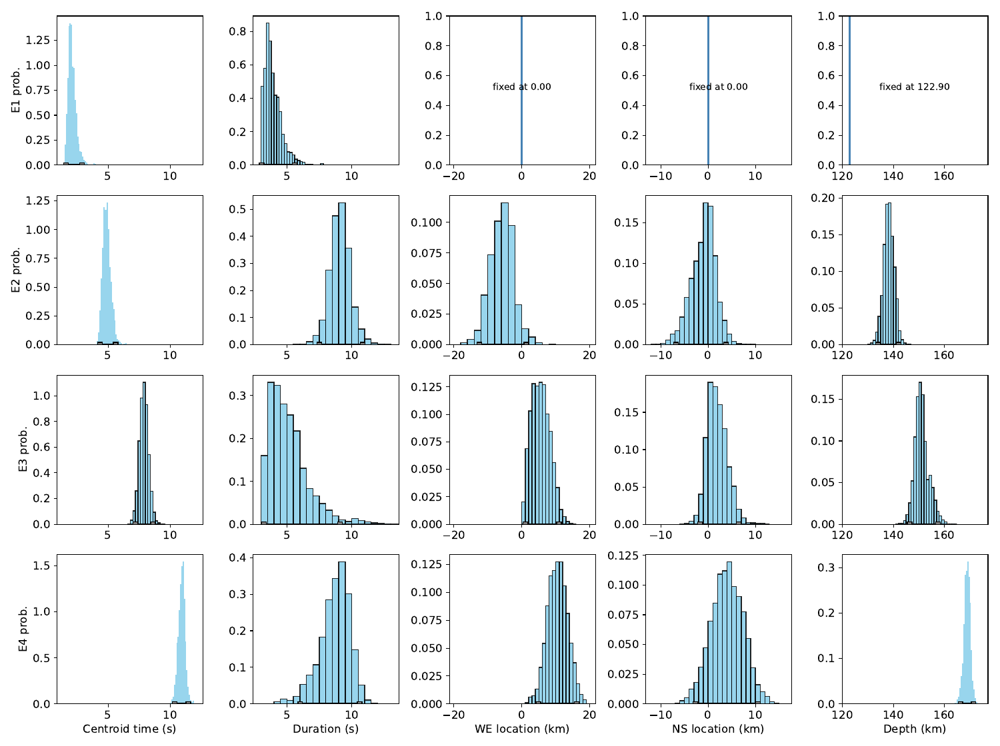

**远震 P 波**（位移；共 2 页中的第一页）：

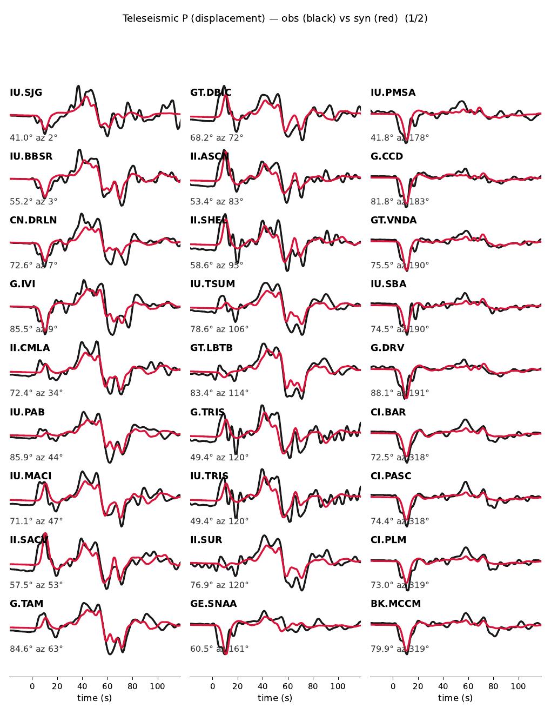

**远震 SH 波**（位移；共 2 页中的第一页）：

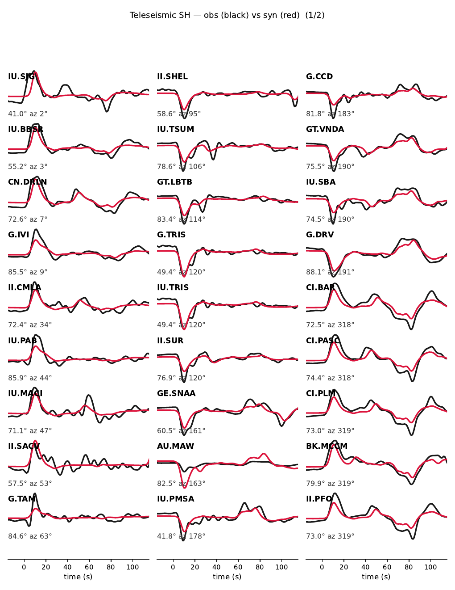

**区域三分量记录**（共 4 页中的第一页）：

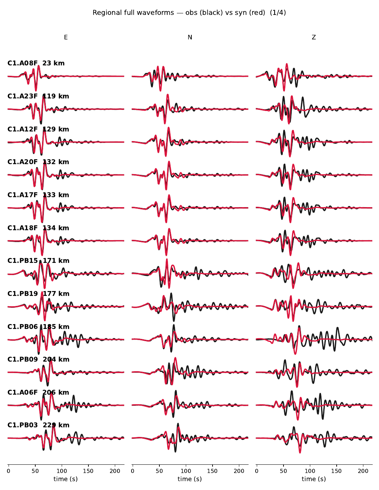

</details>

### 2025 年堪察加俯冲带大型逆冲地震，Mw 8.8

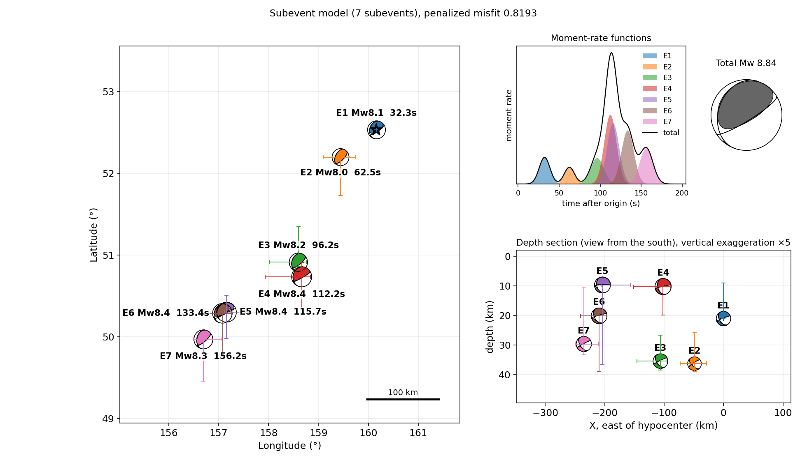

模型有七个逆冲型子事件（Mw 7.9–8.5），历时约 180 s。

**位置与时间**。破裂沿海沟**向西南方向传播了约 380 km**。第一个子事件位于震源处，深 21 km，在 33 s。第二个位于 91 km 外，在 61 s。另外五个距震源 212、264、325、360 和 383 km，在 98 到 164 s 之间。矩率在约 114 s 达到峰值，在 163 s 再次达到峰值。

**速度**。第一个子事件在发震时刻之后 17 s 开始。从那时算起，每个子事件的速度都是 2.1–2.8 km/s，远低于 4.23 km/s 的速度上限。

**机制**。七个机制中有六个与总体逆冲机制一致：它们的张量相似度至少为 0.98。第二个子事件是例外，为 0.89。

**个数**。七个是网格的上限。AIC 在这里仍在下降，因此七个是一个下限（[第 4.6 节](#46-需要多少个子事件)）。用另一组链随机种子做的第二次搜索止于相同的失配（0.8829 对比 0.8823）。它找到了相同的七个子事件，每一个与对应的子事件相差不超过 1.5 s 和 25 km。

*与第一个 v3 模型相比*：图像相同，七个子事件沿海沟分布，在约 160 s、380 km 附近结束。那时，两次搜索只在前三个子事件上一致，对海沟其余部分的划分不同。现在，两次搜索在全部七个子事件上都一致。两个失配（当时 0.819，现在 0.882）不可比较。深度网格现在从 8 km 而不是 3 km 开始，位于震源区模型中 7.45 km 厚的水层和沉积层之下，而且第一个子事件固定在震源深度上。

*与 v2 相比*：v2 模型的第二个子事件位于震中以北约 80 km 处。它落在 v2 余震先验的 141 条虚假走廊之一上（[PITFALLS C1](PITFALLS.md#c1--prior-corridors-re-attached-to-zeroed-speckle)）。它的最后一个子事件在 212 s，位于南南西方向 450 km 处。改正后的先验覆盖搜索网格的 16%，而不是 40%。用这个先验，七个子事件全部沿海沟分布在西南方向，没有一个晚于 164 s。


<details>
<summary><b>不确定性与波形拟合（堪察加）</b></summary>

MCMC 样本集给出的各子事件参数的**后验分布**：

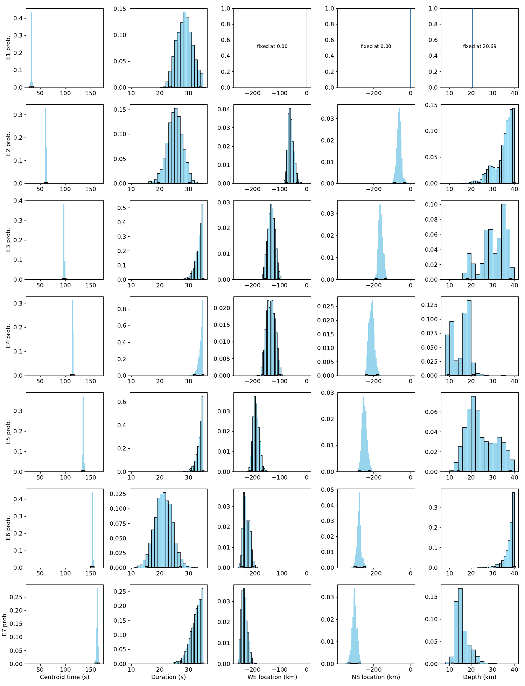

**远震 P 波**（位移；共 2 页中的第一页）：

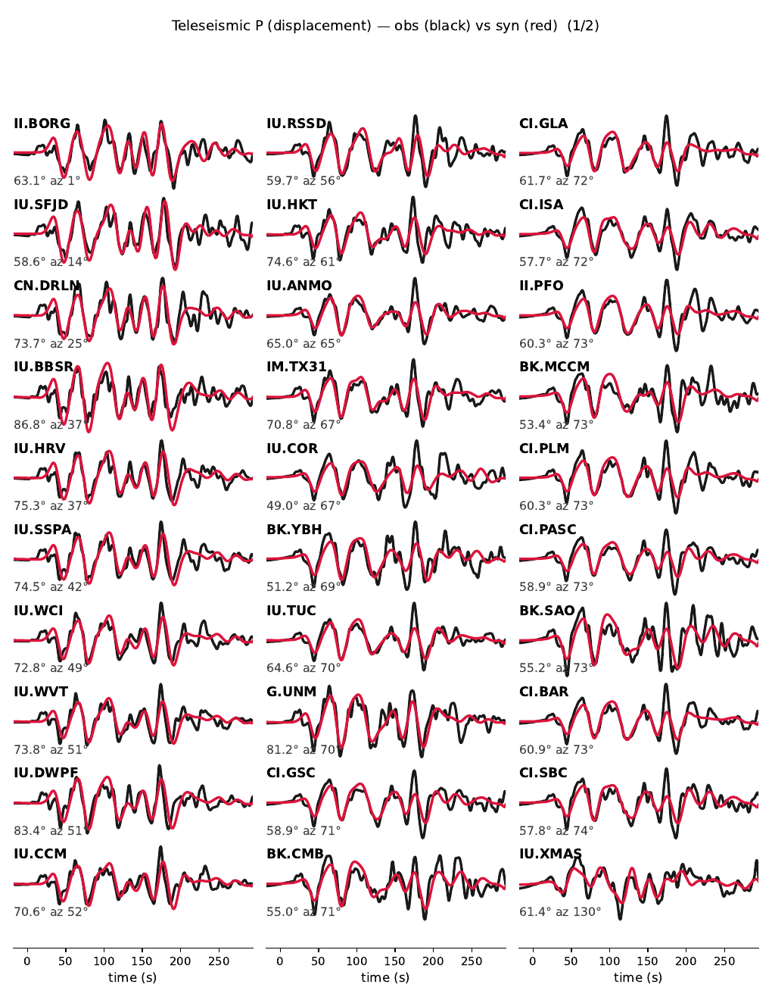

**远震 SH 波**（位移；共 2 页中的第一页）：

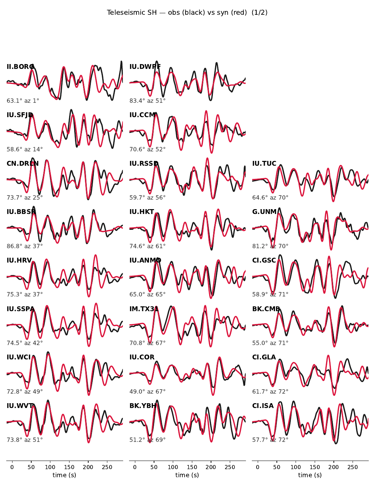

**区域三分量记录**。只用了一个区域台站（IU.PET），权重很小，因此这次地震依靠的是远震数据：

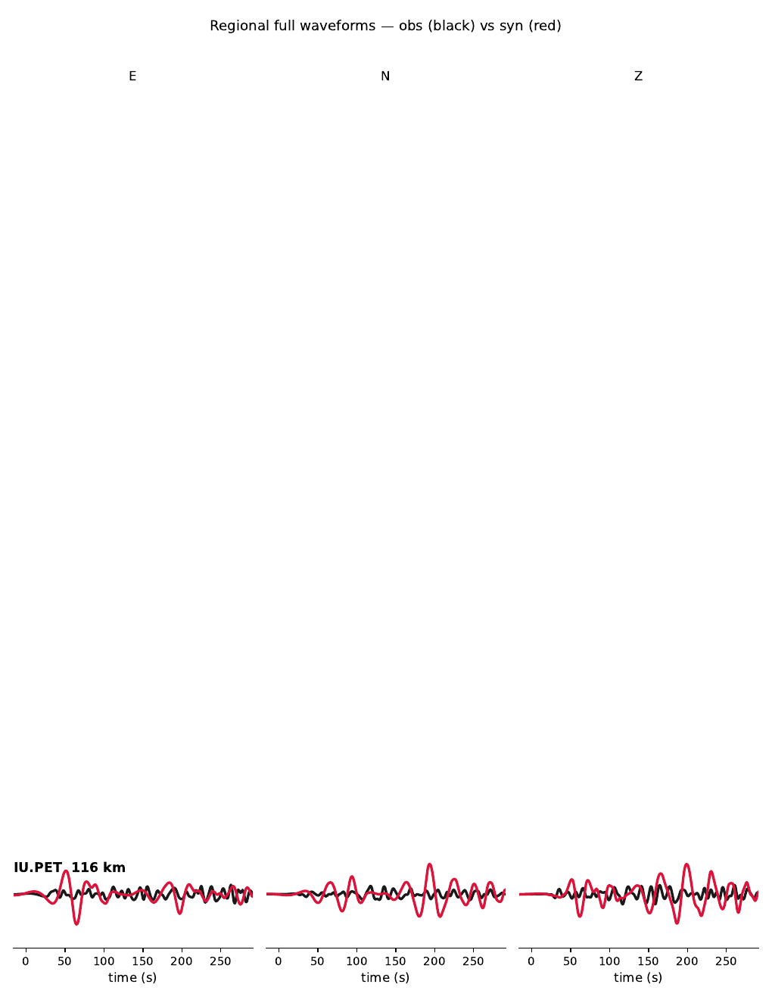

</details>

### 2026 年委内瑞拉近海地震，Mw 7.2

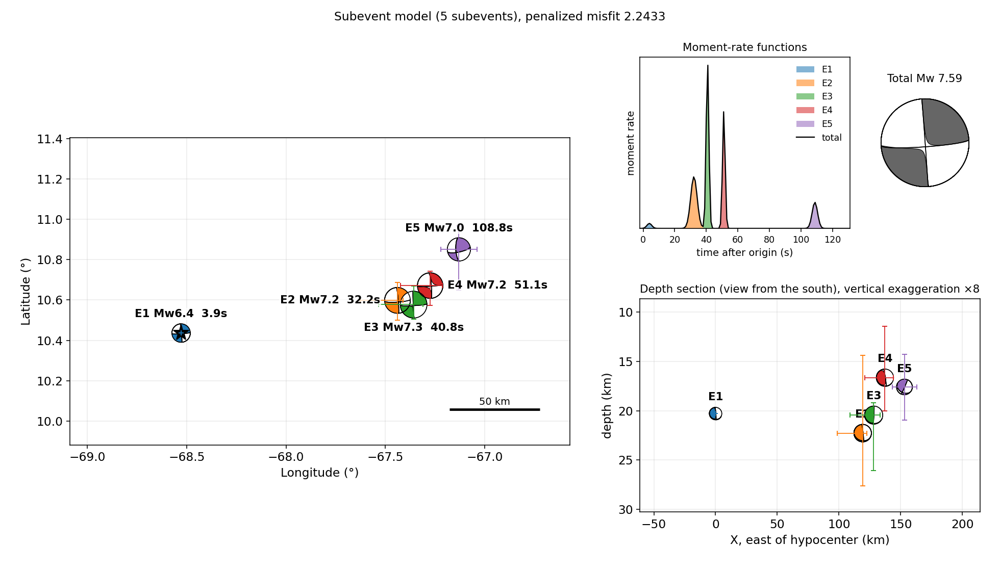

这个模型有五个子事件，历时约 110 s。

**双震（doublet）**。USGS 目录列出了两次地震：一次是位于震中的 Mw 7.2 地震，另一次是 30 s 之后、以东 147 km 处的 M 7.5 地震。流程在获取矩张量时会注意到这一对地震（`programs/prepare_SubMIT/gen_totalmt.py`）。然后它做两件事。它用两个矩张量之和作为参考机制，并把体波频带的高频拐角频率降到 0.1 Hz。

**位置与时间**。第一个子事件（Mw 6.5）位于震源处，深 20 km，在最初 7 s 内释放其地震矩。三个子事件位于以东 121–140 km 处，时间为 32–51 s。它们占总地震矩的 87%（Mw 7.2、7.3 和 7.2；合计 Mw 7.55），距目录中的第二个震中 10–27 km。第五个子事件（Mw 7.0）随后出现在 109 s，距震中 160 km。总矩为 Mw 7.59，等于目录中两次地震的地震矩之和。

**破裂有多快**。对每个子事件，`reference/RESULTS.md` 给出它到震源的距离除以第一个子事件开始以来的时间。三个大的子事件的这个值分别为 3.8、3.2 和 2.8 km/s。搜索的速度上限是 3.83 km/s，即震源区模型的平均 S 波速度（[第 4.5 节](#45-贝叶斯采样)），第一个大的子事件正好停在这个上限上。换句话说，破裂前沿以 S 波速度穿过西段的 120 km，并且在那里只释放很少的地震矩。

这个上限是否掩盖了更快的破裂？为了弄清这一点，我把上限设为 5.5 km/s，重新运行了五个子事件的反演。失配只下降了 0.5%（2.232 对比 2.243）。三个大的子事件留在原处；其中第一个在 31.6 s，距震源 121 km。只有那个小的第一个子事件移动了，从 3.9 s 移到 15.5 s。按这个新的时钟算，第一个大的子事件的速度是 5.4 km/s。所以，数据确定的是这样一件事：大部分地震矩从 28 s 起在以东约 120 km 处释放。中间这一段的速度取决于把微弱的起始放在什么时刻，而这些数据并不要求超剪切（supershear）的破裂前沿。

Celis 等（2026）用区域波形描述了同样的破裂。他们得到五个子事件，分布在约 200 km 的范围上，历时约 60 s；东部的子事件比西部的那个晚 20–42 s（这里是 28–47 s）。他们还提出，在一段没有余震的断层上可能出现了超剪切破裂。

**第二次搜索**。用另一组链随机种子做的第二次搜索同样选出五个子事件，失配高 5.7%。它有同样的三个部分：震源处的第一个子事件，以东 95–117 km、35–53 s 的大部分地震矩，以及 99 s 的一个晚期子事件。它的第一个子事件更晚、更长：质心在 14 s，持续 13 s，Mw 6.7。所以，这次破裂的最初 15 s 是模型中最不确定的部分。

*与第一个 v3 模型相比*：在那个模型里，第一个子事件是 15.8 s 处一个 4.5 s 的脉冲。第二个子事件长 24 s，质心在 38.7 s，位于 127 km 之外。这意味着两个质心之间的速度是 5.5 km/s，而且第二个子事件在第一个子事件的质心之后仅 11 s 就开始了。当时的搜索从第一个子事件的质心起算速度，并且对浅源走滑地震允许 1.5 倍的 S 波速度（[PITFALLS D6](PITFALLS.md#d6--the-first-subevent-was-fixed-at-the-epicentre-only-and-the-rupture-clock-at-its-centroid)）。两个失配（当时 2.056，现在 2.243）不可比较：深度网格现在从 4 km 而不是 3 km 开始，机制先验也是新加的。

*与 v2 相比*：v2 选出六个子事件，并把它们分散在这 170 km 上。它在 35–43 s 的子事件位于震中 45 km 以内，SH 波的拟合也很差（平均相关系数 0.26）。原因是一个数据错误：该模型的 56 条 SH 记录中，有 26 条是未经旋转的北向或东向分量（[PITFALLS A1](PITFALLS.md#a1--horizontals-of-unequal-length-left-unrotated)）。所有水平分量记录都经过旋转之后，32–51 s 释放的地震矩位于距震中 121–140 km 处，也就是目录中第二次地震所在的位置。SH 的相关系数现在是 0.35。这仍是四个示例中最低的：对这个双震，点源对 SH 波的描述不如对 P 波（0.46）。

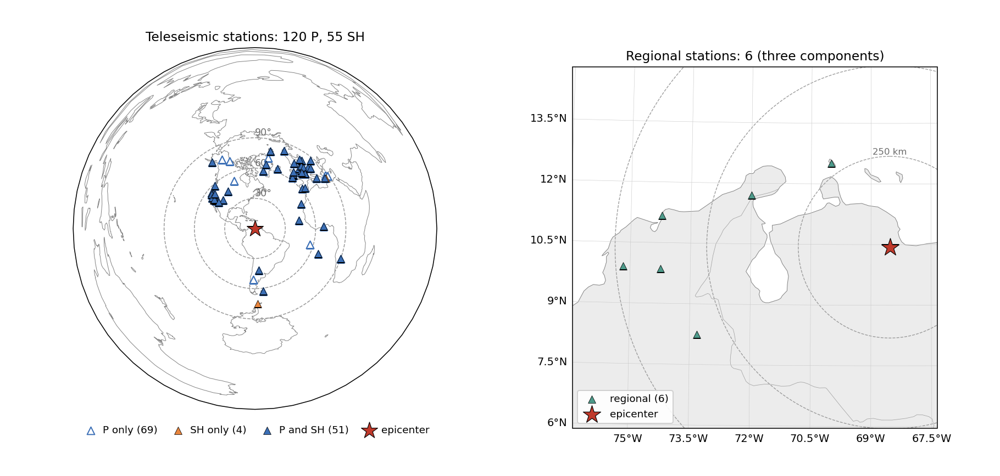

<details>
<summary><b>不确定性与波形拟合（委内瑞拉）</b></summary>

MCMC 样本集给出的各子事件参数的**后验分布**：

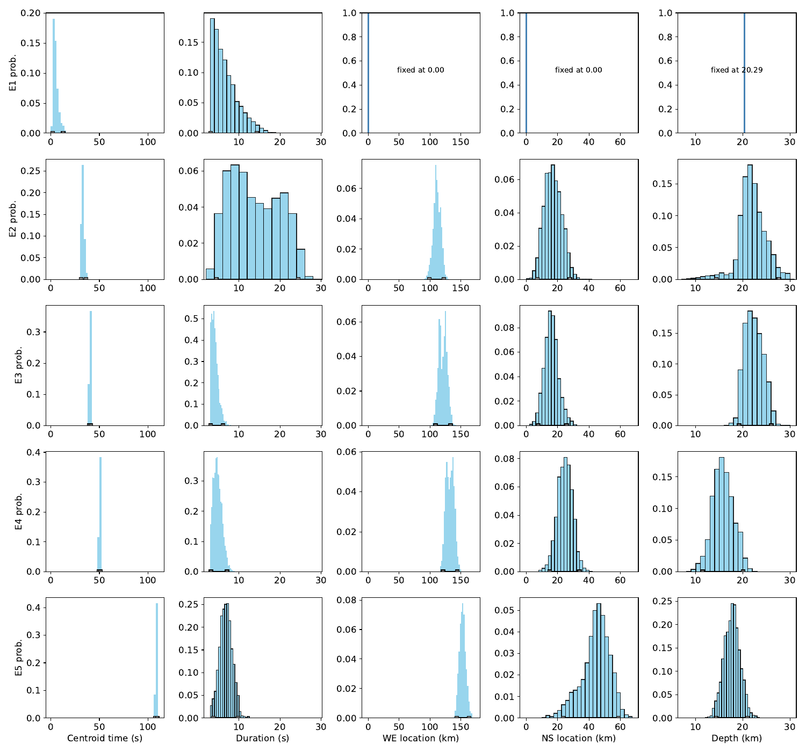

**远震 P 波**（位移；共 2 页中的第一页）：


**远震 SH 波**（位移；共 2 页中的第一页）：

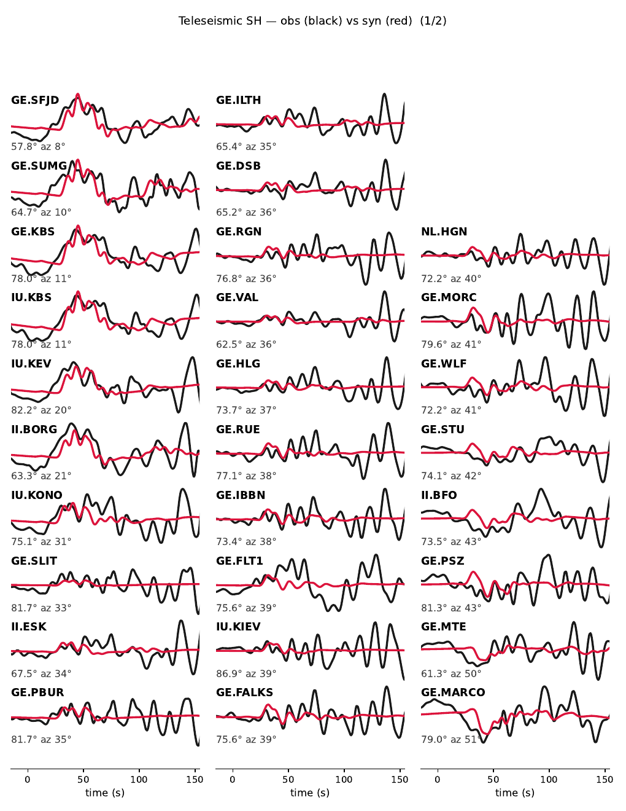

**区域三分量记录**：

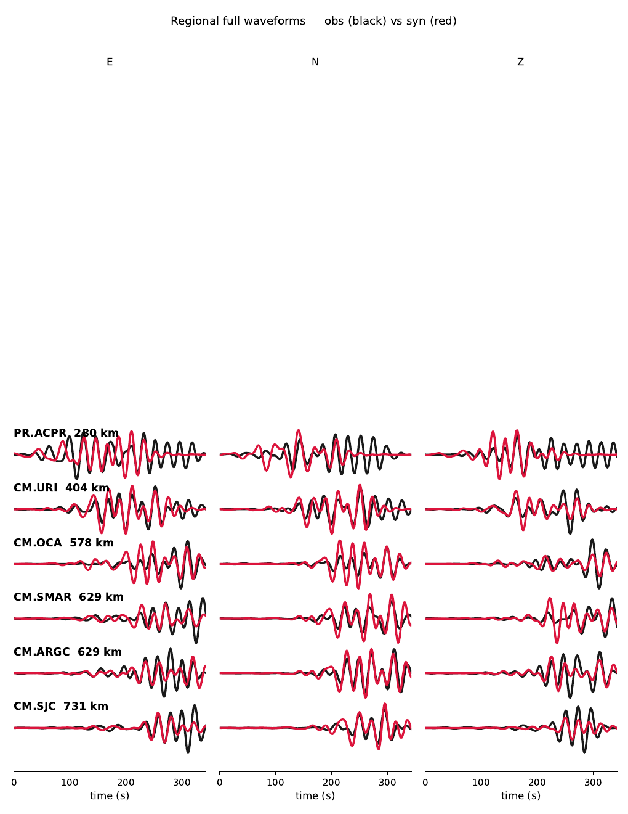

</details>

### 2024 年加州门多西诺角近海地震，Mw 7.0

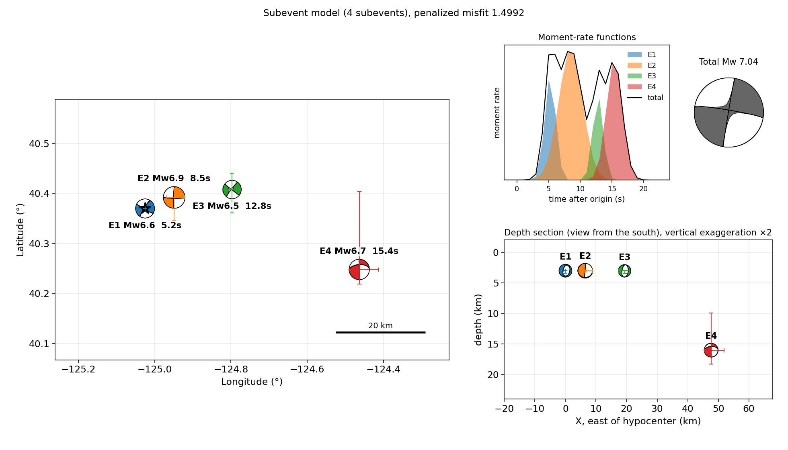

这个模型在约 19 s 内有四个子事件。

**位置与时间**。破裂从震源处一个小的子事件（Mw 6.2）开始。随后是 Mw 6.9 和 6.8 的两个子事件，时间为 7.7 和 11.9 s。它们分别位于东北和东北东方向 18 km 和 32 km 处，深 12–14 km。每个持续 3 s，两者合计占总地震矩的 94%。第四个子事件（Mw 5.6，不到总地震矩的 1%）在 17 s，位于震中附近，它的位置没有被分辨出来。

**破裂有多快**。从破裂开始算起，两个大的子事件的速度分别是 3.8 和 3.5 km/s。速度上限是 4.24 km/s，所以它在这里不起约束作用。

**第一个子事件的深度**。这次地震的目录深度是 0.65 km。这个深度落在震源区模型的水层里，所以第一个子事件位于深度网格的顶部，即 4 km。

**第二次搜索**。用另一组链随机种子做的第二次搜索同样选出四个子事件（失配为 3.790 和 3.802）。每个子事件与对应的子事件相差不超过 0.2 s 和 4 km。

**机制**。每个子事件都有一个节面走向 96–102°，与门多西诺转换断层（Mendocino transform fault）一致，该断层走向 96–100°。但在两个大的子事件上，这个节面分别向南倾 67°、向北倾 50°，而断层接近直立。它们的倾滑分量符号相反。四个矩张量之和是一个直立的走滑机制（走向 280°，倾角 84°）。

**P 波决定了这个模型，而模型并不能重现 P 波**。看西北、北和东方向的台站：它们提供了 71 条 P 波位移记录中的 39 条。在这些台站上，P 波是一个周期为 15.6 s 的振荡。它在每个方位角上看起来都一样，而这些台站靠近走滑机制 P 波辐射的节点（见下方 P 波图的左列）。

在我试过的任何一个层状模型里，岩石中的走滑震源都产生不了这个振荡：

- 流程使用的 CRUST1.0 柱状模型；
- 去掉水层的同一柱状模型；
- 去掉水层和沉积层的同一柱状模型；
- 把 0.63 km 的沉积层换成 2.0 km 和 3.9 km 沉积层的柱状模型（[PITFALLS B5](PITFALLS.md#b5--the-top-of-the-depth-grid-was-a-source-in-the-sediment-layer)）。

只有一个子事件时，P 波失配是 16.7，而 SH 波是 2.6（`reference/lcurve.txt`）。两个子事件通过把各自的机制向相反方向倾斜，把 P 波失配降到 5.1；四个子事件把它降到 3.6。SH 波失配并不随子事件增多而下降（一个、两个和四个子事件分别为 2.58、2.81 和 2.82）。所以，第一个之后的子事件被放在了 P 波需要能量的地方。

**为什么预测的远震波形太小**。选出的模型预测的振幅只有 P 波和 SH 波记录的三分之一左右。区域记录的预测振幅大致正确，但波形没有被预测出来（平均相关系数 0.32）。为了找出是什么压低了远震振幅，我把四个子事件固定在原处，用不同的数据重新求解它们的矩张量：

| 求解矩张量所用的数据 | 总 Mw | P 波失配 | SH 波失配 | SH 相关系数 |
|----------------------------------|:--------:|:--------:|:---------:|:--------------:|
| 全部数据，与目录地震矩绑定（随附的模型） | 7.04 | 3.61 | 2.82 | 0.80 |
| 只用远震记录，与目录地震矩绑定 | 7.04 | 2.65 | 1.09 | 0.73 |
| 只用远震记录，地震矩不受约束 | 7.32 | 2.06 | 0.54 | 0.83 |
| 区域记录的权重加大到十倍，地震矩不受约束 | 6.21 | 135 | 35 | 0.69 |

有两个因素限制了远震拟合。第一个因素是区域记录。1-D 模型预测不了它们的波形：在这几个解中，它们的相关系数中位数都停留在 0.25–0.39。然而，流程的加权让它们占了失配的三分之一，于是它们把地震矩往下拉。把它们的权重加大到十倍，地震矩就降到 Mw 6.2，并且有两个子事件的滑动方向反转。第二个因素是与目录地震矩的绑定。单独使用时，远震记录要求 Mw 7.32，约为目录地震矩的 2.4 倍。两个因素都去掉之后，SH 波拟合得和智利一样好（失配 0.54 对比 0.55）。P 波的拟合仍然较差，因为 15.6 s 的振荡仍然没有得到解释。

有两个可能的原因，但我还没有检验它们。区域速度模型是震中处去掉水层的海洋柱状模型，而区域台站都在陆上。另外，震源区的柱状模型把两个大的子事件放在了地幔中，即 12–14 km 深处；在那里，单位地震矩辐射出的波只有在地壳中的一半左右。

**机制可以倾斜多少，是一个选择**。它就是[第 4.3 节](#43-线性步骤矩张量)中先验的宽度。取 `MechanismSigma= 5` 而不是 10 时，第二个子事件只使失配降低 1.4%，而原来降低 11%。这时，至多五个子事件的模型都不比一个子事件好 1.4% 以上，于是[第 4.6 节](#46-需要多少个子事件)的规则选出单个子事件：Mw 7.0，在 10.3 s，位于震中以东 16 km，深 8 km，持续 4 s。两种设置在地震矩何时何地释放上是一致的：震中以东 16–32 km，7 到 12 s 之间。而四子事件模型的倾角和子事件个数，取决于层状模型解释不了的 P 波。

*与第一个 v3 模型相比*：它的四个子事件中有三个位于 3 km，即深度网格的顶部，而那个网格伸进了 0.63 km 厚的沉积层。该节点的 P 波格林函数是下一个节点的 11–29 倍，并以 7.4 s 的周期振荡。所以，那个模型是用一个不可能存在的震源拟合了这个振荡。它 1.50 的失配不能与现在这个模型的 3.79 相比（[PITFALLS B5](PITFALLS.md#b5--the-top-of-the-depth-grid-was-a-source-in-the-sediment-layer)）。它有两个子事件的走向是 120° 和 127°（[PITFALLS B4](PITFALLS.md#b4--subevent-mechanisms-sat-on-the-30-cone)）。

*与 v2 相比*：v2 选出三个子事件，深度为 3.0–3.7 km，位于那个节点上，或位于它与下一个节点之间。

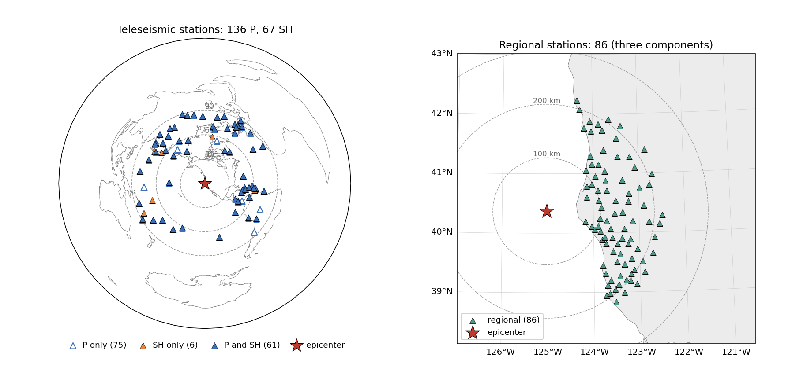

<details>
<summary><b>不确定性与波形拟合（加州）</b></summary>

MCMC 样本集给出的各子事件参数的**后验分布**：


**远震 P 波**（位移；共 2 页中的第一页）：

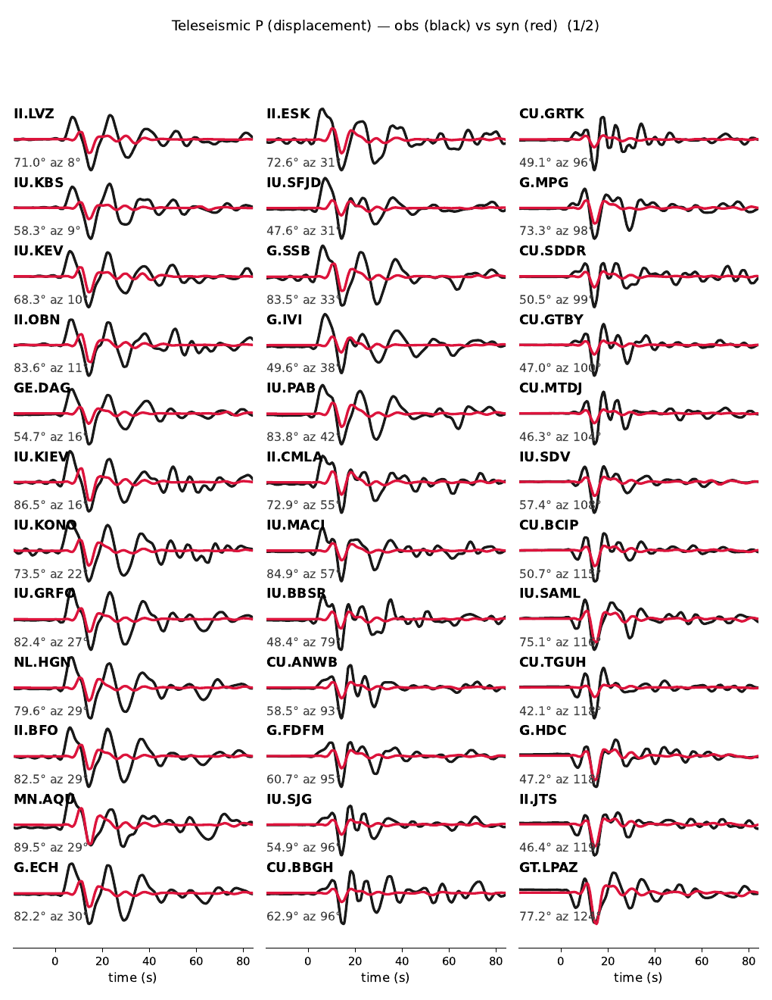

**远震 SH 波**（位移；共 2 页中的第一页）：

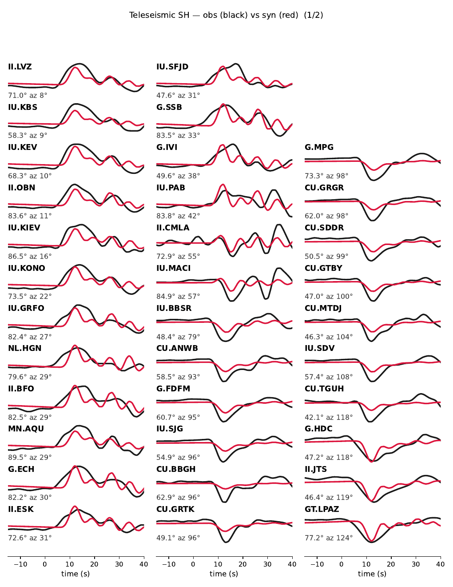

**区域三分量记录**（共 8 页中的第一页）：

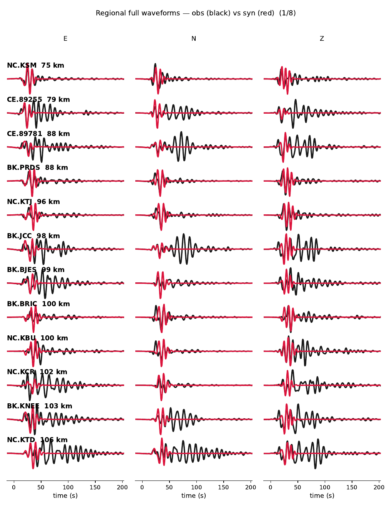

</details>

---

## 7. 数据

SubMIT 拟合同一次地震的两组地震图：

- **远震**记录，来自远处的台站；
- **区域**记录，来自地震附近的台站。

两组数据都可以免费获取。用 [Wilber 3](https://ds.iris.edu/wilber3/) 下载它们，这是 EarthScope（前身为 IRIS）数据管理中心基于事件的下载工具。Wilber 也会从其他数据中心收集数据，例如 GEOFON、RESIF 和 NCEDC。四个示例都同时使用这两组数据，而且这条流程只在两组数据都有的情况下测试过。

| | 远震 | 区域 |
|---|---|---|
| 约束什么 | 从各个方向看到的 P 波和 SH 波：每个子事件何时、何地、如何滑动 | 靠近破裂的三分量波形，它们使位置和时间更精确 |
| 距震中的距离 | **40°–90°** | **最远约 6.5°（约 750 km）** |
| 通道 | **`BH?`**（宽频带地震计） | **`HN?`**（强震加速度计）**或** **`BH?`**；见下文 |
| 时间窗 | 从 P 波到时前 5 分钟到 P 波到时后 30 分钟 | 从发震时刻前 5 分钟到发震后 20 分钟 |
| 示例中的台站 | 下载 100–150 个，保留 58–75 个 | 使用了 2 个（堪察加）到 96 个（加州） |
| SubMIT 拟合什么 | 垂直分量上的 P 波，以及切向分量上的 SH 波 | 全部三个分量 |

**为什么是这些距离**。距离小于约 40° 时，远震 P 波和 S 波穿过上地幔。上地幔的分层会把每个波分裂成多个到时，而简单的远震格林函数不模拟这些到时。超过约 90° 时，这些波会绕着地核弯曲传播。对区域记录，远于约 750 km 的台站会被自动忽略。原因是区域格林函数是在震源区的单一层状模型中计算的，并且只算到 950 km。这个范围给偏离震中的子事件留出了 200 km 的余量。

### 7.1 强震（`HN?`）与宽频带（`HH?`、`BH?`）区域台站

通道代码由三个字母组成。第一个字母表示采样频带，第二个表示传感器类型，第三个表示分量（`Z`、`N`、`E`，或者 `1` 和 `2`）。

* **`HN?` 通道是加速度计，也称为强震传感器**。它们通常每秒记录 100–200 个采样点。它们的设计目标是在最强烈的震动中也不超出量程，因此即使距断层只有几十千米，也能干净地记录大地震。它们的灵敏度远低于宽频带传感器。智利、加州、日本、台湾和其他地区都有密集的强震台网。`chile`、`california` 和 `venezuela` 示例使用了它们。
* **`BH?` 和 `HH?` 通道是宽频带地震计**。它们每秒记录 20–50 个（`BH?`）或 100–200 个（`HH?`）采样点。它们灵敏得多。但在大地震附近，它们可能**限幅**，即信号超出传感器的量程；也可能受到倾斜的干扰。许多台网只分发 `BH?` 和 `HH?` 中的一种。`kamchatka` 示例使用 `BH?`。
* 第 1 步对每种类型都去除仪器响应，得到地面速度。然后它对区域记录做 0.02 Hz 以上的滤波，也就是保留短于 50 s 的周期。这样可以去除加速度计记录中常带有的长周期漂移。

**三种类型都要申请**。第 1 步处理每一条 `HN?`、`HH?` 和 `BH?` 记录，并且**每个台站只保留一条记录**（`programs/select/choose_regional_instruments.py`）。它优先选择宽频带记录；在宽频带记录中，`HH?` 优先于 `BH?`。在两种情况下，它改用强震记录：

- 宽频带记录限幅。如果一条记录在其峰值上停留 3 个或更多采样点，并且该峰值超过 2²³ counts（计数）的 10%，就视为限幅；
- 宽频带记录在 0.02–0.1 Hz 上与同一台站的强震记录不一致，即两者的相关系数低于 0.9，或振幅比在 0.8–1.25 之外。

每次选择都写入 `IRISloc/<event>_loc/regional_instrument_choice.log`。其他通道类型（`HL?`、`EN?`、`LH?` 等）不会被读取。

直到 v2，第 1 步只要在下载数据中发现任何 `HN?` 通道，就只用这些通道，而且从不读取 `HH?`。对 2026 年巴拿马 Mw 7.7 地震的同一份下载数据，v2 在 19 个区域台站中保留了 4 个；v3 保留 17 个。v2 还会拟合一个台站的每个传感器：对 2025 年青森 Mw 7.6 地震，它拟合了来自 7 个台站的 11 条记录（[PITFALLS A2, A4](PITFALLS.md#a--data-integrity)）。

经验法则：申请地震周围约 6.5° 以内的 `HN?`、`HH?` 和 `BH?`。

### 7.2 用 Wilber 3 逐步下载数据

1. **找到地震**。打开 <https://ds.iris.edu/wilber3/>。在地图上或地图下方的列表中找到该事件（较早的事件用 **Custom Query** 查找），点击它的地区名称。台站页面就会打开。
2. **提交远震数据申请**。在台站页面上设置：
   * **Networks**：保留默认的 `_GSN`（全球地震台网，Global Seismographic Network），并加入其他永久宽频带台网，例如 `G`（GEOSCOPE）、`GE`（GEOFON）、`MN`、`IM`、`CN`、`AU` 和 `PS`。目标是让台站在地震周围按方位角均匀分布。如果某个地区台站很多，**All**/**None** 旁边的下拉菜单可以每隔 X 度只保留一个台站。
   * **Channels**：`BH?`
   * **Distance Range**：40 到 90（度）

   点击 **Request Data**，并填写对话框：
   * **Time Range**：Starting 为 `P arrival` 之前 `5` 分钟；Ending 为 `P arrival` 之后 `30` 分钟
   * **Output Format**：`SAC binary (little-endian)`；**Bundle As**：`tar archive`
   * **Request Label**：保留默认值，例如 `2024-07-19 mww7.4 Chile-Argentina Border Region`
   * 填写你的姓名和电子邮件地址，然后点击 **Submit**。
3. **提交区域数据申请**。回到同一事件的台站页面，设置：
   * **Networks**：删除 `_GSN`，以显示所有台网
   * **Channels**：`HN?,HH?,BH?`（见 [7.1](#71-强震hn与宽频带hhbh区域台站)）
   * **Distance Range**：0 到 6.5

   点击 **Request Data**，并设置：Starting 为 `event time` 之前 `5` 分钟；Ending 为 `event time` 之后 `20` 分钟；输出格式和打包方式与上面相同。**Request Label** 填写远震标签后面加上 `_loc`，例如 `2024-07-19 mww7.4 Chile-Argentina Border Region_loc`。
4. **下载**。每个申请准备好后，Wilber 会给你发电子邮件。从邮件中的链接下载这两个 `.tar` 文件。它们存放在一个以你的姓名和标签命名的公开文件夹中。

示例使用了类似的设置。远震时间窗从 P 波前 5 分钟开始（堪察加为 10 分钟），到 P 波后 17–31 分钟结束。区域时间窗从发震时刻前 3–7 分钟开始，到发震后 11–25 分钟结束。第 1 步要求在初至之前至少有 50 s 的记录，用于测量噪声。对区域记录，它还要求发震后至少有 10 分钟的记录。

### 7.3 下载文件的存放位置

把两个 tar 文件放进一个路径较短的新文件夹，不要解包：

```text
/data/myevent/
├── IRIS/       2024-07-19-mww74-chile-argentina-border-region.tar       （远震）
└── IRISloc/    2024-07-19-mww74-chile-argentina-border-region_loc.tar   （区域）
```

每个 tar 文件包含一个文件夹，以申请标签命名，例如 `2024-07-19-mww74-chile-argentina-border-region/`。其中每个通道有一个 SAC 文件（`NET.STA.LOC.CHA.Q.YYYY.DDD.HHMMSS.SAC`）。另外还有仪器响应文件，按数据中心各放在一个子文件夹中（`IRISDMC/SACPZ.NET.STA.LOC.CHA` 等）。

文件夹名称很重要：

* 它们必须以 Wilber 给出的日期和震级开头，即 `YYYY-MM-DD-mwwXY-`。震级（`mww74` 表示 7.4）决定反演搜索的范围。
* 区域文件夹的名称必须是远震文件夹的名称后面加上 `_loc`。远震文件夹也可以以 `_tel…` 结尾（例如 `…-northern_tel-california`）；第 1 步会去掉这个后缀。

震中、深度和发震时刻从 Wilber 写入的 SAC 头段中读取（`evla`、`evlo`、以 km 为单位的 `evdp`，以及发震时刻 `o`）。它们来自 Wilber 中显示的目录解。

**来自其他来源的数据**（FDSN 网络服务、ObsPy、你自己的台网）只要按同样的方式组织，也可以使用：

- 文件夹顶层放按上述规则命名的 SAC 文件；
- 这些文件的头段中包含台站坐标、分量方向（`cmpaz`、`cmpinc`）以及事件的位置、深度和发震时刻；
- 下一级子文件夹中放 SACPZ 响应文件，单位为每米位移对应的计数，与 FDSN 服务提供的一致。

把该文件夹打包成一个 `.tar` 文件，或者直接把文件夹本身放进 `IRIS/` 或 `IRISloc/`。

### 7.4 可选：智利强震记录（CSN）

对于智利的地震，智利国家地震中心（Centro Sismológico Nacional，CSN，<https://evtdb.csn.uchile.cl>）的数据库中有加速度记录，台站数远多于 Wilber 所分发的。对 `chile` 示例，它提供了 53 个台站。Wilber 只有 7 个可用台站，其中 4 个也在 CSN 数据集中。

使用方法：在 CSN 网站上找到该地震，复制其网址末尾的 32 个字符的 id（`https://evtdb.csn.uchile.cl/event/<EVENT_ID>`）。然后在 `prepare` **之前**运行：

```bash
./submit fetch-csn /data/myevent 030cd73d4cf743e322b7bc88f1166a4c   # chile 示例的地震
./submit prepare /data/myevent
```

`fetch-csn` 需要 `wget` 和 `unzip`。它下载该事件的所有台站，把加速度积分为速度，做 0.01 Hz 以上的滤波，重采样到每秒 1 个采样点，并把记录写入 `myevent/StrongMotionData/`。之后 `prepare` 把它们并入区域数据。如果某个台站在两组数据中都有，就用 CSN 记录替换 Wilber 记录。

CSN 数据库还在不断增长。2026 年十月的一次下载返回了 57 个台站，而 `chile` 示例使用的是 53 个；这 53 个都与已发表的记录完全相同。随附的 `examples/chile/inputs.tar.gz` 保留的是已发表时的数据集。

### 7.5 第 1 步（`./submit prepare`）做了什么

`prepare` 先解开 tar 文件，然后分九步，把每条记录转换成反演可以读取的文件：

1. 它把文件重命名为 `NET.STA.LOC.CHA`，并以发震时刻作为时间参考（`o = 0`），跨越午夜和新年时也是如此。头段缺少距离和方位角时，它会计算这两个量。
2. 它用 SACPZ 文件去除仪器响应，得到以 m/s 为单位的地面速度（SAC `transfer … to vel freq 0.001 0.005 10 20`）。然后它去均值、去趋势，并对两端做尖灭（taper）。区域记录还要做 0.02 Hz 的高通滤波。
3. 它用 TauP 在 iasp91 地球模型中计算 P 波初至（用于垂直分量）和 S 波初至（用于水平分量），并把它们存入头段 `t1`。
4. 它校正元数据中夹角不严格为 90° 的水平分量。
5. 它旋转水平分量。远震记录旋转为径向和切向（`.r`、`.t`、`.z`）。区域的 `1`/`2` 分量旋转为东向和北向（`.e`、`.n`、`.z`）。长度不同的两条水平分量记录，先截取到它们共同的时间窗。SAC 拒绝旋转这样的一对记录；而直到 v2，未旋转的东向和北向记录随后会被当作径向和切向写出（[PITFALLS A1](PITFALLS.md#a1--horizontals-of-unequal-length-left-unrotated)）。
6. 它只保留信号足够强的台站。信噪比是到时后 50 s 内的方差除以到时前 50 s 内的方差，再取 10·log₁₀。远震的垂直和切向分量要求至少 3 dB，区域的全部三个分量要求至少 2 dB。对区域记录，每个分量的到时都取 P 波到时。原因是：深源地震的 S 波到时之前是 P 波尾波，而不是噪声（[PITFALLS A3](PITFALLS.md#a3--regional-signal-to-noise-measured-against-the-p-coda)）。
7. 它剔除缺少分量的台站。对远震记录，它还剔除峰值速度超过 1 mm/s 的记录（通常是响应错误或毛刺），以及同一台站的重复传感器（位置码 `00` 优先于 `10`，以此类推）。对区域记录，它每个台站保留一台仪器（[第 7.1 节](#71-强震hn与宽频带hhbh区域台站)）。
8. 它用 SAC 的抗混叠 `decimate`，把每秒 500、200、100、80、50、40、25 或 20 个采样点的记录重采样到每秒 1 个采样点。其他采样率的记录会被放到一边，并给出警告。
9. 仅对区域记录：它把记录截取为发震时刻前 50 s 到发震后 600 s（记录较短时补零），并把台网 `C` 重命名为 `C1`。

**结果放在哪里**。远震记录最终位于 `IRIS/<event>/data/`（`*.r`、`*.t`、`*.z`），区域记录位于 `IRISloc/<event>_loc/data/`（`*.e`、`*.n`、`*.z`）。被剔除的记录会保留下来，便于查看删掉了什么。信噪比低的记录放在事件文件夹内的 `Vel/rtr/bad_data/`（远震）或 `Vel/enz/bad_data/`（区域）中。其余被剔除的记录放在 `Vel/rtr/others/` 或 `Vel/enz/others/` 中。

**随附的输入**。示例正是以这种形式打包的（`examples/<name>/inputs.tar.gz`）：它们是各示例 v3 运行的第 1 步结果。对四个示例的原始 Wilber 下载数据运行 `prepare`（对 `chile` 再加上 `fetch-csn`），可以重现这些文件。

在 v3 修正了第 1 步的地方，它们与 v2 随附的输入不同：

- 长度不等的水平分量对现在会被旋转。这改变了智利 13 个、加州 11 个、委内瑞拉 60 个和堪察加 8 个文件中的径向和切向记录。
- 少数台站越过了信噪比阈值：委内瑞拉 GE.KBS 进入、GE.MATE 移出；堪察加 G.CAN 进入。
- 区域数据集增加了台站：加州 CE.89688、智利 C1.GO02，以及堪察加 750 km 以外的 12 个台站，反演会忽略后者。
- 区域数据集每个站点只保留一个传感器（堪察加：只保留 IU.PET.00）。

`python tools/compare_step1_outputs.py /data/rerun examples/<name>/inputs.tar.gz` 会列出一次重跑与随附文件之间的差异。它还会列出未经旋转的径向和切向记录：v2 随附的委内瑞拉记录中有 62 条，现在一条也没有。之后，第 2 步会再次、更严格地筛选这些记录（[第 5 节](#5-自动化流程)）。

### 7.6 流程自动下载的数据

| 内容 | 来源 | 用途 | 能否离线？ |
|------|--------|----------|----------|
| 余震（前 7 天）以及前一年的地震活动 | [USGS ComCat](https://earthquake.usgs.gov/fdsnws/event/1/) | 由余震构建的位置先验 | 示例回放存档在 `examples/<name>/catalog/` 中的副本 |
| 目录矩张量 | Global CMT 目录 1990–2023，已随附（`programs/mt_SubMIT/1990_2023_gcmt.dat`）；更晚的事件用 USGS ComCat 的矩张量 | 对总矩张量的约束 | 已随附，或为示例存档 |
| 地壳结构 | CRUST1.0，已随附 | 格林函数 | 能 |
| 海岸线和国界 | [Natural Earth](https://www.naturalearthdata.com/)，由 cartopy 下载一次 | 地图 | 没有网络时，地图不画海岸线 |

### 7.7 四个示例的数据

| 示例 | 远震（`BH?`） | 区域 | 区域台网 |
|---------|---------------------|----------|-------------------|
| `chile` | 41°–88° 的 103 个 `BHZ` 通道 → 保留 59 个台站 | `HN?`：来自 Wilber 的 0.4°–4.8° 的 8 个台站 + 来自 CSN 的 53 个 → 保留 57 个 | C1 |
| `california` | 42°–90° 的 129 个 `BHZ` 通道 → 保留 75 个台站 | `HN?`：0.5°–2° 的 98 个台站 → 保留 97 个 | BK、CE、NC、RE、UO、UW |
| `venezuela` | 42°–90° 的 117 个 `BHZ` 通道 → 保留 67 个台站 | `HN?`：2.5°–8° 的 26 个台站 → 保留 22 个 | CM、PR |
| `kamchatka` | 40°–90° 的 152 个 `BHZ` 通道 → 保留 59 个台站 | `BH?`（附近没有强震台站）：1°–14.6° 的 54 个台站 → 保留 38 个，其中只有 IU.PET 在 750 km 以内 | AV、IM、IU |

远震台网是 AU、BK、CI、CN、CU、G、GE、GT、IC、II、IM、IU、MN、NL 和 PS。[第 13 节](#13-致谢引用与许可)列出了所有台网及其 DOI。发表基于这些台网数据的结果时，请引用它们。

---

## 8. 反演你自己的地震

1. 按[第 7 节](#7-数据)的说明**下载数据**。你需要提交两个申请，都以 SAC tar 文件的形式下载：一个远震申请（`BH?`，40°–90°）和一个区域申请（`HN?`、`HH?` 和 `BH?`，约 6.5° 以内）。
2. **把下载的文件放进一个新文件夹**，路径要短（见[故障排查](#11-故障排查)）：

   ```text
   /data/myevent/
   ├── IRIS/       远震 .tar 文件
   └── IRISloc/    区域 .tar 文件
   ```

3. **运行：**

   ```bash
   ./submit prepare /data/myevent     # 第 1 步：仪器响应、旋转、到时拾取、每秒 1 个采样点、信噪比筛选
   ./submit run /data/myevent         # 第 2-4 步：其余所有工作，包括选择 N
   ```

   几点说明：
   - 对智利的地震，在 `prepare` 之前运行 `./submit fetch-csn /data/myevent EVENT_ID`。这会加入 CSN 强震记录（[第 7.4 节](#74-可选智利强震记录csn)）。
   - 第 2 步要从 USGS 下载余震目录；对 2023 年以后的地震，还要下载目录矩张量。因此，机器需要能访问互联网。
   - 结果出现在 `/data/myevent/IRIS/figs_and_results/` 中。
   - 如果想先用 10 分钟检查一切是否正常，可以给 `run` 加上 `--quick`。

**之后修改设置**。每个 `IRIS/inv_<event>_<N>sub/` 文件夹中有两个设置文件：

- `Par.file`：时间窗、频带、权重和正则化；
- `search_par.file`：搜索边界、链长，以及决定子事件个数的 `neq_min`/`neq_max`。

`programs/submit.conf` 保存采样间隔。修改之后，在 `IRIS/` 中用 `bash ../programs/step3_do_inversions.sh N` 重跑一个子事件个数。然后运行 `python ../programs/prepare_SubMIT/plot_lcurve.py` 和 `bash ../programs/step4_figures.sh N`。

有两个可选的环境变量会改变自动配置：

- `SUBMIT_CMTSCALING`（默认 3）决定总矩张量与目录矩张量绑定的牢固程度（[第 4.3 节](#43-线性步骤矩张量)）。
- `SUBMIT_MAX_TELESEISMIC_STATIONS`（默认 100）是一个远震台站数阈值：台站数超过它时，第 2 步会对最密集的台网做稀疏化。

---

## 9. 解读输出结果

文件夹 `IRIS/figs_and_results/` 汇集了所选模型的全部结果：

| 文件 | 内容 |
|------|---------|
| `RESULTS.md` | 一份总结：选出的 N、失配、总地震矩，以及一张子事件表。对每个子事件，表中还给出：它到子事件 1 的距离；这个距离除以子事件 1 开始以来的时间，也就是因果性规则所限制的速度（[第 4.5 节](#45-贝叶斯采样)）；它的节面；以及它的矩张量与整个地震的机制之间的夹角，也就是机制先验所作用的夹角（[第 4.3 节](#43-线性步骤矩张量)） |
| `subevents.png/.pdf` | 第 6 节中展示的图 |
| `stations.png/.pdf` | 所用台站：远震 P 和 SH 台站画在全球地图上，区域台站画在局部地图上 |
| `lcurve.pdf/.txt` | 失配随子事件个数的变化、每个子事件使失配降低了多少，以及用来选择 N 的 AIC。图中的星号标出选择结果；穿过它的虚线每个子事件下降 5%，即一个子事件的代价；空心点是不能被选中的子事件个数。还列出了：各岛的最佳值，以及每个最佳失配的三个因子（数据失配、CLVD 因子、应力因子）和最大轴旋转角（第 4.6 节） |
| `fits_P.pdf`、`fits_SH.pdf`、`fits_Pvel.pdf`、`fits_rayl.pdf` | 每个台站的数据（黑色）与预测（红色），并标有相关系数 |
| `histoplot_py.pdf` | 每个子事件参数的后验分布 |
| `misfit_evolution.pdf` | 每条马尔可夫链上失配的演化 |
| `convergence.txt` | 落在最佳失配 1、2 和 5% 以内的链数，以及每个被采样参数的 split R-hat。明显大于 1.1 的值意味着各链不一致。子事件 1 的位置和深度是固定的，所以不列出 |

每个子事件个数的更多细节在两个文件夹中：

- `IRIS/inv_<event>_<N>sub/`：最佳模型（`best_model_hybrid.dat`）、各条链、日志、`island_best_misfits.txt` 和 `misfit_components.txt`；
- `IRIS/fwd_<event>_<N>sub/`：`fm.dat`，即以 10²⁷ dyne·cm 为单位的矩张量，顺序为 Mxx Mxy Mxz Myy Myz Mzz，x 向北、y 向东、z 向下；以及 `Input.model`，内容为时间、x 向东、y 向北、持续时间、vr、θ 和深度。

---

## 10. 使用 AI 编程助手

本 README 中的一切都由 `./submit` 命令驱动。因此，一个能运行 shell 命令的 AI 编程助手可以按照本 README 替你安装、运行和检查 SubMIT。在助手中打开本仓库，然后提出请求，例如：

* *“检查我的机器是否具备 SubMIT 所需的一切，并帮我安装缺少的部分。”*
* *“复现加州示例，并告诉我它是否与已发表的结果一致。”*
* *“在后台以 frozen 模式重新运行智利示例的反演，完成后告诉我。”*
* *“解释堪察加示例的 L 曲线和所选模型。”*
* *“为 Wilber 下载数据位于 ~/data/myevent 的地震设置一次新的运行。”*

---

## 11. 故障排查

| 问题 | 解决办法 |
|---------|------------|
| SAC 报告有文件无法读取，或积分后的记录没有变化 | SAC 无法处理长于约 120 个字符的文件名。请使用较短的工作路径（`--workdir /data/w`） |
| `COMPILE FAILED` | 运行 `./submit check`。使用 GNU 编译器时，试试 `./submit example … --gnu` |
| 用 GNU 编译后 `mpirun` 立即失败 | 调用到了 Intel 的 `mpirun`。请使用 `--gnu`，它会设置 `SUBMIT_NO_INTEL=1` |
| `ERROR: missing Green's function file` | 某个台站缺少格林函数。重新运行格林函数阶段，或从 `stations*.info` 中删除该台站，并更新 `Par.file` 中的 `num_sta_*` 计数 |
| 关于 `numpy` 或 `obspy` 的 Python 错误 | 运行 `conda activate submit`，或把 `SUBMIT_PYTHON` 设为该环境中的 `python3` |
| `./submit check` 报告 `mpirun` 在 20 s 内没有启动 `true` | MPI 启动器卡住了。测试机器上的 Open MPI 启动器连 `hostname` 都会卡住。请使用另一套 MPI，例如 Intel oneAPI |
| `lcurve.txt` 报告 `NOTE: a tie` | 两个或更多的子事件个数得到的支持相当，选出的是其中最小的（第 4.6 节）。它们都应报告。用更多 MPI 进程（`SUBMIT_NCORE`）运行，可以把较大的那些个数搜索得更充分 |
| `lcurve.txt` 报告某些 N `cannot be selected` | 这些 N 的最佳模型的最后一个子事件停在质心时间范围的上边界上（第 4.6 节）。见表格下方的说明 |
| `convergence.txt` 列出明显大于 1.1 的 split R-hat 值 | 各链在该参数上不一致。要么该参数分辨不佳，要么链太短（`search_par.file` 中的 `burn_in` 和 `nsample`） |
| 破裂可能快于 S 波 | 速度上限是震源区模型的平均 S 波速度（第 4.5 节）。在每个 `inv_<event>_<N>sub` 文件夹的 `search_par.file` 中调高 `vmax_cau`（单位为 km/s）。然后重新运行 `bash ../programs/step3_do_inversions.sh 1 2 3 4 5`，再比较失配 |
| 希望子事件的机制更自由，或者完全一致 | 每个反演文件夹的 `Par.file` 中的 `MechanismSigma` 是机制先验的标准差，单位为度（第 4.3 节）。20 较弱，5 较强，0 关闭先验、只保留 30° 的限制 |
| 需要停止一次运行 | `sh programs/stop_step3.sh work/<name>/IRIS`。它会停止第 3 步的驱动脚本*以及*它的 MPI 作业。只杀掉 shell 会让这些 MPI 作业继续运行 |

**当某些 N 不能被选中时**。如果破裂的持续时间可能超过质心时间范围，就手动加宽这个范围。调高 `search_par.file` 中的 `cen_max`，并调高 `Par.file` 中的 `nd_timeP`、`nd_timeSH`、`nd_timeRayl` 和 `stf_etime`，全部加大相同的秒数。在每个 `inv_<event>_<N>sub` 文件夹中都这样做。然后用第 5 节的命令把每个 N、L 曲线和图件重新运行一遍：在 `IRIS/` 中运行 `bash ../programs/step3_do_inversions.sh 1 2 3 4 5`，再运行 `plot_lcurve.py` 和 `step4_figures.sh`。

---

## 12. 仓库结构

```text
submit                  命令行驱动程序（check、build、example、status、compare、
                        prepare、fetch-csn、run）
environment.yml         Python 环境
PITFALLS.md             失败图谱：v2 中发现的每个缺陷、其代价、修复和测试
tests/                  回归测试（python tests/test_regressions.py，几秒钟）
examples/<name>/        四个经过验证的地震
  inputs.tar.gz           处理后的波形（第 1 步的输出，见第 7 节）
  catalog/                存档的余震目录和矩张量（用于精确复现）
  gf_inputs/              速度模型 + 已发表格林函数的网格
  frozen/<N>sub/          每次已发表反演的精确配置 + 最佳模型
  reference/              已发表的图件、L 曲线、矩张量、最佳模型
programs/               软件包（内部路径是相对路径：请保持此结构）
  step1_* ... step4_*     流程步骤（step3_do_inversions.sh、step4_figures.sh）
  compiler_environment.sh 第 3、4 步共用的 MPI 进程数、Python 和编译器
  MyExtractSeed*.sh       第 1 步对 Wilber 下载数据的处理（远震 / 区域）
  select/                 第 1 步辅助脚本：到时、信噪比筛选、每个台站选择一台
                          区域仪器、抽取到每秒 1 个采样点
  ChileArray/             可选：智利 CSN 强震记录的下载和转换
  code_SubMIT/            反演代码：finv.f90（MCMC）、forward_model.c（数据、格林
                          函数、正演模型、矩张量、失配）、ffwd.f90（为绘图和失配
                          分量做正演）、prepare_stationinfo.py（台站列表）
  fwd_SubMIT/             图件和 RESULTS.md
  prepare_SubMIT/         筛选、先验、权重、边界、1 子事件校准、选择、失配分量
  gf_SubMIT/              格林函数驱动脚本
  hist/                   后验直方图、失配演化、收敛诊断
  fk3.2/ mtel3/ crust1.0/ TauP-2.0/   随附的第三方代码和模型
tools/                  与已发表结果及随附的第 1 步输入做对比，
                        把一次完成的运行打包成示例，README 图件脚本
docs/figures/           本 README 使用的图件
```

---

## 13. 致谢、引用与许可

SubMIT 由 Zhe Jia 开发。如果你使用它，请引用方法论文（Jia 等，2020a、2020b、2022a）以及 Jia 等（2025a），后者用本代码研究了 2024 年 Mw 7.4 卡拉马地震（即 `chile` 示例）。

### 多子事件反演的方法与应用

* Jia, Z., Shen, Z., Zhan, Z., Li, C., Peng, Z., & Gurnis, M. (2020a). The 2018 Fiji Mw 8.2 and 7.9 deep earthquakes: One doublet in two slabs. *Earth and Planetary Science Letters*, 531, 115997. https://doi.org/10.1016/j.epsl.2019.115997
* Jia, Z., Wang, X., & Zhan, Z. (2020b). Multifault models of the 2019 Ridgecrest sequence highlight complementary slip and fault junction instability. *Geophysical Research Letters*, 47(17), e2020GL089802. https://doi.org/10.1029/2020GL089802
* Jia, Z., Zhan, Z., & Kanamori, H. (2022a). The 2021 South Sandwich Island Mw 8.2 earthquake: A slow event sandwiched between regular ruptures. *Geophysical Research Letters*, 49(3), e2021GL097104. https://doi.org/10.1029/2021GL097104
* Jia, Z., Mao, W., Flores, M. C., Barra, S., Ruiz, S., Potin, B., Becker, T. W., Moreno, M., Baez, J. C., Ceroni, D., & Cabrera, L. (2025a). Deep intra-slab rupture and mechanism transition of the 2024 Mw 7.4 Calama earthquake. *Nature Communications*, 16, 8140. https://doi.org/10.1038/s41467-025-63480-5
* Kutschera, F., Jia, Z., Oryan, B., Wong, J. W. C., Fan, W., & Gabriel, A.-A. (2024). The multi-segment complexity of the 2024 Mw 7.5 Noto Peninsula earthquake governs tsunami generation. *Geophysical Research Letters*, 51(21), e2024GL109790. https://doi.org/10.1029/2024GL109790

### 相关研究

* Jia, Z., Zhan, Z., & Helmberger, D. (2022b). Bayesian differential moment tensor inversion: Theory and application to the North Korea nuclear tests. *Geophysical Journal International*, 229(3), 2034–2046. https://doi.org/10.1093/gji/ggac053
* Jia, Z., Jin, Z., Marchandon, M., Ulrich, T., Gabriel, A.-A., Fan, W., Shearer, P., Zou, X., Rekoske, J., Bulut, F., Garagon, A., & Fialko, Y. (2023). The complex dynamics of the 2023 Kahramanmaraş, Turkey, Mw 7.8–7.7 earthquake doublet. *Science*, 381(6661), 985–990. https://doi.org/10.1126/science.adi0685
* Jia, Z., Fan, W., Mao, W., Shearer, P. M., & May, D. A. (2025b). Dual mechanism transition controls rupture development of large deep earthquakes. *AGU Advances*, 6(3), e2025AV001701. <https://doi.org/10.1029/2025AV001701>（用一种相关的网格搜索子事件方法得到的 40 个深源地震的子事件模型）
* Celis, S., Zahradník, J., Plicka, V., Sokos, E., Gallovič, F., Bucha, V., & Kalmár, D. (2026). Unilateral rupture and moment release of the 2026 Mw 7.5 Venezuela earthquake from regional waveforms. *The Seismic Record*, 453–462. <https://doi.org/10.1785/0320260047>（`venezuela` 示例地震的多点源模型）
* Li, J., & Jia, Z. (2026). The 2025 Mw 8.8 Kamchatka megathrust: A rapid recurrence with complex heterogeneous rupture. *Geophysical Research Letters*, 53(9), e2026GL121923. <https://doi.org/10.1029/2026GL121923>（`kamchatka` 示例地震的有限断层模型）

### 本 README 引用的其他文献

* Akaike, H. (1974). A new look at the statistical model identification. *IEEE Transactions on Automatic Control*, 19(6), 716–723. https://doi.org/10.1109/TAC.1974.1100705
* Burnham, K. P., & Anderson, D. R. (2002). *Model Selection and Multimodel Inference: A Practical Information-Theoretic Approach* (2nd ed.). Springer. https://doi.org/10.1007/b97636
* Haario, H., Saksman, E., & Tamminen, J. (2001). An adaptive Metropolis algorithm. *Bernoulli*, 7(2), 223–242. https://doi.org/10.2307/3318737
* Kennett, B. L. N., & Engdahl, E. R. (1991). Traveltimes for global earthquake location and phase identification. *Geophysical Journal International*, 105(2), 429–465. <https://doi.org/10.1111/j.1365-246X.1991.tb06724.x>（计算到时所用的 iasp91 模型）
* Wells, D. L., & Coppersmith, K. J. (1994). New empirical relationships among magnitude, rupture length, rupture width, rupture area, and surface displacement. *Bulletin of the Seismological Society of America*, 84(4), 974–1002.

### 随附的第三方软件与模型（各有其许可条款）

* **fk**——Lupei Zhu（圣路易斯大学），频率-波数法合成地震图：Zhu, L., & Rivera, L. A. (2002). A note on the dynamic and static displacements from a point source in multilayered media. *Geophysical Journal International*, 148(3), 619–627. <https://doi.org/10.1046/j.1365-246X.2002.01610.x>。版权声明见 `programs/fk3.2/README`（附带该声明即可再分发；作者希望在再分发时得到告知）。
* **TauP 2.0**——Crotwell, H. P., Owens, T. J., & Ritsema, J. (1999). The TauP Toolkit: Flexible seismic travel-time and ray-path utilities. *Seismological Research Letters*, 70(2), 154–160. <https://doi.org/10.1785/gssrl.70.2.154>。GPL-3.0（`programs/TauP-2.0/gpl-3.0.txt`，含源代码）；随附的副本省略了文档和可选的 Jython 控制台。
* **CRUST1.0**——Laske, G., Masters, G., Ma, Z., & Pasyanos, M. (2013). Update on CRUST1.0 — A 1-degree global model of Earth's crust. *Geophysical Research Abstracts*, 15, EGU2013-2658.
* SAC 是必需的，但**不**包含在本仓库中；请从 IRIS/EarthScope 获取。

### 数据

示例的波形是用 Wilber 3 从 EarthScope Consortium 数据管理中心（前身为 IRIS DMC）下载的，该中心通过 FDSN 网络服务从 EarthScope、GEOFON、INGV、NCEDC、NRCAN、ORFEUS、RESIF 和 SCEDC 获取了这些数据。智利强震记录来自智利大学（Universidad de Chile）的智利国家地震中心（CSN）。请向你所使用数据的台网致谢：

| 代码 | 台网 | DOI |
|------|---------|-----|
| AU | Australian National Seismograph Network | [10.26186/144675](https://doi.org/10.26186/144675) |
| AV | Alaska Volcano Observatory | [10.7914/SN/AV](https://doi.org/10.7914/SN/AV) |
| BK | Berkeley Digital Seismograph Network | [10.7932/BDSN](https://doi.org/10.7932/BDSN) |
| C1 | Red Sismológica Nacional (Chile) | [10.7914/SN/C1](https://doi.org/10.7914/SN/C1) |
| CE | California Strong Motion Instrumentation Program | [10.7914/b34q-bb70](https://doi.org/10.7914/b34q-bb70) |
| CI | Southern California Seismic Network | [10.7914/SN/CI](https://doi.org/10.7914/SN/CI) |
| CM | Red Sismológica Nacional de Colombia | [10.7914/SN/CM](https://doi.org/10.7914/SN/CM) |
| CN | Canadian National Seismograph Network | [10.7914/SN/CN](https://doi.org/10.7914/SN/CN) |
| CU | Caribbean Network | [10.7914/SN/CU](https://doi.org/10.7914/SN/CU) |
| G | GEOSCOPE | [10.18715/GEOSCOPE.G](https://doi.org/10.18715/GEOSCOPE.G) |
| GE | GEOFON | [10.14470/TR560404](https://doi.org/10.14470/TR560404) |
| GT | Global Telemetered Seismograph Network (USAF/USGS) | [10.7914/SN/GT](https://doi.org/10.7914/SN/GT) |
| IC | New China Digital Seismograph Network | [10.7914/SN/IC](https://doi.org/10.7914/SN/IC) |
| II | Global Seismograph Network (IRIS/IDA) | [10.7914/SN/II](https://doi.org/10.7914/SN/II) |
| IM | International Miscellaneous Stations | [10.7914/vefq-vh75](https://doi.org/10.7914/vefq-vh75) |
| IU | Global Seismograph Network (IRIS/USGS) | [10.7914/SN/IU](https://doi.org/10.7914/SN/IU) |
| MN | Mediterranean Very Broadband Seismographic Network | [10.13127/sd/fbbbtdtd6q](https://doi.org/10.13127/sd/fbbbtdtd6q) |
| NC | USGS Northern California Seismic Network | [10.7914/SN/NC](https://doi.org/10.7914/SN/NC) |
| NL | Netherlands Seismic and Acoustic Network | [10.21944/e970fd34-23b9-3411-b366-e4f72877d2c5](https://doi.org/10.21944/e970fd34-23b9-3411-b366-e4f72877d2c5) |
| PR | Puerto Rico Seismic Network & Puerto Rico Strong Motion Program | [10.7914/SN/PR](https://doi.org/10.7914/SN/PR) |
| PS | Pacific21 | 无（[FDSN 页面](https://www.fdsn.org/networks/detail/PS/)） |
| RE | US Bureau of Reclamation Seismic Networks | 无（[FDSN 页面](https://www.fdsn.org/networks/detail/RE/)） |
| UO | Pacific Northwest Seismic Network, University of Oregon | [10.7914/SN/UO](https://doi.org/10.7914/SN/UO) |
| UW | Pacific Northwest Seismic Network, University of Washington | [10.7914/SN/UW](https://doi.org/10.7914/SN/UW) |

地震目录与数据来源：

* Barrientos, S., & National Seismological Center (CSN) Team (2018). The seismic network of Chile. *Seismological Research Letters*, 89(2A), 467–474. https://doi.org/10.1785/0220160195
* Dziewonski, A. M., Chou, T.-A., & Woodhouse, J. H. (1981). Determination of earthquake source parameters from waveform data for studies of global and regional seismicity. *Journal of Geophysical Research*, 86(B4), 2825–2852. https://doi.org/10.1029/JB086iB04p02825
* Ekström, G., Nettles, M., & Dziewoński, A. M. (2012). The global CMT project 2004–2010: Centroid-moment tensors for 13,017 earthquakes. *Physics of the Earth and Planetary Interiors*, 200–201, 1–9. https://doi.org/10.1016/j.pepi.2012.04.002
* U.S. Geological Survey (2017). Advanced National Seismic System (ANSS) Comprehensive Catalog (ComCat). https://doi.org/10.5066/F7MS3QZH
* 地图使用来自 [Natural Earth](https://www.naturalearthdata.com/) 的海岸线和国界（公有领域）。
